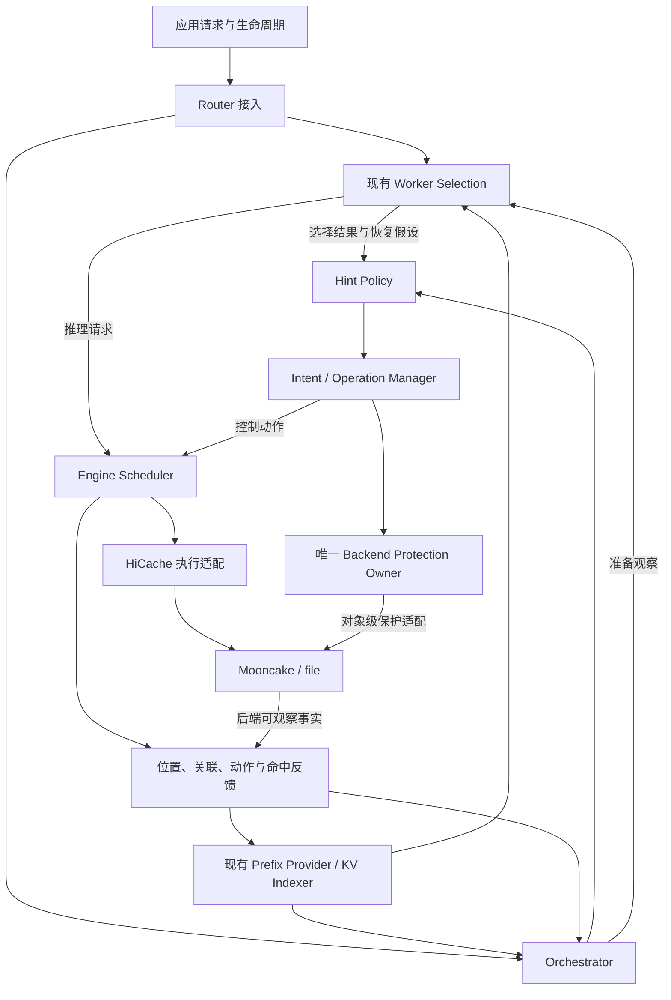

# SGLang Session-Aware KV Cache Orchestrator 实现方案与实施计划

日期：2026-11-04。状态：首轮 P0–P8 已实现；0.8 显存预算下的 TP=1 FULL/Mooncake 持续压力测试已完成。强化测试对照快照为 `f65f0393c4`，优化快照为 `ff764308fb`，含有界 native host read 流水与排队需求复用。P9 配置扩展保留为后续工作。功能测试通过后分别提交。当前实测与边界见 `benchmark/session_kv_control/results/2026-11-04-mem08/FINAL_ACCEPTANCE.zh-CN.md`；原 0.45 配置验收保留于 `benchmark/session_kv_control/results/2026-11-04/FINAL_ACCEPTANCE.md`，过程证据见 `PLAN-REVIEW-LOG.md`。

目标是在保留 `rfc-kvc` 引擎控制实现的基础上，接入 Router 侧的 session 编排，完成 `PREFETCH`、`DEMOTE`、`PIN`、Mooncake 执行适配及结果反馈。主要验证场景是：应用等待工具期间，将已存在于 Mooncake 的上下文准备到另一个 Engine 的 L2，并在恢复推理时实际复用。

本文配套于 [RFC 中文稿](/home/youwei/bzh/project/TokenCake/RFC/docs/sglang/session-kv-orchestrator-rfc.zh-CN.md)和[架构设计稿](/home/youwei/bzh/project/TokenCake/RFC/docs/sglang/session-kv-orchestrator-design.zh-CN.md)，细化代码改动、协议建议、生命周期约束、实施依赖和验收条件。外部需求来源为 [SGLang issue #45189](https://github.com/sgl-project/sglang/issues/45189)。

## 1. 决策状态与代码基线

### 已确认的项目选择

| 编号 | 选择 | 实施含义 |
| --- | --- | --- |
| C1 | 在现有 `rfc-kvc` 基础上修改，保留提交历史并合入上游基线 | 采用 merge 整合；本计划不要求重写已有提交 |
| C2 | Mooncake 为主要存储后端，file 用于测试 | 真实功能验收必须覆盖 Mooncake；file 和 mock 用于可控测试 |
| C3 | 用户已授权实现及测试后提交，取代文档阶段限制 | 执行实现和性能测试，按功能提交；委派产出由 parent 独立审查与验证后提交。当前授权未要求推送或部署 |

### 已采用的实施默认值 D1–D7

用户在本任务中明确采用 D1–D7 为实施默认值。P0 记录这些选择并保留现有功能语义；涉及新增能力的实现属于后续阶段。若选择变化，应同步调整对应阶段和验收矩阵。

| 编号 | 已采用默认值 | 影响 |
| --- | --- | --- |
| D1 | 保留原有 engine retention/quota 等可选策略；Router 编排模式默认关闭这些策略 | 避免本轮同时重写本地调度；同一工具等待信号只由一个策略 owner 处理 |
| D2 | 首轮使用单 Router、多个独立 TP=1 Engine、FULL attention、persistent-host HiCache、关闭 overlap schedule | 复用现有可执行配置；多 rank、Hybrid、PD 和其他 cache mode 单列扩展阶段 |
| D3 | 新增 `sgl-kv-orchestrator` Rust crate，与 `sgl-kv-indexer` 并列，初期嵌入 Router 进程 | 分离编排逻辑与 HTTP、路由实现，不增加独立部署服务 |
| D4 | 首轮 PIN 实现 Engine L2 保护与 Mooncake L3 soft-pin | L1 PIN 后续接入；不能把现有软优先级直接声明为 PIN |
| D5 | 同一 Mooncake 保护域仅允许一个控制写入者 | 首轮不提供多 Router 自动接管；防止对象级 unpin 撤销其他调用方的保护 |
| D6 | 旧控制动作保持兼容，新公开动作使用独立 action type | 保留现有测试和实验入口，Router 使用新动作 |
| D7 | 会话图初期使用有界内存状态；重启后允许应用重报，未重建部分标为 unknown | 不承诺 session 元数据持久化或高可用；保护恢复有独立约束，见第 8 节 |

P1 已将公开动作字段固定为跨语言 schema 与 fixtures，精确字段见 `sgl-router/sgl-kv-orchestrator/README.md`。后续模块名和运行配置仍按对应阶段实施。

### 阅读时核对的基线

| 用途 | 绝对路径 | 提交 |
| --- | --- | --- |
| 当前开发仓库 | `/home/youwei/bzh/project/TokenCake/RFC/sglang-rfc` | `rfc-kvc`: `aedd69c0b0d1dcecf08d69f38ba6fc7de8be7633` |
| 当前分支对应的本地 main | 同一仓库 | `f02458fff127d918cb573914e5e6d5dd8b6fb8d1` |
| 建议合入的固定上游快照 | `/home/youwei/bzh/project/TokenCake/RFC/sglang-origin` | `4517a5ff1bbd1f944d6bde1819300ed14af7b698` |

P0 前的 `rfc-kvc` 包含引擎控制与原有 `sgl-model-gateway`，没有新 `sgl-router`。参考快照已经包含 `sgl-router` 和 `sgl-kv-indexer`。实现基线按上述固定提交评估；若改用更新快照，需重新核对改动点，不能直接假定接口相同。

## 2. 当前实现、复用范围与缺口

| 模块 | 已有能力 | 本轮改动 |
| --- | --- | --- |
| `KVControlService` / `KVControl` | 独立控制、请求附带 hints、能力查询、操作推进 | 增加公开三动作、保护生命周期与反馈接口 |
| `OperationRegistry` | 有界记录、消息重放、结果查询、取消 | 保留语义，补充新动作结果、事件关联和 unknown 观察状态 |
| `LogicalIndex` | session、continuation、共享内容、revision、任务清理 | 复用模型与测试思路；全局关联由 Router 维护，引擎旧索引保留兼容用途 |
| `UnifiedCacheExecutor` | 本地目标解析、copy/move、GPU 软优先级 | 泛化后端适配，增加真实 PIN 和能力描述 |
| `HostCacheTransfers` | GPU↔host，引用管理、共享任务、DMA fence、实际回收 | 保留执行与容量约束，接入新动作和保护检查 |
| `StorageCacheTransfers` / `StorageCacheReads` | file 写入及无本地 radix 前缀时的恢复 | 去除 file 专用能力判断，接入 Mooncake，保留完成登记和取消约束 |
| `CopyPriorityClaims` | 调用方优先级、TTL、显式与本地策略优先级关系 | 继续用于软优先级；新增保护注册表，不改变旧 priority 含义 |
| `PreparedPrefix` | 发布到请求 admission 之间的内部引用移交 | 保留内部用途；不能充当公开 PIN 或永久 readiness 证明 |
| Router Prefix Provider | 前缀匹配、路由 pending 记录 | 提供 confirmed 与 pending 分离的观察接口 |
| Router KV events | 位置观察与部分恢复基础 | 保留 session 归属，补 request/branch 关联、动作反馈与版本检查 |
| 外部 indexer bridge | 事件转发和位置查询 | 补 epoch/sequence 约束；当前 gap 仅记录日志，不能作为恢复完成依据 |

源代码入口及实际路径见第 13 节。已有测试覆盖 file 往返、传输取消、共享兴趣和 namespace 隔离；这些测试的存在不代表新方案已经通过验证。

## 3. 运行范围与验收目标

按 D2 的首轮建议配置，三动作的执行范围如下。

| 能力 | 首轮目标 | 后续扩展 |
| --- | --- | --- |
| PREFETCH | Mooncake L3→Engine L2；保留已有 L2→L1 执行基础 | 主动 L1 准备、peer 路径、其他后端与 cache mode |
| DEMOTE | L1→L2、L1→L3；保存和回收分别报告 | L2→L3 的实际 host 回收 |
| PIN | L2 有界普通驱逐保护；L3 显式 soft-pin | L1 PIN、其他后端保护方式 |
| 请求入口 | 普通文本 HTTP generate/chat，独立控制与附带 hints | gRPC 控制入口和其他前端组合 |
| 模型与拓扑 | FULL、单 rank Engine、多 Engine 共用兼容 L3 | TP/PP/CP/DP、Hybrid、PD、LoRA、多模态、streaming session |
| Router 状态 | 单 owner、有界内存、缺失时重建 | 多 Router 分片、复制、持久化和自动接管 |

扩展路径必须经过能力发现才能使用。接口能够表达某个路径，不能作为该路径已经支持的依据。

首轮验收必须同时具备：

1. A Engine 生成前缀并确认写入 Mooncake；B Engine 没有该前缀的本地 radix 节点和 session 记录。
2. Router 根据应用工具等待/恢复信号，向 B 发出独立 L3→L2 PREFETCH。
3. B 在无新推理请求时完成读取和 host cache 登记，报告实际 ready 范围。
4. 后续请求在 B 使用这段 L2 缓存，通过正常 load-back 执行；用 Engine 命中反馈证明复用。
5. DEMOTE 在引用阻塞时报告已保存与未回收范围；PIN 覆盖续期、释放、过期和共享调用方。
6. 取消、重复提交、事件缺口、Engine 重启与权重切换不会造成提前释放内存或错误报告就绪。

## 4. 模块组织与职责



Orchestrator 建议拆为 `session_index`、`target_resolver`、`intent_manager`、`operation_manager`、`claims`、`policy`、`observations` 和 `interfaces`。这些模块使用注入的 clock、location provider、worker selector、engine client 和 protection executor，单元测试不依赖真实网络。

Router 宿主负责 HTTP、配置、WorkerRegistry、tokenizer、当前路由实现和任务启动。`sgl-kv-orchestrator` 不导入整个 Router crate；通过 trait 接收必要能力。若复用 indexer 类型，只允许单向依赖，不能形成 Router 与 orchestrator 的循环依赖。

Engine 继续拥有物理内存的批准和执行权。后台线程只做存储或网络工作，通过完成队列把结果交回缓存 owner。radix 插入、源副本失效、引用释放及保护变更均在 owner 上执行。

后端适配器负责完整存储 key、K/V 拆分、component/rank 布局及后端保护条件。只有后端自有资源控制可以通过专用适配器直接访问后端；L1/L2 的修改全部经过 Engine。

## 5. 内容、关联与位置模型

### 数据记录与所有权

| 记录 | 建议字段 | owner 与失效规则 |
| --- | --- | --- |
| `CacheIdentity` | model/weight namespace、原始 cache salt、hash scheme、page size、layout、component set | 同一份兼容内容跨 Engine 使用同一身份；独立于 Engine epoch |
| `PrefixDescriptor` | identity、有序 block 描述、已知 token 边界、可选 token 材料、parent frontier | 不含 GPU/host 地址；材料缺失时报告解析缺口 |
| `SessionRecord` | caller、session ID、incarnation、parent、revision、业务状态 | Router；task 完成清理其关联和需求，不删除共享 KV |
| `BranchRecord` | branch ID、parent frontier、request incarnations、prefix references、revision | Router；内容变化产生新版本或分支，不能隐式覆盖其他分支 |
| `ReplicaObservation` | content、owner、tier、owner epoch、state version、observed time、provenance | index/provider 为位置来源；Router 只保留有界观察 |
| `PlacementExpectation` | request/intent、目标 worker、预计范围、过期时间 | Router；路由与预取提交只产生预期，不产生 confirmed replica |
| `IntentRecord` | caller/task、selector snapshot、动作、位置约束、有效期限、来源 | Router；业务需求可生成多个 engine operations |
| `OperationRecord` | message/action/operation IDs、目标 epoch、状态、实际范围、版本 | 执行 owner 为事实来源；Router 跟踪查询与事件 |
| `PinClaim` | caller、task incarnation、claim ID、revision、scope、tier、期限、保护条件 | L2 在 Engine；L3 在唯一 backend protection owner 聚合 |

逻辑关联允许多个 session 共享祖先。删除 A Engine 的某个副本只影响 A 的位置观察；不会删除 B 的副本或全局 branch。结束子任务不影响父任务或兄弟任务的 claims。父任务是否级联结束子任务由显式 `cascade` 参数决定，默认仅清理目标任务。

这里的默认值针对新 Router 生命周期接口。旧 Engine `finish_task` 的递归语义继续保持兼容；新接口的非级联清理应按明确的 intent/claim 集合执行，不能直接调用旧递归清理后声称仅影响父任务。相同 session ID 重新开始任务时分配新的 incarnation，旧事件不会成为新任务的输入。

### 身份统一与跨语言编码

现有 `_content_id()` 是内部描述符哈希，KV events 使用事件 block hash，storage 还有实际对象 key。这些标识的用途不同，不能互相直接替代。P1/P2 需完成以下约束：

- 使用现有引擎与 indexer 的 prefix hash 规则作为位置查询依据；以版本化兼容上下文区分模型、权重、salt 和布局。
- `engine_epoch` 只标记某个执行 owner 的生命周期；不能把它加入跨 worker 共享内容的身份。
- 分支已有 `encode_cache_salt()`。Router 匹配必须按能力声明应用相同编码，且保证只编码一次。Python 与 Rust 使用相同的 UTF-8、JSON、空值和整数规则。
- JSON 中的 64 位事件 hash 建议使用带 scheme 的十进制字符串表示；内部使用 i64。现有 envelope 校验限制安全整数，直接把全部 i64 放进 JSON number 会出现拒绝或精度问题。gRPC 继续使用适合的整数类型。
- 事件中的截断 hash 无法逆推出完整 storage digest。执行路径必须持有足够 token 材料、完整 digest 或后端可验证的描述符，不能从短 hash 猜存储 key。
- storage key 的模型、tenant、rank、component 与 K/V 后缀沿用后端写入时的构造函数；建立 Router→Engine→storage 的 golden fixtures。
- 首轮只有满足完整兼容约束的 worker 才能共享恢复来源。model 名称相同不足以证明权重与布局相同。

### 目标解析和状态边界

应用可使用 session、branch、request 或显式 prefix 寻址。Router 将业务坐标解析成不可变 scope snapshot，再提交给 Engine。Engine 执行本地兼容检查和物理解析。

session-wide 动作绑定提交时已知 branches 与 revision；后续新增分支不自动扩大已提交操作。若业务需要持续 session 需求，由策略为新增分支生成新的 intent。`latest` 只允许作为 Router 解析入口，不能成为运行中操作的可变目标。

解析返回 `known_scope`、`missing_scope`、`materialization_required`、`snapshot_revision`。首轮搬运使用完整、page 对齐的 token prefix，适配现有 `TokensTarget` 路径。无法满足依赖的任意中间区间返回 unsupported；不能从有洞的页面集合推导连续可复用范围。

token 材料使用有界共享存储或近期请求记录，避免每个 branch 复制完整历史。清理材料后仍可保留逻辑关联，但必须报告当前无法构造执行目标。KV events 和请求渲染结果需有 request/branch 关联才能扩展某条分支；只有 session 标签时，不随意归入“最近分支”。

多轮 chat 重渲染可能剥离思考内容或改变模板。恢复时重新比较实际 token prefix，沿分叉点处理共享祖先；不能把上一轮的生成后缀直接拼接成新请求的 KV。生成的末尾 token 是否已经形成可缓存 KV，以 Engine checkpoint 反馈为准。

元数据容量分别限制 sessions、branches、token 材料、pending intents、operations、claims 和事件缓冲。可淘汰过期观察及无引用材料；有效 claim 和在途 I/O 所需记录必须保留。达到上限时拒绝新控制需求或延迟策略执行，普通推理继续走原路径。

## 6. 输入、协议与能力发现

### 应用输入与两个控制入口

拟新增可选 `kv_context` 请求元数据，表达 session incarnation、branch、parent frontier 和 request correlation。兼容读取现有顶层 `session_id`；同时出现的身份必须一致。该字段不改变 Engine 原有 streaming-session API，也不以它替代 cache salt。

应用生命周期建议通过 Router 的 `POST /v1/kv/session/events` 接入。事件包含 `event_id`、session/incarnation、branch、单调 revision、事件类型、来源及可选工具调用 ID、恢复预期。支持 `tool_wait`、`tool_done`、`resume_expected`、`request_finished`、`task_finished`、`task_cancelled`。结构化响应可以提供工具调用候选信息；工具已完成和任务已结束由应用明确报告。

Router 的 `POST /v1/kv/control` 接收业务 selector 或明确 prefix，并负责解析与 fan-out。Engine 继续使用已有 `POST /v1/kv/control` 接收解析后的本地执行命令；两端同名路径有不同目标层次，schema 需明确区分。Engine 的 `GET /v1/kv/capabilities`、query、lookup、ack 和 cancel 入口继续复用。

调用方身份取自可信接入上下文，再绑定到操作及 claim。不能仅凭另一调用方可填写的字符串允许其释放已有保护。

### 动作契约建议

继续使用现有 `KvHintsEnvelope(protocol_version, message_id, actions)`。建议 envelope 保持 `0.1`，新动作以 `1.0` 版本引入。实际兼容范围通过 capabilities 验证，不重新发明一层 hint envelope。

| Action type，拟新增 | payload 核心字段 | 语义 |
| --- | --- | --- |
| `sglang.prefetch` | target、source、destination、allow_partial、timeout_ms | 准备目标 owner 的指定层；不隐含 PIN |
| `sglang.demote` | target、source、destination、allow_partial、timeout_ms | 冷层保存与源层回收属于同一操作的不同结果维度 |
| `sglang.pin` | mode、target、location、claim_id、revision、ttl_seconds、required_protection | mode 为 acquire/renew/release；renew/release 复用 claim 身份 |

拟新增 `PrefixTarget`，包含 `compatibility`、token 边界、可选 token material 与可选有序 block 描述。首轮将可执行目标规范化到既有 token-prefix 路径；未来的 hash-only 路径需独立声明。以下仅是 schema 草案，不能直接作为当前服务器的请求示例：

```json
{
  "kind": "submit",
  "context": {
    "engine_id": "worker-b",
    "engine_epoch": "epoch-from-capabilities",
    "namespace": "weights-v1",
    "caller_id": "router-owner"
  },
  "envelope": {
    "protocol_version": "0.1",
    "message_id": "intent-17-attempt-1",
    "actions": [{
      "action_id": "prepare-b-l2",
      "action_type": "sglang.prefetch",
      "action_version": "1.0",
      "payload": {
        "target": {
          "kind": "prefix",
          "compatibility": {
            "namespace": "weights-v1",
            "cache_salt": null,
            "layout_id": "layout-from-capabilities",
            "page_size": 4,
            "components": ["full"],
            "hash_scheme": "scheme-from-capabilities"
          },
          "token_ids": [1, 2, 3, 4],
          "start_token": 0,
          "end_token": 4
        },
        "source": {"tier": "storage", "backend": "mooncake", "backend_namespace": "shared-a"},
        "destination": {"tier": "host", "engine_id": "worker-b"},
        "allow_partial": false,
        "timeout_ms": 5000
      }
    }]
  }
}
```

示例的 page size、timeout 和名称仅说明字段。P1 固定为可选相对超时 `timeout_ms`（1–86,400,000）；省略时不增加控制 deadline。执行 owner 转换为本地 monotonic deadline，到期发起取消并等待 drain；不比较不同进程的 monotonic 数值。精确 P1 示例及可执行的 file 后端路径见 crate README；上方 Mooncake 示例属于 P2 目标。

请求附带 hints 与独立提交共用解析器和执行器。明确 prefix 可以立即进入异步控制队列。现有 `request_cached` 仍在请求成功完成并 checkpoint 后绑定，不能解释为下一轮请求到达前的已知输入。fan-out/sampling 使用独立 binding incarnation，避免复用 request ID 导致结果串联。

旧 `sglang.copy_to`、`sglang.move_to`、`sglang.set_priority` 保留原语义，由适配层复用执行能力。新增动作对合法层级和完成条件做额外限制。其他消费者的 action 按既有约定透传；本执行器拥有但不支持的 action/version 返回 unsupported。

### Capabilities 与结果

Capabilities 至少报告：协议/action 版本、owner 与 epoch、兼容 namespace、layout/hash/page、实际动作路径、cache mode、component/rank 范围、target 粒度、容量/并发上限、取消能力、PIN 条件与 TTL 上限、query/反馈/恢复覆盖范围。

保护能力使用明确枚举，例如 `eviction_exclusion` 和 `backend_soft_pin`。调用方要求前者而执行方仅有后者时返回 unsupported；允许降级必须是调用方显式约束。L3 backend DRAM、L3 backend SSD、Engine L2 分别标识 owner 和 tier，不能仅凭 `DRAM` 字样认为是 L2。

操作结果保留现有 ref、sequence、status 和 `quiescent`，增加或规范化下列字段：

| 字段 | 含义 |
| --- | --- |
| `requested_scope` / `accepted_scope` | 原需求及执行方实际接受范围 |
| `ready_scope` / `ready_location` | 已登记可复用的数据范围及资源 owner |
| `preserved_scope` / `reclaimed_scope` | DEMOTE 的冷层保存与源层实际释放 |
| `missing_scope` / `blocked_scope` | 缺失内容或阻塞回收范围，附 reason code |
| `claim_id` / `claim_revision` | PIN 的调用方声明身份 |
| `effective_protection` / `remaining_ttl` | 已确认保护条件和查询时剩余期限 |
| `owner_epoch` / `cache_generation` / `state_version` | 过滤旧结果，避免覆盖较新的失效观察 |
| `source_observed_at` / `outcome_sequence` | 结果来源与新旧关系；不能作跨进程时钟全序 |

提交 HTTP 成功只说明命令被接收。动作接受、I/O 完成、缓存登记及后续真实命中分别反馈。

### 配置与资源预算

沿用现有 `kv_control_config` 作为 Engine 开关，增加新执行能力所需的配置；Router 使用独立的可选 orchestration 配置。新增字段名称在 P1 固定，至少覆盖以下预算，全部在创建任务或占用资源前检查：

| 配置范围 | 需要限制的资源 | 耗尽时的行为 |
| --- | --- | --- |
| Session 元数据 | session/branch 数、共享 token 材料字节、历史 revision | 清理无引用历史或拒绝新关联；保留在途操作依赖 |
| 控制入口 | envelope 字节、actions、目标 tokens/spans、单调用方 pending 数 | 返回明确的容量错误，不截断身份或静默丢弃动作 |
| 后台执行 | 每 Engine/后端并发、在途 bytes、单轮控制数量与耗时 | 延迟策略提交，或返回 queued/deferred，保持两种语义一致 |
| PIN | 每层被保护字节、claims 数、TTL 上限、每对象共享 claims | 接受前拒绝；有效保护不因记录容量耗尽而被撤销 |
| 恢复与查询 | RPC timeout、重试次数、退避、query 并发、replay/结果窗口 | 标记 unknown，普通推理按既有路径处理 |
| 策略 | 提前量、准备有效期、无用准备预算、工具等待最小收益条件 | 跳过缺乏依据的自动动作；显式需求仍返回可解释结果 |

旧 `Limits` 和 `CacheLimits` 可作为 Engine 初值来源，Router 预算独立配置。P8 根据实测资源占用调整，不在本文指定未经验证的通用数值。配置开关不能替代运行时能力检查；后端 detach 后需要更新能力缓存。

指标标签使用 action、tier、backend、状态和有限 reason code。session/request/claim ID 放在可查询记录或结构化日志中，避免作为无界 metrics 标签。

## 7. 三动作与 Engine 执行

### PREFETCH

L3→L2 执行流程：解析目标与布局 → 确认可读来源 → 检查 host 容量和在途预算 → 创建/加入共享物理 job → 分配受引用保护的目标空间 → 调用现有 HiCache 异步读取 → owner 消费完成结果 → 注册可匹配的 host radix 内容 → 发布位置与动作结果 → 释放传输临时引用。

现有读取逻辑会处理无本地 radix 节点的恢复，应保留该能力。B Engine 不能依赖 A 的本地 node ID、操作 registry 或 session index 才能读取共享 L3。

首轮容量批准继续采用完整已批准 scope 的预算方式；允许部分完成时，按恢复规则报告真实连续前缀。page 不完整、缺失依赖、某 component 失败或短读均不能被算为完整 ready。已经发生的合法部分写入需要在结果中保留，即使整体失败或被取消。

L2 ready 必须发生在真实 host cache 发布后。staging buffer、后台队列接受、storage GET 返回以及后端 DRAM 就绪均不足以证明 L2 ready。完成后数据遵循普通驱逐规则；持续保留使用独立 PIN。

若策略需要 PREFETCH→PIN，操作管理器等待 ready 结果后提交 PIN，并重新验证目标存在。两步间发生驱逐时返回 missing，再根据需求重试。首轮不承诺二者原子执行；内部传输引用不能无限延长为隐式保护。

### DEMOTE

复用现有 host/storage 写出与 native demote 能力。源层与目的层必须构成能力声明允许的降层路径，不能用任意 `move_to` 方向充当 DEMOTE。

执行过程为：检查已有冷层副本或执行备份 → 获取实际写入完成及可用范围 → 检查计算引用、传输引用、保护 claims 和 radix 结构 → 回收符合条件的源范围 → 分别记录保存与回收。

`preserved_scope` 表示报告时确认存在的冷层副本，不提供无期限保留承诺。后端若需要临时 lease 才能跨备份检查与回收阶段维持可用性，应由适配器持有并报告相应条件。soft-pin 不能被当成强持久化保证。

P3 公开 DEMOTE 按实际证据返回 `active_reference`、`inflight_backup`、`inflight_load`、`structural_dependency`；未分类的不可回收状态保守报告 `not_reclaimable`。L1 PIN 尚不支持，不推断 `pin_conflict`。每次命令完成一次保存与可回收检查，活跃请求引用不会导致无限等待；部分完成后可对仍有 GPU 源副本的完整前缀发起新的有界尝试。已发出的 I/O 仍需完成 drain 才能报告 quiescent。

prefix 祖先存在活跃后代或其他结构依赖时，保留相关源内容。回收必须经过现有 tree core 和 allocator，不能仅发送 Removed 事件。新增 L2→L3 DEMOTE 时还需单独实现 host 引用检查、host 释放及事件，不能沿用仅释放 GPU 的路径冒充完成。

### L2 PIN

新增 `ProtectionRegistry`，独立于 `CopyPriorityClaims`、session 偏好和传输引用。claim 以调用方、task incarnation、claim ID、revision 定位；同一物理范围由多个 claims 保护时，资源只计一次。

在 owner 上验证内容存在、保护容量与 TTL 后，通过现有 host 引用或专门保护检查接入驱逐机制。接口需明确保护的是完整前缀依赖范围，并返回 actual scope。radix split、并发插入与 node 合并必须正确继承或重新绑定保护，不能按临时 node ID 丢失 claim。

TTL 从执行方确认激活时起算。renew 更新本调用方 claim，release 移除本调用方 claim；相同 revision 的相同请求幂等，低 revision 拒绝，高 revision 更新。release 保留有界 tombstone，迟到 renew 不能复活已经结束的 claim。普通命中不续期。

`eviction_exclusion` 承诺在当前 owner/epoch、指定范围和期限内排除普通驱逐。Engine 重启、显式 cache flush 或 namespace 变更属于失效事件，需报告 invalidated；不能对已失效副本继续返回 active。资源不足时在接受前拒绝，不能接受后因普通 admission 压力偷偷撤销保护。

### 调度与异步推进

复用 Scheduler 的 control progress 调用点。后台工作判定需覆盖 active I/O、取消清理、PIN 到期、结果发布和后端 RPC，不能只看 registry 中的 active operations：PIN acquire 操作完成后 claim 仍可能有效。

增加有界 tick 与 `next_deadline`，在无推理请求时处理到期和 I/O 完成。繁忙期间限制每轮控制数量及耗时，禁止在 Scheduler owner 上执行阻塞网络调用。读取完整 scope 的空间、在途目标空间和传输临时引用统一计账，保留 decode headroom。

`quiescent=true` 仅在该操作不再持有任何可能被后台访问的资源后设置。取消请求超时不能证明底层 DMA/网络任务停止。flush、后端 detach、权重更新前先停止新提交并完成必要 drain；保留现有 weight lifecycle 的 namespace 隔离。

## 8. Mooncake 适配与共享保护

### 数据路径

将 file 专用判断替换为注册的 storage execution adapter。建议适配接口覆盖目标描述、lookup、read/write 启动、poll、cancel/drain、实际完成范围以及保护能力查询。具体 Python 名称在 P2 确定，避免在 cache executor 内堆叠后端分支。

Mooncake adapter 复用现有 HiCache store 的 key 构造、host buffer 注册、batch I/O 及错误处理。FULL 模型也需正确处理 MHA 的 K/V 对象、MLA 形式、tenant/config prefix 和 rank 后缀。上游已有 `describe_l3_object_layout()` 可作为布局适配参考，但它对部分布局有明确限制，不能据此宣称所有 MHA/TP 配置可解析。

P2 固定被验证的 Mooncake SDK/服务端版本和安装方式；控制能力由实际接口探测及配置共同确定。存储可读写与支持独立 PIN 是不同能力，任一缺失均需单独报告。

### 对象级 soft-pin

Mooncake 的独立接口提供对象级 soft-pin/unpin，unpin 不负责 session 引用统计，TTL 更新也可能缩短既有保护。实现需以该接口的真实保证为准。[Mooncake #4858](https://github.com/kvcache-ai/Mooncake/pull/4858)

建议由 Router 内独立的 `BackendProtectionOwner` 管理保护域，并由专用 Mooncake adapter 展开物理对象及调用后端。业务策略只提交逻辑目标，不能自己拼 K/V key。Engine 公开 PIN 的 L3 路径只有接入这个相同 owner 时才能宣布支持；未接入时应拒绝 L3 PIN，避免两个执行入口分别维护对象引用。

保护域至少包含 backend cluster、tenant、storage namespace/layout。所有本方案客户端在该域内经同一 owner 写入 PIN 状态；外部系统共同控制相同对象时，需要协商统一 owner 或后端原生带 owner 的 lease 能力，不能仅用本地引用计数保证安全。

owner 内按物理对象聚合 claims：

```text
desired_deadline(object) = max(deadline of each live claim covering object)
```

每个对象的变更串行执行，采用更新版本过滤迟到响应。续期、缩短、释放均根据剩余 claims 重新计算期限；只在没有任何有效 claim 时提交 unpin。K/V 或 component 对象部分成功时报告 object 结果，并按恢复条件计算有效逻辑范围。

本地期望期限不等于后端确认期限。只有确认成功的条件和剩余 TTL 可以返回 active；后端 pressure eviction 仍按 soft-pin 契约发生。返回值中区分 desired、confirmed、unknown，并通过后续查询或可用后端事件更新。

L3 TTL 以实际后端激活时间为准。adapter 将本地 desired deadline 转为后端 TTL 时处理毫秒舍入、传输耗时和后端最大值；若无法获得精确后端期限，返回保守剩余期限或明确的时间不确定性，不能从响应接收时再起算完整 TTL。缩短某个调用方期限也必须保留其他已确认 claims 的有效期限。

### 超时与 owner 重启

保护 owner 的 session 图可以是内存状态，但未结束的后端请求不能因 Router 重启或调用超时被认为已停止。首轮不自动将该保护域交给另一个 owner，也不在重启后批量 unpin 未知对象。

拟提供有界保护 journal 或调用方重报入口，保存/重建 claim 身份、revision、期望期限和已提交的对象变更。若无法重建，记录 unknown，允许后端有限 TTL 自然到期，但不宣称已经释放。Router session 图的 GC 不能删除恢复保护所需的记录。

当某个对象的后端修改结果未知且旧 RPC 仍可能执行时，禁止直接提交会缩短或解除保护的后继修改。需确认旧 RPC 完成、通过可验证后端状态协调，或完成执行端隔离后再恢复。等待一个 TTL 只有在已能界定旧请求不会继续延迟生效时才可作为恢复手段。多实例故障接管所需 fencing 属于扩展阶段，单纯添加本地 epoch 无法约束不识别 epoch 的 Mooncake 接口。

## 9. Router 编排、Worker Selection 与参考策略

### 接入位置

在 AppContext 注册可选 orchestrator，功能关闭时保持现有路径。接入点包括请求规范化、前缀查询完成、worker 选择/实际发送、请求完成、KV 事件、能力变化、worker 失效及独立应用信号。

当前 Router 同时存在 legacy 与 reorg chat routing。提取公共 adapter，把关联与准备观察送入共享编排模块；分别为两个入口增加行为测试。只修改其中一条路径不能算完成 Router 接入。

前缀查询应暴露每个候选的 confirmed 范围、pending 范围及 tier/owner 证据。现有 merged prefix 长度不能直接用于建立 confirmed replica。若旧 `PrefixIndex` 仅提供可路由前缀，另加 location query adapter 或向后兼容扩展，不能为了编排改变原有路由匹配的含义。

### Selection 和 policy 接口

| 接口建议 | 输入 | 输出与限制 |
| --- | --- | --- |
| `LocationProvider` | 明确 prefix、候选 owner | confirmed/unknown 来源、层级、版本；不分配资源 |
| `PreparationSelector` | 候选、能力、位置、当前负载、恢复时间 | 候选 preparation plan；沿用现有候选与 affinity 约束 |
| `HintPolicy` | 应用信号、关联快照、观察、选择结果 | intents；不得同步执行 RPC 或修改 allocator |
| `EngineControlClient` | 明确 target、动作、owner context | submit/query/cancel 结果 |
| `PreparationView` | 请求实际 prefix、当前 candidates | 在途/已确认准备范围与 freshness；不强制路由 |

普通请求路径中，Worker Selection 保持最终路由权。策略读取选点结果及其恢复假设后生成配套动作。工具等待期间，可以调用共享候选过滤和只读评分接口选择准备位置；不得调用会提交 session affinity、增加 in-flight load 或记录 request pending stake 的有副作用路径。

恢复计划描述 owner、tier、可用 scope、能力及估算成本，避免把具体后端名写进通用选点算法。初期直接复用现有负载与 affinity 选择，准备状态作为可验证输入；新增复杂成本模型单列实验。正式路由改变时撤销本任务无用需求，保留其他调用方需求，已登记的普通缓存按原生命周期管理。

### 参考策略

1. `tool_wait`：解析已知 prefix 与预期等待时长；有保留需求时申请支持的冷层 PIN，源层压力和传输成本满足条件时提出 DEMOTE。
2. `resume_expected`：根据预计恢复时间、实测传输时长和可配置提前量，安排 L3→目标 L2 PREFETCH。
3. `tool_done` 或明确恢复队列入队：重新检查目标、负载和内容；立即发起有价值的准备，未能及时完成时使用普通按需恢复。
4. `task_finished` / `task_cancelled`：撤销该 incarnation 的 intents 和 claims，移除关联；共享任务只减去该调用方兴趣。
5. worker 失效或准备过期：更新观察并重新评估需求，不把旧结果绑定给同 URL 的新 epoch。

普通请求完成、模型输出一个工具调用、没有新请求到达，都不能自动产生 task_finished。预测字段必须记录来源、生成时间和置信/有效期；测试中的 oracle 恢复时间只用于上界实验，不能混入真实策略结果。

显式动作优先于本地自动策略的相反意图，但仍受 Engine 可执行性检查。策略不能延长调用方已释放的 PIN，也不能缩短其他调用方保护。复杂 quotas、请求排序和学习型预测器保持扩展接口，本轮不实现新算法。

## 10. 操作状态、事件与恢复

### 操作与 claim 生命周期

沿用 registry 的 received/queued/accepted/running/cancelling 与现有终态。waiting 作为 queued/running 的 reason 表达，例如 capacity 或 dependency。现有 deferred 为终态资源拒绝，需要新的 attempt/message ID 重试，不能把它同时解释为自动排队。

```text
received -> queued -> accepted -> running -> completed / partial / failed
                         |           |
                         +-----> cancelling -> cancelled / effects-reported

PIN acquire operation: completed
PinClaim: active -> renewing / releasing -> expired / released / invalidated
```

示意中的 `effects-reported` 表示取消结果必须报告已经发生的效果，不要求新增这个状态字符串。终态结果与 quiescent 分开解释。Router 的 `unknown` 是观察状态，不证明操作失败或物理资源可释放；真实执行 owner 继续承担 drain 责任。

幂等键沿用 caller/context、message ID、action ID 与 epoch/binding。相同键相同 payload 返回已有结果；不同 payload 返回 conflict。Router fan-out 子操作用稳定 action ID，并记录 attempt；接收响应丢失时使用同一键查询或重试，避免重复传输。重放窗口之外返回 outcome unavailable/unknown，不推断过去没有副作用。

相同内容、兼容上下文、目标 owner/epoch/tier 的准备可以合并到物理 job，多个 intents 各自持有 interest。首轮可只合并完全相同 scope；不承诺任意重叠范围合并。源回收意图和单纯 copy 不得未经校验合并。撤销任一 interest 不会释放其他 interest 或 DMA 仍使用的资源。

### 反馈通道

保留现有 KV 位置通道，新增控制反馈通道，建议使用独立 endpoint，避免订阅空 topic 的旧消费者接收到未知事件。共享序列/缓冲实现可以复用代码，但各通道有明确 source identity 与 replay 游标。

| 反馈 | 内容 | 消费者 |
| --- | --- | --- |
| 位置变化 | Stored、Removed、Cleared、owner/tier、组件范围 | 现有位置 index 与 Router |
| 关联变化 | session/incarnation、request/branch、prefix、revision、来源 | Orchestrator |
| 动作结果 | operation ref、sequence、scope、状态、失败原因 | Orchestrator 与查询客户端 |
| 保护变化 | claim/revision、激活/到期/释放/失效、实际条件 | claim owner 与 Orchestrator |
| 请求使用反馈 | request incarnation、实际 L1/L2/L3 命中与复用范围 | 性能归因与策略观察 |

Router wire 与外部 bridge 当前忽略 session 信息，需要分别接入。扩展现有 Stored 的可选字段时覆盖 map/array 等既有格式兼容；不要把每个关联 session 都复制成一次物理 Stored/Removed。命中已有内容时通过 Router confirmed match 和 Engine 使用反馈补关联，不能等待一次不会出现的新 Stored。

操作结果与位置更新共用可比较的 owner cache state version 或携带位置流 watermark。较晚到达的旧 PREFETCH completion 不得覆盖较新的 Removed。多个来源之间只按各自 owner/epoch/version 比较；到达时间和 wall clock 不构成全局顺序。

### 缺口与重启处理

| 事件 | 必须执行的处理 |
| --- | --- |
| 重复/乱序事件 | 根据 source identity、epoch、sequence 去重；旧版本不覆盖新状态 |
| sequence gap | 标记受影响 owner/tier 观察不完整，尝试 replay；未恢复前不能按全量 confirmed 使用 |
| replay 窗口已过 | 用支持的快照重建，或清除受影响位置并对所需 scope 查询；不得把局部命中报告当完整快照 |
| Engine 重启 | 失效该 Engine 旧 epoch 操作、位置与 L2 claims；保留全局关联及其他 owner 副本 |
| Router 重启 | 会话图重报/恢复；操作按稳定身份查询；L3 保护域按第 8 节恢复 |
| Indexer 重启 | 旧位置观察转为 unknown，重建后再用于准备决策 |
| cache flush | 失效对应 cache generation 的副本和保护；保留其他 Engine/L3 的独立状态 |
| backend detach/变更 | 停止对应路径新动作并 drain；使旧 backend observations/capabilities 失效 |
| 权重切换 | 取消旧 namespace 的新准备需求，隔离旧缓存；同 session 后续请求按新 namespace 重新解析 |
| task 结束后迟到事件 | 可更新有效物理副本，但不得重建旧 incarnation 的需求或 claims |

外部 indexer 的序列约束必须处理 bridge 将一个 publisher batch 拆成多个 RPC 的情况。不能只按原 `seq` 去重，否则会丢弃后续分片。建议增加 source epoch、batch sequence、chunk index/count，或单独 bridge apply sequence 并携带 publisher watermark。query 只能报告已提交范围；缺片时标记不完整。protobuf 已 reserved 的字段号不得复用。

首轮允许缺口后保守地清空该 owner 的观察，并用后续事件及 scope 查询重建；这提供正确降级，不等同于提供高可用全量恢复。capabilities 和运行指标需暴露实际恢复覆盖。

## 11. 实施阶段与依赖

P0–P8 首轮范围已完成。实测推动两处修复：匹配的普通请求共享在途 native L3→L2 读取，以及 host 满容量时按缺口调用原生未保护缓存驱逐。相同完整 page-aligned scope、兼容 salt/extra-key、wait_complete、既有准备/传输预算仍有效。P7 增加实际缓存水位和有界反馈，恢复遵守 owner/epoch/gap 围栏。原始退化结果保留；最终快照的短窗口、host 压力、两套路由和共享保护结果另存。

| 阶段 | 主要产物 | 依赖 | 退出条件 |
| --- | --- | --- | --- |
| P0 基线整合（已完成） | 固定 merge 基线、冲突记录、D1–D7 决策记录 | C1/C2 | 原有控制/搬运回归通过，Router/indexer 可构建 |
| P1 协议与模型（已提交） | 三动作 schema、PrefixTarget、capabilities、结果、跨语言 fixtures、Rust 纯模型 | P0 | Python 72 tests + 66 subtests；Rust 4 tests；locked Router/indexer check 通过 |
| P2 后端与 PREFETCH（已提交） | 注册 file/Mooncake adapters、独立 L3→L2、完成结果、物理 key 描述 | P1 | CPU 74 tests + 66 subtests；GPU/file 通过；真实 Mooncake 跨 owner 无本地前缀恢复及 GPU load-back 通过 |
| P3 DEMOTE（已提交） | native 回收、保存/回收结果、证据化阻塞原因、取消副作用 | P2 | parent CPU/GPU/Mooncake 验证通过，证据见 review log |
| P4 PIN（含 Router 接入，已完成） | L2 registry、L3 protection owner、对象聚合、TTL/renew/release | P1/P2 | 共享保护、未知结果与过期处理通过专项测试 |
| P5 Router 关联与观察（已完成） | session/branch index、confirmed-only 接口、关联输入、位置查询 adapter | P1 | 多分支和纯命中能正确建关联，位置失效不删除关联 |
| P6 编排与路由（已完成） | intent/job 管理、Engine client、独立信号、参考策略、两套路由接入 | P2/P3/P4/P5 | 完成跨 Engine 准备并保留最终路由决策权 |
| P7 反馈与恢复（首轮范围已完成） | 完整事件、query 对账、epoch/gap、bridge 分片顺序、保护恢复 | P2/P4/P5/P6 | 故障注入后无错误 ready、无共享误释放 |
| P8 联合验收与评测（已完成） | 两 Engine Mooncake 场景、功能矩阵、对照实验、运行说明 | P3/P4/P6/P7 | 三动作及主场景均有可重复证据 |
| P9 配置扩展 | 多 rank、Hybrid、PD、其他 cache mode/backend、多 Router | 对应 P8 能力 | 每个新增路径独立通过正确性与恢复验收 |

### P0 的合并重点

保留 `rfc-kvc` 与固定上游快照的历史。合并后重点审查 Scheduler control hook、HiCache completion 路径、tree core/component API、storage attachment、weight lifecycle、request structs 和 KV publisher。不能用整体接受某一侧文件的方式丢掉已有引用与 namespace 约束。

P0 已记录 HEAD、MERGE_HEAD 和测试环境，执行固定上游快照的合并及验证。parent 审查后提交为 `46ba2e84b9`；原始合并记录保留在 `PLAN-REVIEW-LOG.md`。

### P1–P7 的提交边界

- schema 与兼容 fixtures 独立于物理执行；未实现路径明确 unsupported。
- P2 随数据路径交付最小可靠查询与完成反馈，不能等到 P7 才区分入队和完成。
- P3 随回收代码交付 source-reclamation 测试，不把回收结果藏在备份成功中。
- P4 的 L2 registry 与 L3 聚合适配可分 PR；各自完成后只公布对应 PIN 能力。
- P5 可以与 Engine 实现分别推进，但测试使用 P1 的相同 golden fixtures。
- P6 接入旧策略时按 D1 隔离配置，tool-wait 不同时在两处自动运行。
- P7 补齐跨通道恢复，P8 前不得省略序列缺口与重启用例。

### P9 的扩展条件

多 rank 需要统一 operation identity、各 rank 的批准/完成聚合与取消协议；全部必要 rank 就绪后才能报告整体完成。Hybrid 按 FULL/SWA/Mamba 实际恢复依赖计算 scope。PD 的控制目的地使用 cache owner，不能机械采用前端请求接收节点。buffer/direct-linker 只有存在可复用缓存登记语义时才能声明 L2 ready。多 Router 要为 session、intent 与 backend protection 域定义 owner、持久化和 fencing；不直接把单 Router 内存 map 复制为多个独立写入者。

## 12. 测试、指标与交付标准

### 功能测试矩阵

| ID | 场景 | 必须断言的结果 |
| --- | --- | --- |
| T01 | 相同 tokens，不同权重 namespace/salt/layout | 不发生错误匹配或跨域恢复 |
| T02 | Python/Rust hash 与 salt 编码，i64 边界 | 与 Engine/storage 实际 key 对齐，无 JSON 精度损失 |
| T03 | 同 session 多 branch、共享祖先 | 分支均可寻址；session-wide scope 固定 revision |
| T04 | B session 命中 A 写出的已有 prefix，无 Stored | B 的关联得到补全 |
| T05 | pending route 深于 confirmed prefix | 只把 confirmed 范围作为已观察副本 |
| T06 | token 材料被 GC 或缺失历史分支 | 明确返回缺失范围，禁止猜测完整目标 |
| T07 | 目标 Engine 没有本地 radix/session | Mooncake L3→L2 成功登记并被普通请求复用 |
| T08 | 读取短 ACK、部分 K/V 缺失、错误布局 | 只报告真实可恢复范围，完整请求不误报成功 |
| T09 | host 容量不足、传输预算耗尽 | 明确拒绝/等待/部分批准，内存计账正确 |
| T10 | 两个相同预取，取消一个调用方 | 单物理 job，另一需求继续，内存不提前释放 |
| T11 | 全部兴趣取消，后台 I/O 尚未退出 | 保持必要引用，drain 后才 quiescent |
| T12 | Engine 无推理流量 | completion、事件发布和 TTL 仍推进 |
| T13 | DEMOTE 已备份但源有计算/传输引用 | preserved 有效，reclaimed 为空或部分，并有原因 |
| T14 | DEMOTE 成功回收 | allocator 实际增加可用空间，位置事件一致 |
| T15 | L2 PIN 遇到普通内存压力 | 接受范围不被普通驱逐；未接受范围不算受保护 |
| T16 | PIN 期间 node split、共享前缀、不同 TTL | 保护与计账正确继承，释放一个 claim 不影响其他 claim |
| T17 | 重放、迟到 renew、release 后旧消息 | 幂等或 conflict，旧 revision 不复活保护 |
| T18 | Mooncake 对象部分 PIN 成功、超时、迟到响应 | 分对象记录结果；未知操作不被后继 unpin 越过 |
| T19 | task cleanup 与 sibling/parent 共用内容 | 只撤销指定范围需求，其他保护及缓存继续有效 |
| T20 | 预取到 B，正式路由到 C | 正确撤销无用兴趣，保留共享需求，记录未使用准备 |
| T21 | 完成事件晚于 Removed、重复和 gap | 不复活已失效位置；query/replay 正确协调 |
| T22 | Engine/Router/indexer 重启与 URL 复用 | epoch 与 unknown 行为正确，不误认旧操作 |
| T23 | bridge 一个 batch 拆多个 RPC，缺片/重放 | 不丢后续 chunk，不对不完整状态声称完整确认 |
| T24 | flush、backend detach、权重更新 | I/O drain、namespace 隔离、claim 失效一致 |
| T25 | 附带 hints、多采样 fan-out、复用 request ID | binding 隔离，结果不串联，不改变普通推理输出 |
| T26 | legacy/reorg 路由及功能关闭 | 接入一致，关闭时保留原有行为 |
| T27 | 模型不支持或后端缺少保护 API | 能力明确缺失，调用返回 unsupported |
| T28 | chat 重渲染、输出末尾未形成 KV | 只恢复兼容且已实际缓存的范围 |

测试分四层：纯协议/状态模型测试，带真实 cache 结构和可控完成时序的 CPU 测试，GPU/host/file 回归，以及真实 Mooncake 双 Engine 测试。mock 成功不能替代 Mooncake 完成确认；file 测试不能证明跨 Engine 共享已正确。

已有回归测试入口在第 13 节列出。实施时按项目测试环境运行，并记录依赖版本、模型、GPU、cache mode、page size、存储协议和测试命令。本轮已运行协议/状态、真实 cache CPU、GPU/file 和真实 Mooncake 双 Engine 验证；具体命令、结果及不支持范围见最终验收报告和 review log。

### 对照实验与指标

使用相同模型/权重、请求轨迹、缓存容量、worker 数量和存储配置，分别运行：

| 组别 | 配置 | 用途 |
| --- | --- | --- |
| B0 | 现有 prefix cache、HiCache 按需恢复、相同 affinity/路由 | 基线 |
| B1 | B0 + 工具等待期间有界 PIN/DEMOTE | 分析保留与降层影响 |
| B2 | B1 + 固定准备节点的 L3→L2 PREFETCH | 分析提前读取的增量影响 |
| B3 | B2 + 准备状态参与节点选择 | 分析路由协作影响 |

覆盖短/长工具等待、不同提前量、共享比例、host 压力、存储带宽和并发数。包含预取来不及、过早占用 L2、路由改变、无后续请求，以及按需 I/O 已能被其他计算隐藏的情况。避免用同时改变缓存容量或路由策略的配置证明单一动作有效。

记录恢复 TTFT 的 p50/p95/p99、实际 L1/L2/L3 命中范围、重复 prefill tokens、I/O 字节、host 占用及峰值、控制 CPU/RPC 开销、普通推理吞吐与尾延迟、准备成功率和未使用预取量。

`used_prefetch_ratio` 按后续请求实际使用的准备范围计算；完整命令数和实际复用字节数分别统计。共享物理传输的字节只计一次，多个请求的收益独立记录。后续请求只命中某个 prefix，不代表整个 Engine 的缓存状态已被核验。

Agentic RL 扩展记录 batch collection time、有效样本吞吐、trainer wait time 和 staleness。每条轨迹注明工具信号及权重版本来源。权重切换后按兼容规则重新 prefill，不能因 trajectory 未结束就复用旧权重 KV。具体框架、模型、硬件和轨迹集待 P8 实验计划确定，不预先承诺性能收益。

### 首轮完成标准

- [x] D1–D7 的最终选择已记录，并反映到 capabilities 和测试范围。
- [x] 合并后旧控制、引用生命周期和 namespace 回归通过。
- [x] 三动作均有实际执行路径、query 结果及反馈，不以 transport 接收代替完成。
- [x] 真实 Mooncake 双 Engine 场景通过，并证明 B 的 L2 被后续推理使用。
- [x] 共享 PIN、取消、部分失败、idle progress、gap 和重启测试通过。
- [x] 发布能力与已验证模型、布局、rank 和 cache mode 一致。
- [x] B0–B3 配置和原始结果可重复，区分功能成功与性能收益。
- [x] README/运行示例按最终代码更新，本文中采用和变更的设计决定有记录。

## 13. 代码改动地图

下表链接指向阅读时存在的文件。Router 入口目前位于参考仓库；P0 合并后，应在 `sglang-rfc` 的对应位置修改。新增文件名是建议位置，不表示已经创建。

| 现有入口 | 用途与计划改动 |
| --- | --- |
| [contracts.py](/home/youwei/bzh/project/TokenCake/RFC/sglang-rfc/python/sglang/srt/managers/kv_control/contracts.py) | 新动作、目标、保护契约、结果与版本校验 |
| [controller.py](/home/youwei/bzh/project/TokenCake/RFC/sglang-rfc/python/sglang/srt/managers/kv_control/controller.py) | 分发、共享兴趣、取消、旧动作兼容 |
| [registry.py](/home/youwei/bzh/project/TokenCake/RFC/sglang-rfc/python/sglang/srt/managers/kv_control/registry.py) | 幂等、查询、结果序列、反馈挂接 |
| [service.py](/home/youwei/bzh/project/TokenCake/RFC/sglang-rfc/python/sglang/srt/managers/kv_control/service.py) | 能力发现、独立/附带入口、后台工作与期限推进 |
| [http.py](/home/youwei/bzh/project/TokenCake/RFC/sglang-rfc/python/sglang/srt/managers/kv_control/http.py) | 沿用控制 facade，补结果与错误约定 |
| [index.py](/home/youwei/bzh/project/TokenCake/RFC/sglang-rfc/python/sglang/srt/managers/kv_control/index.py) | 参考已有 branch/revision/共享内容模型，保留兼容职责 |
| [key_namespace.py](/home/youwei/bzh/project/TokenCake/RFC/sglang-rfc/python/sglang/srt/managers/kv_control/key_namespace.py) | 跨语言 namespace/salt fixtures |
| [weight_lifecycle.py](/home/youwei/bzh/project/TokenCake/RFC/sglang-rfc/python/sglang/srt/managers/kv_control/weight_lifecycle.py) | 保留权重更新隔离，接入失效反馈 |
| [kv_control_adapter.py](/home/youwei/bzh/project/TokenCake/RFC/sglang-rfc/python/sglang/srt/mem_cache/unified_cache/kv_control_adapter.py) | 移除 file 专用 gate，加入新动作及保护执行 |
| [control_storage_reads.py](/home/youwei/bzh/project/TokenCake/RFC/sglang-rfc/python/sglang/srt/mem_cache/unified_cache/control_storage_reads.py) | Mooncake L3→L2、实际发布范围与短读结果 |
| [control_storage.py](/home/youwei/bzh/project/TokenCake/RFC/sglang-rfc/python/sglang/srt/mem_cache/unified_cache/control_storage.py) | 后端写出与降层保存状态 |
| [control_transfers.py](/home/youwei/bzh/project/TokenCake/RFC/sglang-rfc/python/sglang/srt/mem_cache/unified_cache/control_transfers.py) | native 回收、引用与 PIN 冲突检查 |
| [control_preparation.py](/home/youwei/bzh/project/TokenCake/RFC/sglang-rfc/python/sglang/srt/mem_cache/unified_cache/control_preparation.py) | 保留内部 admission 引用移交 |
| [priority_claims.py](/home/youwei/bzh/project/TokenCake/RFC/sglang-rfc/python/sglang/srt/mem_cache/unified_cache/priority_claims.py) | 保持软优先级与 PIN 语义分离 |
| [scheduler.py](/home/youwei/bzh/project/TokenCake/RFC/sglang-rfc/python/sglang/srt/managers/scheduler.py) | owner tick、idle progress、inference/control 生命周期 |
| [cache_controller.py](/home/youwei/bzh/project/TokenCake/RFC/sglang-rfc/python/sglang/srt/managers/cache_controller.py) | 复用 I/O 队列、完成和 buffer 生命周期 |
| [mooncake_store.py](/home/youwei/bzh/project/TokenCake/RFC/sglang-origin/python/sglang/srt/mem_cache/storage/mooncake_store/mooncake_store.py) | 对象布局、真实 key、I/O 适配；保护通过统一 owner |
| [events.py](/home/youwei/bzh/project/TokenCake/RFC/sglang-rfc/python/sglang/srt/mem_cache/events.py) | 真实位置记录与 session 归属 |
| [kv_events.py](/home/youwei/bzh/project/TokenCake/RFC/sglang-rfc/python/sglang/srt/disaggregation/kv_events.py) | 发布/replay 机制与格式兼容参考 |
| [kv_events_publisher.py](/home/youwei/bzh/project/TokenCake/RFC/sglang-origin/python/sglang/srt/managers/scheduler_components/kv_events_publisher.py) | 合并后的发布入口，补空闲控制反馈 |
| [AppContext](/home/youwei/bzh/project/TokenCake/RFC/sglang-origin/sgl-router/src/server/app_context.rs) | 注入 orchestrator 与 adapters |
| [chat.rs](/home/youwei/bzh/project/TokenCake/RFC/sglang-origin/sgl-router/src/server/routes/chat.rs) / [reorg.rs](/home/youwei/bzh/project/TokenCake/RFC/sglang-origin/sgl-router/src/server/routes/chat/reorg.rs) | 两种路由的关联、选择、发送与完成 hooks |
| [preparation.rs](/home/youwei/bzh/project/TokenCake/RFC/sglang-origin/sgl-router/src/server/routes/chat/preparation.rs) | 请求 metadata、tokens、namespace 规范化 |
| [prefix_provider.rs](/home/youwei/bzh/project/TokenCake/RFC/sglang-origin/sgl-router/src/state/kv_events/prefix_provider.rs) | confirmed 与 pending 观察分离 |
| [wire.rs](/home/youwei/bzh/project/TokenCake/RFC/sglang-origin/sgl-router/src/state/kv_events/wire.rs) | 保留 session 归属、兼容可选字段 |
| [indexer client](/home/youwei/bzh/project/TokenCake/RFC/sglang-origin/sgl-router/sgl-kv-indexer/src/client.rs) | 区分路由 match 与编排 location query |
| [bridge.rs](/home/youwei/bzh/project/TokenCake/RFC/sglang-origin/sgl-router/sgl-kv-indexer/src/bridge.rs) / [kv_indexer.proto](/home/youwei/bzh/project/TokenCake/RFC/sglang-origin/sgl-router/sgl-kv-indexer/proto/kv_indexer.proto) | epoch、分片序列、恢复与观察完整性 |

建议新增位置：

```text
/home/youwei/bzh/project/TokenCake/RFC/sglang-rfc/sgl-router/sgl-kv-orchestrator/
/home/youwei/bzh/project/TokenCake/RFC/sglang-rfc/sgl-router/src/orchestration/
/home/youwei/bzh/project/TokenCake/RFC/sglang-rfc/sgl-router/src/server/routes/kv_control.rs
/home/youwei/bzh/project/TokenCake/RFC/sglang-rfc/python/sglang/srt/managers/kv_control/protection.py
/home/youwei/bzh/project/TokenCake/RFC/sglang-rfc/python/sglang/srt/managers/kv_control/feedback.py
/home/youwei/bzh/project/TokenCake/RFC/sglang-rfc/python/sglang/srt/mem_cache/unified_cache/control_backend.py
```

request metadata 的变更还涉及 [io_struct.py](/home/youwei/bzh/project/TokenCake/RFC/sglang-rfc/python/sglang/srt/managers/io_struct.py)、[OpenAI protocol](/home/youwei/bzh/project/TokenCake/RFC/sglang-rfc/python/sglang/srt/entrypoints/openai/protocol.py)、serving/tokenizer 的字段传递和对应 Rust/protobuf 转换。P1 应审查所有已支持传输入口，避免字段只到 HTTP 边界便被丢弃。

已有测试入口：

- [test_kv_control.py](/home/youwei/bzh/project/TokenCake/RFC/sglang-rfc/test/registered/unit/managers/test_kv_control.py)：协议、索引、registry 与控制生命周期。
- [test_kv_control_service.py](/home/youwei/bzh/project/TokenCake/RFC/sglang-rfc/test/registered/unit/mem_cache/test_kv_control_service.py)：服务、请求绑定、配置与 namespace/权重隔离。
- [test_kv_control_cache.py](/home/youwei/bzh/project/TokenCake/RFC/sglang-rfc/test/registered/unit/mem_cache/test_kv_control_cache.py)：真实 cache 结构与优先级行为。
- [test_kv_control_transfers.py](/home/youwei/bzh/project/TokenCake/RFC/sglang-rfc/test/registered/unit/mem_cache/test_kv_control_transfers.py)：fence、共享兴趣、取消、file 写入和恢复。
- [test_kv_policy_runtime.py](/home/youwei/bzh/project/TokenCake/RFC/sglang-rfc/test/registered/unit/mem_cache/test_kv_policy_runtime.py)：旧策略保留时的回归。
- [test_programmable_kv_cache.py](/home/youwei/bzh/project/TokenCake/RFC/sglang-rfc/test/registered/hicache/test_programmable_kv_cache.py)：GPU/host/file 与 admission handoff。

## 14. 实施记录模板

每个阶段完成后在实现分支记录以下信息，避免后续人员将建议设计、实际实现和实验结果混为一谈。

| 项目 | 待填写 |
| --- | --- |
| 阶段与日期 | P0–P9，实际完成日期 |
| 基线与提交/PR | 固定上游 SHA、分支 SHA、相关变更链接 |
| 采用的决定 | C/D 编号、变更理由及对后续阶段的影响 |
| 已实现契约 | schema/action 版本、支持路径与配置 |
| 验证证据 | T 编号、命令、环境、结果及失败项 |
| 能力限制 | 仍返回 unsupported 的路径、unknown 恢复边界 |
| 后续依赖 | 未完成前不能宣布支持的能力 |

当前进度：首轮 P0–P8 完成，功能提交至 `f65f0393c4`，后续提交记录最终文档与证据。CPU 154 tests/96 subtests、GPU 2 tests/2 subtests、Router unit 1114、proxy 241、Indexer 156、orchestrator 44、benchmark 16 均通过；可选或既有长耗时用例按报告说明跳过。共归档 238 条有效场景及独立保护验收。最终 8K host 压力配对的 TTFT 下降约 84%、完整前台周期下降约 16%，每组 N=3；短窗口 2K 周期未见正收益，并发场景存在后台吞吐代价。结果不推广到未测配置。运行入口、能力边界、失败记录和重算方式见 `benchmark/session_kv_control/results/2026-11-04/FINAL_ACCEPTANCE.md` 与 `sgl-router/KV_ORCHESTRATION.md`。

## 0.8 显存预算持续压力补充验收

GPU KV 自动扩至 B 346944 tokens、host 693952 tokens；natural 场景 L1/L2 分配占用约99.24%/99.75%。64×16K 工作集、8/16/32 并发、每组两次遍历与3轮配对，共5724次正式生成全部完成、8矩阵全部通过离线重算。保留旧1次预取失败和新4次容量DEFERRED，严格每次预取完成的矩阵为6/8；所有恢复输出跨条件一致。

优化后相对同轮按需组：C8平均TTFT−48.0%、受控客户端工作吞吐+11.5%；C16平均TTFT−9.9%、吞吐−1.1%；C32平均TTFT−28.2%、吞吐+13.9%、p95+16.2%，包括4次容量退回。L2 natural热点TTFT−87.1%，全混合吞吐约持平。吞吐包含工具等待和控制收尾，仅排除实验初始flush，不是生产GPU容量指标。负结果、重算、资源成本与N=3限制见当前实测报告。

原P5补充：不同salt并发nativehostreads有界为4，同salt/GPU目标维持串行/独占，查询阶段完整缺口预留；排队exacthostjob可共享普通需求，GPU屏障或整段host容量不足时保留DEFERRED/正常计算退回。受控两个scope读取次数3→2；CPU123项、工具41项、GPU/Mooncake2项测试通过。
