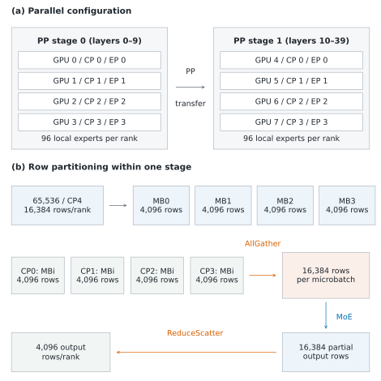
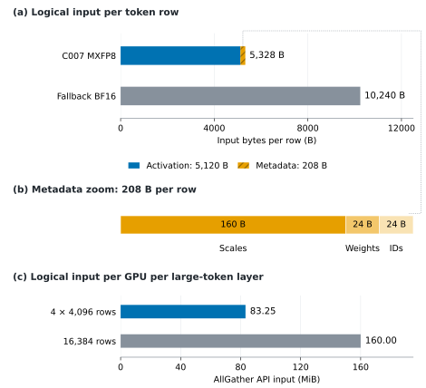
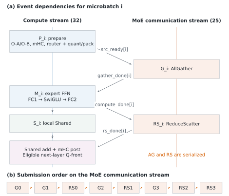
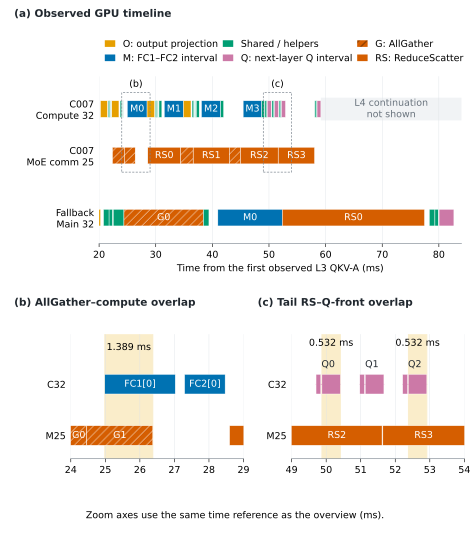
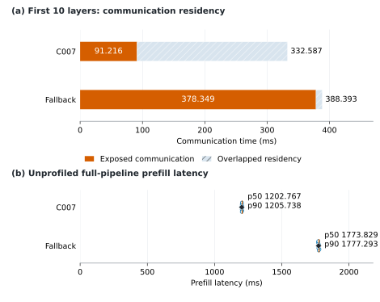
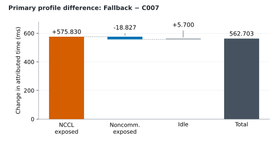

# Row-wise communication and computation pipelines for DeepSeek-V4 prefill

**Technical report, historical experiment collected 2026-11-03.**

## Abstract

A DeepSeek-V4.1-Flash prefill experiment on eight PRO6000 Server GPUs compared a four-way row pipeline with a full-row fallback. Both processed one uncached 65,536-token request with CP4, EP4, and PP2. The measured unprofiled prefill p50 was 1,202.767 ms for the pipelined path and 1,773.829 ms for fallback, a 32.19% latency reduction. Although several full-row GEMMs had higher MFU, their gain was offset by increased exposed communication.

This is a comparison of **combined execution paths**: row partition count, epilogue preparation, query lookahead, and the AllGather input representation changed together. It does not isolate the causal contribution of row partitioning or query lookahead. All GPU results in this report belong to the historical implementation with model-source SHA-256 `430ab04d97f65ab06a19c84323606b5581f14215ebf8a7fe1cb0e8f452fccc8e`. The port was prepared against upstream main `4387a94cf218ba870474d7a2a40a632bc4975798`; the historical speedup is not a measurement of that port.

The accompanying [measurement data](data/measurements.json) retain full precision values. Tables display milliseconds to three decimal places and MFU to two decimal places.

## 1. Terminology and experiment configuration

**Row-wise MoE Pipelining (RMP)** partitions CP-local rows and overlaps expert computation with a dedicated communication stream. **Epilogue-Pipelined MoE (EPM)** extends the preparation phase to include the attention output projection and mHC work. **Cross-Layer Query Lookahead (QLA)** performs the next layer's row-wise query front during current-layer communication drain.

The archived source and figures use legacy identifiers `C004` for RMP, `C007` for EPM, and `QAHEAD` for QLA. In all six figures, **C007** denotes the four-way EPM configuration and **Fallback** denotes the full-row comparison path. These labels identify the measured paths, not upstream release features.

| Property | Both PRO configurations | Variation or boundary |
| --- | --- | --- |
| Hardware | PRO6000 Server, 96 GB per GPU, eight GPUs | Per-GPU peaks used for MFU: BF16/FP16 468, FP8 936, FP4 1,871 TFLOP/s |
| Parallelism | CP4, EP4, PP2; MoE TP1 | PP stage 0: layers 0–9; stage 1: layers 10–39 |
| Request | 65,536 tokens, chunk limit 65,536 | No historical KV; prefix and cached-token counts are zero |
| Model | 40 layers, hidden size 5,120; 384 experts | Actual native top-k is **6**, with 96 local experts per EP rank |
| Native MoE | FlashInfer, MXFP8 activation × MXFP4 weight | Independent A4W4 core tests are separate measurements |
| Native attention O-A | BF16 × BF16 | Independent MXFP8 O-A core tests do not replace native service results |
| Communication | Prefill CP, A2A backend `none`, attention DP1 | MoE AG and RS share one communication stream |
| Compared controls | Four row slices, epilogue pipeline and QLA enabled | Fallback uses one row block, both controls disabled, and BF16 gather |
| Other conditions | DSPARK disabled; replicated TP1 shared expert enabled | No explicit split-weight override in either configuration |
| Bounded replay | Late layers have about 32 local rows | The late 20-layer tail does not enter the large-row four-way branch |

CP, EP, and PP mean context, expert, and pipeline parallelism. MB denotes the number of row slices within a layer. These MBs are not independent requests or PP scheduler microbatches. The earlier synthetic 384-expert/top-8 balanced GEMM experiments are not used to calculate native work or MFU here.

SGLang scheduler overlap, Two Batch Overlap, and Single Batch Overlap are separate mechanisms. In the historical measurement, TBO and SBO were disabled and scheduler overlap was disabled. Explicit model-internal stream/event operations still executed.

## 2. Implementation mechanism

### 2.1. Parallel topology and row partitioning

A 65,536-token request divided by CP4 gives 16,384 local rows per GPU. Four-way partitioning produces four 4,096-row slices. For one slice index, AllGather collects the corresponding rows from all four CP ranks, yielding 16,384 rows in rank-major order. Each rank computes the contribution of its 96 local experts. SUM ReduceScatter combines contributions and returns 4,096 output rows to each original CP rank.

PP2 places model layers on two stages; it does not halve the row count again. Routing weights, row order, local expert ownership, and reduction semantics must remain consistent. Partitioning neither reduces the true token workload nor guarantees balanced expert assignments. Actual expert row counts remain necessary for grouped-GEMM FLOPs.



*Figure 1. Parallel configuration and row partitioning in CP4–EP4–PP2. Each AllGather collects 16,384 rows for a microbatch; after local expert computation, ReduceScatter returns 4,096 output rows per rank. Row microbatching creates no additional PP stages, and query lookahead does not cross a PP boundary.*

The full attention computation has already produced its output before these row slices enter the epilogue. Output projection, per-token normalization, mHC, routing, and expert FFNs can then proceed per slice. Attention is not replaced by four shorter, independent contexts, and cross-token KV dependencies remain intact.

### 2.2. Packed gather input

The pipelined path performs routing, top-k selection, and MXFP8 quantization on local rows. It packs the activation, UE8M0 scales, route weights, and expert IDs into one uint8 row. After gather, the expert path reconstructs standard top-k metadata and consumes the prequantized activation instead of repeating routing and quantization on all gathered rows.

| Field | Bytes per row | Basis |
| --- | ---: | --- |
| MXFP8 activation | 5,120 | Hidden size 5,120, one byte per value |
| K32 UE8M0 scales | 160 | 5,120 / 32, one byte per scale |
| Route weights | 24 | Six FP32 weights |
| Expert IDs | 24 | Six int32 IDs |
| Total | 5,328 | BF16 activation alone occupies 10,240 bytes |

For 16,384 local rows, four gathers sum to 83.25 MiB of API input per GPU per large-token layer, versus 160 MiB for the BF16 full-row gather. The ratio is 1.9219, rather than exactly two, because the packed representation includes metadata. These are logical application payloads recorded at the communication API; they do not count protocol overhead, topology-dependent retransmission, or physical link traffic.



*Figure 2. Logical AllGather input per token row, metadata layout, and input per GPU per large-token layer. The metadata inset preserves the 160/24/24-byte proportions. API input is not physical link traffic; 1 MiB equals 2^20 bytes.*

Both historical paths compute the replicated TP1 shared expert on local rows. The pipeline changes its placement and input-quantization reuse; it does not demonstrate a fourfold reduction in shared-expert work relative to this fallback. Nor does MXFP8 gather imply that O-A or all model compute switches to FP8.

### 2.3. Stream dependencies and submission order

The main stream executes output projection, mHC, routing/packing, expert FC1–activation–FC2, local shared expert, closing mHC, and eligible next-layer query work. The MoE communication stream executes both AG and RS, serially. With four slices, communication submission order is:

```text
G0 → G1 → RS0 → G2 → RS1 → G3 → RS2 → RS3
```

Four events enforce data dependencies:

| Event | Producer | Consumer | Required invariant |
| --- | --- | --- | --- |
| `src_ready[i]` | Main stream after prepare | Communication stream before AG | Packed input is ready to read |
| `gather_done[i]` | Communication stream after AG | Main stream before MoE | The gathered input is complete |
| `compute_done[i]` | Main stream after experts | Communication stream before RS | Local expert contributions are ready |
| `rs_done[i]` | Communication stream after RS | Main stream before closing | Reduced rows may be finalized |



*Figure 3. Event dependencies and communication ordering in the measured EPM implementation. AG and RS are serialized on one communication stream. Closing mHC and eligible next-layer query work run during drain, after all expert and local shared work has been submitted. The dependency diagram is schematic and is not drawn to scale.*

The following pseudocode describes the historical four-slice path. It is not a replacement for the current main-branch boundary/residual interfaces.

```python
01  main = current_stream(); comm = side_stream()
02  bounds = split_rows(CP_local_rows, 4)
03  prepare(0); enqueue_gather(0)
04  prepare(1); enqueue_gather(1)
05  for i in range(4):
06      main.wait_event(gather_done[i])
07      expert_out[i] = packed_experts(gathered[i])
08      record(compute_done[i], main)
09      comm.wait_event(compute_done[i])
10      enqueue_reduce_scatter(i, comm)
11      record(rs_done[i], comm)
12      if i + 2 < 4:
13          prepare(i + 2); enqueue_gather(i + 2)
14      local_shared[i] = shared_on_local_rows(i)
15  pre = allocate_next_query_buffers_if_supported()
16  for i in range(4):  # after all MoE/shared submissions
17      main.wait_event(rs_done[i])
18      merged[i] = reduced[i] + local_shared[i]
19      final_hidden[i] = closing_mhc(merged[i], residual[i])
20      if pre is not None:
21          next_query_front(pre, final_hidden[i], i)
22  if pre is not None: attach_precomputed_inputs_to_next_layer(pre)
23  return final_hidden
```

Events enforce execution order. `record_stream` preserves allocator lifetime for tensors consumed by another stream; it does not replace a readiness event or prove communication completion. Expert execution must skip its own output all-reduce when the enclosing RS owns the reduction, or contributions would be reduced twice. All gathered real rows must be exposed to routing, including rows received from other ranks.

The stream numbers in the captured process are main 32 and MoE communication 25. SWA KV gather used stream 84 and compressor gather used stream 32; they should not be reassigned to the MoE stream in an explanatory diagram. Stream IDs can change in another process.

### 2.4. Why query lookahead satisfies the layer dependency

QLA waits for the current slice's **final** previous-layer result, rather than for all rows in the layer. In particular, `rs_done[i]` alone is insufficient. The main stream first waits for that RS, adds the local shared result, and completes closing mHC. Only then may the next layer read those hidden rows.

The next layer's combine/norm, fused QKV-A, Q normalization, Q-B, and Q RoPE are row-wise operations. For a slice `i`, their inputs are final hidden rows `H_l[i]`, known weights, and its positions:

```text
wait RS[i] → add Shared[i] → close current-layer mHC[i]
          → final H_l[i] → next-layer query_front(H_l[i])
```

Other slices can still have tail RS outstanding. This exposes a valid overlap window without reading an unfinished row. The fused QKV-A projection also produces KV-A, but the historical lookahead step does not advance KV cache store, CP KV materialization, indexer execution, or attention QK/PV. Those operations still wait for their own dependencies in the normal next-layer entry.

Precomputed buffers are attached to the next layer and consumed only when the hidden-state and previous-coefficient objects match. They replace the corresponding projections, rather than duplicate them. The historical implementation selects only a next layer inside the same PP stage and excludes unsupported paths, Engram, speculative auxiliary capture, and bounded-tail transitions. In the measured 10/30 layer partition, there is no layer-9-to-layer-10 lookahead across the PP boundary.

The drain loop follows all main-stream MoE/shared submissions. Consequently, observed QLA covers remaining **tail RS**; it is not arbitrary interleaving of next-layer Q before earlier queued MoE kernels.

### 2.5. Eligibility and fallback boundaries

Historical EPM required prefill CP, A2A `none`, attention DP1, standard top-k routing, an eligible packed-MXFP8 expert path and O projection, more than one equal row slice, and at least 1,024 local rows. Current-stream capture, incompatible statistics streams, fusion paths, and unsupported quantization/layout combinations were excluded. The ordinary RMP entry did not support the active replicated TP1 shared-expert configuration, whereas EPM did.

Therefore, disabling epilogue pipelining is not by itself a controlled RMP baseline for this model. A single-factor comparison must first retain compatible packed input, shared-expert semantics, and reduction ownership. The upstream port must re-establish these guards using the current interfaces; the historical guards are evidence, not a guarantee that every main-branch backend is supported.

## 3. Measurement method

Each native scenario used three warmups and ten unprofiled serial zero-cache requests. Service prefill time spans forward entry through prefill completion, including internal computation, CP/EP communication, and PP transfer. It excludes queuing, HTTP transport, external KV transfer, and subsequent decode.

Input seeds are paired across configurations for a given trial, but differ between trials. Thus the ten samples contain input variation; they are not ten repetitions of one fixed input. The exact trial seeds and input hashes are included in the data bundle. p90 uses linear interpolation and is not a confidence interval.

Timing, shapes, and effective workload were collected separately. Three CPU-plus-GPU auxiliary traces per scenario establish shapes, three GPU-only traces establish native timing, and separate workload collection records actual expert counts and attention pair counts using the corresponding input seeds. Workload hooks were installed after the main timing and GPU trace runs.

| Metric | Calculation | Interpretation boundary |
| --- | --- | --- |
| GPU raw time | Sum of selected native event durations | May overlap other GPU work; not request latency |
| Exposed communication | Communication intervals after subtracting other GPU activity according to the attribution rule | Timeline accounting; not pure link latency or a causal critical path |
| Full profile window | One request's full PP execution window | Stages and ranks are not added as independent request durations |
| First-ten-layer window | CP0/PP0, L0 input norm through L9 closing work | PP boundary transfer excluded |
| Unprofiled p50 | Median of ten service prefill samples | Serial request latency, not saturated PP inter-completion time |
| Independent core UT | Ten warmups, thirty formal timing samples | Only the stated core scope; cannot replace service time or share |

Full-request attribution uses representative CP0 GPU events from PP0 and PP1 on a verified common time axis. Noncommunication GPU work takes precedence over collectives, then PP P2P; equal-priority overlap is apportioned consistently. Raw residency and attributed exposure are both retained.

MFU is calculated as `sum(effective_FLOPs_by_precision / peak_by_precision) / native_raw_time`. Mixed precision first contributes its own ideal time at each arithmetic peak. Hiding an event under communication does not reduce its MFU denominator. Routed expert FLOPs use actual expert token counts, and attention uses real effective query/key metadata. Unknown arithmetic or work stays N/A; balanced-routing estimates and nearby-shape interpolation are not substituted.

## 4. Native GPU timeline evidence

The timeline excerpt is primary trial 101, CP0/PP0. Each configuration is aligned to its own first observed layer-3 QKV-A launch, which may already be prefetched under the previous layer's tail. This is not a strict serial layer boundary. Both use the same 20–84 ms display interval, with actual-coordinate zooms at 24–29 and 49–54 ms.



*Figure 4. Observed GPU events for trial 101. Overview O/M/Q rectangles preserve source interval widths and may include internal gaps; zooms show native kernels and measured intersections. AG and RS share one MoE communication stream. Unshown layer-4 activity does not denote idle time, and the excerpt does not reconstruct a causal end-to-end latency decomposition.*

| Native event intersection | Measured overlap (ms) | Observation |
| --- | ---: | --- |
| L3 AG1 with FC1[0] | 1.389 | The next gather overlaps the current expert computation |
| L3 RS0 with FC1[1] | 1.960 | The next expert computation starts before the earlier combine completes |
| L3 RS2 with L4 Q-B[0] | 0.532 | Next-layer query work executes under tail RS |
| L3 RS3 with L4 Q-B[2] | 0.532 | Query lookahead extends into the final RS |

These intersections occur at different positions in the trace. They prove overlap, but their durations are not counterfactual end-to-end savings: downstream dependencies, kernel resource contention, and other phases still matter.

In fallback, the same layer's BF16 MoE gather occupies approximately 24.390–38.424 ms, FC1 40.972–47.467 ms, FC2 48.618–52.369 ms, and RS 52.371–77.460 ms. Subsequent query-front work starts after 80.042 ms. All are on the same main stream. The pipelined path places MoE collectives on the side stream so ready main-stream work can proceed.

## 5. Results and performance attribution

### 5.1. Request latency and profile windows

| Metric | EPM, four row slices | Full-row fallback | Difference or scope |
| --- | ---: | ---: | --- |
| Unprofiled prefill p50 (ms) | 1,202.767 | 1,773.829 | EPM latency is 32.19% lower; fallback is 47.48% slower |
| Unprofiled prefill p90 (ms) | 1,205.738 | 1,777.293 | Ten samples per configuration |
| Primary profile window (ms) | 1,221.284 | 1,783.987 | Difference 562.703 ms |
| Five key compute groups raw (ms) | 691.795 | 661.406 | Fallback reduces compute residency by 30.389 ms |
| Explicit NCCL exposed attribution (ms) | 258.902 | 834.731 | Fallback increases exposure by 575.830 ms |



*Figure 5. Panel (a) separates first-ten-layer raw communication residency into exposed and overlapped portions. Panel (b) shows ten unprofiled serial zero-cache requests per configuration with paired trial inputs: circles are requests, diamonds p50, and vertical ticks p90. The panels have different timing scopes. Both paths jointly change scheduling controls and gather representation.*

For the two primary GPU-only profile windows, the attribution differences conserve wall time:

| Fallback minus EPM | Change (ms) |
| --- | ---: |
| Explicit NCCL exposed attribution | +575.830 |
| Noncommunication GPU exposed attribution | −18.827 |
| Idle within the representative-event window | +5.700 |
| Profile window total | +562.703 |



*Figure 6. Increased communication exposure, reduced noncommunication exposure, and increased idle sum to 562.703 ms, matching the primary-profile window difference. This is conservation accounting under one attribution rule, not a causal switch ablation. The separate unprofiled p50 difference is 571.062 ms and must not be substituted into this identity.*

The observations support increased exposed communication as the main component of the profile-window regression. They do not identify how much comes from row count, compressed gather, epilogue scheduling, or QLA individually.

### 5.2. Native compute efficiency

| Compute scope | EPM raw (ms) | EPM MFU | Fallback raw (ms) | Fallback MFU |
| --- | ---: | ---: | ---: | ---: |
| Sparse MLA | 226.394 | 18.64%* | 229.957 | 18.35%* |
| MoE FC1 | 161.764 | 56.10% | 154.976 | 58.53% |
| Dense projections, including shared expert | 151.083 | 67.72% | 142.987 | 71.56% |
| MoE FC2 plus scatter | 93.631 | 48.46% | 78.827 | 57.54% |
| Attention O-A | 58.923 | 79.90% | 54.659 | 86.13% |

`*` Sparse MLA MFU covers only the known-work arithmetic subset. This subset accounts for approximately 99.41% and 99.39% of the FA raw duration, respectively; raw time in the table still includes the full FA group. Unknown late-layer arithmetic is not extrapolated to a complete FA MFU.

Native MoE uses MXFP8 activation × MXFP4 weight, and O-A uses BF16. Dense includes shared-expert projections but excludes O-A. The five compute groups occupy 56.63% of the full profile window under EPM and 37.06% under fallback after overlap attribution. A smaller fraction need not imply less work: a longer denominator and more communication exposure also reduce compute share.

Full-row GEMMs improve individual MFU and reduce raw compute time. The complete request nevertheless becomes slower because that improvement is outweighed by communication exposure. An isolated large GEMM is therefore insufficient to choose the service scheduling policy.

### 5.3. First-ten-layer communication

| Path and collective | Calls | Raw (ms) | Exposed (ms) | Window share |
| --- | ---: | ---: | ---: | ---: |
| EPM AllGather | 52 | 101.631 | 35.064 | 6.36% |
| EPM ReduceScatter | 40 | 230.956 | 56.152 | 10.19% |
| EPM total | 92 | 332.587 | 91.216 | 16.55% |
| Fallback AllGather | 22 | 161.873 | 151.830 | 18.38% |
| Fallback ReduceScatter | 10 | 226.519 | 226.519 | 27.42% |
| Fallback total | 32 | 388.393 | 378.349 | 45.80% |

The two first-ten-layer windows are 551.105 ms and 826.103 ms. RS raw residency changes little, from 230.956 to 226.519 ms, while its exposed component rises from 56.152 to 226.519 ms. This directly illustrates a change in coverage. AG raw and exposed time also change with payload representation and execution placement.

PP transfer is excluded from this table. In the full request window, PP P2P exposed attribution is approximately 40.676 and 40.919 ms. Larger raw SendRecv residency cannot be labeled as an equal increase in net network latency, because waiting can overlap other-stage work.

### 5.4. Frozen B200 80K comparison

The B200 reference is one CP4/EP4 instance on four GPUs, processing 81,920 tokens. PRO uses 65,536 tokens and PP2. Workload, hardware, transport implementation, and fusion ranges differ; these ratios are descriptive observations, not matched-shape speedups.

| First-ten-layer scope, excluding PP | PRO64K raw (ms) | B20080K raw (ms) | PRO/B200 |
| --- | ---: | ---: | ---: |
| SWA KV collection | 9.440; 10 AG | 0.770; 30 peer copies | 12.27× |
| Compressor projection AllGather | 11.477; 2 calls | 1.079; 2 calls | 10.64× |
| Attention communication subtotal | 20.917 | 1.848 | 11.32× |
| MoE input dispatch | 80.713; 40 packed AG | Fused inside MegaMoE | N/A |
| MoE output combine | 230.956; 40 RS | Fused inside MegaMoE | N/A |
| All explicit communication | 332.587 | 1.848 plus fused internal communication | Different total scopes |

The compressor uses a four-GPU RING_LL collective in both observations. Per-GPU API input per call is 64 MiB on PRO and 80 MiB on B200. Normalizing the observed application payload and raw time gives a B200/PRO effective-rate proxy of 13.30×. This is not physical link bandwidth or a matched-shape measurement.

After the corresponding overlap accounting, PRO64K exposed communication is 91.216 ms, or 16.55% of its first-ten-layer window. B200 is 1.155 ms, or 1.13%. The B200 value includes explicit NCCL and peer copies, while MegaMoE's internal dispatch/combine cannot be independently separated. Missing fused communication must not be filled with zero to construct an overall speedup.

## 6. Discussion and validation required for the port

These measurements characterize serial zero-cache request latency on a fixed historical configuration. They do not establish saturated PP throughput or quality on all inputs. A throughput experiment must state concurrency and arrival protocol, then divide actually completed tokens by the corresponding wall time.

The main-branch port uses the current boundary/residual interfaces. Its code review and tests have a different scope from these historical measurements. The current upstream `pre-from-prev` path retains a PP1 restriction, which this PR does not remove. The historical CP4/EP4/PP2 result must not be read as a claim that the new port supports PP2. Its GPU accuracy and service-level performance remain separate validation work; the historical results must not be presented as that validation. Keep experimental controls disabled by default until the target backend and workload are verified.

Useful follow-up experiments are:

1. Retain the same packed input, shared-expert behavior, and reduction ownership while comparing one, two, four, and eight row partitions.
2. Toggle QLA alone inside the same EPM configuration to measure tail-RS coverage and its buffer cost.
3. Record actual entry/fallback reasons, including PP boundaries, Engram, bounded-tail transitions, graph capture, and unsupported fusion/quantization paths.
4. Validate row boundaries, rank-major ordering, real top-k routing, one-time reduction, local shared addition, cross-stream buffer lifetime, and next-layer cache identity.
5. Test model outputs and quality in addition to synthetic operator oracles. Kernel correctness checks do not prove whole-model or bitwise equivalence for all deployments.
6. Integrate alternative arithmetic precision separately, then reprofile the complete service rather than replacing native scopes with standalone core timings.

## Appendix A. Precision-aligned independent core tests

Independent UTs used actual native 96-expert token-count vectors and actual O-A shapes with deterministic synthetic tensor values. FC1 and FC2 use MXFP4 × MXFP4 DeepGEMM cores; O-A uses MXFP8 × MXFP8. Tests exclude online quantization, layout transforms, SwiGLU, communication, and FC2 scatter. Production-tactic timings and tactic selection followed by separate formal timing are retained separately.

| Independent core scope | EPM large rows | EPM all calls | Fallback large rows | Fallback all calls |
| --- | ---: | ---: | ---: | ---: |
| MoE FC1 core MFU | 45.30% | 43.15% | 58.10% | 54.59% |
| MoE FC2 core MFU | 34.27% | 33.11% | 41.03% | 39.36% |
| O-A selected-tactic MFU | 70.82% | 66.94% | 77.65% | 72.99% |

For each operator type, combining representative CP0 calls from both PP stages gives 80 large-row plus 20 late small-row calls under EPM, versus 20 large-row plus 20 small-row calls under fallback. Padding overhead is higher for the late small-row expert calls. O-A at M32 uses eight separate two-dimensional GEMMs as a safe fallback, and is not labeled as native batched-MXFP8 efficiency. Tactics were selected before the separate thirty formal samples; the formal samples were not searched retrospectively for a minimum.

The B200 native MegaMoE group fuses FC1, FC2, dispatch, and combine; its full-group MFU is approximately 25.02%. That one number must not be copied into two independent core rows. Precision peaks, fused scope, and auxiliary work must accompany an MFU comparison. None of these UT numbers replace native service latency or share.

## Appendix B. Evidence and reproducibility

The public bundle includes all plotted timing samples, native excerpt coordinates, logical interval grouping, original event identifiers, full precision summary metrics, and precision-aligned core summaries. Historical evidence is identified by content hash, with machine-specific paths replaced by public evidence identifiers. The original raw traces, model weights, service logs, and deployment credentials are not included.

| Evidence | SHA-256 or revision |
| --- | --- |
| Historical model source | `430ab04d97f65ab06a19c84323606b5581f14215ebf8a7fe1cb0e8f452fccc8e` |
| Original frozen comparison | `0f3eaaa76c6714e286e2cdb168b54496f8352023a1f76f23623add4a3654eff1` |
| Native timeline excerpt | `3f576720bbb61b12a5b7a79cb7391cd09f118f40e27151fb81388cf876b5f086` |
| Timeline grouping | `cbe3f12a3f8249fb539a337403fcd3486c6aeb1bf9e8b090266898aeafbf8c92` |
| Main revision used to prepare the port | `4387a94cf218ba870474d7a2a40a632bc4975798` |

The original native analysis independently checked 81,629 data-pairing, FLOP, precision, and timeline-accounting conditions; independent UT review checked 3,367. The academic report redesign passed 3,488 additional consistency checks. These are historical analysis checks, not CI results or proof of all deployment conditions.

To redraw the figures, follow the plotting command in [README.md](README.md). The script preserves the fixed 166 mm canvas and the true native event coordinates. Overview logical intervals can contain internal gaps, and omitted timeline regions do not denote idle time. For the upstream implementation and its new validation, read the code and test results in this PR rather than the historical environment-variable names.
