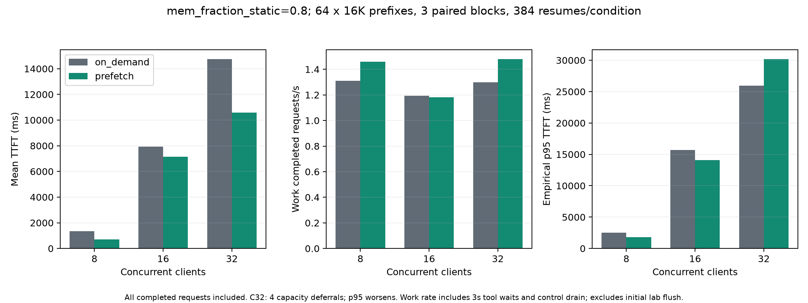

# 0.8 显存预算下的持续 L2/L3 压力测试

在实际 L1/L2 分配占用接近 99% 的条件下，优化后 PREFETCH 在 8、32 并发的受控客户端工作吞吐分别提高约 11.5%、13.9%；16 并发下降约 1.1%。32 并发的 p95 TTFT 增加约 16.2%，并有 4 次容量退回。这组改动有适用范围，不能宣称所有压力档位都改善。

正式执行时段约 137.0 分钟（含数据准备、实验重置和版本切换）。正式矩阵共 5,724 次真实生成调用，全部完成；4,656 条恢复输出在输入一致时跨条件、跨代码快照检查，IDs/文本一致。原始结果保留基线 1 次预取 FAILED 和优化后 4 次 DEFERRED，所有完成请求都计入延迟和吞吐。8 个矩阵均通过离线完整性复核，其中 6 个满足“每次预取均成功”的严格路径校验。

## 配置、容量与负载

- 两台 Engine 均为 `--mem-fraction-static 0.8`，移除 `--max-total-tokens 32768` 限制，自动分配 KV 池。B 实际 L1=346,944、L2=693,952 tokens；A 为 346,688/693,440。两次 Engine 启动的容量相同。
- Qwen3-8B BF16，FULL attention/GQA，TP=1；GPU A 为 A100 80GB PCIe，B 为 A100-SXM4-80GB。所有恢复条件在同一 B 上配对。HiCache ratio=2、persistent host、direct/page_first_direct、write_through；Mooncake v0.3.14 TCP，每 Engine 挂载 128GiB，共享私有 Master。
- context=32768、page=64、chunked prefill=4096、max running requests=32、random seed=0、triton attention/pytorch sampling，关闭 overlap 及 decode/prefill CUDA graph。
- L3 每档使用 64 个独立 salt 的 16K 前缀，工作集 1,048,576 tokens，约为 L2 的 1.51 倍；每个条件两次遍历、3 轮配对，384 条恢复请求。并发扫描 8/16/32；工具等待 3s、预取提前量 2.5s。恢复按预定时间发送，不额外等待预取完成。自然保留 GPU KV，由原生 LRU 驱逐，没有每请求 flush 或 DEMOTE。
- L2 使用 4×16K 热点和 53×16K 冷压力，分别测 natural 与显式 DEMOTE，3 轮配对，共 732 次生成；详情见 [L2 验收](L2_ACCEPTANCE.zh-CN.md)。

`0.8` 是静态显存预算。实际缓存占用使用启动 token 容量减 `kv_available_tokens`；`token_usage`/`kv_used_tokens` 只计活动槽位。natural L2 实验观测到 L1 分配/预留 344,320/346,944（99.24%），L2 使用 692,224/693,952（99.75%）。分配包含缓存及在途工作；资源每 2 秒采样，数值为观测峰值。

5,724 次正式调用由 4,608 条 L3 恢复、384 次 L3 源发布，以及 732 次 L2 预热/冷压力/恢复构成。输入计数约 9,388 万 tokens、输出 150,060 tokens；输入计数包含缓存命中，不能当作 GPU 重算量。少量启动冒烟与独立正确性请求放在 `startup-observations` 和 `provenance`，不混入正式统计。

## 实现与独立证据

Engine 对照源码为 `f65f0393c4c916184c6c9017fafb9fa389ec2f4a`，优化源码为 `ff764308fbb40de10f8e3983cd01d3f54946863e`。优化包含：

- `8c9504c7ec`：不同有效 salt 的 native L3→L2 read 有界流水，默认并发上限 4；同 salt 串行，GPU 目标保留独占与 FIFO 屏障；完整 L2 已驻留目标直接完成。查询先预留完整缺口，实际分配后停止重复计账，取消后保留到真实 drain。
- `ff764308fb`：普通请求可复用仍在排队的精确 native host job。容量不能批准或 GPU 屏障无法推进时保留正常请求的计算退回。没有增加底层 GET worker。

相同受控 CPU file-store 场景中，两个范围加一个匹配的普通需求，从 3 次 query/3 次 GET 降为 2/2；实际 demand span 均为 `(4,0)`。root 在固定前后快照独立复跑，原始脚本、命令、源码 SHA 与输出保留在 `provenance`。阻塞门测试耗时包含编译与人为同步，不作为吞吐数字。

## 优化后相对同轮按需组的结果

TTFT 为 HTTP 发送到首个实际 token；p95 是 384 条相关请求的经验分位数。工作吞吐包含真实 3s 工具等待、推理和候选控制收尾，仅排除每组初始实验 flush；源 A 计算和 L3 发布另列。它表示受控客户端的完整工作周期，不等同于无等待的生产 GPU 容量。每轮请求序列与工作量相同，配对顺序固定 seed 随机。

| 并发 | 按需→预取平均 TTFT ms | p95 TTFT ms | 工作请求/s | 吞吐变化 | 预取未完成路径 |
| --- | ---: | ---: | ---: | ---: | --- |
| 8 | 1343 → 699 | 2506 → 1797 | 1.310 → 1.461 | +11.5% | 0 |
| 16 | 7920 → 7133 | 15689 → 14110 | 1.193 → 1.181 | -1.1% | 0 |
| 32 | 14735 → 10584 | 25955 → 30154 | 1.298 → 1.478 | +13.9% | 4 |



8 并发平均 TTFT 降低 48.0%，p95 降低 28.3%，工作吞吐提高 11.5%，三轮吞吐差值均为正。16 并发平均 TTFT 降低 9.9%，工作吞吐下降 1.1%，整体约持平。32 并发平均 TTFT 降低 28.2%，工作吞吐提高 13.9%，p95 增加 16.2%；三轮包含一次明显的容量退回波动。

32 并发中，已发布前缀的重复预填充从按需的 1,263,360 tokens 降到预取的 295,552 tokens，减少约 76.6%；后者包含 4 次容量 DEFERRED 导致的 65,536 tokens 全前缀重算。没有删除这些请求。host 驱逐只回收已离开 GPU、且没有在途引用的 host 叶节点；GPU 副本及引用会限制可回收 L2，整段 16K 准备不能保证每次批准。

8 并发有 141/384 次操作完成早于请求实际发送；实际恢复命中 L2 的 tokens 为 2,572,288，L3 为 3,719,168，重复预填充为 0。晚到需求可共享在途读取，因此提前就绪率较低仍可能改善延迟；操作完成时刻与物理传输字节不能互相替代。

L2 natural 热点平均 TTFT 为按需 4,552ms、PIN 586ms，下降 87.1%，实际命中由 L3 转为 L2；全混合工作吞吐只提高 0.49%。显式 DEMOTE 口径热点下降 84.2%，混合吞吐下降 0.13%。冷计算占多数，热点改善没有转化为同幅度整体收益。

## 原始退化、资源成本与限制

旧快照的预取工作吞吐在 8/16/32 并发分别低于各自按需组约 15.7%/10.7%/9.9%；8 并发平均 TTFT 还增加约 26.8%。这些负结果及旧 32 并发的 1 次 FAILED 均保留。该失败的普通读取日志先记录完整 16K L3 load，同一时段出现 cache-admission shortfall，随后请求重算并保持输出一致。原始标记没有改为成功。

新 32 并发的 4 次 `DEFERRED/whole_scope_capacity` 是有界容量退回：没有完整 ready 范围，普通请求继续计算，输出一致。它们使该矩阵未满足“每次预取均完成”的严格校验，不能把它列为全成功。CPU/GPU 正确性测试已覆盖这一退回路径；尾延迟代价仍是本轮实测限制。

重启后的按需基线自身也明显变快。两段运行的时段、存储历史与 segment 状态没有隔离；同机 GPU2/3 有其他任务。跨快照的绝对速度变化不能全部归因于代码。主要收益采用每个快照内部相同 B 上的配对；CPU 回归与部分基线时段有重叠，资源记录保留。

按 2s 进程树 CPU 累积计数估算，新 8 并发的 B CPU 核秒/请求约为按需 1.970、预取 1.962；16 并发为 2.484/2.527；32 并发为 2.094/2.018。覆盖率约 97%–98%，窗口边界近似，数值用于成本观察。GPU/host 占用及 Master 容量在 `analysis.json`，CPU 计数在 `cpu-cost.json`；没有推断物理 I/O 字节或精确 host 字节峰值。

每档只有 3 个配对轮次；384 条恢复在封闭客户端与同一缓存状态中相关，不能按 384 个独立样本建立稳定 p99 或普遍吞吐保证。输入是同一合成 ledger 配不同 salt 形成的独立 KV 前缀，没有扫描真实 RL/工具轨迹、共享前缀比例或跨节点 RDMA。本矩阵验证 Engine 分层数据操作，不代表 Router 业务生命周期的高并发压力。

## 验证、复现与清理

- 123 项控制/传输/保护/反馈回归、96 个子测试通过；41 项压测/离线工具测试通过；真实 GPU/file/在线 Mooncake 2 项测试、2 个子测试通过。日志与源码快照在 `provenance`。
- 8 个正式矩阵的原始 HTTP/SSE/control、完整 scope、输出、schedule、manifest 及压缩前后 checksum 全部保留。5 条未完成预取路径仍计入全部完成请求的延迟和吞吐。
- 完整监控为 4,570 条原始记录，9 个有序 gzip parts；物理 SHA 与无损重建原始 SHA 均保留。L2 首次阶段提交的截取视图另存为 `provenance/resources-l2-clipped.jsonl.gz`。
- 结束时捕获两台 Engine 队列为空、capabilities、实际配置；任务 Engine、Master 和采样器已停止，51801/51803/52091/52092/52093 均无本任务监听。GPU2/3 未操作。

```sh
.venv/bin/python benchmark/session_kv_control/analyze_stress.py \
  --results benchmark/session_kv_control/results/2026-11-04-mem08 \
  --output /tmp/mem08-recheck
cd benchmark/session_kv_control/results/2026-11-04-mem08
sha256sum -c SHA256SUMS
```

离线分析退出码 2 表示报告保留了上述未满足严格路径校验的矩阵；文件完整性和指标重算应显示 `verified_cells=8`，完成调用数为 5,724。详细数字见 [自动重算报告](analysis/report.md)、[相对变化 CSV](analysis/paired-relative.csv)、[CPU 成本](analysis/cpu-cost.json) 和 [跨条件输出证明](analysis/output-proof.json)。
