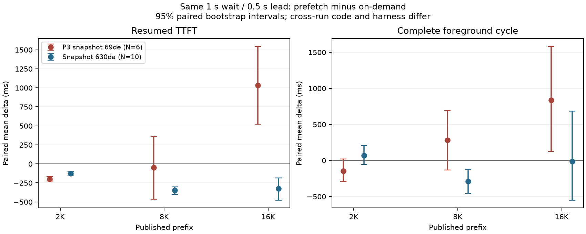
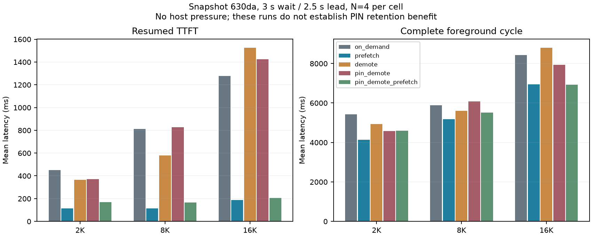

容量修复和最终代码验收见 [FINAL_ACCEPTANCE.md](FINAL_ACCEPTANCE.md)。本页保留初始六次运行的 202 条记录，新增结果另存，原始数据未覆盖。

这批实测支持一个有限判断：在所测 Qwen3-8B、Mooncake、TP=1 配置中，提前准备可缩短恢复请求的 TTFT；完整周期的收益随窗口、缓存压力和并发负载变化。16K 原始短窗口出现明显退化，host 压力下的 8K prefetch 也略慢；这两组结果均保留。

共封存 6 次运行、202 条正式场景记录。全部场景校验通过，失败列表为空；其中包含 12 条负向场景，9 条按设计不发恢复请求。原始请求、响应、控制结果和负向样本均在各目录的 `raw.jsonl.gz`，并未按成功或 ready 状态筛选延迟样本。

| 运行目录 | 窗口：等待 / 提前量 | 正式记录 | 主要配对 N | 说明 |
| --- | --- | ---: | ---: | --- |
| bench-p2-matrix-v1 | 1s / 0.5s | 36 | 每长度 6 | 2K、8K、16K；旧快照 |
| bench-p2-ready-window | 3s / 2.5s | 16 | 每长度 4 | 8K、16K；旧快照 |
| bench-optimized-matrix-v1 | 1s / 0.5s | 72 | 每长度 10 | 60 条主比较，加 12 条负向场景 |
| bench-optimized-retention-matrix | 3s / 2.5s | 60 | 每长度/组 4 | 2K、8K、16K，五种控制组 |
| bench-optimized-background-v1 | 3s / 2.5s | 12 | 每长度 3 | 8K、16K；两个后台请求槽 |
| bench-optimized-host-pressure-v1 | 3s / 2.5s | 6 | 3 | 8K；每次预置四条 16K host 压力前缀 |

运行名中的 `p2` 是历史命名。旧 Engine 运行代码为 `69de4c3e82494d3aa278b22a067bcfd901cda119`，包含 P0–P3、尚无 L2 PIN；后四组使用 `630da396a576b6bb1dceadbeb0f3442fc33c9f20`，也包含 P4/P5 等变更。运行代码由固定 runtime worktree、启动脚本及 Git reflog确认。原始 benchmark manifest 没有记录 runtime Git commit；本包在 `provenance/runtime-provenance.json` 补充来源说明，保持原 manifest 原样。采集程序所在仓库的 Git HEAD 与实际加载的 Engine 代码要分别核对。

两次短窗口实验的配置指纹、seed=1729 一致；对应的 36 条旧/新试验规格具有相同 prefix SHA256。旧组每长度 N=6，新组 N=10，采集脚本及部分统计模块也有变更。跨快照前后差异含有这些混杂因素，不能归为一处代码优化的独立因果效果。详细核对在 `short-window-comparability.json` 和 `provenance/harness-hashes.json`。原始脚本 `0dc6…` 的源码未重新构造；另存的 harness 文件代表打包时版本，哈希差异明确列出。

模型为本地 Qwen3-8B，TP=1、FULL MHA、page_size=64，Python radix、page_first_direct、direct host I/O、write_through、Mooncake TCP，控制 namespace 为 `qwen3-8b-bf16-v1`。两个 Engine 使用独立 GPU 0/1、端口 51801/51803，模型路径、启动参数、能力与模型/tokenizer 文件哈希保存在原始 manifest。当前产物未补猜 GPU 型号、物理 I/O 字节、host 峰值或服务端 CPU。CUDA graph 的实际启动参数为 decode/prefill 均 disabled，不能仅据旧配置指纹中的 `disable_cuda_graph=false` 判定启用了 graph。

TTFT 从恢复请求发出计时，到首个实际输出 token。完整前台周期从源计算开始，包含发布、工具等待和恢复请求的全部 8 个输出 token；flush、host 压力构造、请求结束后的后台 drain 与控制 quiescence 位于该口径之外。`trials.csv` 同时保留 `quiescent_cycle_ms`。较低 TTFT 不自动表示较低完整周期、总资源消耗或后台请求代价。

同一 1s/0.5s 短窗口中的全部样本如下。Δ 为每次运行内部的 prefetch − on_demand 配对均值，负值表示更快；单位 ms。

| 快照 | tokens | N | on_demand TTFT | prefetch TTFT | Δ TTFT［95% CI］ | 恢复前 ready |
| --- | ---: | ---: | ---: | ---: | --- | ---: |
| 69de | 2048 | 6 | 336.18 | 137.97 | −198.21［−227.42, −167.24］ | 6/6 |
| 69de | 8192 | 6 | 804.24 | 755.05 | −49.19［−465.28, 357.61］ | 2/6 |
| 69de | 16384 | 6 | 1469.11 | 2502.69 | +1033.57［521.61, 1545.54］ | 0/6 |
| 630da | 2048 | 10 | 194.97 | 70.85 | −124.12［−146.92, −101.25］ | 10/10 |
| 630da | 8192 | 10 | 484.93 | 137.00 | −347.93［−401.29, −301.51］ | 6/10 |
| 630da | 16384 | 10 | 1190.62 | 864.61 | −326.01［−478.86, −182.97］ | 0/10 |

| 快照 | tokens | on_demand 完整周期 | prefetch 完整周期 | Δ 周期［95% CI］ |
| --- | ---: | ---: | ---: | --- |
| 69de | 2048 | 2315.51 | 2169.66 | −145.85［−291.29, 20.40］ |
| 69de | 8192 | 3841.47 | 4122.44 | +280.97［−131.93, 691.91］ |
| 69de | 16384 | 6849.67 | 7686.41 | +836.73［127.33, 1582.71］ |
| 630da | 2048 | 1913.05 | 1979.42 | +66.37［−57.35, 207.92］ |
| 630da | 8192 | 3948.85 | 3659.19 | −289.66［−454.30, −124.16］ |
| 630da | 16384 | 7256.44 | 7241.44 | −15.01［−552.25, 681.58］ |

69de 的 16K TTFT 与完整周期都变差。630da 的 16K TTFT 较本次 on_demand 低，完整周期区间跨 0，无法据此确认周期收益。两次 16K 短窗口的准备都未在恢复前完成；不能把这些样本改写为“全部 host ready 后的命中收益”。图中仍使用全部配对样本。



较长等待窗口的数据独立列出。69de 的 3s/2.5s 运行中，8K TTFT 为 630.39→96.36ms、16K 为 996.38→160.50ms，prefetch 均为 4/4 提前 ready。对应完整周期为 5567.84→5060.67ms 和 7756.29→6898.06ms。它们具有更充裕的准备时间，不能替代原始短窗口退化结果。

630da 在相同长窗口下的五组均值如下，每格 N=4。三组长度的 prefetch 与 pin_demote_prefetch 都为 4/4 提前 ready；本轮没有 host 压力或后台并发。

| tokens | 控制组 | TTFT ms | 完整周期 ms |
| --- | --- | ---: | ---: |
| 2048 | on_demand | 451.97 | 5420.09 |
| 2048 | prefetch | 112.60 | 4132.41 |
| 2048 | demote | 363.82 | 4924.54 |
| 2048 | pin_demote | 370.54 | 4569.16 |
| 2048 | pin_demote_prefetch | 170.30 | 4600.34 |
| 8192 | on_demand | 811.41 | 5892.04 |
| 8192 | prefetch | 113.79 | 5172.55 |
| 8192 | demote | 578.91 | 5594.32 |
| 8192 | pin_demote | 825.87 | 6077.58 |
| 8192 | pin_demote_prefetch | 166.31 | 5519.79 |
| 16384 | on_demand | 1276.27 | 8422.57 |
| 16384 | prefetch | 186.55 | 6947.31 |
| 16384 | demote | 1524.77 | 8796.04 |
| 16384 | pin_demote | 1423.51 | 7936.54 |
| 16384 | pin_demote_prefetch | 204.31 | 6924.66 |

这些运行验证了相应执行路径；它们不足以证明 PIN 在驱逐压力下带来收益。8K 的 pin_demote 相比 demote，TTFT 增加 246.96ms，配对 CI［59.24, 453.72］。后续压力组仅比较 on_demand/prefetch，没有同时测试 PIN 保留。



后台负载使用两个闭式请求槽，每个新请求带 fresh salt，256 输入 token、16 输出 token。12 条前台场景均有效，后台总失败数、窗口内失败数与 drain 失败数均为 0；截止后仍在途的请求单独 drain，每个“长度×组”的三次试验合计 6 条。

| tokens | 组 | 前台 TTFT均值 ms | 完整周期均值 ms | 后台 requests/s：逐试验均值 | 前台 ready |
| --- | --- | ---: | ---: | ---: | ---: |
| 8192 | on_demand | 1158.00 | 8818.13 | 1.130 | 0/3 |
| 8192 | prefetch | 221.87 | 6223.44 | 1.728 | 3/3 |
| 16384 | on_demand | 1643.11 | 8348.82 | 2.795 | 0/3 |
| 16384 | prefetch | 355.54 | 7927.42 | 0.974 | 3/3 |

16K 前台 TTFT 降低的同时，后台完成率均值下降；不能声称对普通推理没有代价。8K/16K 的完整周期配对 CI 分别为［−8719.15, 1182.02］和［−1592.09, 1159.65］ms，均跨 0。每组只有 3 条试验，且负载窗口长短不同。表中 requests/s 只计在测量窗口内成功完成的请求；按总时长加权的另一口径及边界请求计数保存在 `background-aggregate.json`。这组短测不能充当长期服务吞吐基准。

host 压力组在每次目标试验前，通过真实生成与 DEMOTE 构造四条 16K 前缀；每条 DEMOTE 后的 host 查询均观察到 16384 token。该记录表明压力内容确实进入 host；它没有测量四条同时常驻的字节峰值。压力构造平均花费 8831.54ms 的生成时间，另有 transfer 耗时，这些预置成本不计入上述完整前台周期。

该组 6/6 场景有效，prefetch 恢复前 ready 为 0/3，恢复请求均报告 CPU 命中 0、storage 命中 8192 token。prefetch 控制操作事后完成，不能据此声明恢复时已提前就绪。on_demand/prefetch TTFT 为 759.44/819.89ms，配对 Δ=+60.44ms，CI［36.92, 81.55］；完整周期为 5645.87/5841.11ms，Δ=+195.24ms，CI［−116.66, 656.90］。这组结果显示所测压力条件下提前准备没有带来前台收益。

区间采用配对差值的 percentile bootstrap，4000 次重采样。原始 P3 两组 summary 未记录 CI，本包从完整 raw 配对离线补算，`paired.csv` 标明 `offline_recomputed_from_raw`；其余已有 CI 沿用原 summary，部分增量比较的周期 CI 也明确标为补算。每个采样单元是同一运行内部的一对请求，不把不同快照的样本合并重采样。N=3/4/6/10 都很小，单机时序相关与状态漂移也会限制解释；p95/p99 仅是插值统计，保存在 `groups.csv`，不表示尾延迟保证。ready 子集是执行后选择，只作描述，主结论保持全部完成样本。

这批性能证据尚未覆盖 shared-prefix ratio 扫描、真实 RL rollout/真实工具轨迹、端到端 Router B3 策略对照、多 rank/Hybrid/PD，也未观测物理 I/O 去重字节、host 峰值、服务端 CPU 或长期吞吐。Router 的现场功能验收由另一项记录补充，此处没有把直接 Engine 控制实验写成已完成的 Router 策略性能结果。

离线重算与完整性检查可在该目录执行：

```sh
python3 build_artifacts.py
python3 verify_artifacts.py
sha256sum -c SHA256SUMS
```

默认重算只读取本包压缩的原始记录并生成 CSV、配对明细和静态图，不访问 Engine、Router、Mooncake 或 GPU。绘图使用已有 matplotlib；缺少该库时跳过重画，保留已有图。各运行的 manifest、summary、schedule 原样保存；`raw.jsonl.gz` 使用空 filename、mtime=0 的确定性 gzip。`runs.json` 同时记录未压缩和压缩 SHA256，`SHA256SUMS` 覆盖本包文件。`--repackage --include-host-pressure` 仅用于原采集机重新复制已结束运行，复制前后会检查原文件未变化。
