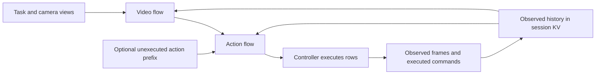

import { DiffusionModelTags } from '/src/snippets/diffusion/model-tags.jsx';
import { Deployment } from '/src/snippets/_deployment.jsx';
import { config } from '/src/snippets/configs/LingBot/lingbot-va.jsx';

<DiffusionModelTags tags={["world action model", "continuous actions", "multi-camera", "session KV", "batched denoising"]} />

## 1. Quick start

Install `pip install -e "python[diffusion]"` from the SGLang checkout. The picker serves one checkpoint on one H200. The Request tab reads the policy metadata. Use the example below to generate the first chunk.

<Deployment config={config} />

## 2. Model capabilities

LingBot-VA predicts future video latents and then conditions a continuous-action flow on those latents. On the next call, the worker updates the session with the camera frames and commands actually executed by the controller. The video latents stay on the worker. The HTTP response contains executable action rows. [Reference implementation](https://github.com/Robbyant/lingbot-va/tree/7c6ffa9bfc4b83582cafc860fab4c82cc7deeeeb)



| Checkpoint | RGB camera keys | First / later action rows | Next observation after first / later chunk | Sampler |
| --- | --- | --- | --- | --- |
| [LIBERO-Long](https://huggingface.co/robbyant/lingbot-va-posttrain-libero-long) | `agentview_rgb`, `eye_in_hand_rgb` | 12 / 16 × 7 | 12 / 16 frames **per camera**, one per executed action | 20 video, 50 action steps |
| [RoboTwin](https://huggingface.co/robbyant/lingbot-va-posttrain-robotwin) | `cam_high`, `cam_left_wrist`, `cam_right_wrist` | 16 / 32 × 16 | 4 / 8 frames **per camera**, one per four executed actions | 25 video, 50 action steps |

The first request takes one RGB frame per camera. LIBERO uses an end-effector translation delta, rotation delta and gripper command. RoboTwin uses the left arm followed by the right arm, each with XYZ, an XYZW quaternion and a gripper value. Send RoboTwin feedback in the policy's relative-to-initial-pose coordinates. The upstream controller composes these poses with the initial end-effector poses before stepping its environment. [RoboTwin client](https://github.com/Robbyant/lingbot-va/tree/7c6ffa9bfc4b83582cafc860fab4c82cc7deeeeb/evaluation/robotwin)

## 3. Generate and continue a chunk

Run this example against the LIBERO server. It uses the release's two example observations and `application/msgpack` with uint8 arrays.

```python
import io
import uuid

import numpy as np
import requests
from PIL import Image
from sglang.multimodal_gen.runtime.entrypoints.action.protocol import pack_msgpack, unpack_msgpack

url = "http://127.0.0.1:30000/v1/actions"
examples = "https://raw.githubusercontent.com/Robbyant/lingbot-va/7c6ffa9bfc4b83582cafc860fab4c82cc7deeeeb/example/libero"
session = uuid.uuid4().hex
images = {}
for key in ("agentview_rgb", "eye_in_hand_rgb"):
    image = requests.get(f"{examples}/observation.images.{key}.png", timeout=30)
    image.raise_for_status()
    images[key] = np.asarray(Image.open(io.BytesIO(image.content)).convert("RGB"))

def generate(images, executed=None):
    obs = {"session_id": session, "images": images}
    if executed is not None:
        obs["executed_actions"] = executed
    body = {"input": {"task": "put both the alphabet soup and the tomato sauce in the basket",
                      "observation": obs}, "parameters": {"seed": 42}}
    response = requests.post(f"{url}/generations", data=pack_msgpack(body),
                             headers={"Content-Type": "application/msgpack", "Accept": "application/msgpack"},
                             timeout=60)
    response.raise_for_status()
    return np.asarray(unpack_msgpack(response.content)["data"][0]["action"]["values"])

actions = generate(images)
print(actions.shape)  # (12, 7)
```

After executing the first chunk, stack the 12 observed frames in chronological order for each camera. Call `generate(observed_images, executed=executed_actions)` with the actual 12 commands. The result has shape `[16, 7]`. At episode end, release the session with `requests.delete(f"{url}/sessions/{session}").raise_for_status()`. Begin each new task with a fresh ID.

### Running multiple robots

Start the LIBERO server with `--batching-mode dynamic --batching-max-size 2 --batching-delay-ms 40`. Requests from different sessions with compatible histories and sampling parameters can share one forward. Each reply reports the executed group size in `extras.policy_batch_size`. A controller sending a deadline can use the [real-time chunk protocol](/docs/sglang-diffusion/api/openai_api#real-time-action-chunks).

On one H200, after warmup, 20 alternating rounds at each concurrency used new LIBERO sessions, the two camera views from the example, the 20/50-step schedule and a 5 s request deadline. Each B2 pair entered the same denoiser forward. The client measured round-trip latency including serialization and queueing.

| Concurrent robots | Requests | On-time chunks/s | p50 | p95 | p99 | Deadline misses |
| --- | ---: | ---: | ---: | ---: | ---: | ---: |
| 1 | 20 | 0.69 | 1.45 s | 1.48 s | 1.49 s | 0 |
| 2 | 40 | 1.33 | 1.50 s | 1.58 s | 1.61 s | 0 |

These timings cover 12-row first chunks over loopback. Camera acquisition, control ticks, WAN transit and steady-state history lengths change the available deadline. The tail percentiles describe this sample.

On one H200 in BF16, with the default denoising schedules, the per-coordinate action RMSE against the original implementation was 0.00221 / 0.00219 (LIBERO) and 0.00151 / 0.00165 (RoboTwin) for the first / second chunk. Each pair used the same seed, example camera inputs and recorded reference actions for the second call. Both checks use repeated camera observations for feedback and measure numerical agreement.

In a LIBERO-10 closed-loop smoke test with the native policy, the first official initial state of each of tasks 0 and 1 reached the environment's success condition in 272 and 280 control steps, respectively. Each episode took 18 model calls. These two episodes exercise feedback over many chunks.
