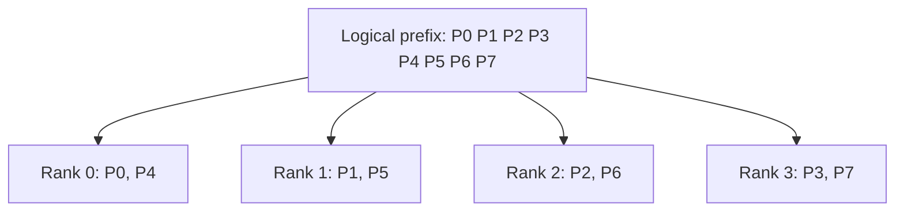

KV cache sharing (KVShard) removes persistent KV replicas across a group of
GPUs. Each rank stores only the pages it owns, while the prefix tree and
scheduler keep a shared logical view. Enable it with
`--enable-kv-cache-sharding` on a supported P/D prefill worker.

[Prefill CP](/docs/advanced_features/prefill_cp) distributes query computation;
KV sharing distributes stored pages. With a fixed pool size per rank, `N`
shard ranks can retain up to `N` times the unique cached tokens, subject to
scratch space and owner imbalance. Cache hits still require communication.

## How it works

### Page ownership and layer gathering

The tree and scheduler use logical token slots. For slot `s`, page size `B`
and shard-group size `N`, the pool maps to owner `(s // B) % N` and local row
`((s // B) // N) * B + s % B`.



This CP4 example starts at owner zero. New paths start on the owner with the
most free pages; extensions inherit the cached path's rotation. Prefix reuse
stays at page granularity `B`. Admission accounts for the most constrained owner.

For each batch, the pool deduplicates cached prefix pages and all-gathers them
into temporary, owner-ordered scratch. Attention and the DSA indexer translate
logical IDs through this mapping. Only owner-selected pages enter persistent
storage. Two scratch slots alternate across layers to overlap the next gather
with current-layer computation.

### HiCache, MTP and P/D

- **HiCache:** Host pages preserve device ownership. Each rank copies only its
  own pages. The gather waits for that layer's H2D completion; attention waits
  for gather completion. Ranks with no local pages still signal completion.
- **MTP:** GLM target and draft KV/indexer state use the same ownership plan
  with separate scratch. Host hits restore both before use. This path supports
  a single NextN layer with EAGLE and top-k one.
- **P/D:** Only P enables sharding. Each owner sends its target/draft KV and
  indexer pages through Mooncake; D receives complete, unsharded cache entries.

The example uses one instance per node:

| Worker | Parallelism | Cache |
| --- | --- | --- |
| Prefill | TP4/CP4, attention TP1 | Sharded GPU cache + CPU HiCache |
| Decode | TP4/EP4, attention DP4/TP1 | Ordinary GPU cache |

Attention DP4 is selected with `--attn-dp-size 4` within the TP4 group.
P/D transport must support both target and draft layouts.

## Deployment example

The following commands launch P TP4/CP4 and D TP4/EP4 on two GB300 nodes,
using four GPUs per node. Replace the example IP addresses and RDMA NIC names
in `kv-shard.env` on both nodes.

```bash
cat > kv-shard.env <<'EOF'
export MODEL_PATH=RadixArk/GLM-5.3-NVFP4
export MODEL_REVISION=6e389189d564d9d3e4ea7fa284fe91f136d8ae2a
export PREFILL_HOST=192.0.2.10
export DECODE_HOST=192.0.2.20
export PREFILL_IB_DEVICES=mlx5_0,mlx5_1,mlx5_2,mlx5_3
export DECODE_IB_DEVICES=mlx5_0,mlx5_1,mlx5_2,mlx5_3
export CUDA_VISIBLE_DEVICES=0,1,2,3
export SGLANG_DISAGG_STAGING_BUFFER=0
export MC_TCP_ENABLE_CONNECTION_POOL=true
unset MC_FORCE_MNNVL SGLANG_MOONCAKE_CUSTOM_MEM_POOL
EOF
```

### Prefill node: TP4/CP4

Run this in its own terminal on the P node.

```bash
source ./kv-shard.env
export SGLANG_UNIFIED_RADIX_TREE_CORE_BACKEND=python
python -m sglang.launch_server \
  --model-path "$MODEL_PATH" \
  --revision "$MODEL_REVISION" \
  --served-model-name glm-kv-shard \
  --trust-remote-code \
  --host 0.0.0.0 \
  --port 30001 \
  --disaggregation-mode prefill \
  --disaggregation-transfer-backend mooncake \
  --disaggregation-bootstrap-port 30200 \
  --disaggregation-ib-device "$PREFILL_IB_DEVICES" \
  --nccl-port 29501 \
  --tp 4 \
  --base-gpu-id 0 \
  --enable-prefill-cp \
  --attn-cp-size 4 \
  --cp-strategy interleave \
  --enable-kv-cache-sharding \
  --dsa-prefill-backend trtllm \
  --dsa-decode-backend trtllm \
  --kv-cache-dtype fp8_e4m3 \
  --page-size 64 \
  --mem-fraction-static 0.9 \
  --chunked-prefill-size 16384 \
  --max-running-requests 32 \
  --enable-hierarchical-cache \
  --hicache-size 240 \
  --hicache-host-memory-mode cache \
  --hicache-write-policy write_through \
  --hicache-io-backend kernel \
  --hicache-mem-layout page_first \
  --bf16-gemm-backend cutedsl \
  --moe-runner-backend flashinfer_cutlass \
  --disable-shared-experts-fusion \
  --speculative-algorithm EAGLE \
  --speculative-num-steps 3 \
  --speculative-eagle-topk 1 \
  --speculative-num-draft-tokens 4 \
  --enable-metrics \
  --enable-metrics-for-all-schedulers \
  --enable-cache-report
```

### Decode node: TP4/EP4

Run this in a separate terminal on the D node. The target uses attention DP4,
FlashInfer A2A and the routed TRTLLM MoE runner with EP4. The EAGLE draft uses
the TP-only path.

```bash
source ./kv-shard.env
python -m sglang.launch_server \
  --model-path "$MODEL_PATH" \
  --revision "$MODEL_REVISION" \
  --served-model-name glm-kv-shard \
  --trust-remote-code \
  --host 0.0.0.0 \
  --port 30003 \
  --disaggregation-mode decode \
  --disaggregation-transfer-backend mooncake \
  --disaggregation-bootstrap-port 30200 \
  --disaggregation-ib-device "$DECODE_IB_DEVICES" \
  --nccl-port 31000 \
  --tp 4 \
  --base-gpu-id 0 \
  --attn-dp-size 4 \
  --ep-size 4 \
  --enable-dp-lm-head \
  --enable-dp-attention-local-control-broadcast \
  --dsa-prefill-backend trtllm \
  --dsa-decode-backend trtllm \
  --kv-cache-dtype fp8_e4m3 \
  --page-size 64 \
  --mem-fraction-static 0.9 \
  --max-running-requests 512 \
  --disable-radix-cache \
  --bf16-gemm-backend cutedsl \
  --moe-a2a-backend flashinfer \
  --moe-runner-backend flashinfer_trtllm_routed \
  --speculative-algorithm EAGLE \
  --speculative-num-steps 3 \
  --speculative-eagle-topk 1 \
  --speculative-num-draft-tokens 4 \
  --speculative-moe-a2a-backend none \
  --speculative-moe-runner-backend flashinfer_trtllm \
  --enable-metrics \
  --enable-metrics-for-all-schedulers \
  --enable-cache-report
```

### Router

After all workers return HTTP 200 from `/health`, run the router on the D
node or another host that can reach both workers. Install the same router
version there. The HTTP endpoints, P bootstrap ports and transport-selected
RDMA ports must be reachable between the nodes.

```bash
source ./kv-shard.env
curl --fail "http://${PREFILL_HOST}:30001/health"
curl --fail "http://${DECODE_HOST}:30003/health"

python -m sglang_router.launch_router \
  --pd-disaggregation \
  --prefill "http://${PREFILL_HOST}:30001" 30200 \
  --decode "http://${DECODE_HOST}:30003" \
  --policy cache_aware \
  --host 0.0.0.0 \
  --port 30000
```

## Validation

Send a request from the router host:

```bash
curl --fail http://127.0.0.1:30000/v1/chat/completions \
  -H 'Content-Type: application/json' \
  -d '{"model":"glm-kv-shard","messages":[{"role":"user","content":"What is 17 + 25?"}],"temperature":0,"max_tokens":128}'
```

For accuracy, run the completion-style GSM8K evaluator:

```bash
set -o pipefail
python -m sglang.test.run_eval \
  --base-url http://127.0.0.1:30000 \
  --model glm-kv-shard \
  --eval-name gsm8k \
  --api completion \
  --num-examples 1319 \
  --num-threads 48 \
  --num-shots 20 \
  --max-tokens 512 \
  --temperature 0 \
  2>&1 | tee gsm8k-sharded-hicache.log
```

The evaluator excludes the 20 demonstrations, leaving 1299 held-out questions.
It does not force GPU eviction or assert host reload. To check L2, reuse a
prefix after unrelated requests evict it from GPU memory, then check
`cached_tokens_details.host` on native `/generate` responses and growth in
`sglang:load_back_tokens_total`. Read one `pool="kv"` / `tp_rank="0"` series
per P instance; logical counters repeat across ranks.

This deployment recipe has not been hardware-validated as part of this change.
The [registered hardware tests](https://github.com/sgl-project/sglang/blob/0f214cb6de059713a44d05055ed9a5e849f12ecd/test/registered/e2e/models/test_dsa_glm52_pd_kv_shard_hicache.py)
run on four GB300 GPUs with P2/D2 and CP2, including the full GSM8K accuracy
case. They use GLM-5.2 and different cache/MTP settings; the accuracy floor
is not a validated GLM-5.3 baseline.
Keep the source SHA, model revision, dependency
manifest, GPU/RDMA topology, resolved arguments, logs and scores for each run.

## References

- [Prefill context parallelism](/docs/advanced_features/prefill_cp)
- [HiCache design](/docs/advanced_features/hicache_design)
- [GLM-5.3 cookbook](/cookbook/autoregressive/GLM/GLM-5.3)
- [KVShard GLM DSA/MTP integration](https://github.com/sgl-project/sglang/pull/42973)
