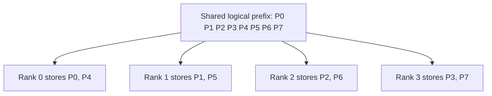
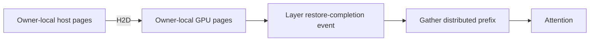

KV cache sharing (KVShard) removes persistent KV replicas across a group of
GPUs. Each rank retains only the pages it owns, while the prefix tree and
scheduler keep a shared logical view of every request. Enable it with
`--enable-kv-cache-sharding` on a supported P/D prefill worker.

[Prefill context parallelism](/docs/advanced_features/prefill_cp) distributes
computation across query tokens. KV sharing distributes the resulting **stored
pages**. These are separate choices: enabling CP alone does not imply that the
persistent KV cache is sharded.

This guide explains the page-based design and its GLM DSA/MTP integration with
CPU [HiCache](/docs/advanced_features/hicache). The default deployment uses one
TP8/CP8 prefill instance and one TP8/attention-DP8/EP8 decode instance on separate
eight-GPU nodes. Two independent TP4/CP4 prefill instances are an alternative.

## Why share the KV cache?

Long prompts and repeated agent conversations can fill GPU cache with copies
of the same prefix. CP distributes attention and indexer work, but can still
leave identical cached history on every CP rank.

KV sharing removes these replicas:

- With prefill CP, attention-CP ranks form the shard group.
- Without CP, supported plain-TP MLA paths can shard replicated latent KV
  across attention-TP ranks.
- GQA without CP already shards KV heads across TP and has no equivalent
  replicated axis to remove.

For a fixed persistent pool size per rank, a group of `N` ranks can retain up
to `N` times the unique cached tokens. Scratch buffers and uneven free-page
availability reduce the usable capacity. A cache hit still requires per-layer
KV communication, so extra capacity is not a guarantee of lower latency.

## Architecture

### Page ownership and the logical prefix

The prefix tree, request-to-token table and scheduler use logical token slots.
The pool maps each slot to its owner and physical row. For logical slot `s`,
page size `B` and shard-group size `N`:

```text
logical_page = s // B
owner        = logical_page % N
local_row    = (logical_page // N) * B + s % B
```

Allocation rotates successive request pages across owners. A new cached path
starts on the rank with the most free pages; a request extending a cached
prefix inherits that path's rotation. The tree rejects insertions that would
join incompatible rotations.



This CP4 example starts at owner zero. Prefix reuse stays at the physical page
granularity `B`, not `N * B`: a three-page prefix remains reusable even when
the shard group has four ranks. Reclamation returns each page to its owner's
free list. Admission accounts for the most constrained owner.

### Reconstruct one layer at a time

Attention needs the prefix history even though each rank stores only part of
it. For each batch, the pool deduplicates shared prefix pages and maps them into
temporary scratch space:

```text
[owner-ordered cached prefix | current chunk | padding page]
```

Each rank packs its owned prefix pages into an equally sized block, padding
unused entries. An all-gather assembles these blocks in owner order. Attention
page tables and DSA indexer accesses translate logical IDs through the batch's
scratch mapping. The full current chunk is staged locally at the write
boundary; only owner-selected pages enter persistent storage.

Two scratch slots alternate across layers. A dedicated communicator and stream
gather the next layer while the current layer executes. Target and draft
scratch are included in the KV-memory budget, and scheduler admission checks
that a batch fits.

Eligible single-node CUDA shard groups can use NCCL copy-engine gathering with
`SGLANG_ENABLE_KV_SHARD_ZERO_SM_GATHER`. The implementation requires NCCL
2.31.2 or newer, no memory saver and no custom memory pool. Unsupported
configurations, or unsuccessful symmetric-window registration, retain
SM-based NCCL gathering. This is separate from Mooncake's P/D transport.

## Compositions

### KV sharing × HiCache

Host pages preserve the same ownership as device pages. Logical indices remain
in the tree and transfer queues; immediately before a copy, each rank selects
its own source/destination pairs and translates them to local physical rows.
The existing transfer controller and kernels move those rows between that
rank's GPU and host memory.



The gather stream waits for the layer's restore-completion event before reading
GPU pages. Attention waits for the gather's ready event. Ranks with no local
pages still publish completion events so completion processing stays aligned.

Sharding reduces each rank's payload, but aggregate host bandwidth depends on
the machine's PCIe/CPU topology and competing traffic. It does not combine the
host memory of separate prefill instances into one cache.

### KV sharing × MTP

The GLM path applies the same ownership plan to target and draft latent KV and
DSA indexer keys/scales. Target and draft share compatible logical allocation
geometry, and each has its own assembly scratch.

A host-cache hit must restore draft state as well as target state. Packed draft
KV/indexer restores complete before the target's first-layer readiness event;
the draft gather stream observes the same completion counter. This combination
supports a single GLM NextN layer with EAGLE and top-k one.

### KV sharing × P/D disaggregation

Only the prefill side enables KV sharing. Each sender pairs source pages with
decode destination pages before filtering by owner. Owners transfer their
target/draft KV and indexer state; decode receives complete ordinary cache
entries. Empty final chunks still participate in completion.

Attention CP on P and attention DP/EP on D are different layouts. For the
default example:

```text
P node: --tp 8 --attn-cp-size 8
        one prefill instance; attention CP8 / attention TP1

D node: --tp 8 --attn-dp-size 8 --ep-size 8
        one decode instance; attention DP8 / attention TP1; MoE EP8
```

`--attn-dp-size 8` is the canonical spelling of attention DP. It does not
create eight independent TP8 model replicas. P/D transport must support the
selected target and draft layouts; matching `--tp` alone is not sufficient.

### Supported GLM configuration

| Component | Supported setting |
| --- | --- |
| Platform | Linux, NVIDIA CUDA; the NVFP4 examples require Blackwell GPUs |
| Prefill | P/D prefill, interleave CP greater than one, PP1 |
| Attention | TRTLLM DSA prefill/decode, FP8 E4M3 KV, page size 64 |
| Indexer | Uncompressed `index_kpool=1`; no DSA cache LayerSplit |
| Transfer | Mooncake, with disaggregation staging buffers disabled |
| MTP | GLM DSA single-layer NextN, EAGLE, top-k one |
| HiCache | CPU L2, `cache` mode, `kernel` I/O, `page_first` or `layer_first` |
| Tree | Python UnifiedRadixCache tree backend |

The GLM combination does not support zigzag, L3 storage/runtime attachment,
buffer-only host mode, external cache linkers, HiSparse, DCP or two-batch
overlap. P-side prefill/speculative CUDA graphs and generic FlashInfer
autotuning are disabled for the sharded path. Decode remains unsharded.

## Deployment example

### Prerequisites

Use two Linux nodes, each with eight Blackwell B300-class GPUs. The nodes need
working Mooncake RDMA connectivity, matching model weights and compatible
CUDA 13 dependencies. Configure the container's GPU, RDMA-device and pinned
host-memory access before launching; see
[installation](/docs/get-started/install) and
[Mooncake requirements](/docs/advanced_features/pd_disaggregation#requirements).

The recipe uses the publicly available `RadixArk/GLM-5.3-NVFP4` checkpoint.
All workers use the same fixed model revision. It reproduces the serving
topology and engine settings; it does not include private deployment wrappers
or their monitoring integrations.

The prefill host-cache budget is **240 GB per rank**: approximately 1.92 TB
across eight P ranks, plus runtime and OS memory. Two TP4/CP4 instances each
budget approximately 960 GB. Reduce `--hicache-size` on machines with less
host memory and record that change when comparing results.

From a checkout containing the KVShard integration, prepare the same
environment on both nodes. To reproduce this recipe's source snapshot:

```bash
git fetch https://github.com/sgl-project/sglang.git refs/pull/46789/head
git checkout --detach 065adbfa003138b99972fc3acbcd491828654241
python3 -m venv .venv
source .venv/bin/activate
python -m pip install --upgrade pip
python -m pip install -e "python[test]"
python -m pip install "mooncake-transfer-engine-cuda13==0.3.13.post1" "sglang-router==0.3.2"
git rev-parse HEAD
python -m pip freeze > environment.txt
nvidia-smi
```

Use an already prepared CUDA environment if your platform needs custom
dependency installation. Do not mix CUDA 12 and CUDA 13 Mooncake packages.
The Mixed-MoE CI test uses DeepEP, whereas this serving recipe uses FlashInfer
MoE on D.

Create `kv-shard.env` in the repository root on each node. Replace the
documentation IP addresses and RDMA names with the addresses reachable from
the other node and the actual NICs reported by `ibv_devices`. Set
`MC_GID_INDEX` separately if your RoCE network requires it; its value is
network-specific. No Hugging Face token is required for this public checkpoint.

```bash
cat > kv-shard.env <<'EOF'
export MODEL_PATH=RadixArk/GLM-5.3-NVFP4
export MODEL_REVISION=6e389189d564d9d3e4ea7fa284fe91f136d8ae2a
export PREFILL_HOST=192.0.2.10
export DECODE_HOST=192.0.2.20
export PREFILL_IB_DEVICES=mlx5_0,mlx5_1,mlx5_2,mlx5_3,mlx5_4,mlx5_5,mlx5_6,mlx5_7
export PREFILL0_IB_DEVICES=mlx5_0,mlx5_1,mlx5_2,mlx5_3
export PREFILL1_IB_DEVICES=mlx5_4,mlx5_5,mlx5_6,mlx5_7
export DECODE_IB_DEVICES=mlx5_0,mlx5_1,mlx5_2,mlx5_3,mlx5_4,mlx5_5,mlx5_6,mlx5_7
export CUDA_VISIBLE_DEVICES=0,1,2,3,4,5,6,7
export SGLANG_DISAGG_STAGING_BUFFER=0
export MC_TCP_ENABLE_CONNECTION_POOL=true
unset MC_FORCE_MNNVL SGLANG_MOONCAKE_CUSTOM_MEM_POOL
EOF
```

These commands use RDMA between nodes. They do not use the separate
single-host GB300 fabric-NVLink configuration. Keep all eight local GPUs
visible in every worker terminal; `--base-gpu-id` selects the local subset.

### Prefill node: TP8/CP8

Run this in its own terminal on the P node.

```bash
source .venv/bin/activate
source ./kv-shard.env
export SGLANG_UNIFIED_RADIX_TREE_CORE_BACKEND=python
python -m sglang.launch_server \
  --model-path "$MODEL_PATH" \
  --revision "$MODEL_REVISION" \
  --served-model-name glm-kv-shard \
  --trust-remote-code \
  --host 0.0.0.0 \
  --port 30001 \
  --disaggregation-mode prefill \
  --disaggregation-transfer-backend mooncake \
  --disaggregation-bootstrap-port 30200 \
  --disaggregation-ib-device "$PREFILL_IB_DEVICES" \
  --nccl-port 29501 \
  --tp 8 \
  --base-gpu-id 0 \
  --enable-prefill-cp \
  --attn-cp-size 8 \
  --cp-strategy interleave \
  --enable-kv-cache-sharding \
  --dsa-prefill-backend trtllm \
  --dsa-decode-backend trtllm \
  --kv-cache-dtype fp8_e4m3 \
  --page-size 64 \
  --mem-fraction-static 0.9 \
  --chunked-prefill-size 16384 \
  --max-running-requests 32 \
  --enable-hierarchical-cache \
  --hicache-size 240 \
  --hicache-host-memory-mode cache \
  --hicache-write-policy write_through \
  --hicache-io-backend kernel \
  --hicache-mem-layout page_first \
  --bf16-gemm-backend cutedsl \
  --moe-runner-backend flashinfer_cutlass \
  --disable-shared-experts-fusion \
  --speculative-algorithm EAGLE \
  --speculative-num-steps 3 \
  --speculative-eagle-topk 1 \
  --speculative-num-draft-tokens 4 \
  --enable-metrics \
  --enable-metrics-for-all-schedulers \
  --enable-cache-report
```

### Decode node: attention-DP8/EP8

Run this in a separate terminal on the D node. The target uses FlashInfer A2A
and the routed TRTLLM MoE runner. The EAGLE draft uses the TP-only path.

```bash
source .venv/bin/activate
source ./kv-shard.env
python -m sglang.launch_server \
  --model-path "$MODEL_PATH" \
  --revision "$MODEL_REVISION" \
  --served-model-name glm-kv-shard \
  --trust-remote-code \
  --host 0.0.0.0 \
  --port 30003 \
  --disaggregation-mode decode \
  --disaggregation-transfer-backend mooncake \
  --disaggregation-bootstrap-port 30200 \
  --disaggregation-ib-device "$DECODE_IB_DEVICES" \
  --nccl-port 31000 \
  --tp 8 \
  --base-gpu-id 0 \
  --attn-dp-size 8 \
  --ep-size 8 \
  --enable-dp-lm-head \
  --enable-dp-attention-local-control-broadcast \
  --dsa-prefill-backend trtllm \
  --dsa-decode-backend trtllm \
  --kv-cache-dtype fp8_e4m3 \
  --page-size 64 \
  --mem-fraction-static 0.9 \
  --max-running-requests 512 \
  --disable-radix-cache \
  --bf16-gemm-backend cutedsl \
  --moe-a2a-backend flashinfer \
  --moe-runner-backend flashinfer_trtllm_routed \
  --speculative-algorithm EAGLE \
  --speculative-num-steps 3 \
  --speculative-eagle-topk 1 \
  --speculative-num-draft-tokens 4 \
  --speculative-moe-a2a-backend none \
  --speculative-moe-runner-backend flashinfer_trtllm \
  --enable-metrics \
  --enable-metrics-for-all-schedulers \
  --enable-cache-report
```

### Router

After all workers return HTTP 200 from `/health`, run the router on the D
node or another host that can reach both workers. Install the same router
version there. The HTTP endpoints, P bootstrap ports and transport-selected
RDMA ports must be reachable between the nodes.

```bash
source .venv/bin/activate
source ./kv-shard.env
curl --fail "http://${PREFILL_HOST}:30001/health"
curl --fail "http://${DECODE_HOST}:30003/health"

python -m sglang_router.launch_router \
  --pd-disaggregation \
  --prefill "http://${PREFILL_HOST}:30001" 30200 \
  --decode "http://${DECODE_HOST}:30003" \
  --policy cache_aware \
  --host 0.0.0.0 \
  --port 30000
```

### Alternative: two TP4/CP4 prefill instances

On the P node, stop the TP8/CP8 instance first. Run the following two commands
in separate terminals. They use independent prefix trees and host caches.
The D command stays unchanged.

**P0: GPUs 0–3**

```bash
source .venv/bin/activate
source ./kv-shard.env
export SGLANG_UNIFIED_RADIX_TREE_CORE_BACKEND=python
python -m sglang.launch_server \
  --model-path "$MODEL_PATH" \
  --revision "$MODEL_REVISION" \
  --served-model-name glm-kv-shard \
  --trust-remote-code \
  --host 0.0.0.0 \
  --port 30001 \
  --disaggregation-mode prefill \
  --disaggregation-transfer-backend mooncake \
  --disaggregation-bootstrap-port 30200 \
  --disaggregation-ib-device "$PREFILL0_IB_DEVICES" \
  --nccl-port 29501 \
  --tp 4 \
  --base-gpu-id 0 \
  --enable-prefill-cp \
  --attn-cp-size 4 \
  --cp-strategy interleave \
  --enable-kv-cache-sharding \
  --dsa-prefill-backend trtllm \
  --dsa-decode-backend trtllm \
  --kv-cache-dtype fp8_e4m3 \
  --page-size 64 \
  --mem-fraction-static 0.9 \
  --chunked-prefill-size 16384 \
  --max-running-requests 32 \
  --enable-hierarchical-cache \
  --hicache-size 240 \
  --hicache-host-memory-mode cache \
  --hicache-write-policy write_through \
  --hicache-io-backend kernel \
  --hicache-mem-layout page_first \
  --bf16-gemm-backend cutedsl \
  --moe-runner-backend flashinfer_cutlass \
  --disable-shared-experts-fusion \
  --speculative-algorithm EAGLE \
  --speculative-num-steps 3 \
  --speculative-eagle-topk 1 \
  --speculative-num-draft-tokens 4 \
  --enable-metrics \
  --enable-metrics-for-all-schedulers \
  --enable-cache-report
```

**P1: GPUs 4–7**

```bash
source .venv/bin/activate
source ./kv-shard.env
export SGLANG_UNIFIED_RADIX_TREE_CORE_BACKEND=python
python -m sglang.launch_server \
  --model-path "$MODEL_PATH" \
  --revision "$MODEL_REVISION" \
  --served-model-name glm-kv-shard \
  --trust-remote-code \
  --host 0.0.0.0 \
  --port 30002 \
  --disaggregation-mode prefill \
  --disaggregation-transfer-backend mooncake \
  --disaggregation-bootstrap-port 30210 \
  --disaggregation-ib-device "$PREFILL1_IB_DEVICES" \
  --nccl-port 29502 \
  --tp 4 \
  --base-gpu-id 4 \
  --enable-prefill-cp \
  --attn-cp-size 4 \
  --cp-strategy interleave \
  --enable-kv-cache-sharding \
  --dsa-prefill-backend trtllm \
  --dsa-decode-backend trtllm \
  --kv-cache-dtype fp8_e4m3 \
  --page-size 64 \
  --mem-fraction-static 0.9 \
  --chunked-prefill-size 16384 \
  --max-running-requests 32 \
  --enable-hierarchical-cache \
  --hicache-size 240 \
  --hicache-host-memory-mode cache \
  --hicache-write-policy write_through \
  --hicache-io-backend kernel \
  --hicache-mem-layout page_first \
  --bf16-gemm-backend cutedsl \
  --moe-runner-backend flashinfer_cutlass \
  --disable-shared-experts-fusion \
  --speculative-algorithm EAGLE \
  --speculative-num-steps 3 \
  --speculative-eagle-topk 1 \
  --speculative-num-draft-tokens 4 \
  --enable-metrics \
  --enable-metrics-for-all-schedulers \
  --enable-cache-report
```

Restart the router with both P endpoints and their distinct bootstrap ports.
The cache-aware policy can route related prefixes to the same P instance;
the two instances do not share a cache merely because they run on one node.

```bash
source .venv/bin/activate
source ./kv-shard.env
curl --fail "http://${PREFILL_HOST}:30001/health"
curl --fail "http://${PREFILL_HOST}:30002/health"
curl --fail "http://${DECODE_HOST}:30003/health"

python -m sglang_router.launch_router \
  --pd-disaggregation \
  --prefill "http://${PREFILL_HOST}:30001" 30200 \
  --prefill "http://${PREFILL_HOST}:30002" 30210 \
  --decode "http://${DECODE_HOST}:30003" \
  --policy cache_aware \
  --host 0.0.0.0 \
  --port 30000
```

## Validation

### Check serving and collect results

From the router host, send a request using the common served model name:

```bash
curl --fail http://127.0.0.1:30000/v1/chat/completions \
  -H 'Content-Type: application/json' \
  -d '{"model":"glm-kv-shard","messages":[{"role":"user","content":"What is 17 + 25?"}],"temperature":0,"max_tokens":128}'
```

To run the same completion-style GSM8K evaluator used by the E2E suite:

```bash
source .venv/bin/activate
set -o pipefail
python -m sglang.test.run_eval \
  --base-url http://127.0.0.1:30000 \
  --model glm-kv-shard \
  --eval-name gsm8k \
  --api completion \
  --num-examples 1319 \
  --num-threads 48 \
  --num-shots 20 \
  --max-tokens 512 \
  --temperature 0 \
  2>&1 | tee gsm8k-production-topology.log
```

The evaluator excludes the 20 demonstrations, leaving 1299 held-out questions.
This command reports accuracy on the configured model and serving topology.
It does not itself force host eviction or assert an H2D reload. Do not apply
the GLM-5.2 CI threshold to GLM-5.3 as a validated baseline.

For L2 validation, reuse a prefix after unrelated requests have evicted it from
GPU memory. Check `cached_tokens_details.host` on native `/generate` responses
and the selected P instance's `sglang:load_back_tokens_total`. A device hit
alone does not establish host reload. Logical token counters repeat across
ranks: read one `pool="kv"` / `tp_rank="0"` series per P instance rather than
summing duplicate rank counts.

### Reproduce the registered hardware tests

The test file also contains controlled hardware regressions. These launch and
stop their own P/D workers and router; run them on an isolated host, separately
from the manual deployment above.

On eight visible B300 GPUs, run the full GLM-5.2 accuracy case:

```bash
source .venv/bin/activate
source ./kv-shard.env
export SGLANG_TEST_PD_DISAGG_DEVICES="$PREFILL_IB_DEVICES"
set -o pipefail
python test/registered/e2e/models/test_dsa_glm52_pd_kv_shard_hicache.py \
  TestGLM52PDShardedHiCacheAccuracy.test_gsm8k \
  -v -f \
  2>&1 | tee gsm8k-sharded-hicache.log
```

Run the Mixed-MoE case separately with
`TestGLM52PDShardedHiCacheAccuracyMixedMoE.test_gsm8k`. It requires the
compatible DeepEP dependency from the CUDA test environment.

These tests use `nvidia/GLM-5.2-NVFP4`, P4/D4, smaller cache pools, 5-step
EAGLE and six draft tokens. They seed the exact 20-shot prefix, wait for D2H,
apply cache pressure, and require H2D growth during scoring. Their floors are
0.935 for the full run and 0.8 for the 32-question Mixed-MoE smoke.
They are different configurations from the production-topology recipe.

The four-GB300 case,
`TestGLM52PDShardedHiCache.test_mtp_answer_survives_pd_and_host_reload`,
checks exact cold/device-hit/host-reload answers, host hits and MTP activity
using its own fabric-NVLink settings. Its GPU-count guard requires exactly
four visible GPUs; the accuracy cases require at least eight. A skipped test
is not a successful hardware validation.

Keep the source SHA, model revision, dependency manifest, GPU/RDMA topology,
resolved server arguments, logs and scores with each run. Stop evaluation
traffic before stopping the router and worker terminals.

## References

- [Prefill context parallelism](/docs/advanced_features/prefill_cp)
- [HiCache design](/docs/advanced_features/hicache_design)
- [GLM-5.3 cookbook](/cookbook/autoregressive/GLM/GLM-5.3)
- [KVShard GLM DSA/MTP integration](https://github.com/sgl-project/sglang/pull/42973)
- [Hardware E2E source](https://github.com/sgl-project/sglang/blob/065adbfa003138b99972fc3acbcd491828654241/test/registered/e2e/models/test_dsa_glm52_pd_kv_shard_hicache.py)
