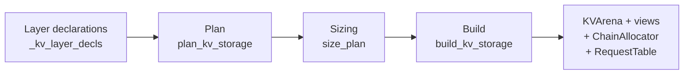
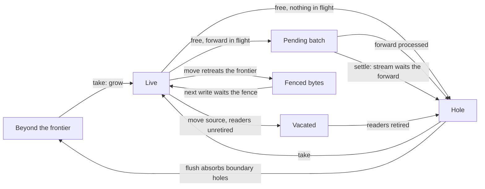

This page is for contributors changing `python/sglang/srt/mem_cache/kv/`, or code that allocates, frees, moves or transfers its pages. For what unified memory is and how to enable it, read [Unified Memory for Hybrid Models](/docs/advanced_features/unified_memory) first.

Code is named as `path::Symbol`. Modules of the KV package are given relative to `python/sglang/srt/mem_cache/kv/` (for example `alloc/band.py`), other runtime modules relative to `python/sglang/srt/` (for example `managers/scheduler.py`), and tests relative to the repository root.

## Module map

| Module | Role |
|---|---|
| `decl.py` | What each layer stores: `KVLayerDecl` with parts, each a geometry (MHA, MLA, state) and a lifetime (`FullLifetime`, `WindowLifetime(window)`, `StateLifetime(checkpoint_interval)`) |
| `plan.py` | `plan_kv_storage`: groups parts into sub-pools and orders them into a chain (`KVStoragePlan`) |
| `sizing.py` | `size_plan`: solves the byte budget into token, window and state targets, concurrency and fixed allocations |
| `memory/arena.py` | `KVArena`: the one `uint8` device region that holds every band |
| `layout/` | Per-layout entry geometry, the typed views kernels read and write, and host layouts |
| `alloc/band.py` | `Band` (an end of the chain) and `FloatBand` (a band between the ends): pages, frontiers, frees, takes, compaction |
| `alloc/chain.py` | `ChainAllocator`: one allocator over all bands; every capacity question and every chain allocation |
| `alloc/stage_capacity.py` | Capacity under pipeline parallelism: each stage's geometry (`StageGeometry`), its simulated snapshot (`simulated_snapshot`) and the decision digest (`StageCapacity`) |
| `alloc/pricing.py` | Pure capacity pricing over a host-only snapshot: `feasible`, `plan`, `first_plan` |
| `alloc/demand.py` | `KVDemand` and `request_demand`: what a request needs from each sub-pool |
| `alloc/forward_steps.py` | `ForwardSteps` and `PendingPages`: pages freed while a forward may still touch them |
| `alloc/page_usage.py` | `PageUsage`, the per-band page ledger, and the `CLEARANCE` rule |
| `alloc/signals.py` | What a wait waits for: CUDA events, host copies, network transfers |
| `alloc/id_space.py`, `alloc/runner_ids.py`, `alloc/iteration_ids.py` | Virtual-to-physical ids per sub-pool, and their translation once per iteration |
| `requests.py` | `RequestTable`: the request rows, holding virtual ids only; `RowResets`: rows whose request state the next forward resets |
| `storage.py` | `KVStorage`: the interface the scheduler, the prefix tree, HiCache and PD use |
| `build.py` | `build_kv_storage`: plan, size, then construct |

The entry point is `mem_cache/kv_cache_configurator.py::KVCacheConfigurator._init_unified_pools`, after `_unified_config_from_budget` has sized the plan.

## From declarations to an arena



1. **Declare.** `KVCacheConfigurator._kv_layer_decls` describes each local layer with `decl.py::kv_layer_decls`: a full-attention part, a window part per window length, a state part, or an attention part and a state part together.
2. **Plan.** `plan.py::plan_kv_storage` groups parts with the same lifetime and allocation unit into one sub-pool. It refuses a plan without a full-attention owner and two geometries in one sub-pool. It sorts the sub-pools by lifetime rank (state, then windows from the longest, then full attention): the first takes the grow-up end, the last the grow-down end, the rest float. A fused draft's window of a lifetime the target lacks becomes a band of its own; a draft with recurrent layers needs the target's state band with a checkpoint policy, and is refused at startup otherwise (`mem_cache/layout/fused_draft.py::place_fused_draft`).
3. **Size.** `sizing.py::size_plan` solves one byte budget for the concurrency it can serve: fixed allocations (the request table, scratch and request rows), state slots (a share of the chain or an explicit count), then the most full-attention tokens whose window targets also fit. It refuses a budget below the floor of one request at batch size 1, its window rows, state slots and the sink (`_bs1_floor_terms`, checked by `check_bs1_floor`); whether a whole request fits, its full-attention tokens included, is checked at the memory clip and at admission. These are boot targets: at run time any sub-pool can take any free bytes.
4. **Build.** `build.py::build_kv_storage` allocates the arena, one view per sub-pool, a `routed_cache.py::RoutedKVCache` over the token views, the `ChainAllocator` and the `RequestTable`, and returns a `KVStorage`.

### Ids

A token slot has a **virtual id**, which the scheduler allocates and `req_to_token` stores, and in each sub-pool a **physical id**, which that sub-pool's kernels index. The full-attention band mints the virtual pages; a window band binds physical pages to the owner's virtual pages, and a virtual page it leaves unbound reads as the sink. The state band has its own slot id space. Each band keeps its mapping in `alloc/id_space.py::UnitIds`.

Because requests hold virtual ids, a page can move without rewriting any request row. Writes are translated once per sub-pool per iteration (`alloc/iteration_ids.py::IterationIds`), reads once by `alloc/runner_ids.py::RunnerIds`; a kernel never translates.

## Capacity and admission

Sub-pools share the arena's bytes, and a request's demand mixes per-token units (full-attention tokens, window rows) with per-request units (state slots) in proportions that differ by request, so no scalar count of free units says whether a demand fits. Every capacity decision asks a concrete demand (`alloc/demand.py::KVDemand`, or pages per band): `ChainAllocator.admits`, `units_fit`, `ensure_capacity` and `fits_after_frees`, or the entry points of `mem_cache/capacity.py`, which combine the prefix cache's eviction with the allocator's answer. Each is one layout search over the bands, priced on a host-only snapshot.

- `alloc/pricing.py::snapshot_chain` records each band's counts and byte frontiers, never hole positions, so pricing never synchronizes with the device. `ChainAllocator.pricing_snapshot` keeps a snapshot until a capacity epoch moves; every rebind of a capacity field (`alloc/band.py::_CapacityField`) moves it.
- `alloc/pricing.py::plan` asks whether a layout serves a demand (pages per band) under one rearrangement step: `NO_MOVE` (bands in place, reusing holes and extending one side), `FLUSH_ENDS` (ends compacted) or `RELAYOUT` (floats relocated between compacted ends).
- `alloc/pricing.py::feasible` is the one capacity question: is there any reachable layout? `first_plan` finds the least rearrangement that serves the demand.
- `ChainAllocator.ensure_capacity` and `units_fit` answer the question the take itself answers, so a yes here is a successful take.

**Estimates.** The scalar reads the allocator interface still requires (`ChainAllocator.available_size`, `full_available_size`, `window_available_size`, `usage`, and `estimated_units_available` behind them) are estimates from free bytes, index space and id room, which ignore alignment, fixed and pending pages. They serve stats, metrics, logs and error text only. The units each sub-pool holds stay exact, so leak checks stay exact. Decision paths are marked with `mem_cache/capacity.py::capacity_decision`; an estimate read inside one raises at `SGLANG_INVARIANT_CHECK=2` and logs once at `1` (`observe_only_read`).

**Admission.** `mem_cache/prefill_budget.py::ChainPrefillBudget` charges each request its full-attention tokens (input plus expected output), for each window sub-pool at most the window it retains plus this pass's transient tail, and its state slots in full. `ChainAllocator.admits` then checks the owner's free virtual ids and the state sub-pool's free slots, and calls `feasible` on `alloc/pricing.py::reclaimed_snapshot`, which credits what the prefix cache could evict per sub-pool. Which entries to evict is the cache's decision; the allocator only answers whether a demand fits (`fits_after_frees` stops an eviction walk). A request that fits an empty pool but no chunk of which fits now waits only while something will give memory back: work admitted earlier in the pass, a forward in flight, a host copy in flight, or a request row other work holds (`ChainPrefillBudget._waiting_frees_memory`). Otherwise it takes the largest chunk limit at which all of it fits now, and when none does the scheduler aborts it as unschedulable instead of queueing it forever. Priority preemption is off under unified memory (`Scheduler.init_schedule_policy`): it does not yet ask admission whether its victims make room. A PD decode node's preallocation charges what its budgets hold back for pending work beside the request (`ChainAllocator.prealloc_fits`).

**Request demand.** `alloc/demand.py::request_demand` prices one request wherever its demand is asked, by the purpose's row of `DEMAND_RULES` (`DemandPurpose.CEILING`, `ADMIT`, `LOAD_BACK`, `DECODE_PREALLOC`). A window's peak follows when the scheduler retires its rows (`window_retirement`) and the retention floor of state checkpoints. `ChainAllocator.max_new_tokens_for_memory` uses the same function for the memory clip of an arriving request, so the clip and admission share one demand model. Its window bound assumes the request's state checkpoints advance: when no tracking or replacement state slot is free, a request can hold more window rows than it was priced for (see [Known limitations](#known-limitations)).

**Pipeline parallelism.** Each stage keeps its own arena, whose bytes and per-sub-pool unit bytes follow its layers, but every stage runs the same logical operations and so holds the same units. `KVCacheConfigurator._unified_config_from_budget` MIN-reduces the concurrency across stages. Every stage must plan a full-attention virtual-id owner (`plan.py::plan_kv_storage` refuses a plan without one), and all stages the same sub-pools on the same page size (`ChainAllocator.install_stage_capacity` refuses any other), so a layer partition that leaves a stage with only window or state layers, or with a layer kind or window length another stage lacks, fails. When the pipeline loop starts, after any post-capture resize, the stages all-gather their geometry (arena bytes, and each band's unit bytes, page counts and id counts) and install it (`ChainAllocator.install_stage_capacity`). From then on every capacity question (`units_fit`, `admits`, a take, the owner's id shortfall) is asked of a simulated snapshot of every stage, built from that stage's geometry and the shared logical counts (`alloc/stage_capacity.py::simulated_snapshot`), the stage's own included; a demand fits only where it fits on every stage. Estimates are read from the same snapshots. The answers depend on shared state alone, so every stage reaches the same decisions with no relay between stages, as tensor-parallel ranks do. A decided take is realizable on every stage's real layout: the only pages fixed there are a HiCache load's window reservation, which ends inside the load-back's physical-take scope once the tree names the rows (`UnifiedRadixCache.name_loaded_window_rows_by_owner`), and that scope lays out all of the load's takes beforehand. There is no separate full-attention live-token cap. At `SGLANG_INVARIANT_CHECK` `1` and above, each stage folds its questions, their answers and the units it holds into a digest (`StageCapacity.take_digest`) and sends it to the next stage right after each iteration's requests; a stage whose digest differs from the previous stage's fails `chain.stage_capacity_agreement`. These checks need `--scheduler-recv-interval 1`.

## Allocation

A band hands out writable pages in one place, `Band._acquire`, in this order:

1. **Holes**: free pages inside the band's span.
2. **Pending pages**: if holes are short, the oldest whole pending batches that cover the rest settle (`Band.settle_pending`: the current stream waits their forwards) and become holes.
3. **Frontier growth**: the band extends toward its neighbour. A float grows toward its larger gap; an empty float is placed at the middle of its region.

Every failure check runs before a settle, so a refused take changes nothing. Capacity counts pages in the same order.

A chain allocation (`ChainAllocator._plan_and_take`) adds the rearrangement, *relief*, around the per-band takes:

1. Plan in place, keeping out of bytes a network send still reads. If that serves the demand, take.
2. Otherwise, if `feasible` says no, refuse before any pending page settles.
3. Otherwise enter urgent recovery (`alloc/band.py::settle_pending_for_recovery`): read ahead on the host everything the layout will read (free lists, pending pages, in-flight write sets, transfer pages), then settle every pending batch of every band and park floats left empty.
4. Plan with rows that unreleased network transfers touch fixed in place (`ChainAllocator._relief_plan`). Only if no such layout exists, plan with every byte, which may wait on the host for a transfer.
5. `ChainAllocator.realize`: compact the listed ends (`Band.flush_for_allocation`), relocate floats in an order where none is copied into a block another still holds (`alloc/pricing.py::move_order`, `FloatBand.relocate_into`), then take each band's pages in chain order.

A single band that is short (a HiCache load's take, for example) calls `Band.relieve`, which runs the same relief through `ChainAllocator.lay_out_for`.

**Zeroing.** MHA and MLA bands zero page envelopes on hand-out (`Band._maybe_zero_pages`): kernels that load whole pages give rows past the sequence length zero weight, so a NaN left there, or a neighbouring state band's FP32 bytes read as BF16, would still reach the output.

## Compaction

Compaction is lazy. A free leaves a hole; holes are closed later, by moves on the schedule stream that are ordered behind every forward and transfer that may still touch the pages.

| | Opportunistic flush | Urgent flush |
|---|---|---|
| Entry | `ChainAllocator.flush_opportunistic`, at the overlap loop's early-processing point and at idle | Relief, through `Band.flush_for_allocation` |
| Waits on an unretired forward | Never: it stops instead. It may queue stream waits on retired forwards, whose tails can still run | Yes: the writers of the pages it moves, after its recovery entry settled the band |
| Moves | At most `SGLANG_LAZY_COMPACTION_MAX_MOVES_PER_CALL` per band | Uncapped: packs every live page toward the band's end |
| Stops at | A source an unfinished forward writes, or a fixed page. A band holding receive rows that await publication is left alone | Nothing but fixed pages, which never move |
| Band with pending pages | Absorbs boundary holes only; the frontier never retreats over a pending page | Settled first |
| Forward whose writes are unknown (speculative steps) | Nothing moves until it retires | Waits it |

A move copies live pages from sources to holes and rebinds their virtual pages (`Band._commit_move_batch`). Before copying, it waits the newest unfinished forward and every transfer that writes a source (`Band._wait_writers`). A source some reader may still read is not reused at once:

- while an unretired forward or an unreleased network transfer may read it, it stays pending inside the band as a *vacated* ledger use (`PageUsage.take_ready_vacated`);
- once only a host copy (a HiCache backup) may read it, it returns to the free list as a hole inside the band, fenced: its next writer waits the copy first (`Band._commit_move_batch`, `Band._drain_pending_reuse`);
- if the move also retreats the frontier past it, its bytes leave the band and are *fenced*: whichever band later writes those bytes waits the fence first (`Band._wait_fences`).

**Floats** never compact: their holes are reusable in place, and a non-urgent flush only hands back boundary holes (`FloatBand._absorb_span_boundary_holes`). A float moves only when a planned layout relocates it. An empty float, with no live, fixed or pending page, is transparent: its neighbours see through it.

`Band.prewarm_compaction` runs the page-copy path once at startup, so the first serving-time move does not compile kernels or take memory outside the pools under a full arena.

## Page lifecycle under the overlap scheduler

### The hazard

Under the overlap scheduler, forward N+1 is launched before forward N's result is processed. When processing N ends request R, N+1 may still include R. N+1:

1. reads R's request row, ids and page tables in its metadata phase;
2. reads R's KV pages for the whole forward;
3. writes R's next slot, a page N+1 itself allocated.

A static pool only has to order (1): no one writes a freed page except a later forward, which the forward stream orders. A unified pool also writes freed pages from the schedule stream, by zeroing on hand-out and by compaction, so (2) and (3) need ordering too.

### Freeing is logical at once

A free (`Band._free_lazy`, `FloatBand.free`) unbinds virtual and physical ids and returns the virtual ids at once, as a static pool does. It issues no stream wait. Those schedule-stream writes are safe because of the scheduler's write-after-read barrier: `managers/scheduler.py::Scheduler._apply_war_barrier` makes the schedule stream wait the running forward's `shared_read_done_event`, or the whole forward stream when the backends declared no read end (`layers/attention/base_attn_backend.py::SharedReadEnds`). The overlap loops apply it after each `run_batch`, before the previous result is processed; the pipeline-parallel loops apply it once per launched micro-batch, after that iteration's result processing (`managers/scheduler_pp_mixin.py::SchedulerPPMixin._pp_apply_war_barrier`), where an aborted chunked request's row can be handed out again while its chunk still runs. Under unified memory the barrier is on for every device (`managers/utils.py::is_war_barrier_enabled`); MPS and MLX, where the scheduler has no device streams, are refused at startup (`arg_groups/kv_cache_hook.py::handle_page_major_kv_layout`).

At `SGLANG_INVARIANT_CHECK` `1` and above, both free paths check on the device that every freed page is bound (`Band._check_freed_pages`, invariant `band.free_of_bound_page`), so a double free, or a free of a page never allocated, fails instead of returning a tombstone to the free list.

### Work after the shared-read end

The barrier releases the schedule stream once the forward declares its shared reads done, so work that belongs to the forward but runs later must not look up the request table or a state map again: the row may already name a new request. The Mamba backends resolve each forward's state slots while preparing its metadata (`layers/attention/mamba/mamba2_metadata.py::ForwardStateSlots`, `MambaAttnBackendBase.forward_state_slots`), and every later reader uses those: the post-verify state commit (`speculative/spec_utils.py::commit_mamba_states_after_verify`, including the commit EAGLE's post-verify graphs replay on a side stream, which stage the slots with the round's other inputs), `HybridLinearAttnBackend.update_mamba_state_after_mtp_verify`, Inkling's conv-state commit, and Qwen4-Exp's per-forward PLE preparation. A speculative verify graph has no input for the checkpoint ids, so the decode graph runner stages them in a static buffer its replay prep resolves. A pipeline stage's relayed verify commit runs after its forward ended, while the batch's requests still own their rows; it resolves the slots when it runs (`speculative/spec_utils.py::relayed_commit_state_slots`), so it follows a compaction that moved them.

Request-scoped device state (a reused row's request memory, or the speculative ReplaySSM ring cursors) is not reset when a row is handed out, which would race the previous request's last forward. Handing a row out marks it (`requests.py::RowResets`), and the next forward resets the marked rows on its own stream before its kernels (`KVStorage.reset_new_rows`, called from `model_executor/model_runner.py::ModelRunner.forward`), outside every CUDA graph. A restored retraction backup writes the row whole and is not reset.

### Physical pages stay pending

The physical pages wait. `alloc/forward_steps.py::ForwardSteps` tracks the forwards in flight:

| Scheduler hook | `ForwardSteps` call | Effect |
|---|---|---|
| `Scheduler._on_step_launch` | `forward_launched` | Opens a launch record, which the step's result carries to processing |
| `Scheduler._record_unified_forward` | `KVStorage.record_forward`, then `forward_recorded` | Records the `forward_done` event and the ids the forward writes |
| `Scheduler._on_step_processed` | `forward_processed` | Advances the processed prefix: retires the forward in each ledger and releases pages pending under it |

A page freed while a recorded forward is unprocessed joins its band's pending batches (`PendingPages`), keyed by the newest unprocessed recorded forward and its event. It counts as free in every capacity check. It returns to the free list in one of two ways:

- **Processing.** `Band.release_pending_through` returns every batch keyed at or before the processed forward. `_on_step_processed` runs after the result processor synchronized a completion that covers `forward_done` (`copy_done`, or `d2h_event` on a pipeline stage), so no later schedule-stream write can race it.
- **Settling.** A take that needs pending pages first, or an urgent recovery, settles whole batches, oldest first: the current stream waits their events on the GPU, without blocking the host, and their pages become holes. The forwards stay unprocessed: pages freed under them later still pend.



`ForwardSteps` asserts that:

- no managed page is freed or allocated between a step's launch and the recording of its event, so every pending page has an event to wait;
- recorded forwards are processed in launch order, and each records a fresh event;
- with no recorded forward in flight, no page is pending (`ForwardSteps.check_idle`).

A step without a forward of its own (a prebuilt batch) records no event: it is never a key, and its processing advances nothing.

Speculative forwards write draft and verify slots reserved before launch, and their tracking slots are produced on another stream, so `_record_unified_forward` records their token and state writes as unknown. Compaction then moves nothing in those bands until the forward retires.

Without the overlap scheduler and without pipeline parallelism, the forward runs on the schedule stream and its result is processed before the next allocation, so nothing is recorded and frees go straight to the free list.

### Decisions follow logical progress

Every allocator decision (which pages a take chooses and in what order, frontiers, capacity, admission, moves, network waits) reads logical state: counts, forwards processed, transfers released. None reads whether an event has fired on this rank. A fired event may only skip a wait that is already satisfied. So TP ranks, which see completions at different times, make identical decisions. Pipeline stages, whose arenas differ, agree because each answers from the shared logical counts and every stage's geometry ([Pipeline parallelism](#capacity-and-admission)).

Within one allocator operation, every host read of device state comes before the first stream wait (`alloc/band.py::allocator_operation`, `Band._before_wait`). A host read behind a wait on a running forward would park the scheduler until that forward ends.

## The per-band page ledger

Each band keeps a `alloc/page_usage.py::PageUsage`: one record (`PageUse`) per use of its pages that is not over yet.

| Use | Recorded by | Ends |
|---|---|---|
| Forward writes | `Band.set_inflight_forward`, from `KVStorage.record_forward` | When the forward retires |
| Host copy (HiCache backup or load) | `KVStorage.record_host_transfer` | At its finish event, which a later writer of its pages waits on its stream |
| Network transfer (PD send or receive) | `KVStorage.record_network_transfer` | When released: `KVStorage.end_network_transfer`, or a move's host wait returns |
| Vacated pages and fenced bytes | A move whose sources some reader may still read | When the readers retire |
| Fixed pages | `PageUsage.fix`: a HiCache load reservation, or rows a relief keeps in place | `PageUsage.unfix` |

A forward *retires* when the scheduler processes it (it and every earlier forward), or when a stream wait ran past its event. Retirement and transfer releases are logical, the same on every rank.

### Who waits for what: `CLEARANCE`

The next writer of a page, a `Consumer`, must clear every `Hazard` the ledger records on it. `CLEARANCE` is the one rule:

| Consumer | `FORWARD` | `COPY_READ`, `COPY_WRITE` | `NETWORK` | `FIXED` |
|---|---|---|---|---|
| `FORWARD`: the next forward | none: the forward stream orders it | stream wait | host wait | excluded |
| `SCHEDULE_COPY`: a move or a state copy | stream wait | stream wait | host wait | excluded |
| `ZERO`: zeroing on hand-out | stream wait | stream wait | host wait | excluded |
| `HOST_LOAD`: a HiCache load | none: its copy stream waits the forward stream first | stream wait | host wait | excluded |
| `NETWORK_RECEIVE`: a PD receive | after retire: the page id reaches the peer only after the forward | stream wait | host wait | excluded |

The `FORWARD` hazard here is a running forward that may still read the old bytes of a page a move vacated. A page its owner freed under a running forward carries the same meaning through its pending batch instead, and is cleared when that forward is processed or the batch settles.

`Band._take_holes` chooses holes by one rule over retirement and releases only: holes no unretired forward makes the consumer wait for come first. What the chosen pages must clear is read after the choice.

## HiCache and PD as ledger uses

### HiCache

- **Backup.** The device-to-host copy stream first waits the forward stream, and the copy is recorded as a reader (`COPY_READ`). A move of a page it reads does not wait; the vacated source is reused only after the copy ends.
- **Load.** `Band.alloc_physical` takes the destination pages and fixes them under a load reservation. If the band has pending pages and its holes do not cover the load, it settles first. Once the prefix tree binds a window load's rows, `UnifiedRadixCache.name_loaded_window_rows_by_owner` names them by owner ids and ends that sub-pool's reservation, so the queued rows may move; the copy translates the ids when it is submitted. At submission, `managers/cache_controller.py::HiCacheController.start_loading` records the copy as a writer (`COPY_WRITE`) and ends any reservation left (`KVStorage.end_load_reservations`), with no gap between the two. The copy stream waits the forward stream before it starts.
- **Host pools.** Each sub-pool has its own host pool, laid out like its view. The two end sub-pools share one page-envelope host backing when both hold MHA pages (`memory/host.py::page_envelope_pair`); a float always keeps its own.

### PD disaggregation

- **Transfers.** Each send or receive is one `NETWORK` use, keyed by an `alloc/signals.py::NetworkTransfer`. The transfer engine runs outside every CUDA stream, so a wait for it is a host wait through `disaggregation/utils.py::NetworkTransferWaiter`: each rank judges its own engine, the judgements are MIN-reduced across the ranks that share the layout, and every rank returns in the same round. A wait that outlives its deadline (`SGLANG_DISAGGREGATION_PAGE_MOVE_WAIT_TIMEOUT`, by default past the sum of the transfer protocol's own timeouts) raises on every rank in the same round, naming the transfers still in flight.
- **Moves avoid transfers.** A relief first plans with every network-held row fixed in place, and with no band extending into bytes a send still reads. Only when no such layout exists does it move them, waiting on the host.
- **Receive rows.** A decode node takes a request's receive rows and holds them (`KVStorage.hold_receive_rows`, an `alloc/signals.py::ReceiveHold`) until their physical ids are published. Opportunistic compaction leaves held rows, and relief keeps them in place when it can.
- **Publication ordering.** The peer may write a destination as soon as it learns its page ids, so publication must follow every earlier use of those pages. A take of pages a forward may still use first queues its wait on the schedule stream, so a readback of the ids on that stream follows it. With deferred publication (`SGLANG_ENABLE_DISAGG_DECODE_DEFERRED_PUBLISH`, used under the overlap scheduler on CUDA without pipeline parallelism), `disaggregation/decode.py::DecodePreallocQueue.publish_pending_destinations` publishes in a later iteration, reading the ids back on a separate stream gated on the allocation's event. A forward launched before the allocation may still be running then; the allocation itself keeps the peer's writes off pages that forward touches: the take waits for the forwards that may still use its pages (pages freed under a running forward stay pending until it is processed), zeroing runs behind those waits, and state copies into the slots run on their consumers' streams. If a page moved since the allocation (`KVStorage.move_epoch`), the readback waits the schedule stream instead, and a held send re-reads its ids before it goes.

## Windows, the prefix tree and checkpoints

- **Window retirement.** As a request advances, `KVStorage.advance` frees the window rows that fell out of each window (`advance.py::retire_window_rows`): a logical free like any other.
- **Prefix tree.** The tree keeps one slot per sub-pool (`KVStoragePlan.tree_slots`): full attention, then the target's primary window, then the remaining windows from the longest, then state. The primary window comes first even when a fused draft adds a longer one, because the cache takes the first window as its generic window slot (`UnifiedRadixCache._index_slots`). A window slot keeps the window's retained length. Tree eviction is a logical free; a node that the forward in flight still reads may be evicted, because its pages stay pending until that forward is processed. `KVStorage.rehome_window` and `bind_window` rebind window rows without allocating; their schedule-stream writes are ordered by the write-after-read barrier like any other.
- **Checkpoints and the retention floor.** With `--mamba-radix-cache-strategy extra_buffer` or `extra_buffer_lazy`, the prefix tree caches recurrent state only at checkpoints, on a grid of `checkpoint_interval` tokens (with `no_buffer` it caches the state at the sequence end, and none of the grid rules below apply). A prefix match lands on a checkpoint, not on the request's tail, so window retirement keeps the window behind the latest checkpoint: `mem_cache/unified_radix_cache.py::UnifiedRadixCache.swa_retain_floor` sets the floor and `retire_window_rows` never frees past it. The floor applies only when the cache shares prefixes. Admission accounts for it, through `request_demand`'s `checkpoint_interval`. With prefix sharing, a prefill frees window rows only when the tree takes a checkpoint (`checkpoint_into_tree`), and a chunk shorter than the checkpoint grid tracks none (`managers/schedule_batch.py::prefill_checkpoint_boundary`), so `managers/schedule_policy.py::mamba_prefill_chunk_grid` cuts every chunk but a prompt's last on that grid. The bound still assumes each checkpoint is taken; the `TODO` at `alloc/demand.py::request_demand` names the two ways one is skipped (no tracking slot under lazy tracking, no replacement slot when the tree takes it).

## Debugging and testing

### Runtime checks

`SGLANG_INVARIANT_CHECK` sets the signal level of invariant checks (`environ.py::InvariantCheckLevel`): `0` off, `1` warn, `2` strict. Unset, it is off, or strict when the older `SGLANG_ENABLE_ASYNC_ASSERT` is set. At `1` and above, the unified pool adds these checks (`alloc/invariants.py`). The fatal ones fail at both levels; the others log at `1` and raise at `2`:

| Check | Fatal | What it asserts |
|---|---|---|
| `band.free_of_bound_page` (`Band._check_freed_pages`) | Yes | Every page a free names is bound: no double free, no free of a page never allocated |
| `band.free_outside_reservation` | Yes | An owner free never names a page reserved for a HiCache load |
| `chain.window_segment_bound`, `chain.window_segment_released` | Yes | Window segment frees name rows still bound to the window, and full-attention segment frees name rows every window already released |
| `chain.stage_capacity_agreement` | Yes | Under pipeline parallelism, every stage made the same capacity decisions and holds the same units |
| `band.host_read_before_wait` (`Band._check_host_read`) | No | No host read of device state follows a stream wait in the same allocator operation |
| `band.geometry_ready` (`Band._assert_ready_for_geometry`) | No | Layout-changing geometry (urgent compaction, relocation, parking) sees a band with no pending page and, inside a recovery, a valid host copy of its free list |
| `mem_cache/capacity.py::observe_only_read` | No | No availability estimate is read inside a capacity decision; logged once per estimate at `1` |

Other checks:

- The `ForwardSteps` assertions above are always on.
- At idle, the scheduler checks each sub-pool for leaked pages, the request table's row states, and the arena's byte conservation (`ChainAllocator.verify_byte_accounting`, including stale capacity snapshots); a decode node skips them while it holds deferred releases. `SGLANG_ENABLE_STRICT_MEM_CHECK_DURING_IDLE` (on by default) makes a leak raise instead of warn.
- `SGLANG_CHECK_KV_PAGE_INVARIANTS=1` checks request-length bounds every busy iteration. Under unified memory it does not validate the bands' physical free lists or maps; the `SGLANG_INVARIANT_CHECK` checks above do.
- `SGLANG_LOG_LAZY_COMPACTION_STATS=1` logs compaction counters per sub-pool.

### Page-safety stress harness

`python/sglang/test/unified_page_safety_harness.py` runs seeded random operation sequences against a real `ChainAllocator` over a real arena (an owner end, one or two floating windows and a state end, with mixed entry and page sizes). The operations are scheduler-level: overlapped forwards, frees under running forwards, window retirement, HiCache loads and backups, network sends and receives, flushes, reliefs, float relocations, state copies and hand-out zeroing. A modeled device runs them on two simulated ranks with different completion timing. After every operation it checks:

| Check | Meaning |
|---|---|
| `lost_write` | Every live virtual page holds what its last writer wrote, and every transfer reads what it was handed |
| `unordered_overlap` | No two unordered actors touch the same bytes when at least one of them writes them |
| `host_read_after_wait` | No host read of device state follows a stream wait on unfinished work in the same step |
| `rank_divergence` | Both ranks make the same layout decisions |
| `cross_dtype_bytes` | Bytes last written as FP32 state never reach an attention page a running forward reads |
| `ledger_leak` | At quiescence, the ledger keeps no record of work that ended |

A failing sequence is shrunk to a minimal one. The CUDA device runs the same operations on real streams with delayed kernels, where the payload, divergence and ledger checks apply.

```bash
# Many seeds on the CPU model, minimizing failures
python3 test/manual/mem_cache/unified_page_safety_stress.py \
  --seeds 0:200 --ops 400 --jobs 32 --minimize --out /tmp/stress
# Replay a saved failing case
python3 test/manual/mem_cache/unified_page_safety_stress.py --replay case.json
# Real CUDA streams
python3 test/manual/mem_cache/unified_page_safety_stress.py --device cuda --seeds 0:8 --ops 200
```

CI runs a fast slice (`test_unified_page_safety_stress.py`) and two weekly sweeps (`test_unified_page_safety_sweep.py` on CPU, `test_unified_page_safety_sweep_cuda.py` on one GPU).

### Allocator traces

`python/sglang/test/unified_allocator_trace.py` records and replays allocator operation traces. `test/manual/mem_cache/unified_trace_compare.py` compares two implementations on the same traces, from seeds or from the scenarios in `test/manual/mem_cache/unified_trace_scenarios/`, and prints the first divergence of each run:

```bash
# On the base checkout
python3 test/manual/mem_cache/unified_trace_compare.py record --page-sizes 1,16,64 --out base.jsonl
# On the candidate checkout
python3 test/manual/mem_cache/unified_trace_compare.py compare --trace base.jsonl
```

In CI, `test/registered/unit/mem_cache/test_unified_allocator_trace.py` replays one scenario (`state_slots_exhausted.json`) against a stand-in adapter, checks which scenarios each configuration selects, and records and replays seeded traces through the real allocator. To run the scenario set against the real allocator, use the `record` and `compare` commands above.

### Key unit tests

All under `test/registered/unit/mem_cache/`:

| Area | Files |
|---|---|
| Plan, layout and sizing | `test_unified_layout_golden.py`, `test_unified_byte_budget_sizing.py`, `test_unified_window_sub_pools.py`, `test_unified_kv_storage.py`, `kv/test_chain_plan.py` |
| Pricing and admission | `test_unified_pricing_property.py`, `test_unified_chain_realize.py`, `test_unified_capacity_decisions.py`, `test_unified_capacity_memo.py`, `test_unified_reclaim_victim_loop.py`, `kv/test_request_demand.py` |
| Pipeline stages | `test_unified_stage_capacity.py`, `test_unified_pipeline_capacity.py` |
| Page lifecycle | `test_unified_release_after_forward.py`, `test_unified_pending_event_batches.py`, `test_unified_scheduler_hooks.py`, `test_unified_page_writability.py`, `test_unified_row_state_reset.py`, `kv/test_forward_state_slots.py` |
| Ledger and transfers | `test_unified_transfer_ordering.py`, `test_unified_host_transfer_tracking.py`, `test_unified_hicache_transfer_lifecycle.py`, `test_unified_take_clearance_runs.py` |
| No host sync | `test_unified_free_no_host_sync.py`, `test_unified_scheduling_no_host_sync.py`, `test_unified_take_host_work.py` |
| Chains and compaction | `test_unified_tri_pool.py`, `test_multi_ended_allocator.py`, `test_unified_float_move_gate.py`, `test_unified_fixed_free_pages.py`, `test_unified_handout_zeroing.py` |

PD transfer bookkeeping is covered by `test/registered/unit/disaggregation/test_unified_transfer_bookkeeping.py`, and the write-after-read barrier under pipeline parallelism by `test/registered/unit/managers/test_pp_war_barrier.py`. Run one with `python3 test/registered/unit/mem_cache/test_unified_take_clearance_runs.py`. Several of them need a CUDA device.

## Known limitations

Each carries a `TODO` at the code named.

- **PD failed transfers.** A failed or timed-out transfer's pages are released at its deferred-release timeout, or a failed send's at once (`disaggregation/prefill.py::_send_done`, `disaggregation/decode.py::DecodeTransferQueue._failed_receive_quiescent`), without proof that the remote transfer engine stopped touching them.
- **The checkpoint retention bound.** `alloc/demand.py::request_demand` assumes the prefix tree takes every checkpoint (see [Windows, the prefix tree and checkpoints](#windows-the-prefix-tree-and-checkpoints)), so admission over that bound is an estimate when a checkpoint stalls: lazy tracking finds no second tracking slot free (`ScheduleBatch.mamba_lazy_prealloc_at_boundary`), or `MambaComponent.prepare_for_caching_req` finds no replacement state slot. The request then holds more window rows than it was priced for, and neither the memory clip nor admission guarantees that it finishes.
