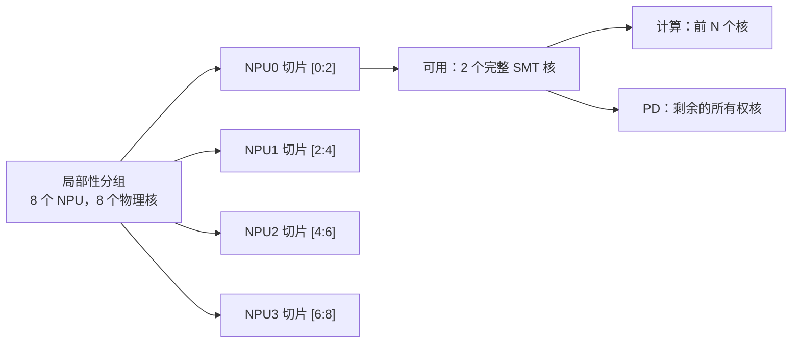
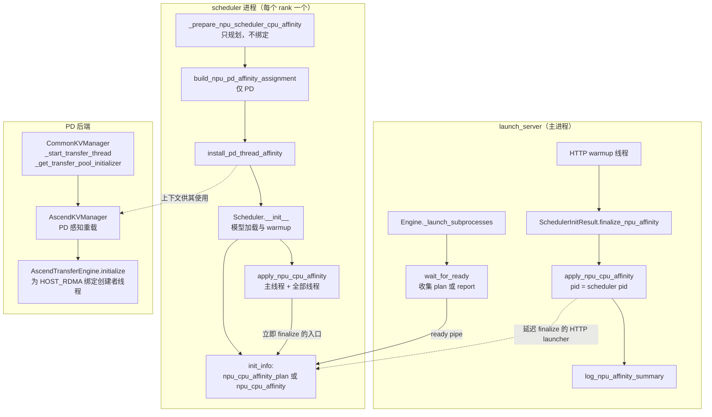
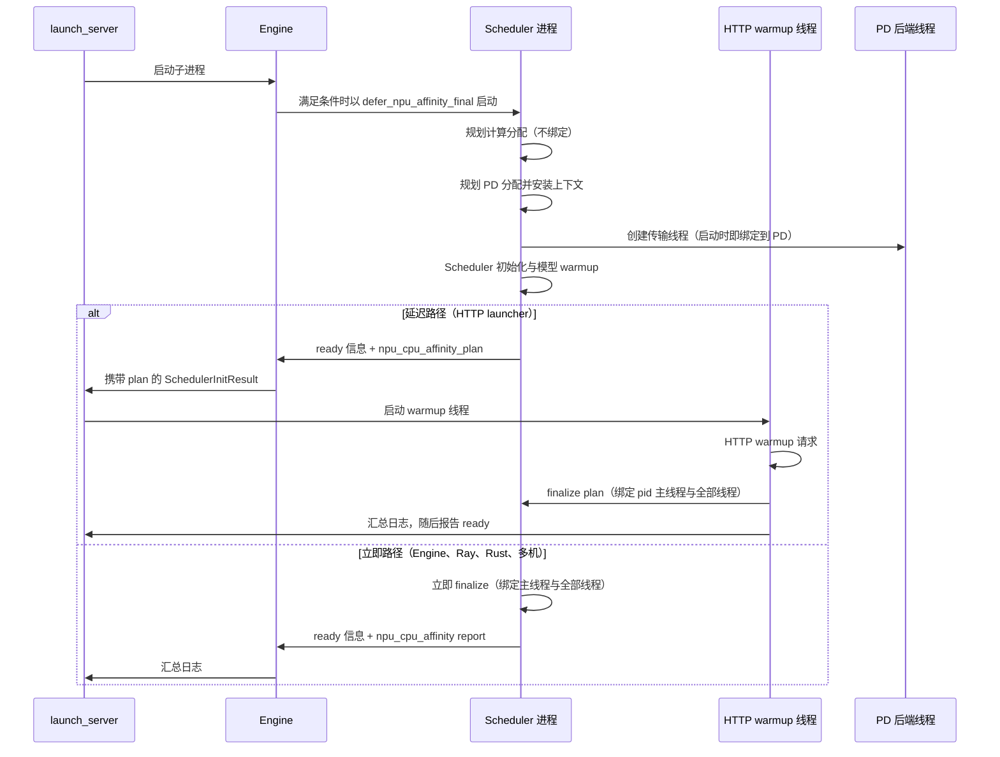
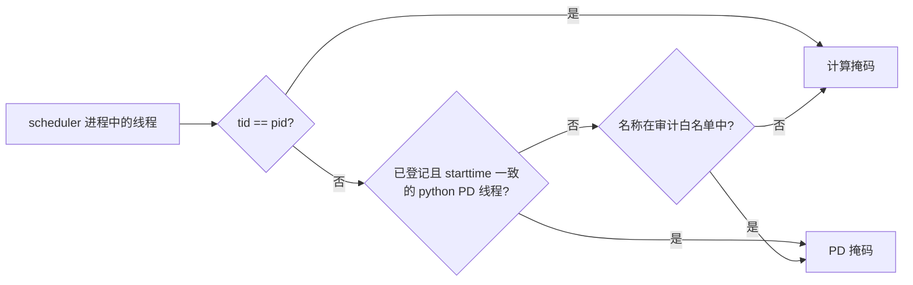

本文面向修改 Ascend NPU CPU 亲和性逻辑的开发者，以及需要理解其日志和失败模式的操作者。环境变量速查见 [Ascend NPU 环境变量](/docs/hardware-platforms/ascend-npus/reference/environment_variables)；其他平台的通用 CPU 亲和性行为见 [环境变量](/docs/references/environment_variables)。

代码按 `path::Symbol` 的格式给出，路径相对于仓库根目录。新增的两个模块位于 `python/sglang/srt/utils/`：

| 模块 | 职责 |
|---|---|
| `npu_affinity.py` | 拓扑发现、物理核规划、最终绑核、报告与日志横幅 |
| `npu_pd_affinity.py` | PD 核预算、线程分类、HOST_RDMA 传输线程绑定器 |

## 背景与目标

Ascend NPU 上的 SGLang scheduler 进程除了模型执行外还有大量 CPU 工作：事件循环、detokenizer IPC、调度与 KV 簿记、图下发，以及 PD 场景下的 KV 传输 worker。把它留在默认的整机 cpuset 上有三个问题：

1. **局部性错误。** 默认 cpuset 覆盖所有 NUMA 节点，关键的 scheduler 线程可能运行在并不属于该 NPU 的核上，并可能被内核在节点之间迁移。
2. **rank 之间互相争抢。** 本机每个 scheduler 都在竞争同一批核，而不是各自独占互不重叠的份额。
3. **传输线程继承了错误的掩码。** HOST_RDMA 传输引擎会创建原生 HCOM 线程（DMA worker、store heartbeat、group manager），这些线程继承创建者的 CPU 掩码。如果创建者被绑定在计算份额上，它们就会在计算核上出生并与 scheduler 争抢 CPU。

原有的 `SGLANG_SET_CPU_AFFINITY` 路径（`utils/process.py::set_gpu_proc_affinity`）用 GPU 下标启发式和整机物理核数计算核集合，无法描述 Ascend NPU 真正拥有哪些核。本文描述的特性在 NPU 上取代该路径：

- CPU 所有权来自真实的 `npu-smi` 拓扑，而不是设备下标。
- 分配在**运行时初始化之前规划**（此时原始 allowed cpuset 仍然可读），在**warmup 之后应用**（从而覆盖初始化期间创建的线程）。
- 可以为 PD HOST_RDMA 线程预留额外的核，同时不占用计算分配中的任何核。

**非目标：** 服务过程中的动态重新划分、CPU 热插拔，以及非 NPU 设备的亲和性。

## 核心概念

### 局部性分组与所有权切片

`npu-smi info -t topo` 会给出每个物理 NPU 本地可用的 CPU。**CPU 集合相同且属于同一 NUMA 节点**的 NPU 构成一个*局部性分组*。分组内的所有完整物理核按物理 NPU id 排序后被划分为固定、互不重叠的切片：

```text
start = slot_index * len(all_cores) // slots_on_node
end   = (slot_index + 1) * len(all_cores) // slots_on_node
```

整除意味着当核数不能被 NPU 数整除时，前面的槽位可能多分到一个核。该切片就是 NPU 的**所有权切片**；即使本 NPU 的请求无法满足，scheduler 也不会借用其他 NPU 切片中的核。

在所有权切片内，只有**完整的在线 SMT 核**可用：一个核的所有在线兄弟核都必须同时满足——位于该 NPU 的本地 CPU 掩码内、位于在线 CPU 集合内、位于进程最初的 cpuset（`os.sched_getaffinity`）内。任一条件不满足，整个物理核都被排除，因为只绑定一个兄弟核会让半个物理核不可用。



### 早期规划、延迟绑定

scheduler 进程在 `run_scheduler_process` 的第一时间解析分配方案，此时 `torch`/`torch_npu` 运行时初始化与 `Scheduler.__init__` 都还没有发生。这时进程 cpuset 仍然反映容器或 launcher 的策略，因此方案可以记录自己允许使用哪些 CPU。此阶段**不做任何绑定**：`configure_scheduler_process` 在 NPU 上会有意跳过 `set_gpu_proc_affinity`。

方案在 scheduler 完成初始化与 warmup 之后应用，此时运行时的长生命周期线程都已存在。过早绑定会漏掉运行时线程；过晚绑定（HTTP server 已经报告 ready 之后）则会让首批请求看到错误的掩码。

## 组件与数据流



| 组件 | 职责 |
|---|---|
| `utils/npu_affinity.py` | 解析拓扑、逻辑 NPU 转物理 NPU、构造分配、执行绑定并校验、输出报告 |
| `utils/npu_pd_affinity.py` | 判断是否请求 PD 核、从未使用的所有权核中分配、绑定并分类 PD 线程 |
| `managers/scheduler.py` | 初始化前规划、安装 PD 上下文、立即绑定或发布延迟 plan、上报失败 |
| `entrypoints/engine.py` | 在 ready 握手中收集各 scheduler 的 report/plan，warmup 后 finalize 延迟 plan |
| `entrypoints/http_server.py` | 为 HTTP launcher 选择延迟路径，并在 warmup 与 ready 之间触发 finalize |
| `managers/data_parallel_controller.py` | 把每个本地 scheduler 的延迟 plan 转发给 launcher |
| `disaggregation/common/conn.py` | 线程启动与线程池初始化的后端钩子 |
| `disaggregation/mooncake/conn.py` | 让 transfer worker、线程池、bootstrap/decode/heartbeat 线程走这些钩子 |
| `disaggregation/ascend/conn.py` | 存在 PD 上下文时重载钩子并登记 PD 线程 |
| `disaggregation/ascend/transfer_engine.py` | 绑定 HOST_RDMA 初始化线程，使原生 HCOM 线程继承 PD 掩码 |
| `utils/numa_utils.py` | 在 NPU 上跳过早期 NUMA CPU/内存策略，使最终绑定独占 cpuset |

## 启动生命周期



### 延迟绑定判定

`entrypoints/http_server.py::launch_server` 仅在以下条件**全部**满足时，用 `defer_npu_affinity_final=True` 包装 scheduler 入口：

- `server_args.device == "npu"`
- `SGLANG_SET_CPU_AFFINITY=1`
- `nnodes == 1`（launcher 拥有所有本地 scheduler）
- `tokenizer_worker_num == 1`
- `SGLANG_RUST_SERVER=0`

否则 scheduler 在初始化结束时自行绑定，这样 `Engine`、Ray、Rust server 和多机启动都不需要 HTTP warmup 边界也能正确工作。延迟 plan 通过 scheduler ready pipe 中的 `npu_cpu_affinity_plan` 传递，并经 DP controller 握手以 `npu_cpu_affinity_plans` 转发。

### finalize 做了什么

`npu_affinity.py::finalize_npu_cpu_affinity` 先校验 scheduler PID 没有被复用（`psutil` 的创建时间必须与 plan 一致），然后调用 `apply_npu_cpu_affinity(plan, phase="final", bind_all_threads=True, pid=<scheduler pid>)`。主线程被设置为**保存的目标集合**，绝不会与它当前的掩码求交：运行时可能在初始化期间收窄过掩码，求交会永久丢失最初选中的 CPU。绑定成功且 `SGLANG_NPU_MIGRATE_PAGES=1` 时，会把已有 host page best-effort 迁移到该 NPU 的 NUMA 节点。

## 计算亲和性分配算法

1. **解析物理 NPU。** `resolve_physical_npu_id` 在设置了 `ASCEND_RT_VISIBLE_DEVICES`（或 `ASCEND_VISIBLE_DEVICES`）时，把运行时 `gpu_id` 映射到物理 id。重复 id、非数字项、越界 id 都会报错。
2. **读取拓扑。** 从 `npu-smi info -t topo` 解析每个物理 NPU 的 CPU 亲和性；`/sys/devices/system/cpu/online`、`/sys/devices/system/node/node*/cpulist`、`lscpu -p=CPU,CORE,SOCKET,NODE` 分别提供在线集合、NUMA 集合和 SMT 拓扑。查询在每个进程内只缓存一次。
3. **校验局部性。** NPU 的 CPU 掩码必须完全落在唯一一个 NUMA 节点内，掩码中的离线 CPU 会被拒绝。拓扑列数与表头不一致、或出现不支持的链路 token 的行会被拒绝。
4. **构造所有权切片。** 局部性分组内的 NPU 按物理 id 排序，当前 NPU 的槽位获得上文公式给出的整除切片。空切片视为错误。
5. **筛选可用核。** 只保留完整的在线 SMT 核，且每个兄弟核都位于 `local ∩ online ∩ original_allowed` 中。如果一个都不剩，规划失败，错误信息中会带上相关掩码。
6. **应用预算。** `SGLANG_NPU_AFFINITY_PCORES_PER_PROC=0` 取全部可用核；正数取 `min(requested, eligible)`（按 socket/core 顺序），请求超过可用数量时会打印裁剪警告。所有权边界不会为了满足请求而移动。
7. **保存方案。** 分配中记录选中的物理核 key 及其逻辑 CPU、完整所有权切片、局部性分组、`npu-smi` 原始亲和性和原始 allowed cpuset。PD 规划与最终绑定复用这份快照，而不是重新读取可能已被运行时改变的 cpuset。

启用亲和性时，`--numa-node` 会与拓扑推导出的 NUMA 节点比对；不一致会让规划失败，而不是悄悄跨节点绑定。

## PD 预留与线程分类

### 预算门槛

`npu_pd_affinity.py::get_pd_affinity_budget` 仅在以下条件**全部**满足时返回非零值：

- 设备是 NPU；
- `disaggregation_mode` 为 `prefill` 或 `decode`；
- `disaggregation_transfer_backend` 为 `ascend`；
- `ASCEND_MF_TRANSFER_PROTOCOL=host_rdma`。

因此 `SGLANG_NPU_PD_AFFINITY_PCORES_PER_PROC=0` 表示关闭 PD 预留；与计算预算不同，这里的 0 不是“取全部”。负数、或未设置 `SGLANG_SET_CPU_AFFINITY=1` 却给出正值，都会导致启动错误。

### 分配规则

`build_npu_pd_affinity_assignment` 只从满足以下条件的核中取：

- 位于计算方案的**所有权切片**内；
- **未被**计算方案选中（`owned_cores - compute_cores`）；
- 是 `local ∩ online ∩ compute.allowed_cpus` 内的完整在线 SMT 核。

可用核少于请求值时规划失败；绝不会为了腾出空间而削减计算分配。

### 线程类别

| 类别 | 来源 | 目标 |
|---|---|---|
| `python_pd` | 由 PD 上下文登记的线程（传输池 worker、传输 worker、bootstrap/decode/heartbeat） | PD 掩码 |
| `native_pd` | 按审计过的名称匹配到的原生 HOST_RDMA 线程 | PD 掩码 |
| `default` | 其他所有线程，包括主线程 | 计算掩码 |

Python 线程通过 `/proc/<pid>/task/<tid>/stat` 中的 `(tid, starttime)` 识别，因此复用的 TID 不会被误认为已登记线程。原生名称是与已审计 MF/HCOM 版本绑定的显式白名单：`adpt_lkdwn`、`host_re_conn`、`grp_listen_evt`、`config_store_hb`、`acc_store_timer`、`rank_state_ts`、`store_chk_sts`、`NetAsyncGrpMgr`、`group_send`、`group_mgr_drv`，以及 `RDMAWkr*`、`RDMAEvent*`、`HcomPerMgr*`、`HCOMHb*`、`OOBTcpConnHdl*`、`OOBUdsConnHdl*`、`OOBTcpSvr*`、`OOBUdsSvr*` 等带编号的族。绝不根据通用名称或 CPU 掩码推断归属。



绑定器最多做两轮分类：如果某个原生线程在最终绑定期间才发布名称，第二轮会重新分类。退出的线程计入 `exited`，不算错误。HOST_RDMA 初始化线程在 `AscendTransferEngine.initialize` 前后被绑定到 PD 掩码，因此在那里创建的原生 HCOM 线程在出生时就继承了 PD 掩码。

## 失败处理

| 情况 | 行为 |
|---|---|
| 拓扑查询或规划失败 | 打印带失败阶段的警告横幅；scheduler **不绑定**任何 NPU 亲和性后继续启动。不会回退到 GPU 下标启发式。 |
| `SGLANG_NPU_AFFINITY_PCORES_PER_PROC` 为负数 | 配置错误，在 scheduler 日志配置完成前抛出，进程以 traceback 退出，而不是静默降级。 |
| 请求 PD 但计算方案缺失、预算为负、或未设置 `SGLANG_SET_CPU_AFFINITY` | scheduler 启动失败，并向 launcher 发信号。 |
| PD 请求超过未使用的所有权核 | PD 规划失败；启动失败，而不是削减计算分配。 |
| 最终绑定部分失败（非 PD） | 打印警告横幅并生成 `INCOMPLETE`/`FAILED` 报告；scheduler 以已应用的掩码继续服务。 |
| 带 PD 的最终绑定失败或不完整 | 视为致命错误：scheduler 抛出 `Grouped PD CPU binding failed`。 |
| HTTP launcher 中的延迟 finalize 失败 | finalize 回调抛异常，server 被标记为 unhealthy，不会报告 ready。 |
| PID 被复用 | 拒绝该 plan，不执行任何绑定。 |

`migratepages` 失败只记录日志，不影响就绪状态。

## 启用方式

两个 NPU 变量都需要 `SGLANG_SET_CPU_AFFINITY=1`；未设置时不会规划或应用任何 NPU 亲和性。`SGLANG_NPU_AFFINITY_PCORES_PER_PROC=0` 仍然表示“使用该 NPU 的完整份额”，而不是关闭。

| 变量 | 默认值 | 含义 |
|---|---|---|
| `SGLANG_SET_CPU_AFFINITY` | `false` | 整条路径的总开关 |
| `SGLANG_NPU_AFFINITY_PCORES_PER_PROC` | `0` | 每个 scheduler 的物理核数；`0` 使用该 NPU 的完整份额，更大的请求会被裁剪 |
| `SGLANG_NPU_PD_AFFINITY_PCORES_PER_PROC` | `0` | 从该 NPU 未使用份额中为 HOST_RDMA PD 线程预留的额外核数；`0` 关闭 |
| `SGLANG_NPU_AFFINITY_DEBUG_THREADS` | `false` | 最终绑定后打印每个线程的名称、TID、角色和读回掩码 |
| `SGLANG_NPU_MIGRATE_PAGES` | `false` | 绑定成功后 best-effort 执行 `migratepages` 到该 NPU 的 NUMA 节点 |

### 仅计算场景

```bash
SGLANG_SET_CPU_AFFINITY=1 \
SGLANG_NPU_AFFINITY_PCORES_PER_PROC=8 \
python -m sglang.launch_server \
  --model-path MODEL_PATH \
  --device npu \
  --tp-size 8 \
  --port 30000
```

### PD + HOST_RDMA

```bash
export SGLANG_SET_CPU_AFFINITY=1
export SGLANG_NPU_AFFINITY_PCORES_PER_PROC=8
export SGLANG_NPU_PD_AFFINITY_PCORES_PER_PROC=2
export ASCEND_MF_TRANSFER_PROTOCOL=host_rdma

# Prefill
python -m sglang.launch_server \
  --model-path MODEL_PATH --device npu \
  --disaggregation-mode prefill --disaggregation-transfer-backend ascend ...

# Decode
python -m sglang.launch_server \
  --model-path MODEL_PATH --device npu \
  --disaggregation-mode decode --disaggregation-transfer-backend ascend ...
```

数据并行时，每个 scheduler 依据自己的 `gpu_id` 规划，因此每个 DP 副本拥有不同的切片。延迟启动会把所有 plan 经 DP controller 转发给 launcher，由 launcher 在 warmup 后统一 finalize。

## 可观测效果

### 日志横幅

最终绑定会为每个 scheduler 输出一段 `NPU CPU AFFINITY RESULT`：

```text
=============== NPU CPU AFFINITY RESULT ===============
phase=final status=SUCCESS pid=12345 runtime_npu=0 physical_npu=0 numa=0 raw_cpu_affinity=0-95,192-287
main_cpu_mask=0-15,192-207 assigned_cores=8P/16L threads_matched=24/25 threads_failed=0 threads_mismatched=0 threads_exited=1
=============== END NPU CPU AFFINITY RESULT ===============
```

存在 PD 预留时，绑定行还会报告 `pd_cpu_mask`、`pd_physical_cores`、`compute_pd_core_overlap`（按构造恒为 `0`），以及按来源统计的已绑定线程数：

```text
pd_cpu_mask=16-17,208-209 pd_physical_cores=2 compute_pd_core_overlap=0 python_pd_threads=6 native_pd_threads=9 default_threads=10
```

HTTP launcher、`Engine` 和 DP controller 会为每个实例打印一段 `NPU CPU AFFINITY SUMMARY`，其中每张物理 NPU 一张卡片。卡片内容来自 ready 报告：期望与实际掩码、`npu-smi` 原始亲和性、实际物理核数、线程计数、PD 掩码以及线程问题。汇总只消费 ready pipe 中的报告，不会推测其他 rank 的掩码。

设置 `SGLANG_NPU_AFFINITY_DEBUG_THREADS=1` 后，结果块会追加 `thread_details`，包含线程名、TID、可用的 Python 名称、角色、来源、启动时间、期望掩码和状态。

规划或绑定失败时会打印 `NPU CPU AFFINITY FAILED` 块，包含 `Phase`、`Runtime NPU`、`Physical NPU`、`Failure stage` 和 `Reason`。PD 失败是致命的；非 PD 失败会让 scheduler 在不绑定的情况下继续运行。

### ready-pipe 报告

scheduler 的 ready 信息中会携带以下二者之一：

- `npu_cpu_affinity_plan`（延迟）：分配、PID、创建时间、rank，以及可选的 `pd_assignment` 和 `python_pd_threads`；
- `npu_cpu_affinity`（立即）：一份包含 `pid`、`runtime_npu_id`、`physical_npu_id`、`numa_node`、`raw_cpu_affinity`、`expected_cpu_ids`、`actual_cpu_ids`、`effective_pcores`、`status`、`threads_total/bound/failed/mismatched/exited`、`thread_issues`、`error` 的报告；PD 场景还包含 `pd_cpu_ids`、`pd_physical_cores`、`pd_threads_bound`。

launcher 在收集握手信息时会移除这些键，因此它们不会出现在 tokenizer manager 的状态里。

### 从命令行核验

```bash
# 某个 scheduler 每个线程的掩码
for t in /proc/<scheduler_pid>/task/*/status; do
  printf '%s ' "$(basename "$(dirname "$t")")"
  grep Cpus_allowed_list "$t"
done

# 主线程掩码
taskset -pc <scheduler_pid>
```

预期结果是：主线程和 default 线程共享计算掩码，PD 线程共享 PD 掩码，且两个掩码互不相交。日志中的 `compute_pd_core_overlap=0` 表达的正是这一不变量。

## 测试

单元测试位于 `test/registered/unit/utils/test_npu_affinity.py`（已注册到 CPU CI）：

```bash
pytest test/registered/unit/utils/test_npu_affinity.py -q
```

覆盖 CPU list 解析、`npu-smi` 解析与校验、拓扑与 NUMA 映射、visible device 解析、384 CPU 拓扑上的固定份额分配、cpuset 过滤、裁剪、绑定/读回与失败上报、汇总格式化与元数据消费、PD 预算门槛、从未使用核中的 PD 分配、线程分类、跨 `multiprocessing.Pipe` 的 plan 序列化，以及 PID 复用拒绝。NUMA 策略跳过由 `test/registered/utils/test_numa_utils.py` 覆盖。

## 限制

- 仅支持 Linux：依赖 `os.sched_getaffinity`/`os.sched_setaffinity` 和 `/proc`。
- 依赖 `npu-smi`、`lscpu` 以及 sysfs 的 NUMA/online 文件；这些查询失败时该 rank 会禁用绑定，而不是让 scheduler 崩溃。
- 一个核只有在完整在线 SMT 的情况下才可用；单兄弟核或部分允许的核会被排除。
- 拓扑解析会拒绝 `npu-smi` 行中未知的链路 token；支持新的 `npu-smi` 输出格式需要扩展白名单。
- 分配在进程生命周期内是静态的；规划后的 CPU 热插拔或 cpuset 变更不受支持。
- 原生 PD 线程名与版本相关。新增或改名的 HCOM 线程在加入审计列表之前会回退到计算掩码。
- 亲和性用于控制局部性和抖动，不保证吞吐；请始终结合目标模型和负载进行验证。
