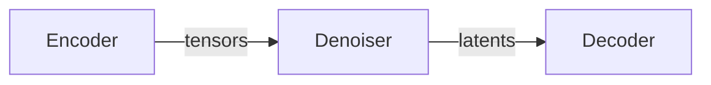
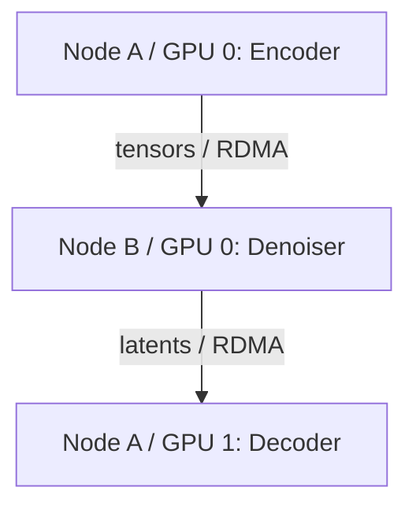
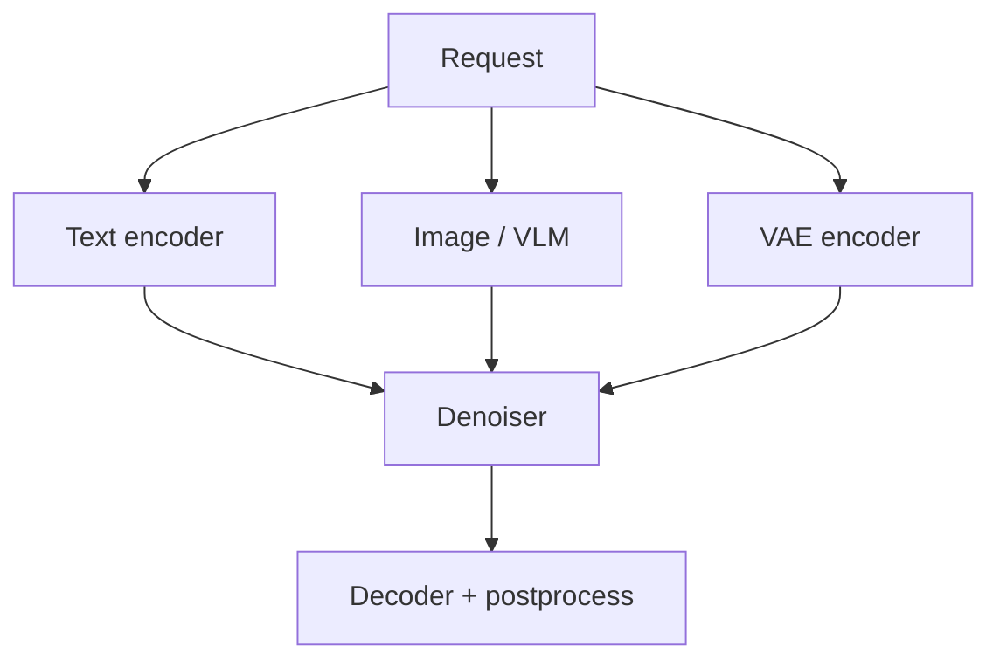

**A pipeline defines computation. A deployment decides where it runs.**
Group consecutive stages into roles, place each role on GPUs, and serve the
complete pipeline through one HTTP endpoint. Tensor payloads move directly
between workers; the coordinator schedules work and returns the result.



Disaggregation lets you place and scale stages independently. It adds
communication and is not inherently faster for a single request.

## Choose a deployment

| You need | Use | Payload boundary |
| --- | --- | --- |
| Move consecutive stages to separate workers | [Sequential stage deployment](#single-machine-example) | Request context transfers automatically |
| Run independent text, image, or VAE encoders in parallel | [Explicit stage graph](#parallel-encoders) | Declare branch inputs and outputs |
| Keep an existing encoder / denoiser / decoder setup | [Preset role deployments](/docs/sglang-diffusion/disaggregation/preset-roles) | Built-in role and payload definitions |

<Warning>
Declarative deployment is experimental and opt-in. Pipelines need accurate
stage/component declarations and compatible loaders/factories. A placement file
does not make every monolithic pipeline splittable. Automatic context transfer
currently supports consecutive groups, not automatic parallel-branch merging.
</Warning>

## Prerequisites

- Linux with NVIDIA GPUs and a working [SGLang Diffusion installation](/docs/sglang-diffusion/installation).
- Mooncake on every GPU worker: `pip install mooncake-transfer-engine`.
  Cross-machine GPU transfers also need a working RDMA fabric.
- The same SGLang version, model package/revision, and compatible numerical
  settings on every process. Authenticate for gated models on each host.
- A trusted private network. Internal RPC uses Python serialization and must
  not be exposed to untrusted clients.

The examples below use `Wan-AI/Wan2.1-T2V-1.3B-Diffusers`. The three-group
split and mixed TP/SP execution have been validated on H200. Other models need
their own exact stage names and component declarations.

## Single-machine example

Start here: one encoder, one denoiser, and one decoder on three GPUs.

| Role | GPU | Stage indices | Work |
| --- | --- | --- | --- |
| `encoder` | 0 | 0-1 | Validate input and encode text |
| `denoiser` | 1 | 2-4 | Initialize latents/timesteps and denoise |
| `decoder` | 2 | 5-6 | Decode and postprocess |
| Coordinator | None | None | Serve HTTP and schedule roles |

### 1. Define stages and placement

Save the following as `deployment.json`. These are actual Wan pipeline stage
names, not aliases. Names and zero-based indices can be mixed. Stages keep their
original pipeline order.

```json deployment.json
{
  "stages": [
    {"name": "InputValidationStage"},
    {"name": "TextEncodingStage", "components": ["text_encoder", "tokenizer"]},
    {"name": "LatentPreparationStage", "components": ["scheduler", "transformer"]},
    {"name": "TimestepPreparationStage", "components": ["scheduler"]},
    {"name": "denoising_stage", "components": ["transformer"]},
    {"name": "decoding_stage", "components": ["vae"]},
    {"name": "decoding_stage_postprocess"}
  ],
  "roles": {
    "encoder": {
      "stages": [0, 1],
      "endpoints": ["tcp://127.0.0.1:19000"],
      "node": "node1",
      "server_args": {"num_gpus": 1, "base_gpu_id": 0}
    },
    "denoiser": {
      "stages": [2, 3, 4],
      "endpoints": ["tcp://127.0.0.1:19010"],
      "node": "node1",
      "server_args": {"num_gpus": 1, "base_gpu_id": 1}
    },
    "decoder": {
      "stages": ["decoding_stage", "decoding_stage_postprocess"],
      "endpoints": ["tcp://127.0.0.1:19020"],
      "node": "node1",
      "server_args": {"num_gpus": 1, "base_gpu_id": 2}
    }
  }
}
```

No stage declares field-level `inputs` or `outputs`, so the framework carries
the request context across each boundary, including nested tensors, scheduler
state, and generator state. You do not need to list every embedding or mask.
Each worker loads only its declared components.

### 2. Start workers and the coordinator

Run each tab's command in a separate terminal from the directory containing
`deployment.json`.

<Tabs>
<Tab title="GPU workers">

```bash
sglang serve --model-path Wan-AI/Wan2.1-T2V-1.3B-Diffusers \
  --stage-deployment deployment.json --stage-node node1
```

This launches all roles assigned to `node1` as separate processes, with unique
internal scheduler/master ports. It does not start the HTTP API.

</Tab>
<Tab title="HTTP coordinator">

```bash
sglang serve --model-path Wan-AI/Wan2.1-T2V-1.3B-Diffusers \
  --stage-deployment deployment.json \
  --host 127.0.0.1 --port 30000 --scheduler-port 18000
```

No GPU is required by the coordinator. Omitting `--stage-node` and
`--stage-role` selects coordinator mode.

</Tab>
</Tabs>

### 3. Send a smoke request

Wait for workers to finish loading, then use the existing generation API:

```bash
curl --fail-with-body -sS http://127.0.0.1:30000/v1/videos \
  -H 'Content-Type: application/json' \
  -d '{
    "model": "Wan-AI/Wan2.1-T2V-1.3B-Diffusers",
    "prompt": "A mountain landscape in daylight",
    "size": "256x256",
    "num_frames": 5,
    "num_inference_steps": 4,
    "seed": 42
  }'
```

This small request checks the complete path, not production video quality.
Image pipelines use the same coordinator with `/v1/images/generations` or
`/v1/images/edits`; see the [HTTP API](/docs/sglang-diffusion/api/openai_api).

## Multi-machine example

Keep the stage list unchanged and move the same roles onto two machines:



Replace the example private addresses below with your routable worker addresses.
Create `deployment-multi.json` from the working single-machine file:

```python
import json
from pathlib import Path

deployment = json.loads(Path("deployment.json").read_text())
deployment["roles"] = {
    "encoder": {
        "stages": [0, 1],
        "endpoints": ["tcp://10.0.0.1:19000"],
        "node": "node-a",
        "server_args": {"num_gpus": 1, "base_gpu_id": 0},
    },
    "denoiser": {
        "stages": [2, 3, 4],
        "endpoints": ["tcp://10.0.0.2:19010"],
        "node": "node-b",
        "server_args": {"num_gpus": 1, "base_gpu_id": 0},
    },
    "decoder": {
        "stages": [5, 6],
        "endpoints": ["tcp://10.0.0.1:19020"],
        "node": "node-a",
        "server_args": {"num_gpus": 1, "base_gpu_id": 1},
    },
}
Path("deployment-multi.json").write_text(json.dumps(deployment, indent=2) + "\n")
```

Copy the same generated file to both machines. In each terminal below,
`cd` to its directory first. Replace `mlx5_0` with that host's RDMA device.

<Tabs>
<Tab title="Node A workers">

```bash
sglang serve --model-path Wan-AI/Wan2.1-T2V-1.3B-Diffusers \
  --stage-deployment deployment-multi.json --stage-node node-a \
  --disagg-p2p-hostname 10.0.0.1 --disagg-ib-device mlx5_0
```

</Tab>
<Tab title="Node B workers">

```bash
sglang serve --model-path Wan-AI/Wan2.1-T2V-1.3B-Diffusers \
  --stage-deployment deployment-multi.json --stage-node node-b \
  --disagg-p2p-hostname 10.0.0.2 --disagg-ib-device mlx5_0
```

</Tab>
<Tab title="Coordinator on node A">

```bash
sglang serve --model-path Wan-AI/Wan2.1-T2V-1.3B-Diffusers \
  --stage-deployment deployment-multi.json \
  --host 127.0.0.1 --port 30000 --scheduler-port 18000
```

Use the same smoke request on node A. For an external client, bind the HTTP
server to an appropriate reachable interface and apply your normal API security.

</Tab>
</Tabs>

Node launch is local process launch, not SSH provisioning. Internal endpoints
and Mooncake session addresses must be mutually reachable. Keep advertised
stage ports, internal scheduler ports, and distributed master ports distinct.

## Configure TP and SP per role

Use the multi-machine manifest above, but give the denoiser four GPUs for
**TP2 x Ulysses2**. This variant uses three GPUs on node A and four on node B:
encoder TP2 on node A GPUs 0-1, decoder on node A GPU 2, and denoiser on all
four node B GPUs.

```python
import json
from pathlib import Path

deployment = json.loads(Path("deployment-multi.json").read_text())
deployment["roles"]["encoder"]["server_args"] = {
    "num_gpus": 2, "base_gpu_id": 0,
    "tp_size": 2, "sp_degree": 1, "encoder_parallel": "replicate",
}
deployment["roles"]["denoiser"]["server_args"] = {
    "num_gpus": 4, "base_gpu_id": 0,
    "tp_size": 2, "sp_degree": 2, "ulysses_degree": 2, "ring_degree": 1,
}
deployment["roles"]["decoder"]["server_args"]["base_gpu_id"] = 2
Path("deployment-tp-sp.json").write_text(json.dumps(deployment, indent=2) + "\n")
```

Restart all three terminals from the previous example with
`--stage-deployment deployment-tp-sp.json`. Use the same file on both hosts.

TP/SP run **within** a role's worker group; they do not split pipeline stages
between roles. Model head-count and sharding constraints still apply. This is
a validated topology, not a claim that it is faster than pure SP for every
workload. See [parallelism](/docs/sglang-diffusion/parallelism) for tuning.

## Scale a role with replicas

Replicas serve different requests. They are not a TP or SP group.

For four GPUs on one machine, start from `deployment.json` and give the
denoiser two independent one-GPU replicas:

```python
import json
from pathlib import Path

deployment = json.loads(Path("deployment.json").read_text())
deployment["roles"]["denoiser"]["endpoints"] = [
    "tcp://127.0.0.1:19010",
    "tcp://127.0.0.1:19030",
]
deployment["roles"]["decoder"]["server_args"]["base_gpu_id"] = 3
Path("deployment-replicas.json").write_text(json.dumps(deployment, indent=2) + "\n")
```

Launch workers and the coordinator as in the single-machine example, replacing
the filename with `deployment-replicas.json`. The node launcher places encoder
on GPU 0, the denoiser replicas on GPUs 1 and 2, and decoder on GPU 3. It advances
each replica's base GPU by that role's `num_gpus`.

The coordinator defaults to `round_robin`. To prefer a worker with free
capacity, add `--disagg-dispatch-policy max_free_slots` to the coordinator.
Each worker executes one request at a time; replica dispatch is not
per-worker dynamic batching.

## Parallel encoders

Text encoding, an image/VLM encoder, and VAE encoding can run as independent
branches **only when their actual data dependencies permit it**:



This requires explicit field contracts; automatic full-context transfer does
not merge parallel branches. For example:

```python
from sglang.multimodal_gen.runtime.disaggregation.deployment.plan import StageSpec

stage_specs = (
    StageSpec("text_encode", inputs=("prompt",), outputs=("prompt_embeds",),
              components=("text_encoder", "tokenizer"), after=()),
    StageSpec("image_encode", inputs=("image_path",), outputs=("extra.image_features",),
              components=("image_encoder",), after=()),
    StageSpec("vae_encode", inputs=("image_path",), outputs=("extra.image_latents",),
              components=("vae",), after=()),
    StageSpec("denoise",
              inputs=("prompt_embeds", "extra.image_features", "extra.image_latents"),
              outputs=("latents",), components=("transformer", "scheduler")),
    StageSpec("decode", inputs=("latents",), outputs=("result.output",),
              components=("vae",)),
)
```

These are **schematic** stage names and fields, not a runnable declaration for
an arbitrary model. The pipeline must register matching stage factories,
produce/consume these fields, and keep non-transferable runtime state local.
Assign each branch to a different role in the placement file; the coordinator
runs independent branches concurrently and waits for their results at the join.

See the [stage deployment reference](/docs/sglang-diffusion/disaggregation/stage-contracts)
for a matching placement example, field semantics, and integration requirements.

## Before serving production traffic

- **Warm up through the coordinator.** Stage workers skip standalone warmup.
  Send representative shapes and input modes, including to every replica.
- **Budget memory per worker.** Weights, activations, retained result copies,
  and transfer pools all consume memory. Sharing a GPU does not share weights.
- **Compare like-for-like.** Match precision, attention backend, each stage's
  parallelism, and VAE memory format before judging numerical differences.
- **Plan for errors.** Admission is bounded, but this is not a durable queue.
  Cancellation cleans up pending work; it does not interrupt a running kernel.

Continue with the
[stage deployment reference](/docs/sglang-diffusion/disaggregation/stage-contracts)
for fields, ports, transport options, and limitations, or
[preset role deployments](/docs/sglang-diffusion/disaggregation/preset-roles)
for the existing CLI-only path.
