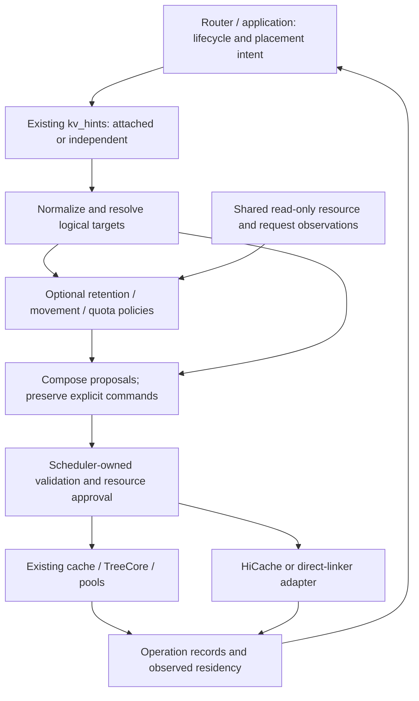

# [RFC]: Programmable KV Cache: Composable Policies for Agentic Serving

[中文版](/home/youwei/bzh/project/TokenCake/RFC/sglang-rfc/docs/programmable-kvc/RFC-programmable-kv-cache.zh-CN.md)

Status: discussion draft, 2026-10-19. This document proposes interfaces and semantics; it does not claim that the implementation or evaluation described below has landed.

## Summary

This RFC proposes a Programmable KV Cache abstraction for agentic serving in SGLang. Routers and applications supply task lifecycle and placement intent; composable engine policies propose retention, movement, and optional quota or request guidance against a shared resource view; the engine approves resources and reports actual completion through existing cache and storage mechanisms.

SGLang already has typed KV hints, session-aware radix caching, hierarchical storage, and direct external-cache linkers. The proposal connects these foundations with a common observation, proposal, composition, approval, and completion contract. Policies and backend adapters are registered independently so that different algorithms can share the same execution and resource-lifetime machinery. Request-attached commands and independent control between inference calls are two entry paths into that contract.

The default engine executes explicit directives. Local policies are opt-in. Retention is a soft eviction priority with a finite TTL; this RFC introduces no public Pin guarantee.

## Motivation

An agent task spans multiple model calls, tool waits, and branches. A completed model request can leave a valuable prefix with no active request reference. A router knows that the task may resume, while the engine knows current pool occupancy, admitted-request growth, and outstanding transfers. Neither a request-local eviction scalar nor an opaque hint envelope provides a complete contract for combining those facts.

| Agentic serving event | Cache decision it can motivate | Information that must meet at the engine |
| --- | --- | --- |
| A parent agent waits for a tool or subagent | Retain valuable context or move eligible copies to a colder tier | Lifecycle/expected wait plus reclaimable capacity and transfer cost |
| Several branches reuse a shared prefix | Preserve shared value while accounting for physical copies once | Branch associations plus current references and residency |
| Several paused tasks may resume under pressure | Choose useful preparation without consuming capacity already needed by admitted requests | Optional resume estimates plus request growth and in-flight reservations |
| A branch or task completes | Remove its associations and policy-owned claims | Task lineage plus other tasks' shared references and transfer holds |

These decisions can interact: a retention policy values a parent's prefix, a movement policy sees a long pause, and an admission policy needs space for a ready branch. They need a common composition and approval boundary to produce a feasible local plan. Global worker selection remains with the router.

For example, two policies can request the same prefix at the same destination. They should share one compatible transfer and one physical reservation while retaining separate results. If they request different prefixes that exceed available capacity, the engine must select, clip, defer, or reject work. A policy observation does not grant capacity, and a received command does not establish usable KV.

## Existing foundations and contribution

This proposal complements the following work:

| Foundation | Reuse and proposed addition |
| --- | --- |
| [Programmatic KV RFC #27574](https://github.com/sgl-project/sglang/issues/27574) and [Q4 roadmap #43098](https://github.com/sgl-project/sglang/issues/43098) | Reuse router/engine ownership and tiered movement goals; specify local composition, resource lifetime, and observable execution. #27574 was automatically closed for inactivity, which does not establish implementation completion. |
| [Envelope RFC #36224](https://github.com/sgl-project/sglang/issues/36224), merged [#38891](https://github.com/sgl-project/sglang/pull/38891) | Reuse `KvHintsEnvelope` and request transport. Add action consumers and request-independent submission without creating another envelope. |
| Merged [session identity #29436](https://github.com/sgl-project/sglang/pull/29436) and [session-aware UnifiedRadixCache #29173](https://github.com/sgl-project/sglang/pull/29173) | Reuse identity, generations, component reference tracking, and lifecycle hooks; add explicit continuation/range addressing and policy integration. |
| [Range retention #36208](https://github.com/sgl-project/sglang/issues/36208), [soft retention #27970](https://github.com/sgl-project/sglang/pull/27970) | Coordinate range and eviction work. This RFC requires independent copy-scoped claims and explicit TTL renewal; refresh-on-hit is a different policy. |
| [HiCache roadmap #21846](https://github.com/sgl-project/sglang/issues/21846), merged [linker integration #37381](https://github.com/sgl-project/sglang/pull/37381) and [hybrid linker #41343](https://github.com/sgl-project/sglang/pull/41343) | Reuse storage, pools, transfers, and completion paths through capability-specific adapters. |
| [Queued SSD prefetch #45128](https://github.com/sgl-project/sglang/issues/45128) | Distinguish storage-side warming while a request is queued from independent preparation before request arrival. Both may participate in an approved plan. |
| [KVCR backend #36409](https://github.com/sgl-project/sglang/pull/36409) | Preserve room for backend-owned actions and peer reuse; coordinate transport and completion semantics before integration. |
| [vLLM RFC #57103](https://github.com/vllm-project/vllm/issues/57103), draft [#62382](https://github.com/vllm-project/vllm/pull/62382) | Align semantic boundaries with the author's September 24 and October 19 updates: mechanism-only default, opt-in policies, and no public Pin. SGLang retains its own cache architecture. |

### Proposed contribution

The contribution is the engine policy contract that lets these pieces cooperate:

| Proposed capability | Consumer value |
| --- | --- |
| Shared observations of capacity, request demand and transfers | Retention, movement and quota policies reason from the same resource facts |
| Proposal-only policies and a replaceable composer | Algorithms can be combined without each directly manipulating cache state |
| One engine approval and resource-lifetime boundary | Compatible work shares resources; competing work cannot spend capacity twice |
| Logical task/continuation/range targeting | Policies can act across model calls and branches without persistent physical block IDs |
| Correlated completion and residency feedback | Later routing and policy decisions can distinguish intent from achieved state |
| Optional request/KV cooperation | Scheduler extensions can consume demand-aware guidance without making one scheduling algorithm mandatory |

Independent control enables these capabilities during tool waits and other intervals without generation. This RFC does not replace global routing, prescribe a particular quota/prediction algorithm, change attention semantics, or require all storage backends to implement all operations. Token-range retention does not remove text from the model's input.

## Proposed design

### Ownership and execution flow



The router owns global placement and task intent. Engine-local policies propose actions using common observations. The scheduler/cache owner validates targets, allocates resources, and changes local state. Backend adapters execute approved work using existing transfer mechanisms. A policy receives values and opaque target descriptions, not mutable scheduler, allocator, or storage objects.

With no policy registered, signals produce an `unconsumed` result and no derived action. Explicit commands still undergo capability, reference, and capacity checks. A composer may resolve competition among policy proposals, but cannot reinterpret an explicit destination, priority, or operation. Conflicting autonomous proposals must yield or report why they cannot proceed.

The existing `CacheAction`/component machinery remains an internal execution mechanism. It does not become a public hint protocol or a second independent policy allocator.

The ownership boundary applies both when an orchestrator issues every command and when an engine policy derives commands from runtime signals:

| Component | Reads | Decides or changes | Boundary |
| --- | --- | --- | --- |
| Router/orchestrator | Task progress, known prefix matches, worker load and locations | Worker selection, task lineage, global placement and lifecycle intent | Cannot grant local GPU capacity or infer completion from receipt |
| Local policy | Immutable signals, resolved targets and requested observation categories | Proposed actions, timing and optional request guidance | Cannot mutate cache state, call storage, or hold allocator references |
| Composer | Explicit directives, policy proposals and dependencies | Which compatible proposals form a plan and which proposals yield | Cannot silently change explicit action semantics or approve resources |
| Scheduler/cache owner | Current request state, pool capacity and pending operations | Admission, target revalidation, reservations, publication and retirement | Owns the ordering of physical mutations |
| TreeCore/components | Logical radix structure, component references and cache actions | Matching, structural feasibility, eligible eviction and component coverage | Do not interpret application tools or global routing policy |
| Backend adapter | Approved content, buffers, destination and transfer requirements | Backend lookup, data movement and completion reporting | Cannot expand the approved scope or free buffers independently |

Conceptually, the processing path is:

```python
inputs = normalize(envelope, execution_context)
targets = resolver.bind(inputs.targets, lifecycle_phase)
view = observations.read(categories_required_by_enabled_consumers)
proposals = [p.propose(inputs.signals, targets, view) for p in policies]
plan = composer.combine(inputs.explicit_actions, proposals, view)
approved = engine.validate_and_reserve(plan, current_state)
executor.submit(approved)
# Subsequent owner-thread progress consumes completion fences,
# publishes reusable content, retires holds, and updates operation results.
```

This sketch describes responsibilities, not a required call frequency. A policy that only changes priority should not force request-demand scanning, and a command needing a lifecycle boundary can remain queued without reserving destination memory. Plan construction and engine approval are separate because capacity may change between them.

#### Core records

The records crossing those boundaries should make pending intent distinguishable from physical state:

| Record | Required meaning |
| --- | --- |
| `KVTarget` | Logical content selector, namespace, continuation/range and requested location |
| `ResolvedTarget` | Bound content spans, reusable dependencies, known copies, missing portions and supported granularity |
| `WorkloadSignal` | Task/branch lifecycle fact or prediction, including optional importance and expected resume time |
| `KVProposal` | Suggested action, source policy, rationale, earliest useful time and dependencies |
| `KVPlan` | Selected actions and ordering constraints, with explicit and policy-derived intent distinguishable |
| `ApprovedOperation` | Actual approved spans, destination, reservations, transfer holds and execution incarnation |
| `OperationResult` | Correlated stage outcomes, actual coverage, failure reasons and released or still-held resources |

These are internal contract categories. They do not require another public envelope or mandate that each category become a separately allocated Python object.

### Logical targets and session lifetime

Three identities remain separate:

- **Content:** a compatible token prefix or component checkpoint, including the cache namespace and model/layout context required by the backend.
- **Association:** a session or continuation refers to that content.
- **Residency:** a valid copy exists at a particular engine/tier and has a particular lifetime.

Public targets may select the committed content of an attached request, a known logical prefix/hash, or a tracked session with an explicit continuation and half-open token range. They never expose reusable pool indices as persistent identifiers. A router need not construct Mooncake object keys or know physical shard layouts.

An operation on a whole session covers its tracked branches. An operation on a historical branch or range binds to an explicit continuation/prefix boundary, not an implicit latest branch. Historical selectors are snapshotted at submission. A symbolic attached-request target may instead bind to committed content at its declared successful-completion boundary, including a supported generated suffix. Execution revalidates the bound content's current physical realization. Missing history, missing residency, unsupported granularity, and incompatible namespaces are distinct outcomes.

The existing session tracker is useful input, but its component frontiers are not a complete historical index. A bounded optional local index supplies continuation and task-tree information when an engine accepts session addressing or runs session-level policies. A router may instead resolve targets to exact logical content. Index eviction must not invent history or leave active operations with dangling references.

Task completion removes that task tree's associations and policy-owned claims. It does not delete externally shared content or revoke active request/transfer references. A tool call ending one generation does not complete the task. `StreamingSession` continues to own its request/KV state under its existing contract; attaching an ordinary task identity does not acquire those locks or imply streaming-session behavior.

#### Local index and branch resolution

The optional local index has a functional contract independent of its data structure:

| Query/update | Expected behavior |
| --- | --- |
| Associate a continuation | Record its exact prefix boundary and optional parent continuation; share common ancestry where possible |
| Resolve a session/range | Return the tracked logical spans, including explicit missing history; do not substitute another branch |
| Reverse lookup | Identify associated tasks and declaration owners without turning one triggering session into exclusive ownership |
| Record a residency transition | Update an engine/tier copy while preserving logical lineage |
| End a task tree | Remove its associations and policy-owned claims while preserving other tasks' shared references |
| Recover after a gap | Mark affected locations unknown until repaired; retain valid logical relationships |

Consider a prefix H that forks into H+B and H+C. A session-wide operation binds both tracked branches at submission. An operation on continuation B and range `[0, k)` binds only the corresponding prefix of H+B. A later extension of B does not enlarge that already-submitted operation. If H is also associated with an independent task U, ending the parent task does not authorize deleting U's copy or clearing U's claims.

The index cannot reconstruct an untracked historical branch from a session name alone. A lazily enabled index needs explicit prefix metadata from the router, a recorded continuation, or another authoritative content descriptor. Retaining a hash without the component/checkpoint information needed to reload it is also insufficient to promise reuse. Bound operation descriptors remain valid independently of ordinary index-cache eviction until those operations retire.

Range resolution separates three quantities: the caller's logical range, the spans actually acted upon, and additional prefix/window/checkpoint dependencies needed for reuse. For example, a range ending at token 4100 with 16-token FULL pages cannot be reported as an exact complete-page operation through token 4100. An adapter may report coverage through 4096 if clipping is permitted, or return unsupported granularity. It must not silently extend protection to 4112. A request for an interior suffix may require an earlier prefix or checkpoint for restoration; that dependency is reported separately from retained or reclaimed coverage.

### Primitive semantics and retention claims

Proposed SGLang-native names are `sglang.set_priority`, `sglang.copy_to`, and `sglang.move_to`, carried by the existing envelope. These names and payload versions are proposals for review, not an established cross-engine standard. Existing `kv.*` proposals should be reconciled with these semantics before shipping an action consumer.

| Operation | Contract |
| --- | --- |
| `SET_PRIORITY` | Set or clear one caller's soft eviction claim on selected current copies. It does not allocate capacity, alter correctness references, or guarantee residency. |
| `COPY_TO` | Establish usable content at the approved destination while preserving the source. Report the actual destination tier and coverage after completion. |
| `MOVE_TO` | Establish the destination, then reclaim eligible selected source residency. Destination completion and source reclamation are separate stages; inability to reclaim may produce partial completion. |
| Explicit eviction, if supported | Remove eligible selected residency. Clearing a priority claim is not eviction; MOVE to a null destination is not an implicit eviction API. |
| Association and task lifecycle | Update logical relationships and policy ownership. These are not implicit side effects of copying content. |

Higher-level Retain, Prefetch, Demote, and Share intents can be lowered to these operations. GPU prefetch is a COPY with a GPU destination; an L3-to-host COPY has a different completion meaning. Cross-engine sharing through a Store requires A-to-Store publication and destination-owned Store-to-B preparation. A successful write to a shared Store does not establish B's GPU residency. An engine cannot approve another engine's GPU capacity.

#### Copy-scoped priority claims

A priority claim contains a caller-scoped `claim_id`, an ordered `revision`, a signed integer `value`, and a finite positive `ttl_seconds`. A higher revision with `value: null` clears only that claim. Equal or older retries do not renew it; conflicting reuse of an identical revision is rejected before mutation. Within the applicable priority profile, larger values survive longer and equal effective priorities use LRU among otherwise eligible candidates.

Claims are scoped to the resolved copy incarnation, tier, component coverage, namespace, and engine epoch. Physical indices and incarnation identifiers remain internal. The maximum still-valid claim supplies a copy's effective claimed priority. Independent claims preserve independent expiry and release:

> A sets priority 90 for 10 seconds; B sets priority 20 for 60 seconds on the same copy. The effective claimed priority is 90 for 10 seconds and then 20. It never becomes 90 for 60 seconds.

TTL begins when the claim becomes effective. Cache hits do not renew it. Expiry removes the claim, not necessarily the bytes. Eviction or invalidation ends the claims attached to that copy. A newly loaded or recomputed copy does not inherit them. A persistent task policy may submit a new claim after materialization, with an observable new lifetime.

Radix splitting alone does not create a new physical copy. Claims must follow their covered spans through splits without restarting TTL or changing revision. A merge cannot collapse different claim lifetimes into one scalar. Range handling must advertise exact support or return actual clipped coverage; unsupported partial pages/checkpoints must not be silently described as fully covered.

SGLang currently gives session-reference preference precedence over the base numerical priority in the FULL component; SWA/Mamba use their own session-aware scans. The proposed programmable retention profile gives explicit cache priorities precedence over that heuristic. Session preference becomes a policy input/proposal rather than an unconditional outer ordering key. Policy-generated claims cannot countermand a conflicting accepted explicit directive; independent explicit callers still obey the claim-merge rule.

This is an intentional opt-in behavior change. The disabled path retains legacy eviction. The implementation must define profile selection and coexistence with the existing session-aware flag, rather than changing node priority while leaving an overriding session comparator in place. Structural and component-cascade constraints remain cache-owned: priority does not make an internal node independently reclaimable when its descendants or checkpoints require it.

Backend leases, including Mooncake retention facilities discussed in [#30796](https://github.com/sgl-project/sglang/pull/30796), are separate capabilities with separately reported guarantees. They are not implied by SET_PRIORITY.

#### Envelope example and action dependencies

The following independent-control example illustrates the proposed payload shape. It is not an API already supported by SGLang. The caller sends it to worker B after obtaining a continuation descriptor that B can resolve, or supplies an equivalent explicit content target:

```json
{
  "protocol_version": "0.1",
  "message_id": "task-7-prepare-b",
  "actions": [
    {
      "action_id": "restore-prefix",
      "action_type": "sglang.copy_to",
      "action_version": "1.0",
      "payload": {
        "target": {
          "kind": "session",
          "session_id": "task-7",
          "continuation_id": "branch-b-turn-3",
          "start_token": 0,
          "end_token": 4096
        },
        "src": {"tier": "storage", "backend": "mooncake"},
        "dst": {"tier": "gpu", "engine_id": "worker-b"}
      }
    }
  ]
}
```

Receipt correlates `task-7-prepare-b / restore-prefix`; it does not mean B has reserved capacity. A completed result identifies the actual materialized component spans and destination. A caller can then submit SET_PRIORITY against the new copies, or an opt-in policy can propose it as a dependent action. Its TTL starts when that priority becomes effective. A failed COPY does not leave a successful priority claim on nonexistent destination copies.

The existing envelope's action list is not an atomic transaction or an implicit dependency language. Unrelated actions are independently processable; a public multi-step request must have explicit dependency semantics before it is supported. Internally, a composed COPY → SET_PRIORITY plan can encode that prerequisite without assuming list order supplies it. Likewise, accepting one action does not imply acceptance of every action in the envelope.

### Policy observations, composition, and capacity

The policy extension has conceptual interfaces; the names below do not prescribe Python classes or an RPC schema.

| Interface | Responsibility |
| --- | --- |
| `PolicyView` | Read-only pool/tier capacity, occupancy, reclaimable candidates, active references, reservations, transfer progress, request-demand estimates, and backend capabilities. |
| `Policy.propose` | Consume a lifecycle signal and observations; return retention, movement, or optional scheduler-guidance proposals. |
| `Composer.combine` | Coalesce compatible work, order dependencies, and resolve policy competition while preserving explicit commands. |
| `Engine.approve` | Revalidate current targets, feasibility, and budgets; obtain real reservations/holds through existing owners. |
| `Adapter.submit/poll` | Execute only approved scope and report completion, failure, and transfer quiescence. |
| `OperationRecord` | Own correlation, approved scope, stage outcomes, and release obligations for an operation instance. |

Observations distinguish physical facts, estimates, and commitments. The maximum output token budget is an upper bound, not a prediction. Running requests' remaining growth and waiting requests' incremental demand may inform approval, but do not create additional physical capacity. Views may be sampled or built on demand; an unconsumed signal must not trigger a full request/index scan. Policies declare the observation categories they need, and their CPU cost is measured.

SGLang's resources are a vector across pools/components/tiers: FULL pages, SWA storage, Mamba states, host staging, and backend transfer limits. A single free-token counter is insufficient. Sharing and overlapping holds must not double-count physical allocations. Logical per-session cost shares used by quota policies do not replace allocator accounting.

Matching content, namespace, component coverage, direction, destination, and backend compatibility can allow operations to share a transfer. Each caller retains its own result and cancellation state. Cancellation of one waiter cannot release a buffer still used by another waiter, a request, or DMA. Distinct operations must not independently spend the same observed free space.

Optional quota/admission/request-score policies may consume these observations and return guidance through an explicit scheduler extension. They do not reorder queues or choose preemption victims themselves. The scheduler owns application of that guidance and its fairness behavior. A score with no consumer is not a scheduling optimization. This RFC does not standardize TokenCake formulas, a DAG representation, or a predictor.

#### Observation contract

The observation contract should expose enough detail to explain a decision:

| Observation | Producer | Interpretation |
| --- | --- | --- |
| Free and allocated units per pool; reclaimable candidates | Cache/pool owner | Current physical facts, with shared allocations counted once |
| Request locks, transfer holds and pending reservations | Request and operation owners | Existing commitments that constrain reclaimability and allocation |
| Waiting incremental demand and running-request growth | Scheduler/cache observation | Labeled estimates, including which compatible cached spans were assumed |
| Backend availability, known/unknown hits, queued work and transfer estimates | Adapter | Versioned observations or estimates, not a remote durability guarantee |
| Session/continuation, tool wait/resume, importance and expected resume | Router/application | Optional semantic context; absent predictions remain valid inputs |
| Operation outcome and actual transfer cost | Operation registry/adapter | Feedback for deciding whether future movement is useful |

A view identifies its sampling time and any truncation or missing categories. A decision based on an incomplete view must not treat unknown remote residency as a hit or omitted demand as zero. Implementations may cache expensive estimates while maintaining cheap physical counters incrementally. Engine approval always uses current feasibility checks.

#### Composition and conflict resolution

A reference composer can preserve explicit actions, coalesce compatible transfers, order prerequisites, and arbitrate competing policy proposals. It need not normalize arbitrary scores into one weighted sum. Retention, movement and quota policies may use different score scales; their arbitration interface must make the selected precedence or policy-specific comparison explicit. For example:

| Competing intent | Required resolution |
| --- | --- |
| Two policies request the same compatible GPU prefix | One physical load/reservation; independent caller records and cancellation |
| An explicit priority conflicts with an autonomous session preference | Preserve the explicit claim; suppress or report the conflicting policy proposal |
| A cold save is proposed before a GPU reclaim | Require successful cold publication before attempting source reclamation |
| Priority is proposed for a copy still being loaded | Apply only to the successfully materialized scope; start TTL at effectiveness |
| Two different prefetches each fit the same old snapshot | Approve against the remaining real budget, not twice against the old snapshot |

#### Resource approval and ownership

As a capacity example, suppose a destination has 10 GiB available for additional work before policy headroom. Two proposals for the same 8 GiB prefix consume 8 GiB once. Two different 8 GiB prefixes cannot both be accepted. If the selected admission policy additionally protects 3 GiB for already-admitted growth, neither 8 GiB load fits the resulting 7 GiB budget. These figures illustrate accounting only; the model's maximum output length is not automatically reserved as predicted growth.

Approval records obligations rather than creating a second allocator:

| Resource | Acquisition | Release or ownership transition |
| --- | --- | --- |
| Destination reservation | Before transfer submission, through the owning pool | Release on safe failure/cancellation; transition to ordinary resident allocation on publication |
| Source transfer hold | Before request/temporary source ownership can end | Release only when the backend can no longer access the source |
| Host staging | Before a transfer stage requiring it | Return after the corresponding read/write fence, including delayed cancellation |
| Shared transfer waiter | When joining compatible work | Remove only that waiter's interest; keep shared resources while other users or DMA remain |
| Priority claim | When a valid destination copy is selected and updated | Clear, expire, or invalidate with the copy; it never owns a physical allocation |

If a reservation has already allocated pool space, that space is already excluded from the free count and must not be subtracted a second time. Conversely, a logical reservation not yet backed by an allocation must reduce subsequent approval budgets. Both forms need a single owner and an explicit conversion step.

#### Optional policy examples

TokenCake-style extensions illustrate the interface without fixing a default algorithm. A tool-wait policy can compare expected pause length with observed save/load time and current pressure before proposing MOVE. A recovery policy can prepare content early when capacity is available, or coordinate preparation with admission when early residency would compete with queued work. A quota policy can apportion shared logical cost among task classes and propose admission or scores while borrowing unused capacity. The pool still charges each physical copy once, and a quota ceiling is not a guaranteed reservation. An implementation must measure whether additional reuse offsets transfer and control costs for its workload.

### Lifecycle, asynchronous results, and failures

Request-attached and independent submission use the same dispatcher, target resolver, and resource approval. Independent control does not create a synthetic inference request.

For attached GPU-source COPY/MOVE and SET_PRIORITY, the implementation must distinguish successful completion, abort/error, preemption, and intermediate checkpoints. The proposed successful-completion profile acts on committed content before request references are released, acquiring separate transfer holds as needed. A checkpoint does not execute the action again. Cold-source preparation may execute before admission; a matching resume waits for compatible in-flight work rather than issuing a second load.

Accepted work can outlive its request. Pending operations participate in scheduler progress, idle/sleep decisions, flush, weight-update draining, and shutdown. Backend I/O does not mutate radix or allocator state from an unowned thread. All required ranks and components must reach the relevant completion fence before a reusable result is published. Existing layer-wise loading can continue internally, but early per-layer readiness is not a claim that an independently queried prefix is already reusable.

#### Results and retries

The result model distinguishes:

| Stage/outcome | Meaning |
| --- | --- |
| Received | The input was correlated and retained for processing; no capacity or residency promise. |
| Queued | Waiting for a lifecycle boundary or prerequisite; no implied physical reservation. |
| Accepted/running | Scope and resources were approved; work may still be incomplete. |
| Completed/partial | Report completed stages, actual content/tier coverage, and any source copies not reclaimed. |
| Deferred | This submission cannot proceed under current resources; callers may intentionally retry as a new submission. |
| Missing/unsupported/rejected | Distinguish absent content, unavailable capability, and invalid or disallowed requests. |
| Failed/cancelled | Separate backend failure from intentional abandonment. Neither permits buffer reuse before access has stopped. |
| Unconsumed | A signal had no enabled policy consumer and caused no derived action. |

Queries and events read the same operation record. Results carry original message/action identifiers, engine epoch, execution instance, namespace, actual scope, and stage outcomes. Request-attached fan-out needs an execution context because batch or parallel sampling can carry identical envelope IDs into distinct requests. Replays in one bound context return the existing result; they must not renew TTL, reserve twice, or accidentally bind to a newer copy. Cancellation identifies an operation incarnation, protecting against delayed cancellation of a later submission.

Completed COPY describes an observed transition, not a durable residency lease. Subsequent ordinary eviction is allowed. A residency query reports current state without reserving it. A MOVE that stored data but could not reclaim a referenced or structurally constrained source reports those stages separately.

#### Cancellation, failures, and resource retirement

The operation registry and physical transfer jobs have related but distinct lifetimes. A caller can finish collecting or cancel its own result while a shared job still serves another caller. The job's owner remains responsible for all buffer access and pool retirement. A timeout is a decision to stop waiting; it is not evidence that a device or NIC has stopped writing.

| Interleaving or failure | Observable result and resource obligation |
| --- | --- |
| No capacity at approval | Deferred with no submitted transfer; undo any provisional acquisition before returning |
| Source disappears before dispatch | Missing/re-resolve only within the bound target; never substitute a reused physical slot |
| One required rank/component fails | Do not publish the incomplete reusable scope; retire buffers after all relevant access stops |
| Store succeeds but source remains referenced | Report stored destination and partial MOVE with unreclaimed source spans |
| Resume arrives during compatible COPY | Join the existing load; acquire request ownership before relying on the published copy |
| One of several callers cancels | Cancel that operation's interest; retain shared transfer and request holds |
| Sole caller cancels after dispatch | Stop additional stages where possible, drain backend access, then return unused allocations |
| Reset/restart or weight generation changes | Reject stale completion/intent; invalidate the affected engine generation without deleting unrelated Store objects |

Bounds apply to active operations, target descriptions, claims, derived policy work, completed results, and replay fingerprints. Exhausting a metadata budget produces an explicit control outcome and must not prevent ordinary unhinted inference. Acknowledgement may release detailed terminal records while retaining a bounded replay fingerprint. Once that retention window expires, the protocol must not promise indefinite exactly-once execution; callers use unique IDs and inspect the reported engine epoch and replay window.

Physical operation records cannot be discarded merely to satisfy a result-cache limit while a worker still accesses their buffers. Event delivery also cannot be the condition for freeing completed resources: a slow or disconnected observer reads retained/queryable state without stalling the owner thread indefinitely.

Malformed envelopes follow ingress validation. Unsupported or failed actions produce bounded per-action outcomes; independent supported actions remain processable. An action has exactly one execution owner. Backend pass-through and native interpretation must be explicit, preventing duplicate execution while preserving opaque payloads for their registered consumer.

Control failure must not introduce invalid KV. A resume may use the ordinary lookup/recompute path when that is safe under its backend contract. Existing request-abort behavior for unsafe or failed direct-linker loads remains applicable; this proposal does not promise universal transparent retry.

#### Trust boundary and cache generations

Independent control belongs to a trusted control-plane boundary, including a directly connected trusted application where deployment permits it. Session identity is not authorization or cache compatibility. Existing namespace, cache-salt, model/adapter identity, and layout checks remain authoritative. RL weight updates must drain incompatible work and change the relevant cache generation/namespace before reuse. Storage objects belonging to another engine or compatible generation must not be deleted as a side effect of local reset.

### SGLang integration and observation

| Layer | Integration direction |
| --- | --- |
| Ingress | Reuse `managers/kv_hints.py`, `GenerateReqInput`, tokenized IPC, and `Req`; add independent control and explicitly document native HTTP, Engine, OpenAI-compatible, and gRPC coverage. Existing transport does not establish every public entrypoint. |
| State owner | Integrate dispatch/progress with scheduler-owned lifecycle and `release_kv_cache`/checkpoint/lock handling. Revalidate source lifetime before releasing the request. |
| Cache | Add backend-neutral target, claim, and operation hooks around `BasePrefixCache`/UnifiedRadixCache/TreeCore. Reuse component allocation, eviction, and deferred actions. |
| HiCache | Adapt GPU↔host and storage↔host operations, reservations, staging, completion queues, and storage keys. Cache and buffer-only modes advertise distinct support. |
| Direct linker | Adapt the existing external-linker contract without requiring an engine host-cache tier. Distinguish backend warming from GPU materialization and preserve request-private loading constraints. |
| Python/Rust | Extend the TreeCore boundary and shared semantic tests. Current session-aware operation requires Python; advertise unsupported combinations or deliberate fallback instead of assuming parity. |
| Observation | Reuse KV events for residency, add bounded operation results and association deltas where needed, and coordinate recovery with existing snapshot/replay work. |

FULL, SWA, and Mamba require different reusable boundaries. Moving a token range may require prefix dependencies, a complete sliding window, or a checkpoint. Results expose the actual recoverable coverage. Presence of one component or one shard cannot be reported as a complete prefix hit. Layout conversion, heterogeneous topology, and backend keys remain adapter responsibilities; the capability matrix states which combinations work.

#### Backend capability matrix

Capability discovery describes the executable combination, not just `supports_prefetch=true`:

| Dimension | Examples of information to advertise |
| --- | --- |
| Action and direction | GPU→host COPY/MOVE, storage→host COPY, host/storage→GPU COPY, local priority |
| Target support | Attached committed request, explicit content, tracked session/continuation, range alignment |
| Cache representation | FULL/SWA/Mamba coverage, required checkpoint/window boundaries, draft/target state restrictions |
| Execution path | HiCache cache mode, buffer-only staging, direct linker, request-attached or independent progress |
| Parallel layout | Supported TP/PP/CP configurations and any cross-topology conversion requirements |
| Completion | Backend warm, host ready, GPU reusable, cold stored, source reclaimed; cancellation/quiescence support |
| Observation | Available residency query tiers, association deltas, operation replay and restart information |

These dimensions are implementation obligations, not a claim that every combination is currently available. Ordinary inference support for a layout does not by itself imply independent cache movement support for that layout.

#### HiCache and direct-linker adaptation

For HiCache, the adapter follows existing GPU→host write-through or write-back and host→storage paths. It associates those stages with the approved operation, preserves the relevant component locks, and reports cold availability only after the required storage writes finish. A restore resolves compatible storage keys, obtains host/staging capacity where required, then obtains the approved GPU capacity and completes the existing load-back/publication path. Host arrival alone satisfies only a host-target COPY.

For a direct linker, data can move between external storage and GPU buffers without a persistent engine-owned L2 cache. Storage-side SSD→DRAM warming can improve later loading but consumes backend capacity, not a reserved GPU allocation. A GPU-target COPY still needs a destination pool allocation and a completion/publication contract. If a linker only supports loading into a live request's buffers, independent GPU preparation must be advertised as unsupported until persistent publication is implemented. It cannot be emulated by reporting that the backend contains the data.

The adapter translates resolved content into backend-owned page keys, pools and rank slices. Mooncake groups may establish completeness or backend retention for a group of objects; they do not replace session-to-content associations. Known cold copies can remain useful after the session that first wrote them ends, provided namespace and content identity remain compatible. Ending that writer's task cannot delete a Store object still shared by another task.

FULL prefix pages, a SWA tail, and a Mamba checkpoint may have different physical lengths. The resolver returns their dependency closure and the minimum prefix boundary actually reusable across all required components. Approval and results retain component/pool identity through transfer and publication. Python and Rust TreeCore implementations must use the same rules for node splits, stale handles, claims and completed coverage; a Python object pointer is not a portable logical target.

#### Events, associations, and recovery

Merged [#37482](https://github.com/sgl-project/sglang/pull/37482) attributes stored content to a triggering session. A shared-prefix cache hit can remain quiet, so this is not an owner set or a complete association feed. Router-known matches and optional local association deltas supply the additional relationships.

Event consumers distinguish publisher incarnation and sequence gaps. Use existing bounded replay where possible; unrepaired gaps make affected residency unknown. Snapshot bootstrap and router recovery are tracked separately in [#33394](https://github.com/sgl-project/sglang/issues/33394), [#34407](https://github.com/sgl-project/sglang/pull/34407), and [#32729](https://github.com/sgl-project/sglang/pull/32729). Restart clears that engine's runtime records and invalidates its stale locations without removing other engines' copies or global task lineage.

The feedback channels update different state:

| Fact | Consumer update | What it does not establish |
| --- | --- | --- |
| New copy published | Add valid residency for the reported engine/tier/component scope | Residency at another destination or a lasting lease |
| New association | Connect a session/continuation to content, including a cache-hit association | Exclusive ownership of the content |
| Residency removed | Invalidate that location | Deletion of global task lineage or other copies |
| Active references reach zero, if exposed | Mark the copy potentially reclaimable subject to other constraints | Task completion or immediate eviction |
| Operation outcome | Advance the correlated operation and its stages | Continued residency after a historical completion |

Recovery should replay a bounded gap before rebuilding state. If replay cannot repair it, a consumer marks the affected publisher's locations unknown and uses a supported snapshot/query or later observations. An operation result can repair knowledge about that operation's scope; it is not a complete engine snapshot. Query responses should identify the engine epoch and observation point so an old response cannot overwrite newer residency facts.

### End-to-end example: tool wait and resume on another engine

1. A task's branch completes generation on A and enters a tool wait. The router retains its continuation boundary and sends an explicit movement command or an optional lifecycle signal.
2. A approves eligible source spans and transfer holds. Its adapter publishes the required content to a shared Store.
3. MOVE reports which cold copies became valid and which GPU spans were actually reclaimed. References from another branch can leave the result partial.
4. The router chooses B and submits a COPY for the explicit compatible prefix before resume. B approves its own destination resources and shares any compatible load already in progress.
5. B reports the actual tier and reusable coverage after completion. A task policy may issue fresh copy-scoped priority claims at B; A's old GPU claims do not migrate implicitly.
6. The resumed request validates and uses available content. A miss follows the existing safe fallback. Task completion removes its associations and policy-owned declarations while preserving other tasks' references.

The opportunity is to overlap useful movement with tool waits. A short wait, a slow transfer, or a saturated destination can make movement counterproductive. Prediction is optional, and neither a high hit rate nor successful copying alone demonstrates an end-to-end benefit.

## TokenCake experiments: before and after optimization

The following author-provided measurements compare the TokenCake reference system before and after optimization. They motivate the proposed interfaces; the corresponding SGLang integration remains to be evaluated. The [TokenCake paper](https://arxiv.org/abs/2510.18586v5) supplies the temporal/spatial scheduling ideas, while the tables below use the separately recorded experiments linked with each workload. Different models, budgets and workloads are reported as separate studies.

### Static DAG workloads

The before-optimization configuration already enables prefix caching, chunked prefill, asynchronous scheduling and full-input-length admission checks. Both configurations use the same model kernels and prefill token budget. Common settings are:

| Setting | Value |
| --- | --- |
| Model | Qwen2.5-14B-Instruct, BF16 |
| GPU per configuration | One A800-SXM4-80GB; TP=1, PP=1 |
| GPU memory fraction / maximum context | 0.5 / 32,768 tokens |
| GPU KV capacity | 3,050 blocks × 16 tokens, equal before and after |
| Batch token budget | 8,192 |
| Additional CPU KV | None before optimization or for scheduling-only; 100 GiB for tool-window saving and the combined configuration |
| Work per run | 24 complete DAGs, 648 model calls, 155,136 output tokens |

Dependencies, arrivals, initial inputs and output budgets are fixed. Generation executes the model and extends later inputs; tool results and waits are simulated. The reported completion time covers the entire DAG batch, including arrivals and tool waits. The comparison keeps GPU KV capacity equal but adds CPU capacity to movement configurations, so it measures the resulting system configuration rather than an equal-total-memory policy comparison. [Experiment record](https://github.com/vllm-project/vllm/issues/57103)

| Application QPS | Before optimization: batch completion (s) | After optimization: batch completion (s) | Reduction |
| --- | ---: | ---: | ---: |
| 0.05 | 875.74 | 676.86 | 22.7% |
| 0.1 | 940.76 | 671.28 | 28.6% |
| 0.2 | 938.79 | 640.45 | 31.8% |
| 0.5 | 938.99 | 648.05 | 31.0% |
| 1.0 | 960.44 | 631.77 | 34.2% |

At 1.0 QPS, application P95 decreases from 929.12 to 604.50 seconds, a 34.94% reduction. The before/combined configurations at 0.05 and 0.1 QPS have three runs each; other configuration/QPS combinations have one. Reported aggregates use per-metric medians where repeated. These finite-batch measurements do not establish a maximum sustainable arrival rate.

#### Component ablation

The 1.0-QPS ablation separates scheduling and tool-window saving:

| Configuration | Batch completion (s) | Reduction from before optimization | Preemptions |
| --- | ---: | ---: | ---: |
| Before optimization | 960.44 | — | 41 |
| After: scheduling only | 837.78 | 12.77% | 0 |
| After: tool-window saving only | 691.01 | 28.05% | 58 |
| After: scheduling + saving | 631.77 | 34.22% | 0 |

The combined configuration reduces completion time a further 8.57% relative to saving alone. The gains overlap and must not be added. Saving-only still uses eligibility and importance information. Initial-input prefill computation decreases from 3,282,597 to 952,780 tokens, while input reuse through GPU hits and CPU reloads increases from 44.12% to 83.78%. That prefill accounting excludes repeated prefill after preemption; it does not measure all recomputation.

For this RFC, the ablation motivates exposing request demand and cache movement through a common observation/approval contract. The measured scheduling implementation also changes ordering, admission and preemption selection. Its full gain cannot be assigned to the cache-operation interface or assumed for a different scheduler integration.

### Real coding agents

A separate experiment runs the first 20 SWE-bench Verified tasks through mini-swe-agent 2.4.6 with real repository edits and tool execution. Each configuration admits at most 16 tasks concurrently. The two configurations run on one GPU each, sharing a 36-core CPU quota and a 240-GiB host-memory limit. Problems and initial settings match; generated trajectories and request lengths can differ. [Experiment record](https://github.com/vllm-project/vllm/issues/57103)

| Metric | Before optimization | After optimization | Interpretation |
| --- | ---: | ---: | --- |
| Output tokens in 1,800 seconds | 83,292 | 106,239 | Fixed observation window |
| Output throughput (tokens/s/GPU) | 46.27 | 59.02 | +27.6% |
| Mean request TPOT | 51.73 ms | 36.55 ms | −29.3% |
| Preemptions | 11 | 0 | Observed run-level counts |
| Sampled peak GPU KV usage | 100% | 91.83% | 8.17 percentage points lower |
| Input cache reuse | 9.97% | 10.39% | 0.42 percentage points higher |
| Mean request queue time | 18.06 s | 34.65 s | Waiting increases |

The throughput rows use the 1,800-second window; other rows retain the source's run-level aggregates. CPU reloads account for 1.14% of the optimized configuration's input. The small reuse increase does not explain the full throughput gain; generation efficiency and scheduling tradeoffs also matter. The record does not establish improved task-resolution accuracy. This result motivates reporting admission delay and task outcomes alongside throughput.

The static-DAG and coding-agent measurements exercise tool-window saving followed by request-triggered recovery. They do not establish the benefit of predictive prefetch before request arrival. That capability requires its own timing and misprediction evaluation.

### Multi-turn rollout under different cache budgets

A later reference experiment uses Qwen3.8-27B BF16 on two A100-80GB GPUs, TP=2, concurrency 16, maximum context 16,384 and batch token budget 4,096. The workload comes from a real verl `ToolAgentLoop`: eight GSM8K questions sampled four times produce 32 rollouts, with approximately 8.8K–10.9K input tokens per request and 5–20 ms tool waits. Movement configurations additionally use a Mooncake Store. [Detailed experiment record](https://github.com/zhhangBian/vllm-note/blob/067332e66730b336e749c336aa97aee1a223b615/docs/programmable-kvc/rollout-report-2026-10-12.md)

The main comparisons use three fixed-work replays per configuration. Each replay has 113 model calls and 8,121 output tokens; the model generates again, but later inputs and output lengths follow the recorded trace. Replay does not rerun tools or evaluate rewards. Timing includes control preparation and task cleanup, excludes service startup and explicit warmup, and retains the recorded execution variability. Configurations ran in groups rather than randomized interleaving.

| GPU KV per GPU | Optimization | Before optimization (s) | After optimization (s) | Throughput change |
| --- | --- | ---: | ---: | ---: |
| 2 GiB | Quota/prefix-reuse scheduling | 449.06 | 219.63 | +104.5% |
| 2 GiB | Retention + movement + quota | 449.06 | 247.60 | +81.4% |
| 8 GiB | Retention + movement + quota | 54.09 | 56.13 | −3.6% |

Values are medians at equal GPU KV capacity within each row. The 2-GiB budget deliberately creates memory pressure. Quota-only has no KV movement and reduces median preemptions from 118 to 17. The full configuration loads/writes median totals of approximately 11.97/33.50 GB per replay and does not outperform quota-only. Its slowest replay has TTFT P99 of 99.92 seconds, compared with a before-optimization median of 95.98 seconds. Throughput improvement therefore does not imply uniform tail-latency improvement.

At 8 GiB, both configurations have zero preemptions and 999,600 cached input tokens. The full policy avoids movement but still incurs control and observation overhead. This counterexample requires the implementation to measure the low-pressure path even when no action is emitted.

Separate live runs execute tools and evaluate rewards: before optimization takes 452.37 seconds, the full policy 288.73 seconds, and quota-only 214.34 seconds; all score 32/32 on the sampled rollouts. Each configuration has one live run, the trajectories differ, and there are only eight independent problems. These observations describe rollout serving, without a trainer/optimizer performance claim.

#### Larger-workload follow-up

A larger-workload follow-up uses 256 rollouts, 920 calls and 60,136 output tokens at concurrency 64, with 12.12 GiB GPU KV per GPU in both configurations. A quota/prefix-reuse configuration reduces completion time from 1,994.30 to 1,369.48 seconds (+45.6% throughput), preemptions from 9 to 2, and TTFT P99 from 123.42 to 71.21 seconds. This is one run per configuration, with a 120-second waiting bound and 30-second aging scale; repeated stability and low-pressure overhead remain unmeasured for that configuration. [Follow-up experiment record](/home/youwei/bzh/project/TokenCake/RFC/vllm-rfc/docs/programmable-kvc/rollout-report-2026-10-18.md)

### Implications for interface design

Taken together, these workloads support the following interface requirements:

| Observation | Design requirement |
| --- | --- |
| Scheduling and saving can complement each other, but composition can also underperform | Policies share observations and execution resources; evaluate each component and the combination |
| Short tool waits can leave little opportunity to amortize movement | Timing and measured transfer costs are optional policy inputs; movement is not mandatory at every pause |
| High cache reuse or completed loads do not identify the whole source of speedup | Attribute actual reuse, recomputation, queue time, transferred bytes and end-to-end task time separately |
| A fitting working set can regress despite zero movement | Bound signal/index overhead and avoid unnecessary client waits and full demand scans |
| Throughput and tail latency can move differently | Include fairness, admission delay and task-level outcomes in acceptance criteria |

## Implementation plan

Keep the full architecture explicit while organizing implementation into reviewable pieces:

- Shared action/result contracts, dispatcher, independent control, capability discovery, and bounded replay/query state.
- Copy-scoped priority claims, revision/TTL behavior, range/split handling, and integration with session-aware eviction through the selected profile.
- HiCache and direct-linker adapters, independent progress, resource holds, compatible-load joining, and staged MOVE results.
- Optional local policy/composer and scheduler-guidance examples, followed by router integration and wider component/topology coverage.

This sequence does not claim that later capabilities already work or narrow the RFC to the first implementation slice. Each change should extend the relevant existing SGLang suites and state its capability/validation matrix.

## Evaluation plan

### Correctness and lifecycle validation

Correctness checks should cover independent shared claims and expiry; clear/retry ordering; page and checkpoint boundaries; split/merge stability; task branches and stale generations; Python/Rust equivalence where supported; duplicate COPY and resume races; all-rank/component publication; partial MOVE; cancellation before and after dispatch; failed storage; idle progress; reset and weight updates. Tests must verify actual prefix reuse and model outputs, not just successful RPCs or byte counters. Hardware-dependent cases remain separate from CPU contract tests.

### Performance comparisons and measurement

Compare on the same SGLang baseline:

- Native cache policy and the existing session-aware mode.
- Explicit router control with engine feasibility only.
- Priority-only, movement-only, optional scheduling-guidance, and composed-policy configurations.

Report GPU KV, host cache, shared Store, and staging capacities separately. Include low-pressure overhead, pressure produced by realistic concurrency/working sets, short and long tool waits, forks, shared prefixes, inaccurate predictions, control-plane delay, and backend failures. Track task completion time, TTFT/TPOT tails, throughput, recomputation, actual resumed reuse, transfer bytes, unused preparations, admission delay/fairness, CPU cost, and metadata memory. Fixed-work replay and live agent/tool runs answer different questions and should be reported separately.

The before/after studies motivate this comparison matrix and its low-pressure controls. A SGLang implementation must reproduce the relevant behaviors and measure its own performance before claiming the same gains.

## Open questions

The main questions for upstream review are the native action names and their relationship to `kv.*`, retention-profile migration, range/checkpoint coverage rules, independent HTTP/gRPC control shape, and staged HiCache/linker/Rust support. The core proposed semantics remain soft priority, explicit-command precedence, copy-scoped claims, and engine-owned resource lifetimes.
