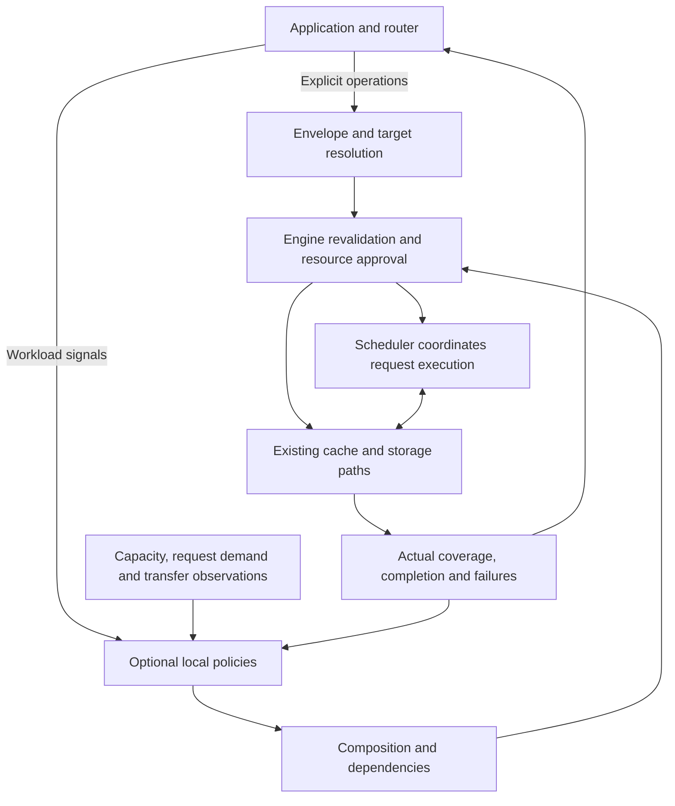

# [RFC]: Programmable KV Cache: Composable Policies for Agentic Serving

## Summary

This RFC proposes a programmable KV cache interface for SGLang. Applications express retention, movement, and sharing intent, while engines can optionally enable local optimization policies. Applications and routers responsible for placement across engines provide task context; the engine combines it with current capacity, request demand, and transfer state to approve operations and report actual outcomes.

The design reuses the existing hint envelope, session-aware caching, HiCache, and direct external-storage integration. Explicit commands are the default, local policies are optional, and retention uses finite eviction priorities that memory pressure may override. The contribution centers on policy composition, shared resource approval, and coordination between cache preparation and request execution. A vLLM reference implementation evaluates these mechanisms; the measurements below are vLLM results and require separate validation in SGLang.

## Motivation

An agent task spans model requests, tool waits, and parallel branches, with related context tracked through a session. When one request ends, useful KV may temporarily have no active request reference but still be needed after a tool returns. Recency alone cannot distinguish an imminent resume from a long pause or a completed branch; keeping every paused context on the GPU competes with other requests.

CPU memory and external storage provide colder tiers for GPU cache content. Prefetch loads content onto the GPU before use, while demotion moves temporarily unused content to a colder tier. Both consume bandwidth and capacity, and their value depends on the recomputation and waiting they avoid. Applications know tool state and branch relationships; engines know current occupancy, expected growth of running requests, and transfers already approved but not yet complete.

Admission is the scheduler's decision to let a waiting request execute, and cache preparation must account for it. A tool might return in 10 milliseconds while its request remains queued for capacity. Immediate prefetch can displace other work and be evicted again before use. Conversely, several resumes may need the same prefix and should share one load rather than allocate and transfer it repeatedly.

## Relationship to #27574 and existing work

[#27574](https://github.com/sgl-project/sglang/issues/27574) already proposes router-issued sharing, prefetch, demotion, and retention intent, with allocation, completion, and cache visibility owned by the engine. Its scope also includes control outside inference requests. This RFC builds on those foundations by specifying optional local policy composition, resource lifetimes, and request scheduling cooperation. The author also supports combining external orchestration with engine-local policies, making a common execution interface a suitable integration point. [Discussion](https://github.com/sgl-project/sglang/issues/27574#issuecomment-4684302169)

Retention guarantees differ explicitly. #27574 separates priority-based Retain from bounded Pin; its initial experiment maps Pin to time-limited protection in Mooncake storage while GPU copies remain evictable. This RFC's public foundation is soft priority on current copies, with no public Pin guarantee. A backend lease can remain a separate capability with separately reported guarantees.

| Existing work | Reuse and proposed addition |
| --- | --- |
| [Envelope RFC #36224](https://github.com/sgl-project/sglang/issues/36224), [transport PR #38891](https://github.com/sgl-project/sglang/pull/38891) | Reuse the merged KvHintsEnvelope; add action interpretation, independent submission, and correlated outcomes |
| [Session identity #29436](https://github.com/sgl-project/sglang/pull/29436), [session-aware cache #29173](https://github.com/sgl-project/sglang/pull/29173) | Reuse identity and current cache associations; add explicit branch, context-range, and task-completion semantics |
| [Range priority #36208](https://github.com/sgl-project/sglang/issues/36208), [soft retention #27970](https://github.com/sgl-project/sglang/pull/27970) | Coordinate priority, expiry, and independent declarations on shared content; distinguish explicit renewal from renewal on cache hits |
| [HiCache roadmap #21846](https://github.com/sgl-project/sglang/issues/21846), [external linker #37381](https://github.com/sgl-project/sglang/pull/37381), [hybrid extension #41343](https://github.com/sgl-project/sglang/pull/41343) | Reuse pools, transfers, and completion paths; add resource approval and reusable publication for operations outside requests |
| [Q4 roadmap #43098](https://github.com/sgl-project/sglang/issues/43098), [queued storage prefetch #45128](https://github.com/sgl-project/sglang/issues/45128) | Coordinate global placement with local preparation and distinguish storage warming from GPU readiness |

This RFC preserves global routing, cache allocation, and model computation. It does not require a particular predictor or scheduling algorithm. Backends may support different combinations of operations, but capabilities and unsupported cases must be explicit.

## Design principles and execution flow

Application inputs are explicit operations or workload signals. Operations specify content and destination; signals describe tool waits, resumes, importance, and task completion for enabled policies to interpret. Without an appropriate policy, a signal returns an unconsumed outcome and causes no cache action.

KvHintsEnvelope is the existing common message format: a message contains an identifier and a list of actions, each with its own identifier, type, version, and payload. Request-attached and independent submissions reuse it. SGLang should assign interpretation per action so the engine and a backend cannot execute the same action twice. The action list is neither an atomic transaction nor an implicit dependency order.

Policies receive read-only observations and propose actions; they cannot mutate request queues, allocators, or transfer resources. The composer coalesces compatible work, orders dependencies, and resolves policy competition without changing accepted explicit intent. The scheduler and cache owner revalidate targets and capacity before execution, and backends execute only approved scope. With control and policies disabled, existing behavior remains; enabled overhead must be measured.

### Content targets and session lifetime

Operations may select committed content from an attached request, a tracked branch and token range within a session, or explicit content identifiers that the engine can resolve. Content identity includes compatibility information such as model weights and cache layout. Physical addresses and reusable allocator block IDs are not persistent public targets.

Associations describe which tasks need content, residency describes where valid copies currently exist, and operation results describe what one command achieved. These are separate records. A session ID cannot reconstruct untracked context, and a destination engine needs resolvable content metadata. Historical branch/range operations bind their scope at submission; later branches do not join implicitly. Request-attached actions may explicitly bind committed content at successful completion.

Resolution reports actual coverage, gaps, and dependencies needed for reuse without silently expanding the target or substituting another branch. Task completion removes its associations and policy declarations while preserving content still used by other tasks, active requests, or transfers. Finishing generation for a tool wait does not finish the task. Logical records are bounded, and unavailable history is reported explicitly.

### Primitive operations and retention

| Operation | Contract |
| --- | --- |
| SET_PRIORITY | Set or clear one caller's soft eviction claim on current copies; allocate no capacity and alter no active-use references |
| COPY_TO | Establish usable content at the destination while preserving the source; report the actual tier and coverage |
| MOVE_TO | Establish the destination and reclaim eligible source residency; report storage and reclamation separately, with partial completion when reclamation is blocked |

Prefetch is COPY to GPU; demotion is MOVE to a colder tier. Cross-engine restoration through shared storage requires source publication and destination loading, each approved by its owning engine. Clearing priority is not eviction, and MOVE cannot imply deletion unsupported by a backend. Native action names require coordination with existing kv.* proposals and are not assumed to be a cross-engine standard.

Each priority claim has its own ID, ordered revision, value, and finite duration. Expiry starts when the claim takes effect; equal or older retries do not renew it, and conflicting content at the same revision is rejected. A newer revision may update or clear that caller's claim. Effective priority is the maximum among valid claims, without combining one caller's higher value with another's longer duration. Invalidation ends the claim; a reloaded copy does not inherit it. Hits do not renew expiry, tree splits do not restart it, and merges must preserve independent scopes and durations.

For example, A requests priority 90 for ten seconds and B requests priority 20 for sixty seconds. Priority is 90 for the first ten seconds and 20 afterward; A's expiry leaves B intact. Both remain soft preferences under pressure, while active request and transfer references continue to protect memory in use.

### Shared observations and policy composition

Observations expose capacity by pool and tier, active references, reclaimable content, approved loads, transfer progress, waiting requests' incremental demand, and expected growth of running requests. Facts and estimates remain distinct; unknown or missing information cannot be treated as zero demand. Policies read only the categories they need, avoiding a full request scan for every signal.

Operations loading the same compatible content to the same destination share physical transfers and capacity while retaining independent results and cancellation interests. Competing work is approved against the actual remaining budget rather than spending the same stale free-space observation twice. A priority action dependent on a new copy waits for successful publication rather than relying on its position in an action list.

**Capacity and ordering** is an optional scheduling policy that coordinates session capacity shares and selects waiting requests. Shares are borrowable soft constraints, not permanent memory partitions. Selection considers importance, waiting time, and reusable content. Each allocation rechecks incremental demand using actual prefix hits and leaves room for expected growth of running requests. Excessive waiting may lift policy deferral, but physical feasibility still applies.

**Application coordination** additionally uses tool waits and resume information to choose retention, saving, and prefetch. Short pauses require comparing transfer costs with capacity competition. Under queued demand, preparation can follow the session selected for admission; with spare capacity, it may run earlier. Routers still choose global placement, and the existing scheduler applies local guidance. TokenCake's work on capacity, ordering, and cache cooperation motivates these examples; its formulas and predictors are outside the public interface.

### Asynchronous completion, cancellation, and failure

Receipt does not imply resource approval, and approval does not imply reusable KV. Results correlate message/action IDs and distinguish queued, running, completed, partial, deferred, missing, unsupported, failed, and cancelled outcomes. GPU COPY completes only after all required shards and model states finish transferring and are registered for reuse. Historical completion does not guarantee continued residency. MOVE reports destination storage and source reclamation separately, preserving referenced sources.

Request-attached GPU-source operations acquire independent transfer holds at successful completion before request cache references are released. Abort or error cancels pending actions; preemption and resumption do not duplicate completion actions. Independent operations progress even with no inference work. During complete preparation, required members already in place remain protected. Temporary references are transferred or retired with the operation, and consumers acquire their own references before use; this protection is not a lasting residency guarantee.

A resume encountering a compatible load joins it. Cancellation removes only that caller's interest without disrupting other waiters. Even when all callers cancel, resources remain held until the backend stops accessing them. Failed loads cannot publish incomplete reusable content; supported paths may fall back to recomputation while preserving the failure result.

Identical retries return existing results within a bounded retention window without reexecution or renewal; intentional retries use new submission IDs. Callers can acknowledge collected results to release detailed records, with no indefinite deduplication promise after expiry. Capacity exhaustion rejects new control work instead of discarding active records. Restarts and weight changes isolate stale commands, completions, and incompatible KV. A session ID is not authorization: independent control is intended for routers or deployment-authorized applications.

## SGLang integration

HiCache manages transfers among GPU, engine-owned CPU memory, and external storage. The direct linker connects external storage to engine buffers without requiring a persistent engine CPU cache. Each path uses its own adapter to reuse allocation, buffers, and completion machinery under the common control semantics.

| Integration point | Requirement |
| --- | --- |
| Attached and independent ingress | Reuse KvHintsEnvelope; state HTTP, Python, and gRPC coverage separately; expose capabilities and correlated results |
| Scheduling and request completion | Approve operations through the scheduling state owner; acquire transfer holds before releasing request resources; support idle progress and admission coordination |
| Sessions and cache tree | Reuse identity and associations; add explicit branch/range resolution; apply claims and invalidation through TreeCore, the cache-tree interface |
| HiCache / direct linker | Advertise directions, destination tiers, publication outside requests, and cancellation support; reuse real pools and transfer paths |
| Observation | Separate operation outcomes, associations, and residency; reuse cache events while handling restart and event gaps |

Session-aware eviction and explicit priority must be coordinated. In the new mode, explicit priorities precede default session preference among eligible candidates, and conflicting policy proposals cannot override explicit intent. Disabled behavior remains unchanged. Tree structure and state dependencies still determine reclaimability; changing a node's numerical priority alone is insufficient.

Hybrid models may require full-attention prefixes, sliding-window state, or Mamba checkpoints. These can use different pools, and transfers may need staging buffers. Approval and completion must preserve that structure and report a jointly reusable boundary. Python and Rust TreeCore implementations follow the same semantics, with separate validation and explicit fallback or unsupported outcomes.

A direct linker that can load only into active-request buffers needs reusable cache publication before supporting independent GPU prefetch. Storage warming or arrival in CPU memory is not GPU readiness. Capability discovery covers direction, target type, model-state representation, parallel layout, completion meaning, and cancellation, rather than a single prefetch flag.

Session attribution in a storage event identifies the writer, not every later shared hit. Placement indexes need separate association information and sequence-aware replay or snapshots to repair gaps, treating affected residency as unknown until recovery. Engines can share control semantics and policy tests; exchanging raw KV across frameworks requires independent validation of model, weight, and layout compatibility.

## vLLM reference implementation and experiments

[vLLM RFC #57103](https://github.com/vllm-project/vllm/issues/57103) and its [reference implementation PR #62382](https://github.com/vllm-project/vllm/pull/62382) provide the control, lifecycle, and execution paths described above. Subsequent experiments evaluate policy benefits and costs. These are neither SGLang measurements nor a controlled comparison against #27574.

### Setup and primary results

Experiments use Qwen3.8-27B in BF16 on two A100 80GB PCIe GPUs, with model computation distributed across both devices. Concurrency is 64 and maximum context length is 16,384 tokens. GPU memory utilization is set to 50%, yielding approximately 12.12 GiB of KV capacity per GPU. Movement configurations additionally use Mooncake Store with a storage region configured as 64 GB. Comparisons therefore hold GPU cache capacity constant but do not equalize total memory resources.

The workload comes from real tool-call trajectories in the verl reinforcement-learning framework using GSM8K math tasks. The pressure replay contains 32 shared-prefix groups, 256 trajectories, 920 calls, approximately 8.78 million input tokens, and 60,136 output tokens. Complete inputs and output lengths are fixed, and subsequent calls use recorded inputs so generation differences cannot change the workload. Live tool execution is evaluated separately. Multiple samples per question mean the trajectories are not 256 independent problems.

The native configuration uses default caching and scheduling. Capacity and ordering changes resource allocation and request selection; application coordination adds retention and movement. Pressure comparisons have three independent runs per configuration; cache-fit and prediction experiments have two. Results use medians and include model calls, control processing, and transfer draining, excluding startup and warmup. For fixed work, throughput gain is native elapsed time divided by candidate elapsed time, minus one.

Time to first output is measured from request submission to the first token. P99 and P95 describe values below which approximately 99% and 95% of samples fall; latency columns also report medians across runs.

| Pressure configuration | Batch completion time | Throughput gain over native | Time to first output P99 | Trajectory latency P95 |
| --- | ---: | ---: | ---: | ---: |
| Native | 1,997.26 s | — | 125.02 s | 758.91 s |
| Capacity and ordering | 1,386.21 s | 44.1% | 71.59 s | 534.92 s |
| Application coordination | **1,188.53 s** | **68.0%** | **70.51 s** | **469.94 s** |

Application coordination improves throughput by another **16.6%** over capacity and ordering. Uncached input falls from approximately 7.97 million to 4.61 million tokens, and mean server queueing falls from 73.80 to 32.72 seconds. This supports reduced recomputation and better execution ordering as explanations, without isolating every policy's independent contribution.

The cache-fit workload uses four prefix groups, 256 trajectories, 864 calls, and 66,160 output tokens. Native, capacity and ordering, and application coordination take **170.87, 168.97, and 169.61 seconds**, respectively, with equal cache hits and no stores or loads in the coordinated configuration. The small timing differences are not treated as stable gains; the result shows that cost checks avoid unnecessary movement in this measured low-pressure case.

### Prediction sensitivity and tradeoffs

The following experiments preserve actual tool pauses and model work while changing the resume estimate supplied to the policy. Recorded true pauses reveal tool completion time but not future queueing or admission time.

| Resume information | Batch completion time | Throughput gain over native | Relative to normal application coordination |
| --- | ---: | ---: | ---: |
| Recorded true tool duration | 1,230.42 s | 62.3% | −3.4% |
| Fixed estimate of 1 millisecond | 1,181.00 s | 69.1% | +0.6% |
| Fixed estimate of 30 seconds | **1,077.04 s** | **85.4%** | **+10.4%** |

A longer pause estimate permits more content to enter saving and preparation, providing a plausible explanation for increased reuse. The data does not yet separate movement, request ordering, and run variation. **85.4% is the measured pressure result under that prediction setting; the normal configuration's 68.0% also has validation that movement is suppressed when the working set fits.** Thirty seconds is not a general recommendation.

A more aggressive forced-movement configuration takes 1,016.20 seconds under pressure but 493.26 seconds in the cache-fit workload, approximately **2.9 times** native elapsed time. Each run stores about 259–261 GB and loads only about 2.0–2.7 GB, showing that successful transfers do not guarantee net benefit. Control work also costs CPU time: native and application coordination use client CPU medians of 71.81 and 127.31 seconds. These include output processing and metric collection, so the entire difference cannot be attributed to control overhead.

The observations support three interface requirements: policies need demand and measured transfer information together; complete preparation should coordinate with admission; outcomes should correlate with actual consuming requests. Residency at every lookup is not fully observed, so neither all cache hits nor all incomplete-prefix outcomes can be attributed to useful or wasted prefetch.

### Live tools and correctness

A live tool loop completes 256 trajectories, 923 calls, and 60,231 output tokens in 1,079.34 seconds, scoring 248/256 (96.875%). Twelve calls reach the output limit, and one tool-argument formatting warning is recorded. Generated trajectories differ from fixed replay, so this time is not used to calculate the throughput gains above.

In a separate paired evaluation of 128 questions, both CPU-memory and Mooncake paths score 124/128 with recomputation and 124/128 with actual loaded-cache reuse, with no answer differences or output truncations. Validation also exercises shared branches, load/resume races, cancellation, capacity deferral, storage outage, restart, and real parameter updates and rollback. These results support correctness within the tested scope, not complete training updates or every model and parallel layout.

## Implementation and evaluation plan

Delivery proceeds through a common contract: actions, independent ingress, and results; branch/range resolution and copy-scoped priority; COPY, MOVE, and idle progress on one supported backend; shared loading, optional policies, and admission cooperation; then further model states, TreeCore implementations, and parallel layouts. Each stage states its coverage and continues to use existing cache and transfer machinery.

SGLang performance comparisons should include native caching, existing session-aware caching, the same backend without directives, application-issued explicit control, capacity and ordering, and application coordination. Explicit control and local policies receive the same task information and predictions, with bounded retries, to identify the value of fast local observation. Report GPU, CPU-cache, external-store, and staging capacity separately, and compare pressure and cache-fit workloads independently.

Correctness tests cover independent shared claims, ranges and splits, publication of all required model states, concurrent loads and resumes, partial MOVE, safe cancellation, restart, and weight isolation. They must check real reuse and model outputs. Performance evaluation combines fixed replay with live tools, measuring throughput, task outcomes, tail waiting, recomputation, consumed and unused movement, and control costs. Workloads should extend to coding agents, long-document QA, and mixed long and short requests.

## Open questions

- How should explicit priority and existing session preference be selected and combined while retaining disabled behavior?
- How should action names, independent endpoints, and result retention integrate with existing message consumers?
- How should HiCache and direct linker expose common stage outcomes, and in what order should hybrid state, Python/Rust, and parallel layouts be supported?
- How should tool waits, request queues, and transfer time jointly guide preparation, and how should actual prefetch consumption be measured?
