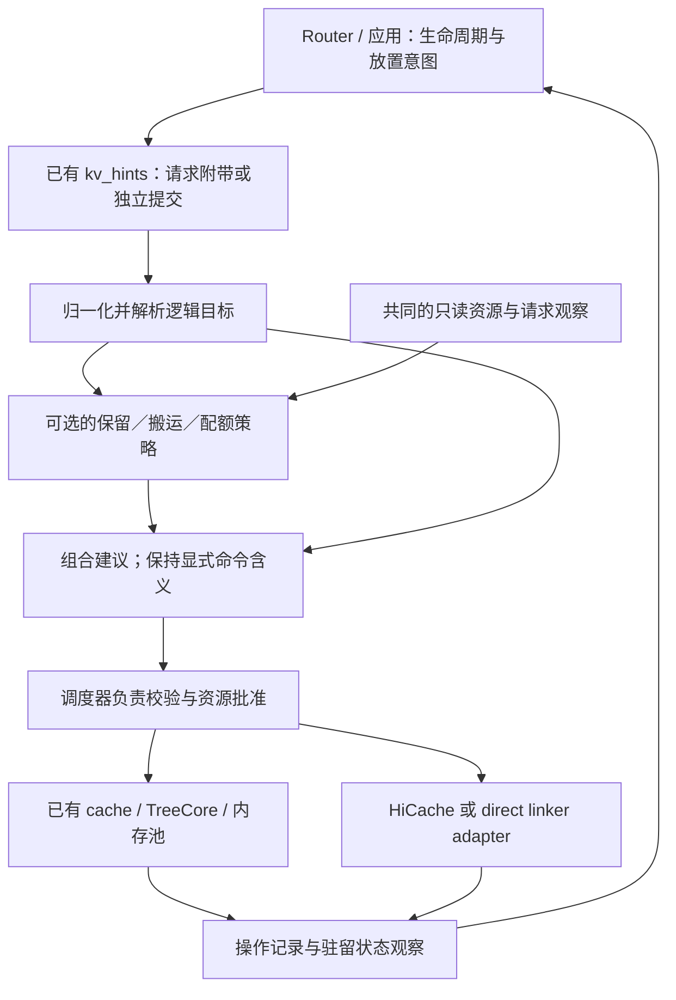

# [RFC]: Programmable KV Cache: Composable Policies for Agentic Serving

[English version](/home/youwei/bzh/project/TokenCake/RFC/sglang-rfc/docs/programmable-kvc/RFC-programmable-kv-cache.md)

状态：讨论稿，2026-10-19。本文提出接口与语义，不表示下述实现或评估已经合入。

## 概述

本 RFC 为 SGLang 提出面向 agentic serving 的可编程 KV Cache 抽象。router 和应用提供任务生命周期与放置意图；可组合的引擎策略根据共同资源视图，提出保留、搬运及可选的配额或请求调度建议；引擎通过已有缓存与存储机制批准资源，并报告实际完成情况。

SGLang 已具备类型化 KV hint、感知 session 的 radix cache、分层存储和直接连接外部缓存的 linker。本提案用共同的观察、建议、组合、批准和完成契约连接这些基础。策略与后端 adapter 独立注册，使不同算法能够共享执行与资源生命周期管理机制。请求附带命令和两次模型调用之间的独立控制，是进入同一契约的两种路径。

引擎默认执行显式指令。本地策略按需启用。缓存保留采用具有有限 TTL 的软淘汰优先级；本 RFC 不引入公共 Pin 保证。

## 动机

一个 agent 任务会跨越多次模型调用、工具等待和分支。一次模型请求结束后，有价值的前缀可能已没有活跃请求引用。router 知道任务可能恢复，引擎则知道当前内存池占用、已准入请求的后续增长和未完成传输。仅靠请求级淘汰标量或不解释载荷的 hint envelope，都不足以定义如何结合这些信息。

| Agentic serving 事件 | 可能触发的缓存决策 | 引擎需要结合的信息 |
| --- | --- | --- |
| 父 agent 等待工具或子 agent | 保留有价值的上下文，或将符合条件的副本移至冷层 | 生命周期／预计等待时间，以及可回收容量和传输成本 |
| 多个分支复用共享前缀 | 保留共享内容的价值，同时对物理副本去重计账 | 分支关联，以及当前引用和驻留状态 |
| 多个暂停任务可能在资源紧张时恢复 | 选择有用的准备操作，避免占用已准入请求所需容量 | 可选恢复时间估计，以及请求增长和在途预留 |
| 分支或任务完成 | 移除其关联和策略持有的声明 | 任务关系，以及其他任务的共享引用和传输持有 |

这些决策可能相互影响：保留策略认为父任务前缀价值较高，搬运策略发现暂停时间较长，准入策略又需要为已就绪分支腾出空间。它们需要共同的组合与批准边界，才能形成可执行的本地计划。全局 worker 选择继续由 router 负责。

例如，两个策略可能要求在同一目的地准备同一个前缀。它们应共享一份兼容传输和一份物理预留，同时保留各自的结果。如果它们要求不同前缀，且总需求超过可用容量，引擎就必须选择、裁剪、延期或拒绝部分工作。观察到容量不代表获准使用容量，收到命令也不代表 KV 已可用。

## 相关工作与本提案的贡献

本提案补充以下工作：

| 已有基础 | 复用部分与拟补充内容 |
| --- | --- |
| [Programmatic KV RFC #27574](https://github.com/sgl-project/sglang/issues/27574) 与 [Q4 路线图 #43098](https://github.com/sgl-project/sglang/issues/43098) | 沿用 router/engine 职责划分和分层搬运目标；明确本地策略组合、资源生命周期和可观察的执行结果。#27574 因不活跃被自动关闭，不能据此判断实现已完成。 |
| [Envelope RFC #36224](https://github.com/sgl-project/sglang/issues/36224)、已合入的 [#38891](https://github.com/sgl-project/sglang/pull/38891) | 复用 `KvHintsEnvelope` 和请求传输；增加动作消费者与独立提交入口，不另建 envelope。 |
| 已合入的 [session identity #29436](https://github.com/sgl-project/sglang/pull/29436) 与 [session-aware UnifiedRadixCache #29173](https://github.com/sgl-project/sglang/pull/29173) | 复用身份、代次、组件引用跟踪和生命周期挂点；增加明确的 continuation/range 寻址及策略接入。 |
| [Range retention #36208](https://github.com/sgl-project/sglang/issues/36208)、[soft retention #27970](https://github.com/sgl-project/sglang/pull/27970) | 协调 range 与淘汰工作。本 RFC 要求独立的副本级声明和显式 TTL 续期；命中续期属于另一种策略。 |
| [HiCache 路线图 #21846](https://github.com/sgl-project/sglang/issues/21846)、已合入的 [linker integration #37381](https://github.com/sgl-project/sglang/pull/37381) 与 [hybrid linker #41343](https://github.com/sgl-project/sglang/pull/41343) | 通过按能力划分的 adapter 复用存储、内存池、传输和完成路径。 |
| [排队期间 SSD 预取 #45128](https://github.com/sgl-project/sglang/issues/45128) | 区分请求排队期间的存储端预热与请求到达前的独立准备；两者都可以参与已批准的计划。 |
| [KVCR 后端 #36409](https://github.com/sgl-project/sglang/pull/36409) | 保留后端自行解释动作及 peer 复用的空间；接入前协调传输与完成语义。 |
| [vLLM RFC #57103](https://github.com/vllm-project/vllm/issues/57103)、草稿 [#62382](https://github.com/vllm-project/vllm/pull/62382) | 对齐作者在 9 月 24 日和 10 月 19 日更新的语义边界：默认仅提供执行机制、本地策略可选、无公共 Pin。SGLang 继续使用自己的缓存架构。 |

### 本提案的贡献

本 RFC 的贡献是使这些机制能够协同工作的引擎策略契约：

| 拟提供能力 | 对使用方的价值 |
| --- | --- |
| 容量、请求需求和传输的共同观察 | 保留、搬运和配额策略依据同一组资源事实作判断 |
| 仅提出建议的策略与可替换组合器 | 不同算法能够组合，无须各自直接修改缓存状态 |
| 统一的引擎批准与资源生命周期边界 | 兼容工作共享资源，竞争工作不能重复使用同一份容量 |
| 逻辑任务／continuation／range 寻址 | 策略可以跨模型调用和分支操作，无须长期使用物理 block ID |
| 可关联的完成结果与驻留反馈 | 后续路由和策略决策能够区分意图与已实现状态 |
| 可选的请求／KV 协同 | 调度器扩展能够消费感知需求的建议，无须强制采用某一种调度算法 |

独立控制使这些能力能在工具等待等无生成期间使用。本 RFC 不替换全局路由，不规定某一种配额或预测算法，不改变 attention 语义，也不要求所有存储后端实现全部操作。按 token range 保留缓存不会从模型输入中删除文本。

## 设计方案

### 职责与执行流程



router 负责全局放置和任务意图。引擎本地策略使用共同观察提出动作建议。调度器及缓存管理方校验目标、分配资源并修改本地状态。后端 adapter 通过已有传输机制执行已批准的工作。策略只接收值和不暴露内部结构的目标描述，不能取得可修改的调度器、分配器或存储对象。

没有注册策略时，信号返回 `unconsumed`，不派生动作。显式命令仍须经过能力、引用和容量检查。组合器可以解决策略建议之间的竞争，但不能重新解释显式指定的目的地、优先级或操作。冲突的自主策略建议应让步，或报告无法继续的原因。

已有 `CacheAction` 与组件机制继续承担内部执行职责，不扩张成公共 hint 协议，也不成为另一套独立的策略分配器。

无论所有命令都由编排器发出，还是由引擎策略根据运行信号派生，都适用以下职责边界：

| 组件 | 读取的信息 | 决定或修改的内容 | 边界 |
| --- | --- | --- | --- |
| Router/orchestrator | 任务进度、已知前缀匹配、worker 负载和位置 | worker 选择、任务关系、全局放置和生命周期意图 | 不能批准本地 GPU 容量，不能由接收回执推断完成 |
| 本地策略 | 不可变信号、已解析目标和所需类别的观察 | 动作、执行时机及可选请求调度建议 | 不能修改缓存、调用存储或持有分配器引用 |
| 组合器 | 显式指令、策略建议及其依赖 | 哪些兼容建议组成计划，哪些建议让步 | 不能静默改变显式动作语义或批准资源 |
| 调度器／缓存管理方 | 当前请求状态、内存池容量和未完成操作 | 准入、目标复核、预留、发布和资源回收 | 负责物理状态修改的顺序 |
| TreeCore／组件 | 逻辑 radix 结构、组件引用和缓存动作 | 匹配、结构可行性、合法淘汰和组件覆盖范围 | 不解释应用工具或全局路由策略 |
| 后端 adapter | 已批准的内容、buffer、目的地和传输要求 | 后端查询、数据搬运和完成报告 | 不能扩大已批准范围或独立释放 buffer |

概念上的处理路径如下：

```python
inputs = normalize(envelope, execution_context)
targets = resolver.bind(inputs.targets, lifecycle_phase)
view = observations.read(categories_required_by_enabled_consumers)
proposals = [p.propose(inputs.signals, targets, view) for p in policies]
plan = composer.combine(inputs.explicit_actions, proposals, view)
approved = engine.validate_and_reserve(plan, current_state)
executor.submit(approved)
# 状态管理线程在后续推进中处理完成屏障，
# 发布可复用内容、结束资源持有，并更新操作结果。
```

这段示意规定职责，不规定调用频率。仅修改优先级的策略不应强制扫描请求需求；等待生命周期边界的命令可以保持排队，同时不预留目的地内存。计划构造与引擎批准之间，容量可能已经变化，因此两者分别处理。

#### 核心记录

跨越这些边界的记录，应能区分待执行意图和物理状态：

| 记录 | 必须表达的含义 |
| --- | --- |
| `KVTarget` | 逻辑内容选择器、namespace、continuation/range 和请求的位置 |
| `ResolvedTarget` | 已绑定内容区间、复用所需依赖、已知副本、缺失部分和支持粒度 |
| `WorkloadSignal` | 任务／分支生命周期事实或预测，可包含 importance 与预计恢复时间 |
| `KVProposal` | 建议动作、来源策略、理由、最早有用的执行时间和依赖 |
| `KVPlan` | 选中的动作及顺序约束，并能区分显式意图与策略派生意图 |
| `ApprovedOperation` | 实际批准的区间、目的地、预留、传输持有和执行实例 |
| `OperationResult` | 可关联的阶段结果、实际覆盖范围、失败原因及已释放或仍持有的资源 |

这些是内部契约类别，无须另建公共 envelope，也不要求每一类都对应一个单独分配的 Python 对象。

### 逻辑目标与 session 生命周期

以下三种身份分别维护：

- **内容（Content）**：兼容的 token 前缀或组件检查点，包含后端需要的缓存 namespace 及模型／布局上下文。
- **关联（Association）**：session 或 continuation 与内容之间的引用关系。
- **驻留（Residency）**：某个 engine/tier 上存在有效副本，并具有自己的生命周期。

公共目标可以选择附带请求的已提交内容、已知逻辑前缀／hash，或带有明确 continuation 和 token 半开区间的已跟踪 session。可复用的物理池索引不会作为持久标识暴露。router 无须构造 Mooncake object key，也无须了解物理分片布局。

整 session 操作覆盖其已跟踪分支。历史分支或 range 操作绑定明确的 continuation／前缀边界，不隐式选择最新分支。历史选择器在提交时保存快照。附带请求的符号目标则可以在声明的成功完成边界，绑定当时已提交的内容，包括实现支持的生成后缀。执行时重新校验所绑定内容的当前物理实现。历史缺失、副本缺失、粒度不支持和 namespace 不兼容分别报告。

已有 session tracker 能提供有用信息，但其组件 frontier 不构成完整历史索引。引擎接受 session 寻址或运行 session 级策略时，可启用有界的本地索引，提供 continuation 和任务树信息。router 也可以直接将目标解析为精确逻辑内容。索引淘汰不能虚构历史，也不能使执行中的操作留下悬空引用。

任务完成会移除该任务树的关联与策略持有的声明，不删除其他任务共享的内容，也不撤销活跃请求或传输引用。因工具调用而结束一次生成，不等于任务完成。`StreamingSession` 继续按已有契约持有请求／KV 状态；附带普通任务身份不会取得这些锁，也不隐含 streaming-session 行为。

#### 本地索引与分支解析

可选本地索引的功能契约不依赖具体数据结构：

| 查询／更新 | 预期行为 |
| --- | --- |
| 关联 continuation | 记录精确前缀边界和可选父 continuation；尽可能共享公共祖先 |
| 解析 session/range | 返回已跟踪的逻辑区间，并明确历史缺失；不替换成其他分支 |
| 反向查询 | 找到关联任务和声明持有者，不将某个触发 session 视为独占 owner |
| 记录驻留变化 | 更新某个 engine/tier 的副本，同时保留逻辑关系 |
| 结束任务树 | 移除其关联和策略声明，同时保留其他任务的共享引用 |
| 从事件缺口恢复 | 修复前将受影响位置标记为未知，保留有效逻辑关系 |

设前缀 H 分叉为 H+B 和 H+C。整 session 操作在提交时绑定这两个已跟踪分支。针对 continuation B 和区间 `[0, k)` 的操作，仅绑定 H+B 中对应的前缀。B 的后续扩展不会扩大已提交操作的范围。如果独立任务 U 也关联 H，结束父任务不授权删除 U 的副本或清除 U 的声明。

索引无法仅凭 session 名称重建未跟踪的历史分支。惰性启用的索引需要 router 提供明确前缀元数据、已有 continuation 记录，或其他权威内容描述。只保存 hash、缺少重载所需组件／检查点信息，也不足以承诺可复用。已绑定的操作描述在操作结束前应保持有效，不受普通索引缓存淘汰影响。

range 解析分别处理调用方的逻辑区间、实际执行操作的区间，以及复用所需的额外前缀／窗口／检查点依赖。例如，FULL page 大小为 16 token 时，不能将截至 token 4100 的范围报告为精确覆盖至 4100 的完整页操作。允许裁剪时，adapter 可报告实际覆盖至 4096；也可以返回粒度不支持。不能静默将保护扩大至 4112。恢复一个内部后缀可能依赖更早的前缀或检查点，这些依赖应与保留或回收范围分别报告。

### 基本操作语义与保留声明

拟议的 SGLang 原生动作名称为 `sglang.set_priority`、`sglang.copy_to` 和 `sglang.move_to`，由已有 envelope 携带。这些名称与载荷版本仍待评审，尚未形成跨引擎标准。动作消费者交付前，应与已有 `kv.*` 提案协调语义。

| 操作 | 契约 |
| --- | --- |
| `SET_PRIORITY` | 在选中的当前副本上设置或清除某个调用方的软淘汰声明。不分配容量、不改变正确性引用、不保证驻留。 |
| `COPY_TO` | 在已批准的目的地建立可用内容，同时保留源副本。完成后报告实际目的层和覆盖范围。 |
| `MOVE_TO` | 建立目的副本后，回收所选源副本中符合条件的驻留。目的端完成与源端回收属于不同阶段；无法回收时可报告部分完成。 |
| 显式淘汰（能力支持时） | 移除符合条件的所选驻留。清除优先级声明不等于淘汰；向空目的地 MOVE 不隐含淘汰 API。 |
| 关联与任务生命周期 | 更新逻辑关系和策略所有权，不作为复制内容的隐式副作用。 |

更高层的 Retain、Prefetch、Demote、Share 意图可以转换成这些操作。GPU 预取对应目的地为 GPU 的 COPY；L3→host COPY 的完成含义不同。经 Store 跨引擎共享，需要 A→Store 发布，以及由目的引擎负责的 Store→B 准备。成功写入共享 Store 不代表 B 的 GPU 已驻留。一个引擎不能替另一个引擎批准 GPU 容量。

#### 副本级优先级声明

优先级声明包含调用方作用域内的 `claim_id`、有序 `revision`、有符号整数 `value`，以及有限正数 `ttl_seconds`。使用更高 revision、`value: null` 只清除该声明。同版本或旧版本重试不续期；同一 revision 携带冲突内容时，修改状态前拒绝。在适用的优先级模式中，数值越大越晚淘汰；其他条件允许时，有效优先级相同的候选按 LRU 排序。

声明绑定已解析的副本代次、tier、组件覆盖范围、namespace 和 engine epoch。物理索引与副本代次标识保持内部使用。副本的有效声明优先级取仍有效声明的最大值。各声明独立到期、独立释放：

> A 对同一副本设置 priority 90、有效 10 秒；B 设置 priority 20、有效 60 秒。前 10 秒有效优先级为 90，之后为 20，不能组合成“90、60 秒”。

TTL 从声明生效时开始计时。缓存命中不续期。到期移除声明，不要求立即删除数据。副本被淘汰或失效时，其声明结束。新加载或重算得到的副本不继承旧声明。持续任务策略可以在新副本建立后提交新声明，其新生命周期应可观察。

仅拆分 radix 节点不会创建新的物理副本。声明应随覆盖区间拆分，保持原 TTL 和 revision。合并节点不能把不同声明的生命周期压缩成一个标量。range 处理应声明精确支持能力，或返回实际裁剪范围；不支持的部分页／检查点不能被静默报告为完整覆盖。

SGLang 当前在 FULL 组件中将 session-reference 偏好置于基础数值优先级之前；SWA/Mamba 使用各自的 session-aware 扫描。拟议的可编程保留模式中，显式缓存优先级高于这一启发式偏好。session 偏好作为策略输入或建议参与，不再作为无条件排在外层的排序键。策略生成的声明不能抵消与其冲突的、已接受的显式指令；独立显式调用方之间仍遵循声明合并规则。

这是按需启用的行为变化。未启用时保留原有淘汰行为。实现必须明确模式选择及其与已有 session-aware 开关的组合方式；仅修改 node priority、保留更高优先级的 session 比较器，无法实现上述语义。结构与组件级联约束继续由缓存负责：如果子节点或检查点仍依赖某个内部节点，优先级不会使它变成可独立回收的节点。

后端 lease（包括 [#30796](https://github.com/sgl-project/sglang/pull/30796) 讨论的 Mooncake 保留能力）属于单独能力，其保证需分别报告。SET_PRIORITY 不隐含这些保证。

#### Envelope 示例与动作依赖

下面的独立控制示例展示拟议载荷形态，并非 SGLang 已支持的 API。调用方取得 B 能解析的 continuation 描述后，将消息发给 worker B；也可以提供等价的显式内容目标：

```json
{
  "protocol_version": "0.1",
  "message_id": "task-7-prepare-b",
  "actions": [
    {
      "action_id": "restore-prefix",
      "action_type": "sglang.copy_to",
      "action_version": "1.0",
      "payload": {
        "target": {
          "kind": "session",
          "session_id": "task-7",
          "continuation_id": "branch-b-turn-3",
          "start_token": 0,
          "end_token": 4096
        },
        "src": {"tier": "storage", "backend": "mooncake"},
        "dst": {"tier": "gpu", "engine_id": "worker-b"}
      }
    }
  ]
}
```

接收回执关联 `task-7-prepare-b / restore-prefix`，不表示 B 已预留容量。完成结果标识实际建立的组件区间与目的地。调用方随后可以对新副本提交 SET_PRIORITY；可选策略也可以将其作为依赖 COPY 的动作提出。TTL 从优先级实际生效时开始。COPY 失败不能在不存在的目的副本上留下成功的优先级声明。

已有 envelope 的 action 列表不提供原子事务或隐含依赖语义。无关动作可独立处理；公共多步请求在获得支持前，必须明确依赖关系。内部组合的 COPY → SET_PRIORITY 计划可以表达这一前提，不依靠列表顺序推断依赖。同样，接受一个动作不表示接受 envelope 中的全部动作。

### 策略观察、组合与容量

策略扩展使用以下概念接口；名称不规定具体 Python 类或 RPC schema。

| 接口 | 职责 |
| --- | --- |
| `PolicyView` | 只读的 pool/tier 容量、占用、可回收候选、活跃引用、预留、传输进度、请求需求估计和后端能力。 |
| `Policy.propose` | 消费生命周期信号与观察，返回保留、搬运或可选的调度建议。 |
| `Composer.combine` | 合并兼容工作、安排依赖并解决策略竞争，同时保持显式命令含义。 |
| `Engine.approve` | 复核当前目标、可行性和预算，通过已有资源管理方取得真实预留与资源持有。 |
| `Adapter.submit/poll` | 仅执行已批准范围，报告完成、失败以及传输是否已停止访问资源。 |
| `OperationRecord` | 管理某个操作实例的关联信息、批准范围、阶段结果和资源释放责任。 |

观察区分物理事实、估计和已承担的资源承诺。最大输出 token 预算仅是上限，不能直接当作预测。运行请求的后续增长与等待请求的增量需求可以影响批准，但不会增加物理容量。视图可以按需构造或采样；未被消费的信号不得触发完整请求／索引扫描。策略声明所需观察类别，其 CPU 成本纳入测量。

SGLang 的资源分布在不同内存池、组件和存储层：FULL page、SWA 存储、Mamba state、host staging，以及后端传输限制。一个 free-token 计数器不足以表达这些资源。共享和重叠持有不能导致物理分配重复计数。配额策略使用的 session 逻辑成本分摊不能替代分配器记账。

内容、namespace、组件覆盖、方向、目的地与后端兼容性都匹配时，多个操作可以共享传输。每个调用方保留自己的结果与取消状态。取消一个等待者，不能释放其他等待者、请求或 DMA 仍在使用的 buffer。不同操作不能各自独立使用观察到的同一份空闲空间。

可选的配额、准入和请求评分策略可以消费这些观察，并通过明确的调度器扩展返回建议。它们不自行重排队列或选择抢占对象。调度器负责应用建议及其公平性行为。没有消费者的 score 不构成调度优化。本 RFC 不将 TokenCake 公式、某种 DAG 表示或预测器规定为标准。

#### 观察契约

观察契约应提供足以解释决策的信息：

| 观察 | 提供方 | 含义 |
| --- | --- | --- |
| 各 pool 的空闲与已分配单元、可回收候选 | 缓存／内存池管理方 | 当前物理事实，共享分配只计一次 |
| 请求锁、传输持有和待兑现预留 | 请求与操作管理方 | 已存在的资源承诺，约束可回收量和后续分配 |
| 等待请求增量需求、运行请求后续增长 | 调度器／缓存观察 | 明确标记的估计，并说明假设哪些兼容缓存区间可用 |
| 后端可用性、已知／未知命中、排队工作和传输估计 | Adapter | 带版本的观察或估计，不构成远端持久性保证 |
| Session/continuation、工具等待／恢复、importance 和预计恢复时间 | Router／应用 | 可选语义上下文；没有预测仍是有效输入 |
| 操作结果与实际传输成本 | 操作注册表／adapter | 用于判断未来搬运是否有用的反馈 |

视图应标记采样时间，以及截断或缺失的类别。基于不完整视图决策时，不能把未知远端驻留当作命中，也不能把未包含的需求当作零。实现可缓存计算昂贵的估计，同时增量维护成本较低的物理计数。引擎批准始终使用当前可行性检查。

#### 策略组合与冲突处理

参考组合器可以保持显式动作、合并兼容传输、安排前置依赖，并裁决竞争的策略建议。无须将任意评分归一化为一个加权和。保留、搬运与配额策略可能使用不同评分尺度；裁决接口应明确采用的优先关系或策略专用比较规则。例如：

| 竞争意图 | 必须满足的处理方式 |
| --- | --- |
| 两个策略要求同一个兼容 GPU 前缀 | 一份物理加载／预留；调用方记录和取消状态独立 |
| 显式优先级与自主 session 偏好冲突 | 保持显式声明；抑制冲突策略建议或报告冲突 |
| 建议先存入冷层再回收 GPU | 尝试回收源副本前，必须成功发布冷层副本 |
| 对仍在加载的副本提出优先级建议 | 仅作用于成功建立的范围；从实际生效时开始 TTL |
| 两个不同预取都能放入同一份旧快照中的空闲空间 | 根据实际剩余预算批准，不能重复使用旧快照中的容量 |

#### 资源批准与持有责任

用一个容量例子说明：某目的地在扣除策略保留余量前，有 10 GiB 可用于额外工作。两个针对同一 8 GiB 前缀的建议只占用一次 8 GiB；两个不同的 8 GiB 前缀则不能同时接受。如果所选准入策略还为已准入请求的增长保留 3 GiB，剩余预算只有 7 GiB，任何一个 8 GiB 加载都无法放入。这些数字仅说明记账方式；模型最大输出长度不会自动作为预测增长被预留。

批准过程记录资源责任，继续复用已有分配器：

| 资源 | 获取时机 | 释放或所有权转换 |
| --- | --- | --- |
| 目的地预留 | 提交传输前，通过对应 pool 获取 | 安全失败／取消后释放；发布时转换为普通驻留分配 |
| 源端传输持有 | 请求或临时源所有权结束前 | 仅在后端不再访问源数据后释放 |
| Host staging | 进入需要它的传输阶段前 | 对应读／写屏障完成后归还，包括延迟完成的取消 |
| 共享传输等待者 | 加入兼容工作时 | 只移除该等待者的需求；仍有其他使用方或 DMA 时保留共享资源 |
| 优先级声明 | 选中并更新有效目的副本时 | 显式清除、到期或随副本失效；不拥有物理分配 |

如果预留已经取得真实 pool 空间，该空间已从 free 计数中移除，不能再扣减一次。尚未对应真实分配的逻辑预留，则必须减少后续批准预算。两种形式都需要唯一管理方和明确的转换步骤。

#### 可选策略示例

TokenCake 类扩展用于展示接口用途，不固定默认算法。工具等待策略可以结合预计暂停时长、已观测的存出／加载时间和当前压力，再决定是否提出 MOVE。恢复策略可以在容量充足时提前准备；如果提前驻留会与排队工作争用容量，也可以将准备与准入协调。配额策略可以在任务类别间分摊共享逻辑成本，借用未使用容量，并提出准入或评分建议。pool 对每个物理副本仍只计一次，配额上限也不等于保证预留。实现需要测量额外复用是否抵消了当前负载中的传输和控制成本。

### 生命周期、异步结果与失败

请求附带与独立提交共用分发器、目标解析器和资源批准路径。独立控制不创建合成推理请求。

对于请求附带的 GPU-source COPY/MOVE 和 SET_PRIORITY，实现必须区分成功完成、中止／错误、抢占和中间检查点。拟议的成功完成模式在请求引用释放前，对已提交内容执行动作，并按需取得独立传输持有。中间检查点不会再次执行动作。冷层源内容的准备可以在准入前执行；匹配的恢复请求等待已有兼容传输，不重复发起加载。

已接受工作可以在原请求结束后继续存在。未完成操作参与调度器推进、空闲／休眠判断、flush、权重更新排空与关闭流程。后端 I/O 线程不能绕过状态所有权修改 radix 或分配器。发布可复用结果前，所有必要 rank 和组件必须到达相应完成屏障。内部可以继续采用已有的逐层加载，但某一层提前就绪，不代表独立查询的整个前缀已经可复用。

#### 结果状态与重试

结果模型区分以下状态：

| 阶段／结果 | 含义 |
| --- | --- |
| Received | 已关联并保存输入以供处理；不承诺容量或驻留。 |
| Queued | 等待生命周期边界或前置依赖；不隐含物理预留。 |
| Accepted/running | 已批准范围与资源；工作仍可能未完成。 |
| Completed/partial | 报告已完成阶段、实际内容／tier 覆盖，以及尚未回收的源副本。 |
| Deferred | 当前资源条件下，本次提交无法继续；调用方可以明确发起一次新提交来重试。 |
| Missing/unsupported/rejected | 区分内容缺失、能力不可用，以及请求无效或不被允许。 |
| Failed/cancelled | 区分后端失败与主动放弃；资源访问停止前，两者都不允许复用 buffer。 |
| Unconsumed | 信号没有已启用的策略消费者，未派生任何动作。 |

查询与事件读取同一份操作记录。结果携带原 message/action 标识、engine epoch、执行实例、namespace、实际范围和阶段结果。请求附带动作在 fan-out 时需要执行上下文，因为批处理或并行采样可能将相同 envelope ID 带入不同请求。同一绑定上下文内的重放返回已有结果，不续期 TTL、不重复预留，也不误绑定新副本。取消操作标识具体操作实例，防止迟到取消影响后续提交。

COPY 完成描述已经观察到的状态变化，不提供持久驻留 lease。后续普通淘汰仍被允许。驻留查询报告当前状态，不为副本预留空间。MOVE 成功存储数据、但因引用或结构约束未能回收源副本时，分别报告这些阶段。

#### 取消、失败与资源回收

操作注册表与物理传输任务的生命周期相关，但分别管理。一个调用方可以完成结果收集或取消自己的操作，而共享任务仍继续服务其他调用方。任务管理方继续负责所有 buffer 访问与 pool 资源回收。超时表示停止等待，不能作为设备或网卡已停止写入的证据。

| 并发交错或失败情形 | 可观察结果与资源责任 |
| --- | --- |
| 批准时容量不足 | 返回 Deferred，不提交传输；返回前撤销临时取得的资源 |
| 分发前源副本消失 | 仅在已绑定目标内报告缺失或重新解析；不能替换为被复用物理槽位中的其他内容 |
| 某个必要 rank／组件失败 | 不发布不完整的可复用范围；相关访问全部停止后回收 buffer |
| Store 成功，但源仍被引用 | 报告目的端已存储，以及带未回收源区间的部分完成 MOVE |
| 兼容 COPY 期间恢复请求到达 | 加入已有加载；依赖已发布副本前取得请求所有权 |
| 多个调用方中的一个取消 | 取消该操作的需求；保留共享传输和请求持有 |
| 唯一调用方在分发后取消 | 尽可能停止后续阶段，等待后端访问结束，再归还未使用分配 |
| Reset／重启或权重代次变化 | 拒绝旧完成结果／意图；使受影响引擎代次失效，不删除无关 Store 对象 |

活跃操作、目标描述、声明、策略派生工作、完成结果与重放指纹都应有界。元数据预算耗尽时返回明确控制结果，不能阻止普通无 hint 推理。ACK 可以释放详细终态记录，同时保留有界重放指纹。保留窗口到期后，协议不承诺无限期的恰好一次执行；调用方使用唯一 ID，并检查返回的 engine epoch 与 replay window。

worker 仍访问 buffer 时，不能仅为满足结果缓存上限而丢弃物理操作记录。已完成资源的释放也不能依赖事件送达：慢速或断开的观察方通过保留状态／查询恢复，不应无限阻塞状态管理线程。

格式错误的 envelope 遵循入口校验。不支持或失败的动作产生有界的逐动作结果；其他独立且受支持的动作仍可处理。每个动作只有一个执行方。后端透传与原生解释的归属必须明确，防止重复执行，同时为注册的消费者保留未经解释的载荷。

控制失败不能引入无效 KV。在后端契约允许安全回退时，恢复请求可走普通查询／重算路径。对于不安全或失败的 direct-linker 加载，已有的请求中止行为继续适用；本提案不承诺所有失败都能透明重试。

#### 可信控制面与缓存代次

独立控制位于可信控制面边界内，部署允许时也包含直接连接的可信应用。session 身份不提供授权或缓存兼容性保证。已有 namespace、cache salt、模型／adapter 身份和布局检查继续作为判断依据。RL 权重更新必须排空不兼容工作，并在复用前切换相应缓存代次／namespace。本地 reset 不能顺带删除其他引擎或兼容代次的存储对象。

### SGLang 接入与观察

| 层次 | 接入方向 |
| --- | --- |
| 入口 | 复用 `managers/kv_hints.py`、`GenerateReqInput`、分词后 IPC 和 `Req`；增加独立控制，并明确原生 HTTP、Engine、OpenAI 兼容入口和 gRPC 的覆盖范围。已有传输不表示所有公共入口均已支持。 |
| 状态管理方 | 将分发／推进接入调度器负责的生命周期，以及 `release_kv_cache`／checkpoint／lock 处理；释放请求前复核源资源生命周期。 |
| 缓存 | 在 `BasePrefixCache`／UnifiedRadixCache／TreeCore 周围增加后端中立的目标、声明和操作挂点；复用组件分配、淘汰及延后执行的动作。 |
| HiCache | 适配 GPU↔host 与 storage↔host 操作、预留、staging、完成队列和存储 key。cache 模式与 buffer-only 模式分别声明支持能力。 |
| Direct linker | 适配已有外部 linker 契约，不要求引擎必须具有 host cache 层；区分后端预热与 GPU 副本建立，保留请求私有加载约束。 |
| Python/Rust | 扩展 TreeCore 边界和共享语义测试。当前 session-aware 功能需要 Python；明确报告不支持的组合或有意采用的回退，不假设两者能力一致。 |
| 观察 | 复用 KV events 表达驻留；按需增加有界操作结果和关联增量，并与已有 snapshot/replay 工作协调恢复。 |

FULL、SWA 和 Mamba 具有不同的可复用边界。搬运一个 token range 可能需要前缀依赖、完整滑动窗口或检查点。结果应暴露实际可恢复覆盖范围。单个组件或分片存在，不能报告为完整前缀命中。布局转换、异构拓扑和后端 key 继续由 adapter 负责；能力矩阵明确哪些组合可执行。

#### 后端能力矩阵

能力发现应描述可执行组合，仅有 `supports_prefetch=true` 不够：

| 维度 | 应声明的信息示例 |
| --- | --- |
| 动作与方向 | GPU→host COPY/MOVE、storage→host COPY、host/storage→GPU COPY、本地优先级 |
| 目标支持 | 附带请求的已提交内容、显式内容、已跟踪 session/continuation、range 对齐 |
| 缓存表示 | FULL/SWA/Mamba 覆盖、必要检查点／窗口边界、draft/target state 限制 |
| 执行路径 | HiCache cache 模式、buffer-only staging、direct linker、请求附带或独立推进 |
| 并行布局 | 支持的 TP/PP/CP 配置及跨拓扑转换要求 |
| 完成含义 | 后端已预热、host 已就绪、GPU 可复用、冷层已存储、源已回收；取消与访问停止的支持情况 |
| 观察 | 可查询驻留的 tier、关联增量、操作 replay 和重启信息 |

这些维度是实现需要满足的契约，不表示所有组合已经可用。支持某布局的普通推理，不自动代表支持该布局的独立缓存搬运。

#### HiCache 与 direct linker 适配

HiCache adapter 沿用已有 GPU→host write-through 或 write-back，以及 host→storage 路径。它将这些阶段与已批准操作关联，保留相关组件锁，并在必要存储写入完成后才报告冷层可用。恢复过程解析兼容存储 key，按需取得 host/staging 容量，再取得已批准 GPU 容量，完成已有 load-back／发布流程。仅到达 host，只能满足目的地为 host 的 COPY。

direct linker 可以在外部存储与 GPU buffer 之间传输，无须持久的引擎 L2 cache。存储端 SSD→DRAM 预热可以改善后续加载，但占用的是后端容量，不构成 GPU 分配预留。目的地为 GPU 的 COPY 仍需要目的 pool 分配，以及完成／发布契约。如果 linker 只支持加载到活跃请求的 buffer，在实现持久发布之前，独立 GPU 准备必须声明为不支持。不能通过报告后端已有数据来代替这一能力。

adapter 将已解析内容转换为后端管理的 page key、pool 和 rank slice。Mooncake group 可以表达一组对象的完整性或后端保留，但不能替代 session→内容关联。只要 namespace 和内容身份仍兼容，即使最早写入内容的 session 已结束，已知冷副本仍可能有用。结束写入方任务不能删除其他任务仍共享的 Store 对象。

FULL 前缀页、SWA 尾部和 Mamba 检查点的物理长度可能不同。解析器返回全部必要依赖，以及所有必要组件共同满足的可复用前缀边界。批准和结果在传输／发布期间持续保留组件与 pool 身份。Python 与 Rust TreeCore 必须对节点拆分、旧 handle、声明和完成覆盖采用相同规则；Python 对象指针不能作为可移植逻辑目标。

#### 事件、关联与恢复

已合入的 [#37482](https://github.com/sgl-project/sglang/pull/37482) 将存储内容归因到触发该存储的 session。共享前缀命中可能不产生新事件，因此这既不构成 owner 集合，也不提供完整关联流。router 已知的匹配和可选本地关联增量，用于补充这些关系。

事件消费者区分发布者代次与序号缺口。尽可能复用已有 bounded replay；无法修复的缺口使相关驻留变为未知。snapshot 启动与 router 恢复分别由 [#33394](https://github.com/sgl-project/sglang/issues/33394)、[#34407](https://github.com/sgl-project/sglang/pull/34407) 和 [#32729](https://github.com/sgl-project/sglang/pull/32729) 跟踪。重启清除该引擎的运行记录，并使其旧位置失效，不移除其他引擎的副本或全局任务关系。

不同反馈更新不同状态：

| 事实 | 消费者更新 | 不能据此推断的内容 |
| --- | --- | --- |
| 发布新副本 | 为报告的 engine/tier/component 范围增加有效驻留 | 其他目的地也有驻留，或该副本具有持久 lease |
| 新增关联 | 将 session/continuation 与内容连接，包括命中产生的关联 | 对内容的独占所有权 |
| 移除驻留 | 使该位置失效 | 全局任务关系或其他副本也被删除 |
| 活跃引用降为零（能力提供时） | 在其他约束允许时，标记副本可能可回收 | 任务完成或立即淘汰 |
| 操作结果 | 推进对应操作及其阶段 | 历史完成后仍持续驻留 |

恢复应在重建状态前尝试重放有界缺口。replay 无法修复时，消费者将相关发布者的位置标为未知，再通过受支持的 snapshot/query 或后续观察恢复。某个操作的结果可以修复该操作范围内的已知状态，但不构成完整引擎快照。查询响应应标识 engine epoch 和观察时点，避免旧响应覆盖较新的驻留事实。

### 端到端示例：工具等待后在另一引擎恢复

1. 某任务分支在 A 上完成生成并进入工具等待。router 保留其 continuation 边界，发送显式搬运命令或可选生命周期信号。
2. A 批准符合条件的源区间和传输持有。adapter 将必要内容发布到共享 Store。
3. MOVE 报告哪些冷副本已有效，以及哪些 GPU 区间实际完成回收。其他分支的引用可能使结果保持部分完成。
4. router 选择 B，在恢复前为明确且兼容的前缀提交 COPY。B 批准自己的目的资源，并共享已有的兼容加载。
5. B 在完成后报告实际 tier 和可复用覆盖范围。任务策略可以在 B 上提交新的副本级优先级声明；A 的旧 GPU 声明不会隐式迁移。
6. 恢复请求校验并使用可用内容。缺失时按已有安全路径回退。任务完成移除其关联和策略声明，同时保留其他任务的引用。

这里的优化机会是将有用的搬运与工具等待重叠。暂停过短、传输过慢或目的地饱和，都可能使搬运产生负收益。预测是可选输入，单凭高命中率或复制成功都无法证明端到端收益。

## TokenCake 实验：优化前后对比

以下作者提供的测量比较 TokenCake 参考系统优化前后的表现，用于论证拟议接口；相应 SGLang 接入仍需评估。[TokenCake 论文](https://arxiv.org/abs/2510.18586v5) 提供时间／空间调度思路，下列表格则采用各负载所链接的独立实验记录。不同模型、预算和负载作为不同研究分别报告。

### 静态 DAG 负载

优化前配置已启用前缀缓存、chunked prefill、异步调度和完整输入长度的准入检查。两种配置使用相同模型 kernel 与 prefill token 预算。共同设置如下：

| 设置 | 数值 |
| --- | --- |
| 模型 | Qwen2.5-14B-Instruct，BF16 |
| 每组 GPU | 一张 A800-SXM4-80GB；TP=1、PP=1 |
| GPU 内存比例／最大上下文 | 0.5 / 32,768 tokens |
| GPU KV 容量 | 3,050 blocks × 16 tokens，优化前后相同 |
| Batch token 预算 | 8,192 |
| 额外 CPU KV | 优化前与仅调度组不使用；工具等待期间存出及组合组使用 100 GiB |
| 每轮工作量 | 24 个完整 DAG、648 次模型调用、155,136 个输出 token |

依赖、到达时序、初始输入和输出预算固定。生成过程实际执行模型，并将输出加入后续输入；工具结果和等待为模拟。完成时间覆盖整个 DAG 批次，包含到达间隔与工具等待。比较保持 GPU KV 容量相同，但搬运配置额外增加 CPU 容量，因此测量对象是相应系统配置，不能作为总内存相同条件下的纯策略比较。[实验记录](https://github.com/vllm-project/vllm/issues/57103)

| 应用 QPS | 优化前：批次完成时间（s） | 优化后：批次完成时间（s） | 降幅 |
| --- | ---: | ---: | ---: |
| 0.05 | 875.74 | 676.86 | 22.7% |
| 0.1 | 940.76 | 671.28 | 28.6% |
| 0.2 | 938.79 | 640.45 | 31.8% |
| 0.5 | 938.99 | 648.05 | 31.0% |
| 1.0 | 960.44 | 631.77 | 34.2% |

在 1.0 QPS 时，应用 P95 从 929.12 秒降至 604.50 秒，下降 34.94%。优化前／组合配置在 0.05 和 0.1 QPS 各运行三轮；其他配置与 QPS 组合各一轮。存在重复时，对各指标分别报告中位数。这些有限批次测量不能确定最大可持续到达率。

#### 组件消融

1.0 QPS 的消融分别考察调度与工具等待期间存出：

| 配置 | 批次完成时间（s） | 相对优化前降幅 | 抢占次数 |
| --- | ---: | ---: | ---: |
| 优化前 | 960.44 | — | 41 |
| 优化后：仅调度 | 837.78 | 12.77% | 0 |
| 优化后：仅工具等待期间存出 | 691.01 | 28.05% | 58 |
| 优化后：调度 + 存出 | 631.77 | 34.22% | 0 |

组合配置相对仅存出又减少 8.57% 的完成时间。收益存在重叠，不能直接相加。仅存出组仍使用可执行条件和 importance 信息。初始输入的 prefill 计算量从 3,282,597 降至 952,780 token；GPU 命中与 CPU 重载共同带来的输入复用率从 44.12% 增至 83.78%。这项 prefill 计量不包含抢占后的重复 prefill，不能代表全部重算量。

对本 RFC 而言，这组消融支持通过共同的观察／批准契约提供请求需求与缓存搬运信息。受测调度实现还修改了排序、准入和抢占选择，其完整收益不能全部归因于缓存操作接口，也不能直接套用于另一种调度器接入。

### 真实 coding agent

另一组实验通过 mini-swe-agent 2.4.6 运行 SWE-bench Verified 的前 20 个任务，实际修改仓库并执行工具。每组最多并发 16 个任务。两组各使用一张 GPU，共享 36 核 CPU 配额和 240 GiB host-memory 上限。问题与初始设置一致，生成轨迹和请求长度可能不同。[实验记录](https://github.com/vllm-project/vllm/issues/57103)

| 指标 | 优化前 | 优化后 | 含义 |
| --- | ---: | ---: | --- |
| 1,800 秒内的输出 token | 83,292 | 106,239 | 固定观察窗口 |
| 输出吞吐（tokens/s/GPU） | 46.27 | 59.02 | +27.6% |
| 请求平均 TPOT | 51.73 ms | 36.55 ms | −29.3% |
| 抢占次数 | 11 | 0 | 运行级实测计数 |
| 采样 GPU KV 使用率峰值 | 100% | 91.83% | 降低 8.17 个百分点 |
| 输入缓存复用率 | 9.97% | 10.39% | 增加 0.42 个百分点 |
| 请求平均排队时间 | 18.06 s | 34.65 s | 等待增加 |

吞吐行使用 1,800 秒窗口；其他行保留来源中的运行级汇总。CPU 重载占优化组输入的 1.14%。较小的复用增量不能解释全部吞吐收益，生成效率与调度取舍也有影响。记录没有证明任务解决正确率提高。这组结果支持在报告吞吐时同时报告准入延迟和任务结果。

静态 DAG 与 coding-agent 测量覆盖工具等待期间存出，以及后继请求触发的恢复。它们没有证明请求到达前预测性预取的收益；这项能力需要单独评估执行时机与预测误差。

### 不同缓存预算下的多轮 rollout

较新的参考实验使用 Qwen3.8-27B BF16、两张 A100-80GB、TP=2、并发 16，最大上下文 16,384，batch token 预算 4,096。负载来自真实 verl `ToolAgentLoop`：八个 GSM8K 问题各采样四次，形成 32 条 rollout；单次请求约有 8.8K–10.9K 输入 token，工具等待约 5–20 ms。搬运配置额外使用 Mooncake Store。[详细实验记录](https://github.com/zhhangBian/vllm-note/blob/067332e66730b336e749c336aa97aee1a223b615/docs/programmable-kvc/rollout-report-2026-10-12.md)

主要对照每种配置进行三轮固定工作量回放。每轮包含 113 次模型调用、8,121 个输出 token；模型重新生成，但后续输入和输出长度遵循已有轨迹。回放不重新执行工具，也不评估奖励。计时包含控制准备和任务清理，排除服务启动与显式预热，并保留记录中的运行波动。各配置分组执行，未随机交错。

| 每卡 GPU KV | 优化项 | 优化前（s） | 优化后（s） | 吞吐变化 |
| --- | --- | ---: | ---: | ---: |
| 2 GiB | 配额／前缀复用调度 | 449.06 | 219.63 | +104.5% |
| 2 GiB | 保留 + 搬运 + 配额 | 449.06 | 247.60 | +81.4% |
| 8 GiB | 保留 + 搬运 + 配额 | 54.09 | 56.13 | −3.6% |

每行数值为相同 GPU KV 容量下的中位数。2 GiB 预算用于主动形成内存压力。仅配额组不搬运 KV，将抢占中位数从 118 降至 17。完整配置每轮加载／写入总量的中位数约为 11.97/33.50 GB，表现未超过仅配额组。其最慢回放的 TTFT P99 为 99.92 秒，优化前中位数为 95.98 秒。因此吞吐改善不代表尾延迟始终改善。

8 GiB 时，两组均零抢占，并命中 999,600 个输入 token。完整策略避免了搬运，但仍有控制与观察开销。这一反例要求实现即使没有发出动作，也测量低压力路径。

另有执行真实工具并评估奖励的在线运行：优化前耗时 452.37 秒，完整策略 288.73 秒，仅配额 214.34 秒；采样 rollout 的奖励均为 32/32。每组只有一次在线运行，轨迹不同，独立问题仅八个。这些观察描述 rollout serving，不构成 trainer/optimizer 性能结论。

#### 较大工作集的后续实验

较大工作集的后续实验使用 256 条 rollout、920 次调用、60,136 个输出 token，并发 64，两组每卡 GPU KV 均为 12.12 GiB。配额／前缀复用配置将完成时间从 1,994.30 降至 1,369.48 秒，吞吐提高 45.6%；抢占从 9 降至 2 次，TTFT P99 从 123.42 降至 71.21 秒。每组仅运行一轮，使用 120 秒等待上限与 30 秒老化尺度；该配置的重复稳定性和低压力开销尚未测量。[后续实验记录](/home/youwei/bzh/project/TokenCake/RFC/vllm-rfc/docs/programmable-kvc/rollout-report-2026-10-18.md)

### 实验对接口设计的启示

这些负载为以下接口要求提供依据：

| 观察 | 设计要求 |
| --- | --- |
| 调度与存出可以互补，但组合也可能表现较差 | 策略共享观察和执行资源；分别评估各组件及其组合 |
| 短工具等待可能没有足够时间摊销搬运 | 将时机和实测传输成本作为可选策略输入，不要求每次暂停都搬运 |
| 高复用率或已完成加载不能解释全部加速来源 | 分别归因实际复用、重算、排队时间、传输字节与端到端任务时间 |
| 工作集可容纳时，即使零搬运也可能退化 | 限制信号／索引开销，避免不必要的客户端等待和完整需求扫描 |
| 吞吐与尾延迟可能向不同方向变化 | 将公平性、准入延迟和任务级结果纳入验收标准 |

## 实施计划

保留完整架构目标，同时将实现组织为便于评审的部分：

- 共同的动作／结果契约、分发器、独立控制、能力发现，以及有界 replay/query 状态。
- 副本级优先级声明、revision/TTL 行为、range/split 处理，以及通过所选模式接入 session-aware 淘汰。
- HiCache 与 direct-linker adapter、独立推进、资源持有、兼容加载合并，以及分阶段 MOVE 结果。
- 可选本地策略／组合器和调度建议示例，再扩展 router 接入及更多组件／拓扑组合。

上述顺序不表示后续能力已经实现，也不将 RFC 范围缩减为第一批实现。每项改动应扩展相关 SGLang 既有测试套件，并说明能力／验证矩阵。

## 评估计划

### 正确性与生命周期验证

正确性检查应覆盖：共享声明的独立性与到期；清除／重试顺序；page 和 checkpoint 边界；拆分／合并稳定性；任务分支与旧代次；受支持范围内的 Python/Rust 等价性；重复 COPY 与 resume 竞争；所有必要 rank／组件完成后的发布；部分完成 MOVE；分发前后取消；存储失败；空闲推进；reset 与权重更新。测试必须验证实际前缀复用和模型输出，不能只检查 RPC 成功或字节计数。依赖硬件的测试与 CPU 契约测试分别组织。

### 性能对照与测量

在同一 SGLang 基线上比较：

- 原生缓存策略与已有 session-aware 模式。
- router 显式控制、引擎仅判断可行性的模式。
- 仅优先级、仅搬运、可选调度建议，以及组合策略配置。

分别报告 GPU KV、host cache、共享 Store 和 staging 容量。评估应包含低压力开销、由实际并发／工作集形成的压力、短／长工具等待、分支、共享前缀、预测误差、控制面延迟和后端失败。跟踪任务完成时间、TTFT/TPOT 尾部、吞吐、重算、恢复请求实际复用、传输字节、未使用的准备结果、准入延迟／公平性、CPU 成本及元数据内存。固定工作量回放与真实 agent／工具运行回答不同问题，应分别报告。

优化前后实验为这套对照矩阵及低压力对照提供依据。SGLang 实现需要复现相关行为并测量自身性能，才能声称获得同样收益。

## 待讨论问题

供上游评审的主要问题包括：原生动作命名及其与 `kv.*` 的关系、保留模式迁移、range/checkpoint 覆盖规则、独立 HTTP/gRPC 控制形态，以及分阶段的 HiCache/linker/Rust 支持。核心提议保持为软优先级、显式命令优先、副本级声明和由引擎负责的资源生命周期。
