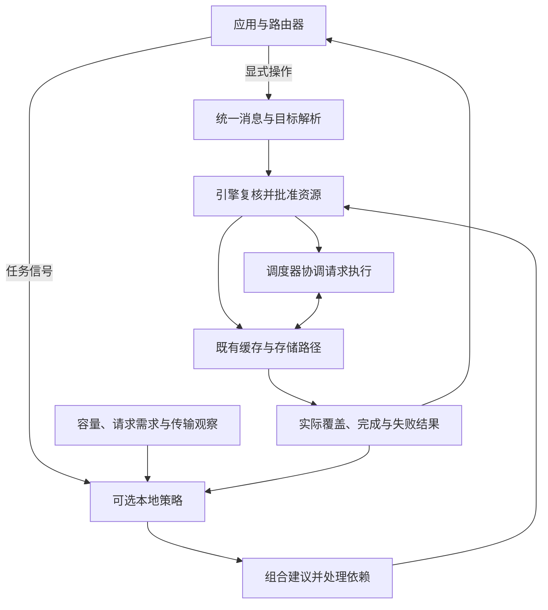

# [RFC]: Programmable KV Cache: Composable Policies for Agentic Serving

## 概述

本 RFC 为 SGLang 提出可编程 KV Cache 接口，使应用能够表达缓存保留、搬运和共享意图，并允许引擎按需启用本地优化策略。应用及负责跨引擎请求分配的路由器提供任务信息；引擎结合即时容量、请求需求和传输状态，批准操作并报告实际结果。

设计复用现有缓存控制消息、会话感知缓存、HiCache 分层存储和直接连接外部存储的接口。默认只执行显式指令，本地策略可选；保留采用有期限、可被资源压力覆盖的淘汰优先级。贡献集中于策略组合、统一资源批准和缓存准备与请求执行的协同。vLLM 参考实现已用于验证这些机制，下文实验均来自 vLLM，SGLang 的收益需要单独评估。

## 动机

智能体任务跨越多次模型请求、工具等待和并行分支，属于同一任务的上下文可以通过会话关联。一次请求结束后，有价值的缓存可能暂时没有请求使用，却会在工具返回时再次需要。仅依据近期访问记录管理缓存，难以区分即将恢复的任务、长时间暂停的任务和已经结束的分支；始终保留这些内容又会挤占其他请求的空间。

CPU 内存和外部存储可以作为保存 GPU 缓存的冷层。预取是在使用前将内容加载回 GPU，降级则将暂时不用的内容迁往冷层。两者都消耗带宽和容量，其价值取决于能否减少后续重算与等待。应用知道工具状态和分支关系，引擎掌握当前占用、正在生成的请求还需多少增长空间，以及已经批准但尚未完成的传输。

调度器选择等待请求进入执行的过程称为准入，它与缓存准备需要协调。例如，工具可能在 10 毫秒后返回，但目标请求仍会因容量竞争排队。立即预取可能占用其他工作的空间，并在实际使用前再次被淘汰。另一方面，多个恢复请求也可能需要同一段前缀，此时应共享一次加载，而非重复分配和传输。

## 与 #27574 及现有工作的关系

[#27574](https://github.com/sgl-project/sglang/issues/27574) 已提出由路由器表达共享、预取、降级和保留意图，由引擎负责分配、完成与缓存可见性，也包括请求之外的控制路径。本提案沿用这些基础，并把可选本地策略的组合、资源生命周期和请求调度协同具体化。该讨论的作者也认可外部编排与引擎内策略可以共同推进，因此两者适合通过共同执行接口整合。[相关讨论](https://github.com/sgl-project/sglang/issues/27574#issuecomment-4684302169)

保留保证存在明确差异：#27574 区分软优先级 Retain 与有限期限的 Pin，其初步验证将 Pin 映射为 Mooncake 外部存储中的限时保护，GPU 副本仍可回收。本提案的公共基础采用当前副本上的软优先级，不提供公共 Pin 保证；后端限时保护可以作为单独能力，独立报告其保证。

| 已有工作 | 复用部分与拟补充内容 |
| --- | --- |
| [统一消息 RFC #36224](https://github.com/sgl-project/sglang/issues/36224)、[传输 PR #38891](https://github.com/sgl-project/sglang/pull/38891) | 复用已合入的 KvHintsEnvelope；补充动作解释、独立提交和关联结果 |
| [会话身份 #29436](https://github.com/sgl-project/sglang/pull/29436)、[会话感知缓存 #29173](https://github.com/sgl-project/sglang/pull/29173) | 复用身份与当前缓存关联；补充明确的分支、上下文范围和任务结束语义 |
| [范围优先级 #36208](https://github.com/sgl-project/sglang/issues/36208)、[软保留 #27970](https://github.com/sgl-project/sglang/pull/27970) | 协调优先级、期限与共享内容的独立声明，明确与命中后续期的差别 |
| [HiCache 路线图 #21846](https://github.com/sgl-project/sglang/issues/21846)、[外部存储接口 #37381](https://github.com/sgl-project/sglang/pull/37381)、[混合模型扩展 #41343](https://github.com/sgl-project/sglang/pull/41343) | 复用内存池、传输和完成路径；补充请求外操作的容量批准与可复用发布 |
| [Q4 路线图 #43098](https://github.com/sgl-project/sglang/issues/43098)、[排队期间存储预热 #45128](https://github.com/sgl-project/sglang/issues/45128) | 协调全局放置与本地准备，区分存储端预热和 GPU 已就绪 |

本 RFC 不替换全局路由、缓存分配器或模型计算，也不规定必须采用某个预测器或调度算法。不同后端可以支持不同操作组合，但必须明确报告能力和不支持的情况。

## 设计原则与执行流程

应用输入分为显式操作和任务信号。显式操作指定要处理的内容和目标位置；任务信号描述工具等待、恢复、重要性及任务结束，供已启用策略判断是否需要动作。没有相应策略时，信号返回未消费结果，不产生缓存副作用。

KvHintsEnvelope 是已有的统一消息格式，一条消息携带消息标识与动作列表，每个动作具有独立的标识、类型、版本及参数。请求附带和独立提交复用这套格式。SGLang 应按动作确定负责解释的组件，避免同一动作被引擎和后端重复执行；动作列表本身不表示原子事务或隐含执行依赖。

策略只接收只读观察并提出建议，不直接修改请求队列、分配器或传输资源。组合器合并兼容工作、安排依赖并处理策略竞争，不能改变已接受的显式操作含义。调度器和缓存管理方在实际执行前复核目标与容量，后端只执行批准的范围。未启用控制与本地策略时，保留现有行为，并测量启用后的额外成本。

### 内容目标与会话生命周期

操作可以选择附带请求的已提交内容、已跟踪会话中的特定分支和 token 范围，或由引擎能够解析的内容标识指定目标。内容标识需包含模型权重、缓存布局等兼容性信息；物理内存地址和可复用块编号不作为持久的公共目标。

会话关联说明哪些任务需要内容，驻留说明有效副本当前位于哪个引擎和存储层，操作结果记录某次指令完成了什么。这三类信息分别维护。会话标识不能重建未记录的上下文，跨引擎操作需要目的端可解析的内容描述；历史分支或范围在提交时绑定，之后新增的分支不自动加入。请求附带动作也可以明确选择在成功完成时绑定已提交内容。

引擎返回实际覆盖、缺失范围及恢复所需依赖，不能静默扩大目标或改用另一个分支。结束任务会移除其关联与策略声明，同时保留其他任务、正在执行的请求和传输仍使用的内容。工具等待期间结束一次生成，不等于任务结束。逻辑记录有容量上限，缺失历史应明确报告。

### 基础操作与保留语义

| 操作 | 契约 |
| --- | --- |
| 设置优先级（SET_PRIORITY） | 设置或清除某个调用方对当前副本的软淘汰声明；不分配容量，不改变实际使用引用 |
| 复制（COPY_TO） | 在目的地建立可用副本并保留源，报告实际目的层与覆盖范围 |
| 迁移（MOVE_TO） | 建立目的副本后回收符合条件的源驻留，分别报告保存和回收；源无法回收时可返回部分完成 |

预取对应复制到 GPU，降级对应迁移到冷层。通过共享存储跨引擎恢复，需要源端保存和目的端加载两个操作，各引擎批准自己的资源。清除优先级不等于淘汰，迁移也不能隐含后端尚未支持的删除能力。原生动作命名与已有 kv.* 提案需协调，不能假定名称已经成为跨引擎标准。

每个优先级声明具有独立标识、更新版本、数值和有效期限。期限从实际生效开始计算，同版本或旧版本重试不续期，同版本内容冲突应拒绝；更高版本可以更新或撤销自己的声明。不同调用方的有效声明取最高优先级，不能把一方的较高数值与另一方的较长期限拼接。副本失效时声明结束，重新加载的新副本不继承旧声明；普通命中不续期，树节点切分不重启期限，合并也不能抹去独立声明的范围与期限。

例如，A 声明优先级 90、期限十秒，B 声明优先级 20、期限六十秒。前十秒有效值为 90，之后为 20，A 到期不影响 B。两者均为软保护，资源紧张时仍可淘汰；正在被请求或传输使用的内存继续由实际引用保护。

### 共同资源观察与策略组合

资源观察按内存池和存储层表达容量、实际引用、可回收内容、已批准加载、传输进度，以及等待请求的增量需求和运行请求的预计增长。事实与估计需要区分，未知或缺失信息不能当作零需求。策略只读取所需类别，避免每个信号都触发完整请求扫描。

两个操作加载同一段兼容内容到同一目的地时，共享物理加载和容量，但保留各自的结果及取消状态。不同操作竞争同一份空间时，批准必须基于实际剩余容量，不能重复使用旧观察中的空闲量。优先级设置若依赖复制生成的新副本，就应等复制成功后生效，不能仅依赖消息中的排列顺序。

**容量与顺序调度**是可选策略示例，用于协调会话容量份额并决定哪些等待请求先执行。份额属于可借用的软约束，不将显存永久分区；调度同时考虑请求重要性、等待时长和可复用内容。每次分配前应根据实际缓存命中复核新增需求，并为运行请求的预计增长留出空间。等待过久可以解除策略造成的延期，仍须满足物理容量要求。

**应用协同调度**在此基础上利用工具暂停和恢复信息，决定保留、存出与预取。短暂停需要比较搬运成本和容量竞争；有排队竞争时，准备可以与被选中的会话准入协调，空闲时则允许提前加载。全局请求放置继续由路由器负责，策略建议由引擎原有调度器应用。TokenCake 的容量、顺序与缓存协同研究为这些示例提供背景，具体公式和预测器不属于本 RFC 的公共接口。

### 异步完成、取消与失败

接收指令不代表资源已经批准，批准也不代表缓存已经可用。结果通过消息与动作标识关联，并区分排队、执行、全部或部分完成、资源延期、内容缺失、不支持、失败和取消。GPU COPY 只有在必要分片及模型状态完成传输，并登记为可复用缓存后才能完成；历史完成结果不保证副本随后一直驻留。MOVE 分别报告目的保存和源回收，仍有引用的源不能提前释放。

请求附带的 GPU 源操作在成功结束、请求释放缓存前取得独立传输使用权；中止或错误取消待执行动作，暂时中断后恢复的请求不会重复触发完成动作。请求外操作在没有生成工作时也应继续推进。完整准备期间，已到位的必要部分保持受保护，完成后按操作生命周期移交或释放临时引用；消费者在使用前取得自己的引用，临时保护不构成长期驻留保证。

恢复请求遇到兼容加载时应加入已有传输。取消只撤去该调用方的需求，不能破坏其他等待者；即使所有调用方取消，资源仍须等后端停止访问后才能释放。加载失败不得发布不完整内容，受支持路径可以退回重算，并明确报告失败。

重复提交相同操作在有界保留窗口内返回既有结果，不重复执行或续期；有意重试使用新的提交标识。调用方确认收齐结果后可以释放详细记录，窗口到期后不承诺无限期去重。控制记录达到上限时应拒绝新增工作，不能丢弃仍在使用的记录。重启和权重更新需隔离旧指令、旧完成结果及不兼容缓存；会话标识本身不构成授权凭证，独立控制面向路由器或部署授权的应用。

## SGLang 接入

HiCache 管理 GPU、引擎 CPU 内存与外部存储之间的分层传输；direct linker 是直接连接外部存储的执行路径，不要求持久的引擎 CPU 内存缓存。两类路径通过各自适配器复用既有分配、缓冲区和完成机制，共享上述控制语义。

| 接入位置 | 要求 |
| --- | --- |
| 请求与独立入口 | 复用 KvHintsEnvelope，明确各 HTTP、Python 和 gRPC 入口的支持范围，提供能力查询和关联结果 |
| 调度与请求结束 | 由调度状态管理方批准操作，在释放请求资源前取得传输使用权；支持无请求推进及准备与准入协同 |
| 会话与缓存树 | 复用已有会话身份和关联，补充分支及范围定位；通过维护树结构的 TreeCore 接口应用声明与失效 |
| HiCache / direct linker | 分别声明可执行方向、目的层、请求外发布与取消能力，复用实际内存池和传输路径 |
| 状态观察 | 分开操作结果、会话关联与副本位置，复用缓存事件并处理重启和遗漏事件 |

会话感知淘汰与显式优先级需要协调。新模式下，显式优先级在符合回收条件的内容之间优先于默认会话偏好，冲突的策略建议不能覆盖显式意图；未启用时保留现有行为。缓存树结构及状态依赖仍决定哪些内容可以回收，仅修改节点优先级不足以完成接入。

混合模型需要完整注意力前缀、滑动窗口状态或 Mamba 状态检查点等不同恢复内容。它们可以使用不同的内存池，传输还可能需要临时缓冲空间；批准与完成必须保留这些结构，并报告共同可恢复的范围。Python 与 Rust TreeCore 应遵循相同语义，支持范围分别验证，能力缺失时明确回退或返回不支持。

direct linker 如果只能加载到活跃请求的缓冲区，就需要补充后续请求可查找的缓存发布能力，才能支持独立 GPU 预取。存储端预热或仅到达 CPU 内存不能等同于 GPU 已就绪。能力发现应覆盖方向、目标类型、模型状态、并行布局、完成含义及取消行为，而非单一的“支持预取”标志。

现有存储事件中的会话归因只描述触发写入的一方，无法表示所有共享命中。位置索引应结合独立关联信息，并利用带序号的事件重放或完整状态快照修复缺口；恢复前将受影响位置标为未知。不同引擎可共享控制语义与策略测试，直接交换原始 KV 数据则另需模型、权重及布局兼容验证。

## vLLM 参考实现与实验

[vLLM RFC #57103](https://github.com/vllm-project/vllm/issues/57103) 及其[参考实现 PR #62382](https://github.com/vllm-project/vllm/pull/62382) 提供了上述控制、生命周期和执行路径。后续实验用于检验策略价值与代价，下述结果不代表 SGLang 性能，也不构成与 #27574 的同条件对照。

### 实验设置与主要结果

实验使用 Qwen3.8-27B、BF16（16 位浮点）精度、双 A100 80GB PCIe，模型由两卡共同执行。并发为 64，最大上下文为 16,384 token；显存使用比例设为 50%，每卡实际 KV 容量约 12.12 GiB。搬运配置额外使用存储区域配置为 64 GB 的 Mooncake Store，因此比较反映相同 GPU 缓存预算下的系统收益，总内存资源并不相同。

负载来自 verl 强化学习框架的真实工具调用轨迹，以 GSM8K 数学任务驱动模型与工具交互。压力回放包含 32 个共享前缀组、256 条轨迹、920 次调用、约 878 万输入 token 和 60,136 个输出 token。每次输入及输出长度固定，后续调用使用记录输入，避免生成差异改变工作量；真实工具运行另行评估。轨迹包含同题多次采样，不能视为 256 个独立问题。

原生配置沿用默认缓存与调度，容量与顺序调度只调整资源安排，应用协同调度增加保留和按需搬运。压力对照各独立运行三次，容量充足与预测敏感性实验各运行两次，按中位数比较。计时包含模型请求、控制处理和传输排空，不含启动与预热。固定工作量下，吞吐提升为“原生耗时 ÷ 对照耗时 − 1”。

首个输出等待指提交请求到收到第一个 token 的时间，P99/P95 分别描述约 99%/95% 的样本不超过的值，延迟列也取重复运行的中位数。

| 压力配置 | 批量完成时间 | 相对原生吞吐提升 | 首个输出等待 P99 | 任务完成延迟 P95 |
| --- | ---: | ---: | ---: | ---: |
| 原生引擎 | 1,997.26 秒 | — | 125.02 秒 | 758.91 秒 |
| 容量与顺序调度 | 1,386.21 秒 | 44.1% | 71.59 秒 | 534.92 秒 |
| 应用协同调度 | **1,188.53 秒** | **68.0%** | **70.51 秒** | **469.94 秒** |

应用协同调度比容量与顺序调度进一步提高 **16.6%** 吞吐，未命中输入量从原生约 797 万降至约 461 万 token，平均排队从 73.80 秒降至 32.72 秒。这支持减少重算与改善执行安排的解释，各策略的独立贡献尚未全部分离。

容量充足对照使用四个前缀组、256 条轨迹、864 次调用和 66,160 个输出 token。原生、容量与顺序调度、应用协同调度分别为 **170.87、168.97、169.61 秒**，命中输入量相同，应用协同配置没有存出或加载。小幅时间差异不作为稳定收益；该结果说明成本判断避免了已测低压力场景中的无效搬运。

### 预测敏感性与优化取舍

保持实际工具暂停及模型工作量不变，改变提供给策略的恢复估计，得到以下结果。记录中的真实暂停时长仅提供工具完成时间，不包含未来排队或准入时机。

| 恢复时间信息 | 批量完成时间 | 相对原生吞吐提升 | 相对常规应用协同配置 |
| --- | ---: | ---: | ---: |
| 记录中的真实工具耗时 | 1,230.42 秒 | 62.3% | −3.4% |
| 固定预测 1 毫秒后恢复 | 1,181.00 秒 | 69.1% | +0.6% |
| 固定预测 30 秒后恢复 | **1,077.04 秒** | **85.4%** | **+10.4%** |

较长暂停估计允许更多内容进入保存和准备流程，是复用增加的一个合理解释，但现有数据尚不能分离搬运、请求顺序与运行波动的作用。**85.4% 是这一预测条件下的压力结果；常规配置的 68.0% 同时具备容量充足时抑制无效搬运的验证。** 30 秒预测不作为通用推荐值。

更积极的强制搬运配置在压力负载上达到 1,016.20 秒，但容量充足时耗时 493.26 秒，约为原生的 **2.9 倍**。每次写出约 259–261 GB，加载仅约 2.0–2.7 GB，表明成功传输并不保证净收益。控制处理也有成本：原生与应用协同配置的客户端 CPU 时间中位数为 71.81 和 127.31 秒，其中包含结果处理和指标采样，不能把全部差额视为纯控制开销。

这些观察支持三项接口要求：策略同时获取需求与实测传输信息；完整准备与实际准入协调；结果能关联到真正使用缓存的请求。尚缺完整准备后的每次驻留变化，不能把全部命中归给预取，也不能把未形成完整命中的传输都判为浪费。

### 真实工具执行与正确性

真实工具循环完成 256 条轨迹、923 次调用和 60,231 个输出 token，耗时 1,079.34 秒，自动评分 248/256（96.875%）；12 次调用达到输出长度上限，并有一次工具参数格式警告。生成轨迹与固定回放不同，该耗时不用于计算前述吞吐收益。

独立的 128 题对照中，CPU 内存与 Mooncake 两条路径均得到重算 124/128、加载后复用 124/128，答案差异和长度截断均为零。共享分支、加载竞争与取消、资源延期、存储停机、重启及实际参数更新/回滚也进行了验证。结果支持受测范围内的执行正确性，尚不覆盖完整训练更新流程和所有模型或并行布局。

## 实施与评估计划

实现按共同契约逐步交付：统一动作、独立入口和结果；分支与范围解析及副本级优先级；一条受支持后端上的复制、迁移与无请求推进；共享加载、可选策略和准入协同；其他模型状态、TreeCore 与并行布局。每一阶段明确支持范围，继续复用已有缓存和传输实现。

SGLang 性能评估应分别比较原生缓存、已有会话感知缓存、相同后端但无指令、应用直接控制、容量与顺序调度，以及应用协同调度。应用直接控制与本地策略使用相同任务信息和预测条件，并进行有界重试，才能判断本地快速观察带来的增量价值。GPU、CPU 缓存、外部存储及临时缓冲容量分别报告，压力与容量充足负载分别比较。

正确性验证覆盖共享声明、范围与节点切分、完整模型状态发布、并发加载与恢复、部分迁移、取消后资源释放、重启和权重隔离；必须检查实际缓存命中及模型输出。性能验证结合固定回放与真实工具运行，观察吞吐、任务结果、尾部等待、重算、有效与未使用搬运以及控制开销，并扩展到代码智能体、长文档问答和长短请求混合负载。

## 待讨论问题

- 显式优先级与已有会话偏好如何选择和组合，新模式如何保持未启用时的行为。
- 独立控制的动作命名、入口和结果保留期限，如何与现有消息消费者协调。
- HiCache 与 direct linker 如何提供相同的阶段结果，以及混合状态、Python/Rust 和并行布局的交付顺序。
- 工具等待、请求排队和传输时间如何共同用于准备决策，以及如何衡量预取实际被消费的比例。
