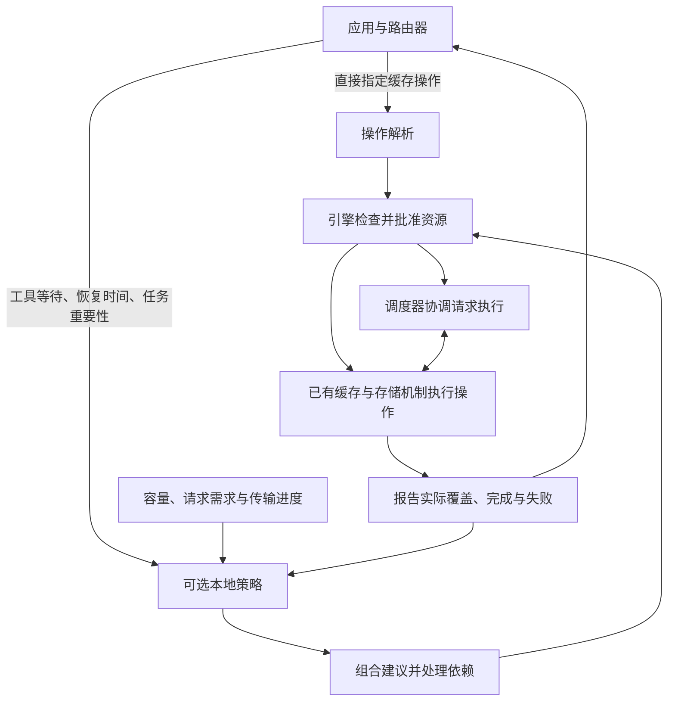

# Programmable KV Cache：优化进展与 SGLang 接入方案

2026 年 10 月

本项工作面向多轮智能体推理，研究如何利用应用信息减少上下文重复计算，并控制缓存搬运和请求排队的成本。所提出的可编程 KV Cache 设计已在 vLLM 上实现缓存控制、可选优化策略与请求调度的协同。本报告介绍这一设计、实验得到的收益与限制，以及利用 SGLang 已有缓存基础实现相同机制的方案。

## 1. 多轮智能体为什么需要可编程缓存

大模型以 token 为基本单位处理文本，token 可以是一个字、词或词的一部分。模型会为已经计算过的 token 保存注意力所需的 Key 和 Value 状态，通常称为 KV Cache。后续生成可以复用这些状态，避免反复计算相同的历史内容；如果不同请求具有相同的输入前缀，引擎还可以复用这段前缀的缓存，从而减少处理新请求输入的时间。

智能体任务通常包含多次模型调用，并在调用之间执行搜索、代码运行或其他工具。本文将一次完整的应用工作称为“任务”，将其中一次模型调用称为“请求”，将跨请求延续的上下文关联称为“会话”。任务还可能创建多个分支，例如让几个子任务分别分析同一份代码；这些分支可以共享开头的上下文，随后生成各自的内容。

一次请求完成时，任务往往仍在继续。工具执行期间，前一轮产生的缓存可能暂时没有请求使用，却会在工具返回后再次需要。如果引擎只依据近期访问情况回收缓存，就可能丢弃即将恢复的长上下文；如果始终把所有暂停任务的缓存留在 GPU，则会挤占其他请求的运行空间。这使缓存管理同时面临保留、搬运和执行顺序的选择。

缓存可以保存在 GPU 显存、CPU 内存或外部存储中。GPU 上的数据可以直接用于计算；保存在其他位置的数据需要加载回 GPU，因此本文将 CPU 内存和外部存储统称为“冷层”。把未来需要的数据提前加载回 GPU 称为“预取”，把暂时不用的数据移到冷层称为“降级”。这两种操作都消耗带宽和内存，只有节省的重算与等待成本超过搬运成本时，才会改善整体性能。

请求调度与缓存决策也相互影响。引擎中的调度器负责选择哪些等待请求进入执行，这一步称为“准入”；它既要为新请求分配缓存，也要为已经开始生成的请求保留后续增长空间。工具返回只说明应用已经准备好继续，目标请求仍可能在引擎中排队。如果预取远早于实际准入，加载的数据可能再次被淘汰；如果等到执行时才开始加载，搬运又会增加请求等待时间。

应用知道任务之间的关系、工具等待和可能的恢复时间，引擎则掌握即时的缓存占用、排队请求和传输进度。可编程 KV Cache 的目标，是提供一个明确的接口，使这两类信息能够参与同一次决策，同时由引擎继续负责内存安全和实际执行。

## 2. SGLang 已有的基础与相关社区工作

### 前缀复用、分层存储与会话信息

SGLang 的 RadixAttention 使用前缀树组织可复用内容。具有相同开头的请求可以共享树中的公共部分，请求产生分歧时再沿不同分支延伸。这为“找到某段上下文对应的缓存”提供了基础，也意味着缓存操作必须遵守树结构和共享关系：一个任务结束，并不意味着它用过的所有内容都可以删除。

HiCache 将这套复用能力扩展到分层存储，通常以 L1 表示 GPU 缓存、L2 表示引擎管理的 CPU 内存缓存、L3 表示外部存储。Mooncake Store 是其中一种用于保存和共享缓存的外部存储服务。HiCache 已经具备存出、从存储读取以及加载回 GPU 的路径，L3 是否能被多个引擎共享则取决于后端和部署方式；数据已进入共享存储，也不表示某个目的引擎已经取得可直接计算的 GPU 副本。

SGLang 还提供 external linker，即连接缓存管理与外部存储的传输接口。其中 direct linker 路径可以在外部存储与引擎的数据缓冲区之间搬运内容，而不要求引擎保留一份长期的 CPU 内存缓存。可编程缓存需要同时适配 HiCache 和这类直接传输路径，完成状态则必须明确区分“外部存储已有数据”“CPU 内存已就绪”和“GPU 已可复用”。

会话感知缓存已经把跨请求信息引入了淘汰决策。应用为属于同一会话的请求提供相同标识，引擎记录该会话与可复用内容的关系，并在回收缓存时优先考虑没有活跃会话关联的内容。这种偏好属于软保护：内存不足时，关联到会话的缓存仍然可以被回收；正在被请求或传输使用的内存则必须等使用结束后才能释放。会话标识用于关联缓存，应用仍需向每次请求提供预期的完整输入。

有些模型会组合不同的计算结构，其复用要求也不同：完整注意力需要已有前缀的状态，滑动窗口注意力只关注近期窗口，Mamba 这类状态空间模型则需要在特定位置保存的可恢复状态，称为状态检查点。SGLang 的 UnifiedRadixCache 为这些混合模型统一管理相应内容，分别使用 FULL、SWA 和 Mamba 组件。它们的容量和恢复边界不同，所以“已经加载若干 token 的缓存”并不一定意味着模型可以从同一个位置继续执行。TreeCore 是维护缓存树结构的核心接口，已有 Python 和 Rust 实现；新控制能力需要通过这一接口协调各类状态。

### 已有缓存控制消息，但执行语义仍需补充

SGLang 已合入 `KvHintsEnvelope`。其中，hint 指应用发送给引擎的缓存指令或提示，envelope 是承载这些内容的统一消息格式：一条消息包含消息标识和若干动作，每个动作具有自己的标识、类型、版本及参数。这一结构使应用能够关联一次提交与后续结果，也允许不同动作分别演进。

已合入的工作主要解决消息如何经过请求入口到达引擎，还没有交付本提案所需的完整控制体系。例如，收到一条“提前加载”的动作后，仍需明确目标内容、容量要求、执行时机、失败处理，以及向调用方报告 GPU 已就绪的条件。本提案复用这套消息格式，并为这些执行问题补充统一约定。

缓存事件与路由索引也是已有基础。缓存事件报告内容的写入、移除等变化，索引用这些信息帮助路由器选择引擎；路由器在本文中指负责跨引擎请求分配的组件。已有事件还能记录触发存储的会话，但这不等于记录了所有共享该内容的会话：后来的请求可能直接命中已有缓存，而没有产生新的写入事件。因此，内容位置与会话关联需要分别维护。

### 相关 RFC 与 PR

RFC 是供社区讨论的设计提案，PR 是提交代码或文档修改的请求。以下状态截至 2026 年 10 月 20 日，区分已经合入的基础、正在推进的实现和关闭但未交付的尝试。

| 方向 | 相关工作 | 状态与作用 |
| --- | --- | --- |
| 可编程缓存总体设计 | [RFC #27574](https://github.com/sgl-project/sglang/issues/27574) | 提出由应用或路由器表达共享、预取、降级和保留意图，由引擎管理资源。该讨论因不活跃关闭，完整执行体系尚未交付 |
| 当前社区路线图 | [#43098](https://github.com/sgl-project/sglang/issues/43098)、[#21846](https://github.com/sgl-project/sglang/issues/21846) | 正在推进，覆盖跨引擎缓存共享、路由与引擎协作、分层存储和传输优化 |
| 统一消息格式 | [RFC #36224](https://github.com/sgl-project/sglang/issues/36224)、[PR #38891](https://github.com/sgl-project/sglang/pull/38891) | RFC 仍开放，消息传输 PR 已合入；具体动作的解释和执行由后续工作补充 |
| 会话身份与缓存关联 | [PR #29436](https://github.com/sgl-project/sglang/pull/29436)、[PR #29173](https://github.com/sgl-project/sglang/pull/29173) | 均已合入，可复用会话标识、关闭处理及会话感知的缓存淘汰偏好 |
| 按输入范围设置保留优先级 | [RFC #36208](https://github.com/sgl-project/sglang/issues/36208) | 正在讨论，聚焦不同 token 范围的优先级；原型覆盖普通前缀树缓存，带期限的保留留待后续 |
| 有时限的软保留 | [PR #27970](https://github.com/sgl-project/sglang/pull/27970) | 尚未合入，在空闲超过指定时长后降低优先级，并在命中后延长保护，需与本提案的期限及撤销规则协调 |
| 应用信息驱动的本地策略 | [RFC #24656](https://github.com/sgl-project/sglang/issues/24656)、[PR #29199](https://github.com/sgl-project/sglang/pull/29199) | RFC 仍开放，PR 关闭未合入；提供了把任务信息用于缓存管理的相关探索 |
| 外部存储中的限时保留 | [PR #30796](https://github.com/sgl-project/sglang/pull/30796) | 关闭未合入，是后端保留能力的验证。存储端保证与 GPU 软优先级需要分别定义 |
| 直接连接外部存储 | [PR #37205](https://github.com/sgl-project/sglang/pull/37205)、[PR #37381](https://github.com/sgl-project/sglang/pull/37381) | 均已合入，提供 Mooncake 存储接入与端到端传输基础 |
| 混合模型的直接传输 | [PR #41343](https://github.com/sgl-project/sglang/pull/41343) | 已合入，扩展对滑动窗口注意力和 Mamba 状态的支持 |
| Rust 缓存树与外部存储 | [PR #32710](https://github.com/sgl-project/sglang/pull/32710)、[PR #37306](https://github.com/sgl-project/sglang/pull/37306) | 均已合入；新控制能力仍需处理 Python 与 Rust 的覆盖差异 |
| 存储布局统一 | [PR #39727](https://github.com/sgl-project/sglang/pull/39727)、[PR #39726](https://github.com/sgl-project/sglang/pull/39726) | 存储布局与加载基础部件已合入；[完整集成 #39728](https://github.com/sgl-project/sglang/pull/39728) 和 [linker 适配 #39815](https://github.com/sgl-project/sglang/pull/39815) 仍在推进 |
| 排队期间预热存储 | [RFC #45128](https://github.com/sgl-project/sglang/issues/45128) | 正在讨论，目标是在请求排队时把固态存储（SSD）上的缓存读取到存储端内存，与请求到达前的独立预取互补 |
| 调度、加载与计算重叠 | [RFC #44721](https://github.com/sgl-project/sglang/issues/44721)、[草稿 PR #44723](https://github.com/sgl-project/sglang/pull/44723) | 正在推进，需要与缓存准备的执行顺序和完成条件协调 |
| 引擎之间直接复用缓存 | [KVCR RFC #32903](https://github.com/sgl-project/sglang/issues/32903)、[PR #36409](https://github.com/sgl-project/sglang/pull/36409) | 尚未合入；KVCR 是面向实例间缓存交换的后端方案，需要对齐统一消息和传输生命周期 |
| 缓存事件与索引 | [PR #37482](https://github.com/sgl-project/sglang/pull/37482)、[PR #33370](https://github.com/sgl-project/sglang/pull/33370) | 会话存储归因和进程内索引已合入；完整共享关系仍需额外记录 |
| 位置状态恢复 | [快照 PR #34407](https://github.com/sgl-project/sglang/pull/34407)、[事件重放 PR #32729](https://github.com/sgl-project/sglang/pull/32729) | 仍在推进，分别用于获取完整位置状态和补回遗漏事件；它们决定路由器在重启或消息丢失后如何恢复判断 |

这些工作已经覆盖了缓存数据组织、存储传输和部分应用信息。本 RFC 重点补充它们之间的协作规则，包括应用可操作的范围、策略提出建议的依据、引擎批准资源的条件，以及指令接收与缓存实际可用之间的区别。

## 3. RFC 的设计：把应用意图转化为可执行的缓存操作

### 应用提供意图，引擎负责执行

本提案题为 *Programmable KV Cache: Composable Policies for Agentic Serving*，即面向智能体服务、支持策略组合的可编程缓存。设计已在 [vLLM RFC #57103](https://github.com/vllm-project/vllm/issues/57103) 中讨论，并据此形成 SGLang 接入方案。

RFC 将缓存控制分为两层。基础层提供明确的缓存操作，适合由应用或路由器直接决定目标；扩展层允许在引擎内启用可选策略，根据应用信息和即时资源状态提出操作建议。无论来自哪一层，所有动作都必须通过同一套容量检查、内存使用保护和完成处理，策略不能绕过引擎直接修改缓存。

这一划分保留了两种部署方式。已有成熟调度逻辑的路由器可以直接发出缓存指令，只让引擎检查可行性并执行；希望利用高频本地状态的部署，则可以把“任务正在等待工具”“预计何时恢复”“任务重要程度”等信息交给引擎内的策略。未启用相应策略时，这些信息不会自动产生搬运。直接指定的动作也不会被策略悄然改成另一个目的地或另一种操作。

可选策略的价值来自决策所需信息的时间尺度。应用的任务关系和工具状态通常按调用变化，引擎的空闲容量、运行请求增长和传输完成则变化得更快。如果所有判断都放在远端路由器，就需要持续同步这些状态，并处理消息到达时信息已经过期的情况；把应用信息送到引擎内，可以让本地策略在更接近实际分配的时刻作出判断。是否值得启用这层策略，仍应通过与外部直接控制的对照实验来验证。

### 三项基础操作

在已有的统一消息格式上，RFC 定义三项主要操作。操作目标是一段确定的缓存内容，目的地可以是 GPU、CPU 内存或受支持的外部存储。

| 操作 | 对调用方的含义 | 完成时应说明什么 |
| --- | --- | --- |
| 设置保留优先级（SET_PRIORITY） | 在指定期限内，使当前缓存副本比低优先级副本更晚被淘汰 | 实际作用的内容范围、优先级及有效期限 |
| 复制（COPY_TO） | 在目的地建立副本，同时保留源副本 | 数据到达了哪一层、哪些范围已可用；目的地为 GPU 时，还需确认引擎能够查到并复用它 |
| 迁移（MOVE_TO） | 在目的地保存内容后，回收符合条件的源副本 | 目的端保存结果与源端回收结果；两者可能具有不同的完成范围 |

预取可以由复制到 GPU 表达，降级可以由迁移到冷层表达，跨引擎共享则可以由“源引擎复制到共享存储”和“目的引擎复制到自己的 GPU”组成。目的引擎必须批准自己的容量，源引擎无法替它预留显存。清除一个保留优先级只会撤销淘汰偏好，不等于立即删除缓存。

保留优先级采用软保护，压力足够高时仍允许回收。公共接口不提供硬锁定承诺，也不会通过最高优先级使内存永久不可淘汰；正在被请求或传输使用的内容，由实际使用关系保证安全。这一区分使应用能够表达偏好，同时避免大量长期保留要求阻止引擎继续服务。

同一段共享内容可能同时被多个任务要求保留，因此每个调用方都拥有独立的声明。例如，任务 A 希望以优先级 90 保留十秒，任务 B 希望以优先级 20 保留六十秒，那么前十秒采用 90，随后采用 20。A 的声明到期不能清除 B 的声明，B 的较长期限也不能延长 A 的高优先级。普通缓存命中不自动续期，重复发送同一次更新也不续期。

声明绑定当前副本。当该副本被淘汰，声明随之结束；之后从外部存储重新加载的副本，需要由调用方或策略重新声明。长期任务的保留意图可以由策略继续维护，但公共基础操作始终保持明确的作用对象和期限。这与按“距离上次访问多久”自动延长保护的方案有所区别，也是需要与现有软保留提案协调的语义。

### 操作内容、会话关联与缓存位置分别表达

应用应能够用请求、会话中的特定分支或输入 token 范围来选择内容，而无须掌握某个内存块的地址。对于连续延伸的任务，系统需要记录某个分支在给定位置已经形成的上下文；对于后来产生的新分支，已经提交的操作不能自动扩大到它，否则调用方无法判断一次指令影响了哪些内容。

为此，RFC 将三类信息分开维护。会话关联说明“哪些任务需要这段内容”，缓存位置说明“这段内容当前在哪个引擎和存储层”，操作结果说明“某次指令已经完成了什么”。任务可以保留与内容的关联，即使 GPU 副本暂时被淘汰；一个复制操作曾经成功，也不能证明该副本之后一直留在 GPU。结束任务时，系统撤销这个任务的关联和策略声明，同时保留其他任务仍在共享的内容。

内容选择还必须满足模型的恢复条件。对于前缀缓存，操作范围需要与可复用的缓存单元对齐；对于混合模型，恢复某个位置可能同时需要完整注意力前缀、近期滑动窗口和 Mamba 检查点。引擎应返回实际覆盖的范围及缺失部分，不能把任意一部分已经搬完解释为整个上下文可以复用。

### 策略如何组合，以及谁有权分配资源

保留、搬运和调度策略可能对同一任务提出不同建议。例如，保留策略认为共享前缀价值很高，搬运策略看到任务要长时间等待工具，而调度器又需要为已经就绪的其他任务腾出空间。RFC 要求这些建议依据共同的资源观察进行组合，使它们能够形成一个有明确顺序和依赖的执行计划。

资源观察包含当前容量、正在使用的缓存、可回收内容、已批准但尚未完成的加载，以及运行请求后续所需的增长空间。策略读取这些信息后只能提出建议；引擎在真正分配时仍需再次检查，因为从观察到执行之间，其他请求可能已经改变了可用容量。

兼容建议可以共享资源。例如，两个任务同时希望把同一段内容加载到同一个 GPU，应当共享一次传输和一份目的内存，同时保留各自的结果。存在竞争时，系统可以推迟部分工作；存在依赖时，应在前置动作成功后继续，例如先完成复制，再为新副本设置保留优先级。消息中列出多个动作本身不代表它们同时成功，也不应依靠动作排列顺序猜测传输已经完成。

### 请求之间也能控制缓存

工具等待通常发生在两次模型请求之间，因此 RFC 同时支持附带在请求上的动作，以及没有生成请求时独立提交的动作。两种入口使用相同的消息格式和执行规则，应用无须发送一个没有业务意义的生成请求来触发缓存加载。

异步执行意味着调用方提交指令后，可以继续其他工作，并通过动作标识查询结果。结果需要区分已经接收、等待资源、正在传输、全部或部分完成，以及缺失、失败和取消。迁移操作尤其需要分别报告“已存入冷层”和“已回收源副本”；如果源仍被其他请求使用，保存可以成功，操作则报告包含未回收范围的部分完成结果。

取消也有两个时间点：调用方可以立即放弃这次操作，但已经开始的传输仍可能读取内存。引擎必须等传输停止访问后再释放资源，并保证一个调用方的取消不会破坏其他调用方共享的加载。重启或模型权重更新后，旧指令和旧缓存还需要通过运行实例及模型版本信息隔离，避免把过时结果误用于新的计算。

RFC 的贡献因此包含完整的执行约定，而不止三个动作名称：它规定了应用如何表达意图、不同策略如何共同使用资源，以及一次操作怎样从提交变成可复用的缓存。它保留现有推理与存储实现，也不要求所有后端支持全部方向和模型组合。

## 4. vLLM 上的实际设计与优化机制

### 统一控制与现有执行路径

vLLM 参考实现已在[草稿 PR #62382](https://github.com/vllm-project/vllm/pull/62382) 中公开，后续优化继续沿用上述 RFC 边界。实现复用 vLLM 已有的统一缓存消息、缓存管理器和传输连接器；连接器负责把已批准的传输对接到 CPU 内存或 Mooncake Store，缓存定位、资源批准和结果管理则由引擎统一处理。

对于附带在请求上的 GPU 源操作，引擎在请求成功结束、释放所用缓存之前取得传输需要的独立使用权，使保存过程能够跨越请求结束继续执行。对于冷层到 GPU 的加载，引擎在传输完成并把数据登记为可复用缓存后才报告就绪；恢复请求如果遇到同一段内容正在加载，就等待已有传输，避免再启动一次竞争加载。

多个 GPU 共同运行模型时，只有所有相关分片完成，目标内容才可供请求使用。加载失败后，受支持的路径可以恢复普通计算，并报告未获得缓存命中；结果查询与传输资源释放也遵循各自的完成条件，避免把“控制消息处理成功”误当成“模型已经使用缓存”。

这套实现把控制记录、任务关联和物理缓存分开管理，因此既能支持直接指令，也能让可选策略通过同一执行路径工作。公开 PR 仍处于讨论与审查阶段，与社区已有的优先级和独立预取实现还需要整合；SGLang 方案目前属于设计与接入阶段，本文性能数据均来自 vLLM。

### 容量与顺序调度：决定哪些请求先执行

在统一控制机制之上，参考实现提供了**容量与顺序调度**，用于决定各会话可以使用多少缓存，以及等待中的哪些请求应当先进入执行。这项策略结合缓存占用、共享前缀和请求等待情况，减少容量不足造成的中断，同时提高已有上下文被再次使用的机会。

这项策略考虑每个会话当前占用多少缓存、新请求还需要多少额外空间，以及已经运行的请求继续生成时可能增长多少。它按会话权重计算相对资源份额，在有空闲容量时允许任务借用未使用空间；这些份额用于控制何时进入执行，并不意味着为每个任务永久切出一块显存。实际能否分配仍由引擎决定。

共享前缀必须在这个过程中正确计账。假设两个请求具有相同的长开头，第一个请求进入执行后，第二个请求只需为尚未共享的输入和自己的后续生成增加空间。如果仍按两个完整上下文分别计算，就会不必要地延迟第二个请求；如果两个请求都按同一份旧空闲量计算，又可能批准超过实际容量的工作。因此，调度器需要在每次实际分配时更新判断，使用刚得到的缓存命中结果，并分别保留各请求后续生成所需的空间。

执行顺序同时考虑任务重要程度、已等待时间和可复用前缀的规模。长时间等待的请求会逐步获得更高优先级，并在达到等待阈值后解除策略施加的额外延期，但仍需满足真实内存条件。这样的设计鼓励共享上下文连续使用，也保留了防止低优先级请求长期等待的机制。

实验中的“容量与顺序调度”配置只启用上述请求安排机制，不主动把缓存搬往冷层，用于区分请求执行顺序带来的收益，以及缓存保留和搬运在此基础上的增量价值。

### 应用协同调度：结合工具等待安排保留与搬运

**应用协同调度**在容量与顺序调度的基础上，进一步利用工具暂停、预计恢复时间和分支状态，安排缓存保留、向冷层保存和加载回 GPU。它把应用提供的未来需求与引擎掌握的当前执行机会结合起来，但不要求恢复时间完全准确，也不将某一种预测算法规定为公共接口。

保留策略根据应用提供的重要性和恢复信息，对已有 GPU 副本设置有期限的软优先级。如果目标内容正在加载，优先级会等副本可用后再生效，避免在还不存在的缓存上提前消耗保护时间。

搬运策略在工具等待时判断是否值得把内容存到冷层。这个判断同时考虑预计暂停时长、已经观察到的存出和加载成本、当前缓存占用以及等待请求的需求；在明显没有空间竞争的短暂停中，保留 GPU 副本通常更合适。在压力较高且排队持续时，即使工具很快返回，请求也可能无法立即继续，此时搬运仍可能减少其他工作的重算或等待。

加载时机与请求准入保持协调。有排队竞争时，准备工作尽量跟随被调度器选中的会话，减少数据在 GPU 中等待很久却未被使用的情况；存在空闲容量时，则允许更早预取，把传输与其他计算重叠起来。策略只依据成功存出的范围安排后续加载，并在目标内容缺失或加载失败时保留重算路径。

### 一次工具调用期间的执行过程

以一个需要查询外部信息的任务为例，模型生成工具请求后，应用告诉引擎任务进入等待，并提供可选的恢复时间估计。引擎结合当前请求需求决定保留 GPU 缓存，或者将允许迁出的内容存入冷层；保存成功之后，只有不再被其他工作使用的源副本才允许回收。

工具返回或应用更新恢复估计时，引擎判断何时准备后续请求所需的上下文。如果同一段内容已经在 GPU，就直接复用；如果正在加载，就加入已有等待；如果需要新加载，则检查完整恢复范围的容量。在数据真正可用后，调度器基于实际命中结果安排请求继续执行，并重新核算之后请求的新增需求。

这使优化目标从“尽量多保留或多加载一些缓存”，变成“在请求能够使用它的时刻，准备足够且可复用的内容”。请求顺序、内存使用与传输由此形成可以共同调整的机制。

## 5. 性能实验与主要结果

### 实验设置与比较方式

实验使用 Qwen3.8-27B，采用 BF16（16 位浮点）精度，模型计算分布在两张 A100 80GB PCIe GPU 上。各对照保持相同 GPU 缓存预算，搬运配置额外使用 Mooncake Store，因此比较结果反映系统配置收益，尚未将 GPU 与 CPU 存储折算为相同总资源成本。

负载来自 verl 强化学习框架中的真实工具调用任务，以 GSM8K 数学问题驱动多轮模型与工具交互。一条任务从开始到完成的调用序列称为一条轨迹。实验记录每次完整输入、生成长度和工具间隔，再用固定工作量回放比较性能：各配置重新执行模型计算，但使用相同的记录输入和输出长度，后续输入也保持为记录内容，从而避免模型产生不同工具路径而改变比较工作量。

| 项目 | 设置 |
| --- | --- |
| 模型与硬件 | Qwen3.8-27B，BF16，双 A100 80GB PCIe |
| GPU 缓存预算 | 服务显存使用比例设为 50%，每卡实际 KV Cache 容量约 12.12 GiB |
| 并发与上下文 | 并发 64，最大上下文 16,384 token，每批处理 token 预算 4,096 |
| 外部存储 | Mooncake Store，缓存存储区域配置为 64 GB |
| 压力负载 | 256 条轨迹、920 次模型调用，约 878 万输入 token、60,136 输出 token |
| 共享结构 | 64 个问题、每题 4 次采样，形成 32 组共享输入前缀；256 条轨迹不等同于独立题目样本 |
| 统计口径 | 重复运行后的耗时中位数，保持输入、输出长度和 GPU 缓存预算一致 |
| 计时范围 | 模型执行、控制处理、任务结束处理及未完成传输；不包含服务启动和预热 |

实验区分“缓存压力较高”和“工作集可被缓存容纳”两种情况。工作集指一段执行期间需要反复访问的缓存内容，前者用于检验复用与搬运收益，后者用于检查优化是否引入不必要的开销。主压力对照各独立运行三次，容量充足与预测敏感性实验各运行两次，按耗时中位数比较；不同工作集分别比较，不直接跨场景计算加速比。

吞吐表示单位时间完成的工作量，固定工作量下的吞吐提升按“原生配置耗时 ÷ 优化配置耗时 − 1”计算。首个输出等待时间指提交请求到收到第一个生成 token 的时间，任务完成延迟则覆盖一条完整轨迹。P99 和 P95 分别表示约 99% 和 95% 的样本不超过该值，用于观察较慢请求或任务的表现；表中延迟指标也取重复测量的中位数。

### 缓存压力下：应用协同调度提高吞吐 68.0%

性能比较包含三种配置：原生引擎沿用引擎默认的复用和调度方式；容量与顺序调度改变请求进入执行的时机与顺序；应用协同调度进一步启用软优先级保留和按需搬运。

| 配置 | 批量完成时间 | 相对原生吞吐提升 | 首个输出等待 P99 | 任务完成延迟 P95 |
| --- | ---: | ---: | ---: | ---: |
| 原生引擎 | 1,997.26 秒 | — | 125.02 秒 | 758.91 秒 |
| 容量与顺序调度 | 1,386.21 秒 | 44.1% | 71.59 秒 | 534.92 秒 |
| 应用协同调度 | **1,188.53 秒** | **68.0%** | **70.51 秒** | **469.94 秒** |

应用协同调度相对原生配置减少约 40.5% 的总耗时，相对容量与顺序调度进一步提高 16.6% 的吞吐，任务完成时间 P95 降低约 12.1%。这说明请求安排已经贡献了明显收益，缓存保留与搬运协同又提供了额外改善；由于这些机制相互影响，这个增量仍需通过进一步对照拆分，不能全部归给某一项预取操作。

运行指标与减少重算和等待的解释一致：未命中的输入 token 从约 797 万降至约 461 万，服务端平均排队时间从 73.80 秒降至 32.72 秒。上述收益来自相同模型工作量下更有效的缓存使用和执行安排，没有改变模型计算本身，也没有单独加速某个 GPU 计算算子。

各次运行的完成时间范围分别为原生引擎 1,983.42–2,003.82 秒、容量与顺序调度 1,385.85–1,388.76 秒、应用协同调度 1,182.21–1,261.62 秒。收益在这组重复实验中保持明显，但仍限于已测的模型、缓存需求规模和任务分布。

### 容量充足时：保留复用机会，避免无效搬运

容量充足负载仍包含 256 条轨迹，但共享前缀集中在四组内容中，共有 864 次模型调用和 66,160 个输出 token。各配置使用相同的这份负载。

| 配置 | 耗时中位数 | 命中输入 token | 主动搬运 |
| --- | ---: | ---: | --- |
| 原生引擎 | 170.87 秒 | 8,084,608 | 无 |
| 容量与顺序调度 | 168.97 秒 | 8,084,608 | 无 |
| 应用协同调度 | 169.61 秒 | 8,084,608 | 无 |

三种配置获得相同缓存命中，应用协同调度没有触发存出或加载，表明压力与成本判断避免了这一场景中的多余工作。耗时差异较小，不宜解释为额外性能收益；更有价值的结果是，压力场景中获益的策略在此处保留了原有复用能力。

补充对照分别测试了仅启用控制功能，以及同时启用控制与传输连接器但不发送缓存指令的情况。这两种配置与原生配置的耗时差异均不足 0.1%，说明在该容量充足负载中，启用基础机制本身没有表现出明显退化。主动提交大量控制指令的成本仍需单独分析。

### 恢复时间预测：准确工具时间并不等于最佳缓存时机

恢复时间实验比较了四种输入：常规应用协同配置根据已经观察到的工具耗时更新估计；真实暂停时长对照直接使用回放记录中的实际工具等待时间，用于隔离工具时间估计误差；另两种配置分别固定预测在 1 毫秒和 30 秒后恢复。后两者故意向相反方向偏离，用于观察策略对时间信息的敏感性，各组都保持相同压力工作量。

| 时间信息 | 耗时中位数 | 相对原生吞吐提升 | 相对常规应用协同配置的吞吐变化 |
| --- | ---: | ---: | ---: |
| 根据历史工具耗时更新估计 | 1,188.53 秒 | 68.0% | — |
| 使用记录中的真实暂停时长 | 1,230.42 秒 | 62.3% | -3.4% |
| 固定预测 1 毫秒后恢复 | 1,181.00 秒 | 69.1% | +0.6% |
| 固定预测 30 秒后恢复 | **1,077.04 秒** | **85.4%** | **+10.4%** |

1 毫秒估计与常规配置差异较小，没有显示明确的额外收益；30 秒估计在该压力实验中获得更高吞吐，同时有更多缓存命中和更短排队。然而，它明显晚于典型工具暂停时间，并且会同时影响是否存出和何时加载，因此这个结果不能解释为“把恢复时间估得更晚就普遍更好”。

实验揭示了工具完成与请求真正能够继续执行之间的区别。即使知道准确的工具结束时间，引擎仍可能因容量不足而延迟目标请求；一份刚加载回 GPU 的缓存也可能在等待期间被其他工作挤出。从策略规则看，较长的暂停估计允许更多内容进入保存和准备流程，因此更积极的搬运是一个合理解释，但现有结果还不能分离搬运、请求排序与运行波动各自的贡献。85.4% 是这一预测条件下已测得的压力场景收益，常规配置的 68.0% 则同时具备容量充足场景下抑制无效搬运的验证；两者覆盖的条件不同，30 秒预测不作为通用推荐值。

### 真实工具执行与正确性验证

独立的真实工具运行完成了 256 条任务轨迹、923 次模型调用和 60,231 个输出 token，总耗时 1,079.34 秒，任务自动评分为 248/256（96.875%）。这一过程实际执行工具并让结果进入后续模型输入，生成路径与固定回放不同，因此其耗时用于描述实际运行情况，不参与前述相对吞吐计算；运行中有请求达到输出长度上限，仍需结合任务结果评估生成质量。

模型质量实验比较了强制重新计算上下文与搬运后实际复用缓存的输出。在固定的 128 题对照中，CPU 内存和 Mooncake 两条路径均得到重算 124/128、复用 124/128，答案差异为零，没有输出长度截断。这表明该样本和配置中没有观察到复用造成的答案退化。

执行正确性覆盖了共享分支结束、重复操作、并发加载与请求恢复、取消、资源不足时延期、存储停机和引擎重启。跨引擎加载验证了目的端实际命中缓存；模型参数更新与回滚验证了不同权重版本之间的缓存隔离。这些结果支持已实现操作的可靠性，尚未覆盖完整训练器更新流程、所有模型结构或所有并行部署组合。

## 6. 优化中的主要问题与取舍

### 更积极地搬运，可能同时改善压力负载并损害低压力负载

更积极的搬运策略表现出明显的场景差异：它在压力负载上把耗时降至 1,016.20 秒，相对原生吞吐提高 96.5%，但在容量充足负载上，耗时上升到 493.26 秒，约为原生 170.87 秒的 2.89 倍。该配置每轮向外部存储写出约 259–261 GB，而实际加载只有约 2.0–2.7 GB，大量传输没有转化为后续使用。

常规应用协同调度据此加入暂停与传输成本判断，并结合实际占用和持续排队决定是否搬运，使容量充足时的存出与加载降为零。策略评估同时报告压力收益和容量充足表现，因为更高的单点吞吐无法代表其适用于更广的负载，传输成功与性能改善也需要分别验证。

### 一部分缓存加载完成，仍可能无法恢复完整上下文

一个请求需要的内容可能分布在多个缓存单元和模型状态中。如果准备到一半时，先加载的部分已经被回收，或者不同状态只支持恢复到不同位置，那么每次小传输都成功，整体仍可能无法复用。实现因此在开始准备前检查完整恢复范围的容量，并在准备过程中保护已经到达、但尚需等待其他成员的内容。

现有分析仍观察到部分准备范围存在缺口。缺口可能来自未保存的内容、不同状态的恢复边界，也可能只是因为一部分内容原本就在 GPU，所以没有出现在本次传输结果中。要进一步降低无效搬运，需要把保存、加载、真正可用、请求进入执行和实际命中关联到同一段内容，不能仅依据搬运字节数判断是否有效。

### 可分配容量与仍然保留的缓存内容并非同一件事

vLLM 中，一些没有请求使用的缓存块已经允许被新的分配覆盖，即使其中还保留可复用内容。因此，主动清除它们未必增加可分配空间；反过来，保留源副本也未必减少新请求的可用空间。基于这一特性，实验比较了存入冷层后保留 GPU 源副本的方案，以检验增加即时恢复命中机会能否改善性能。

这项比较没有显示明确净收益。保留哪些内容、之后按什么顺序覆盖它们，以及何时让请求进入执行，都会改变整体效果，现有运行波动也不足以断言保留源副本一定更慢。复制操作仍有应用价值，但没有把“始终保留源副本”作为自动策略默认行为。SGLang 的树结构和共享引用具有自己的回收约束，这项取舍需要在其原生缓存上重新评估。

### 提前加载与正在执行的请求会竞争资源

提前预取能够把传输藏在工具等待或其他计算之后，但也会提前占用 GPU 空间。在长队列下，任务可能很久以后才进入执行，期间已准备的缓存会与当前请求后续生成的空间竞争。把准备工作与被选中的请求协调，可以减少这类竞争，代价是部分加载可能继续体现在请求等待时间中。

当前实验支持采用这种协调方式，同时也表明工具恢复预测无法独自决定最优时机。仍需用相同应用信息和传输配置，对照提前准备、按请求选择准备以及完全由外部应用发出指令的方式，分离各项机制的收益。

### 控制处理与公平性仍需要优化

把控制消息异步发送、减少无用查询和避免重复扫描请求，可以降低等待，但不会消除 CPU 与网络成本。已测压力负载中，负责发起请求并收集结果的测试程序，在原生、容量与顺序调度和应用协同调度配置下消耗的 CPU 时间中位数分别约为 71.81、54.73 和 127.31 秒。这些是累计 CPU 时间，包含生成结果处理、控制通信和指标采样，既不能直接加到总耗时上，也不能将全部差额解释为纯控制开销；服务端状态扫描和消息处理仍需分别测量。

容量与顺序调度会提高长时间等待请求的执行机会，现有各共享前缀组的较慢任务也都优于原生配置，但负载仍主要来自同一类数学工具任务。真实服务中，长文档任务和短对话可能相互干扰，因此还需要观察短请求延迟、最长等待和不同任务类别的资源占用，防止整体吞吐改善掩盖某类请求的退化。

## 7. 在 SGLang 上实现相同机制

### 复用原生缓存与传输，补充共同执行边界

SGLang 已经拥有前缀树、会话关联、HiCache 和 direct linker，接入方案在这些基础上补充控制层。统一消息进入引擎后，由同一个负责调度状态的执行方解析目标、检查资源和推进结果，避免应用策略、存储线程与调度器分别修改同一份缓存状态。

| 需要实现的能力 | SGLang 的已有基础 | 拟补充内容 |
| --- | --- | --- |
| 缓存指令入口 | 已合入的统一消息格式与请求传输 | 动作解释、独立提交、能力查询和关联结果；分别明确各服务入口的支持范围 |
| 跨请求的内容定位 | 会话标识、前缀树与会话关联 | 特定分支和历史上下文范围的记录，明确实际可操作范围 |
| 有期限的保留优先级 | 现有节点优先级与会话感知淘汰 | 调用方独立声明、到期与撤销，以及共享内容上各声明的独立管理 |
| 复制与迁移 | HiCache、direct linker 及既有传输完成路径 | 独立操作所需的容量批准、内存使用权，以及分阶段完成结果 |
| 请求外推进 | 已有调度与后台传输 | 没有生成请求时仍能推进加载、处理取消并释放资源 |
| 共享加载 | 已有缓存内容匹配 | 多个调用方共同等待兼容传输，分别管理取消和结果 |
| 容量与顺序调度 | 请求选择、缓存匹配和内存分配 | 根据实际共享命中复核新增需求，并为运行请求保留增长空间 |
| 可选协同策略 | 会话、请求及缓存状态观察 | 将保留、搬运和请求安排放在共同资源视图下决策 |

现有会话感知淘汰会优先考虑是否存在会话关联，单独提高某个节点的优先级并不足以保证应用显式偏好生效。本提案建议在启用新策略模式时，使应用显式优先级在可淘汰内容之间优先于默认会话偏好，同时继续保护实际使用中的内容；未启用时保留现有行为。这需要在完整注意力、滑动窗口和 Mamba 状态上采用一致的规则。

容量判断也必须保留模型状态的结构。完整注意力、滑动窗口和 Mamba 检查点可能使用不同的内存池，存储传输还可能需要临时缓冲空间，因此不能用一个“剩余 token 数”代替所有资源。完整准备需要同时满足必要状态的容量与恢复边界，各 GPU 分片也必须共同完成，才能报告目标位置可复用。

独立加载需要在现有请求驱动路径上扩展。direct linker 如果只能把内容加载到某个活跃请求的缓冲区，就需要补充如何把结果登记为后续请求可找到的缓存；在支持这一能力之前，应明确限制独立预取的范围。现有会话感知模式对 Python TreeCore 的依赖，也意味着 Python 与 Rust 的支持范围需要分别说明和验证。

请求结束与取消是执行上的关键边界。对于附带在成功请求结束时执行的保存动作，SGLang 需要在释放请求缓存前保留传输使用权；对于取消操作，则需等已经派发的传输停止访问之后再释放内存。已有错误处理可能选择结束受影响请求，新的独立预取还需要说明哪些失败允许继续重算，不能假设所有路径都具有相同恢复行为。

### 两种引擎共享语义，各自承担物理实现

vLLM 与 SGLang 可以共享“选择哪些内容、执行什么动作、依据哪些资源信息判断、怎样描述完成与失败”这组约定。应用层只需根据引擎公布的能力选择受支持操作，无须了解它内部使用块管理还是前缀树，也无须自己构造存储对象标识。

共同策略层可以接收会话关系、工具状态和只读资源观察，输出保留、搬运及请求安排建议；各引擎的适配层负责把建议映射到自己的缓存单元、内存池和传输接口。这样可以复用应用集成、决策逻辑和行为测试，同时保留每种引擎对真实资源的控制权。

有两项现有差异需要在接口上协调。vLLM 参考实现按整条消息选择由引擎还是后端解释，SGLang 的消息格式则允许各动作独立，因此 SGLang 更适合逐动作指定负责的组件，避免重复执行。vLLM 还保留了较早的逻辑内容保留接口，而 SGLang 方案以当前副本上的有期限优先级为公共基础，长期任务偏好交给可选策略维护，可以减少两套寿命规则并存的复杂度。

相同优化机制也不意味着两个框架可以直接交换任意 KV 数据。跨框架复用原始缓存还要求模型权重、数值格式、位置编码、并行切分和存储布局兼容，需要独立的适配和正确性验证。本阶段的共同目标，是让相同应用信息与优化方法能够分别作用于两种引擎。

### SGLang 的验证应包含已有能力的独立对照

SGLang 原生已经具备会话感知缓存和分层存储，因此评估需要区分这些已有能力与新协同机制的贡献。建议在相同模型、GPU 预算和固定任务负载下比较以下配置，并同时覆盖压力与容量充足场景。

| 对照配置 | 要回答的问题 |
| --- | --- |
| 原生缓存与默认调度 | SGLang 自身的性能基线是什么 |
| 原生会话感知缓存 | 已有跨请求关联能带来多少收益 |
| 相同存储后端，不发送缓存指令 | 增加冷层和启用连接器本身产生什么影响 |
| 应用直接控制缓存，不启用本地策略 | 在相同任务信息和预测条件下，外部控制能达到什么效果 |
| 容量与顺序调度 | 改变请求执行顺序和容量判断贡献多少收益 |
| 应用协同调度 | 本地缓存决策与请求安排共同启用后，是否仍有增量收益 |

两种引擎可以使用相同的任务输入、调用依赖、工具间隔和输出长度组织回放，但应核对实际 token 序列，避免不同输入模板改变工作量。真实工具执行另外检查任务结果和生成质量，缓存失败、取消与模型更新则通过专门的正确性实验验证。只有在 SGLang 内建立这些独立对照后，才能判断 vLLM 中发现的机制是否同样有效。

## 8. 后续需要回答的问题

性能优化的主要方向是把工具时间估计扩展为对“何时值得准备、何时能被使用”的联合判断。恢复时间实验已经说明，准确知道工具结束时间仍不足以选择最佳缓存时机；进一步分析应定位具体内容在保存、加载、进入可用状态和被请求使用之间经历了什么，并统计未被消费、重复加载或准备后再次淘汰的内容，识别最值得减少的开销。

负载评估将扩展到真实代码智能体、长文档问答以及长任务与短对话混合运行。它们分别引入较长且波动更大的工具等待、大规模共享上下文和明显不同的延迟需求，有助于判断当前收益是否依赖数学工具任务的前缀结构。每种负载都需要同时观察吞吐、任务结果、短请求延迟和额外存储成本。

SGLang 的实现可以从一条明确支持的缓存与存储路径开始，完成内容定位、优先级、复制和迁移及其真实结果，再加入独立推进和请求调度协同；混合模型与不同 TreeCore 实现按相同语义逐步扩展。社区需要共同确定的关键问题，是显式优先级如何与现有会话偏好组合，独立加载怎样登记为可复用缓存，以及 HiCache 和 direct linker 如何提供一致的完成与取消语义。
