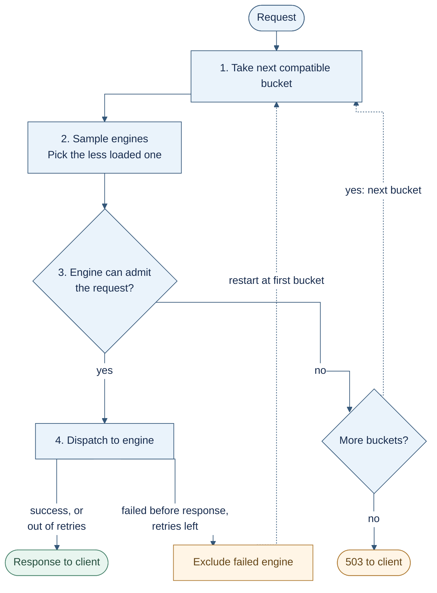

# SGLang router architecture

This document describes `--chat-routing reorg`: the deployment, request flow,
and routing policies. The default legacy path is outside its scope.

- [1. Overview](#1-overview)
- [2. Configuration examples](#2-configuration-examples)

## 1. Overview

### 1.1 Deployment Architecture

A deployment consists of a **router** and **buckets of SGLang engines**. A bucket
is a logical group defined in the router configuration. It contains either a
**unified engine group**, where each engine handles both prefill and decode,
or separate **prefill and decode (P/D) groups**.

The example below shows short-context and long-context buckets, each with prefill
and decode engines.


Each engine publishes load reports and KV events, which the router uses for
routing. An optional [external KV indexer](sgl-kv-indexer/README.md) can supply
prefix matches. The router also maintains session bindings and in-flight request
counts.

To serve a request, the router chooses a bucket, selects engines within it, and
forwards the request. In P/D, it sends the request to both the prefill and decode
engines; the prefill engine transfers KV directly to the decode engine.

### 1.2 Request routing lifecycle
Routing a request typically goes through **preprocessing** (rendering and
tokenizing), **picking a bucket**, **scoring candidate engines** (load, prefix
matching, or session affinity), **choosing engine(s)**, **forwarding** the
request, and **handling output tokens** (e.g. tool parsing). Along the way it
also applies **admission control**, **failure handling**, and **retries**.

#### Example load-aware routing

The router walks the buckets that fit the request's length, ordered by SLO
preference, then smaller capacity, then `rank`.
In each bucket it samples engines, picks the less loaded one, and checks
admission. If the admission policy rejects the request, the router moves to the next
bucket; if every bucket rejects it, the request fails with 503. An admitted
request is dispatched. If dispatch fails before any response is sent and retries
remain, the router excludes the failed engine and starts again from the first
bucket.

Load is a vector of engine metrics compared field by field, and the first
difference decides. For unified and prefill engines the order is estimated
prefill queue time, waiting uncached tokens, waiting requests, running requests,
then in-flight requests; decode engines rank by waiting and running requests,
then KV usage.



#### Example cache-aware and session-aware routing

These policies replace steps **2–3** above. `cache_aware` serves plain and
prefill groups only; decode groups use `power_of_two` unless they set
`session_aware`. Both policies split the group's engines in two:

- **Preferred engine (A):** for `cache_aware`, the best-ranked prefix owner that
  passes admission; for `session_aware`, the engine bound to the session.
- **Normal engines:** the rest of the engine group. When needed, the router picks
  one of them (**B**) with the load-aware `power_of_two` policy.

A and B are checked against the same group admission limits (for example
`max_kv_usage` or `max_waiting_requests`; see [configuration examples](#2-configuration-examples)).

- **`prefer` mode (default):** use A if it passes admission.
- **`balanced` mode:** also pick a B engine and compare the loads of A and B.
  - Switch to B only when it is clearly less loaded:
    `load(A) > load_factor × load(B)` **and** `load(A) − load(B) > load_gap`
    (defaults: factor 2; gap 1024 tokens, or 4 requests). Otherwise, including
    when either load is unknown, keep A.
  - `balanced_by` sets the load metric:
    - **`prefill_tokens` (default):** the engine's reported waiting uncached tokens,
      plus the tokens this request would prefill on it. For `cache_aware` that
      subtracts the engine's cached prefix, so A's cache hit counts in its favor.
    - **`running_requests`:** the engine's reported running requests.
- **No A, or A fails admission (either mode):** fall back to B. If B also fails
  admission, the group rejects the request and the router tries the next bucket.

## 2. Configuration examples

Settings resolve as **group JSON field > CLI flag > built-in default**. Without
`--bucket-config`, the router uses two default buckets that cover every engine:
`plain` for unified engines and `pd` for P/D engines.

### Example A: cache-aware, CLI only

```bash
sgl-router --chat-routing reorg --policy cache_aware \
  --affinity-mode prefer \
  --cache-affinity-min-match-ratio 0.2 \
  --max-waiting-requests 16 --max-in-flight 56 ...
```

- A prefill engine owns the prefix if it holds at least 1024 matched tokens
  (the default) **and** 20% of the prompt.
- `prefer` sends the request to the best owner that passes admission.
- Every group, decode included, rejects an engine that reports 16 or more
  waiting requests, or has 56 or more requests in flight from this router.

### Example B: session-aware, balanced by running requests

```bash
sgl-router --chat-routing reorg --policy session_aware \
  --affinity-mode balanced --affinity-balanced-by running-requests \
  --session-id-header x-session-id ...
```

- Requests with the same `x-session-id` stick to the engine they are bound to.
- The session moves to another engine only when the bound engine has more than
  2x its running requests **and** more than 4 extra (the defaults).
- Plain and prefill groups use `session_aware`; decode groups stay on
  `power_of_two` unless a group sets `"policy": "session_aware"`.

### Example C: P/D buckets from a file

Pass this file with `--bucket-config` and `--policy cache_aware`. It defines a
short tier with a TTFT estimate and a long tier:

```json
{
  "ttft_slo": "slo_first",
  "buckets": [
    {
      "id": "short",
      "max_input_tokens": 4096,
      "max_context_tokens": 8192,
      "ttft_ms": 300,
      "prefill": {
        "worker_services": ["inference/prefill-short"],
        "admission": {"max_pending_prefill_tokens": 32768},
        "affinity": {"mode": "balanced", "load_factor": 1.5}
      },
      "decode": {
        "worker_services": ["inference/decode-short"],
        "admission": {"max_kv_usage": 0.9}
      }
    },
    {
      "id": "long",
      "rank": 1,
      "max_context_tokens": 131072,
      "prefill": {"worker_services": ["inference/prefill-long"]},
      "decode": {"worker_services": ["inference/decode-long"]}
    }
  ]
}
```

- Requests that fit within 4k input and 8k context fit both buckets; `short` is
  tried first because it is smaller. Longer requests go only to `long`.
- `short` prefill engines use cache-aware routing in balanced mode and reject
  requests while 32k or more uncached tokens are waiting. `short` decode engines
  use `power_of_two` and reject requests at 90% KV usage.
- If `short` rejects a request, the router tries `long`.
