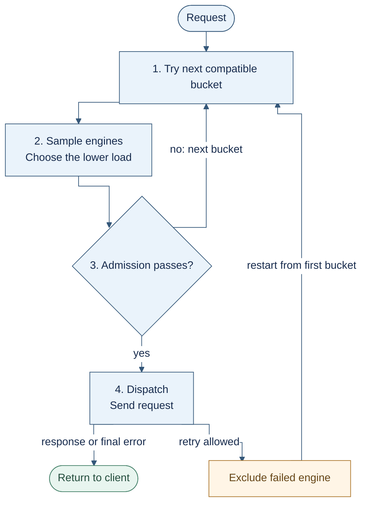
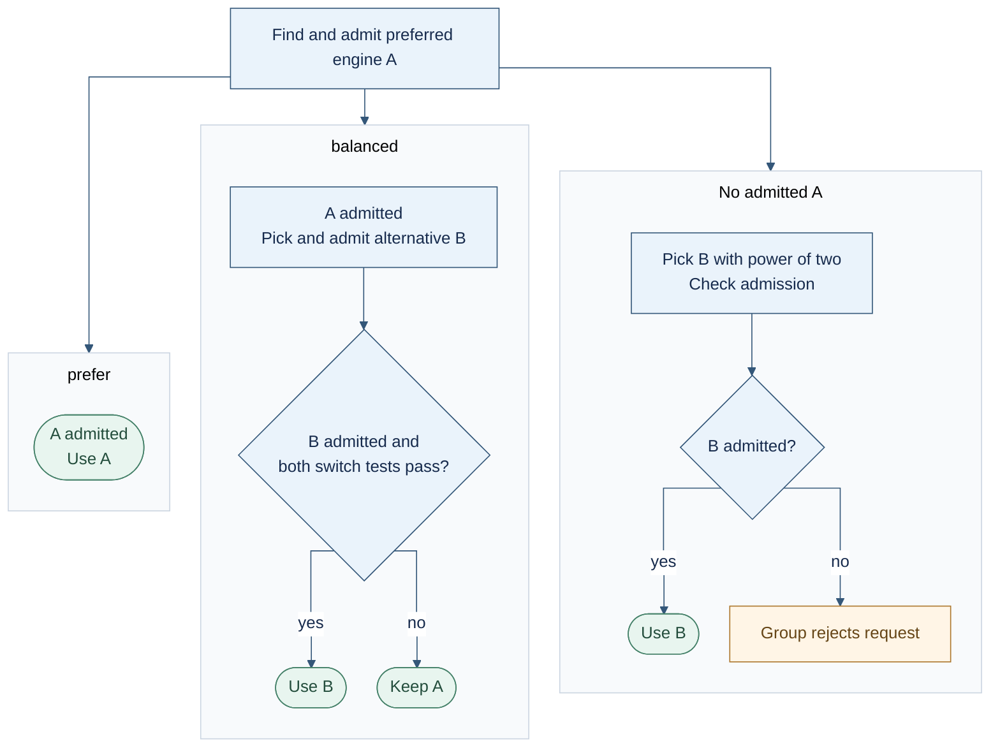
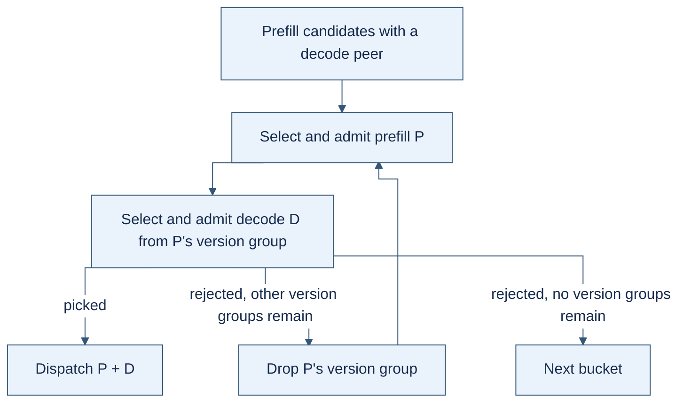

# SGLang router architecture

This document describes `--chat-routing reorg`: the deployment, request flow,
and routing policies. The default legacy path is outside its scope.

- [1. Overview](#1-overview)
- [2. Engine state](#2-engine-state)
- [3. Buckets](#3-buckets)
- [4. Engine groups](#4-engine-groups)
- [5. Policies](#5-policies)
- [6. Configuration](#6-configuration)
- [7. Failures and retries](#7-failures-and-retries)
- [8. Code map](#8-code-map)
- [Appendix: legacy options](#appendix-legacy-options)

## 1. Overview

### 1.1 Deployment Architecture

A deployment consists of a **router** and **buckets of SGLang engines**. A bucket
is a logical group defined in the router configuration. It contains either a
**unified engine group**, where each engine handles both prefill and decode,
or separate **prefill and decode (P/D) groups**.

The example below shows short-context and long-context buckets, each with prefill
and decode engines.


Each engine publishes load reports and KV events, which the router uses for
routing. An optional [external KV indexer](sgl-kv-indexer/README.md) can supply
prefix matches. The router also maintains session bindings and in-flight request
counts.

To serve a request, the router chooses a bucket, selects engines within it, and
forwards the request. In P/D, it sends the request to both the prefill and decode
engines; the prefill engine transfers KV directly to the decode engine.

### 1.2 Request routing lifecycle
Routing of a request typically goes through: preprocessing (render/tokenizing), picking a bucket, get candidate engine "scores" (load/prefix-matching or session affinity), choose engine(s), forward requests, and handle output tokens (e.g. tool parsing).

It also considers other factors like: admission control, failure, retry etc.

#### Example load-aware routing

Follow the main path from top to bottom. Rejection moves to the next bucket;
a dispatch retry starts bucket selection again.



With one candidate, choose it directly. Admission checks only the chosen engine;
a rejection does **not** try the other sample. If no bucket remains, return an
error. A dispatch retry excludes the failed engine and restarts from the first
bucket; it requires a retryable failure, remaining budget, and no response started
([retry details](#7-failures-and-retries)).

#### Example cache-aware and session-aware routing

Replace steps **2–3** above with this decision tree. **A** is the admitted
preferred engine: the best admitted prefix owner for `cache_aware`, or the bound
engine for `session_aware`. **B** is a `power_of_two` pick from the remaining
candidates, excluding A and rejected affinity engines.



The [switch tests](#13-policies-at-a-glance) require both a load ratio and a load
gap. Missing load data or a missing/rejected B keeps A. B may itself own a cached
prefix. `session_aware` binds or rebinds to the selected engine when a session ID
is present.

After selection, continue to dispatch. If the group rejects the request, try the
next bucket; P/D may first try another version group. Invalid policy results
stop with 500. Failed reselection after a dispatch retry returns the previous error.

The path serves `/v1/chat/completions`, `/v1/completions`, `/generate`,
`/v1/messages`, `/v1/embeddings`, `/v1/classify`, and `/v1/rerank`.
The last three require unified engines and return 400 if the model has P/D engines.

### 1.3 Policies at a glance

Each engine group combines a **selection policy**, optional **affinity mode**,
and **admission caps**. Selection chooses an engine; admission checks whether it
can take the request. Every policy checks admission, even when affinity wins.

| Selection policy | Engine choice | Load and comparison | `prefer` (default) | `balanced` |
| --- | --- | --- | --- | --- |
| [`power_of_two`](#power_of_two) — all stages; default | No affinity; sample two engines | Choose the lower stage load, using the order below | Not applicable; admit the winner once | Not applicable |
| [`cache_aware`](#cache_aware) — unified / prefill | A = best admitted prefix owner | Rank owners by this request's uncached tokens, then stage load. Balance using waiting uncached tokens + this request's uncached tokens | Use A; otherwise try B | Compare admitted A and B; keep A unless B clears both switch thresholds |
| [`session_aware`](#session_aware) — all stages | A = engine bound to this session, stage, model, and bucket | Balance using waiting uncached tokens + the full request input | Use A; otherwise try B and bind it | Same comparison; rebind if B wins |

**Stage load order** compares each field in turn; lower wins:

| Stage | Comparison order |
| --- | --- |
| Unified / prefill | Estimated prefill queue time (if both have it) → waiting uncached tokens → waiting requests → running requests → in-flight requests |
| Decode | Waiting requests → running requests → allocated KV / capacity → allocated KV tokens → in-flight requests |

Balanced mode switches from A to B only when B passes admission and
`load(A) > load_factor × load(B)` **and** `load(A) − load(B) > load_gap`.
Defaults: factor **2**, gap **1024 tokens**. `balanced_by: running_requests`
uses reported running requests instead, with a default gap of **4 requests**.
A missing comparison signal or a rejected B keeps A.

See [engine state](#2-engine-state) for missing reports and
[policy details](#5-policies) for fallback behavior.

## 2. Engine state

### 2.1 Load reports

Engines publish per-DP-rank load reports; the router sums the ranks for each engine.
A report is fresh when every expected rank reported within **5 seconds**.
Missing, stale, or incomplete reports produce unknown values, never zero.

| Signal | Report field / source | Used by |
| --- | --- | --- |
| Running requests | `num_running_reqs` | Ranking, `max_running_usage`, balanced `running_requests` |
| Waiting requests | `num_waiting_reqs` | Ranking, `max_waiting_requests` |
| Waiting uncached tokens | `num_waiting_uncached_tokens` (native) | Prefill ranking, `max_pending_prefill_tokens`, balanced `prefill_tokens` |
| Allocated KV tokens | `num_used_tokens` in the router | Decode ranking |
| Allocated KV + queued request tokens | `num_total_tokens` (native) | `max_kv_usage` |
| KV capacity / running capacity | `max_total_num_tokens` / `max_running_requests` | Usage fractions |
| Estimated prefill queue time | Waiting uncached tokens ÷ measured prefill throughput | Prefill ranking; needs two advancing native samples per rank |
| In-flight requests | Router-local counter | Ranking tie-break / fallback, `max_inflight_requests` |

Basic running and waiting counts work with older report formats. Native load
ranking also requires valid KV and running capacities.

- **Admission:** an unknown value passes its cap (fail open).
- **Ranking:** if either sampled engine lacks a fresh native report,
  `power_of_two` compares in-flight counts only. Cache owners still rank by
  uncached tokens first; if any owner lacks a native report, their load tie-break
  uses in-flight counts.
- **Observation:** each policy captures load for its decision. Nested fallback
  policies capture their own snapshot; the outer policy checks its own caps.
  In-flight counts are read locally. No check reserves capacity.

For example, prefill A has a 120 ms queue and 9k waiting uncached tokens; B has
80 ms and 12k. B wins on queue time. Without B's queue estimate, A wins on tokens.

### 2.2 KV events

KV events report stored, removed, or cleared cache blocks. The router-local
radix tree turns them into prefix matches; `cache_aware` uses those matches to
estimate each engine's uncached input. KV events carry cache metadata, not KV data.

With an external indexer, engine events reach it through a bridge and the router
queries prefix matches over gRPC. Load reports still go directly to the router.
See the [indexer](sgl-kv-indexer/README.md) and
[KV-event replay](README.md#kv-event-gap-replay) setup guides.

## 3. Buckets

A bucket sets token limits, optional SLO estimates, rank, and either a unified
group or a prefill/decode pair. Bucket ordering does not inspect engine load.
`BucketResolver::resolve` returns all compatible buckets in this order:

1. **Input range:** `min_input_tokens ≤ input ≤ max_input_tokens`.
2. **Context:** input + requested output ≤ `max_context_tokens`; use input alone
   when output length is unknown.
3. **SLO tier:** `slo_first` favors buckets meeting `x-sgl-ttft-slo-ms` or
   `x-sgl-tps-slo`; `best_effort` puts those buckets last. Each unmet preference
   adds one tier. Disabled preferences ignore their headers.
4. **Within a tier:** smaller input capacity, then lower `rank`, then ID.
   Input capacity is the smaller of `max_input_tokens` and `max_context_tokens`.

In [Example B](#6-configuration), 4k input with a 16k expected peak fits only
`long`. With an 8k peak and a 200 ms TTFT target, both buckets fit and neither
meets the target; `short` comes first on capacity. If it rejects the request,
`long` is tried next.

## 4. Engine groups

A group supplies healthy engines for the model and role, minus retry exclusions.
Configure at most one membership field:

| Membership | Engines included |
| --- | --- |
| Omitted | Every engine of the group's role |
| `worker_ids` | Exact IDs: static URL, or Kubernetes `namespace/pod-UID` |
| `worker_services` | Kubernetes `namespace/service`, matched by the EndpointSlice `kubernetes.io/service-name` label; survives pod replacement |

A policy may return only an engine from this candidate set.

**P/D pairing:** prefill and decode must share a version group
(`--pd-version-group-label`). Both picks come from the same bucket.



## 5. Policies

### 5.1 Contract

```rust
pub trait Policy: Send + Sync + Debug {
    fn pick<'a>(&'a self, engines: &'a [Arc<Worker>], request: &'a PickRequest<'a>)
        -> BoxFuture<'a, Result<Pick, PickError>>;
}
```

`PickRequest` holds request facts. Each policy owns its load, prefix, or session
state handles and performs admission internally. `Pick` contains an engine and
a reason tag; the tag is not currently logged or exported.

| Result | Action |
| --- | --- |
| `Pick` | Complete the bucket selection, then dispatch |
| `NoCandidates` / `AdmissionRejected` / `NoAdmissibleEngine` | Try another P/D version group when applicable, then the next bucket |
| `InvalidSignal` / `InvalidConfiguration` / `OutsideCandidates` | Stop with 500 |

### 5.2 Selection

#### power_of_two

Sample two distinct engines, choose the lower [stage load](#13-policies-at-a-glance),
and check admission **once**. If rejected, do not try the other sample.
A single candidate is checked directly.

#### cache_aware

1. Look up the prefix once per selection attempt, shared across buckets.
2. Keep owners passing both the minimum matched-token and optional match-ratio gates.
3. Rank by uncached input, then prefill load, then engine ID; keep the top K.
4. Check admission on each owner. The first admitted owner is A.
5. Use A in `prefer`; otherwise draw B and apply the affinity comparison.

**K** = min(candidate count, max workers, max(min workers, ⌈ratio × candidate count⌉)).
Defaults keep at most 8 owners until the group exceeds 160 engines, capped at 32.
B excludes A and rejected owners. If neither A nor B is admitted, selection fails.
An unavailable indexer is a cache miss; a rejected indexer query is an error.

For a 10k prompt with a 20% match gate and a waiting-request cap of 16:

| Engine | Cached | Waiting | `prefer` result |
| --- | --- | --- | --- |
| E1 | 8k | 16 | Owner, rejected by admission |
| E2 | 3k | 3 | Owner, selected |
| E3 | 500 | 0 | Below hit gate; fallback only |

#### session_aware

Bindings use **stage + model + bucket + session ID**. Without a session header,
use `power_of_two` and admission without binding. Missing or ineligible bindings
also fall back to `power_of_two`; bind only after admission.

Bindings update as soon as the group picks an admitted engine:

- A balanced switch or a P/D version-group re-pick can rebind the session.
- Later bucket or dispatch failure does not undo the binding.
- Failed fallback keeps the old binding.
- A racing first binding wins; the other request checks admission on it.

Idle bindings are removed by the periodic sweeper using `--session-idle-secs`
and `--session-eviction-interval-secs`.

### 5.3 Prefer vs balanced

`prefer` uses admitted A. `balanced` may choose admitted B under the
[two switch thresholds](#13-policies-at-a-glance). Without A, both modes use B.

| `balanced_by` | load(engine) |
| --- | --- |
| `prefill_tokens` (default) | Reported waiting uncached tokens + this request's uncached input |
| `running_requests` | Reported running requests; excludes the incoming request |

For `cache_aware`, uncached input is total batch input minus the matched prefix
of its longest prompt, even if that match is below the hit gate. `session_aware`
has no prefix signal, so it counts all input tokens.

Example: a 10k prompt, A caches 8k and has 30k waiting; B caches nothing and has
4k waiting. Loads are 32k and 14k. With defaults, 32k > 2 × 14k and the 18k gap
exceeds 1024, so B wins. With only 20k waiting on A, its 22k load keeps the request.

### 5.4 Admission

Caps apply per engine. CLI caps are defaults for **every group**, including
decode; group `admission` fields override them individually.

| Cap | Rejects when |
| --- | --- |
| `max_inflight_requests` | Router in-flight requests ≥ cap |
| `max_waiting_requests` | Reported waiting requests ≥ cap |
| `max_pending_prefill_tokens` | Reported waiting uncached tokens ≥ cap |
| `max_running_usage` | Running requests ÷ running capacity ≥ cap |
| `max_kv_usage` | (Allocated KV + queued request tokens) ÷ KV capacity ≥ cap |

Unset caps are not checked; unknown values pass. The incoming request is not
counted and no capacity is reserved, so concurrent requests can pass the same cap.

| Policy | Admission checks |
| --- | --- |
| `power_of_two` | Its single selected engine |
| `cache_aware` | Each top-K owner, then B if needed; a rejected B keeps admitted A |
| `session_aware` | Bound engine, then B if needed; a rejected B keeps admitted A |

## 6. Configuration

Precedence: **group JSON field > CLI flag > built-in default**. Without
`--bucket-config` there are two default buckets covering every engine, `plain`
(rank 0) and `pd` (rank 1); discovery decides which one has candidates.

**Routing**

| Flag | Default | Group JSON key |
| --- | --- | --- |
| `--chat-routing reorg` | `legacy` | — |
| `--policy` | `power_of_two` | `policy`: `power_of_two` or the `--policy` value |
| `--bucket-config <file>` | default buckets | — |
| `--retry-max-attempts` | 1 (no retry) | — |

**Admission**: each cap is unset (not checked) by default. See [5.4](#54-admission).

| Flag | Group JSON key (`admission.*`) |
| --- | --- |
| `--max-in-flight N` | `max_inflight_requests` |
| `--max-waiting-requests N` | `max_waiting_requests` |
| `--max-pending-prefill-tokens N` | `max_pending_prefill_tokens` |
| `--max-running-usage F` | `max_running_usage` |
| `--max-kv-usage F` | `max_kv_usage` |

**Affinity** (`cache_aware`, `session_aware`). See [5.3](#53-prefer-vs-balanced).

| Flag | Default | Group JSON key (`affinity.*`) |
| --- | --- | --- |
| `--affinity-mode` | `prefer` | `mode` |
| `--affinity-balanced-by` | `prefill-tokens` | `balanced_by` (`prefill_tokens` / `running_requests`) |
| `--affinity-load-factor` | 2 (must be ≥ 1) | `load_factor` |
| `--affinity-load-gap` | 1024 tokens or 4 requests | `load_gap` |

The last three require balanced mode. One exception to the precedence rule: a
group whose `balanced_by` differs from `--affinity-balanced-by` ignores
`--affinity-load-gap`, which is in the other metric's unit, and uses its own
`load_gap` or that metric's default.

**Cache-aware** (global; no group override)

| Flag | Default |
| --- | --- |
| `--cache-affinity-min-matched-tokens` | 1024 |
| `--cache-affinity-min-match-ratio` | unset |
| `--cache-candidate-min-workers` / `-ratio` / `-max-workers` | 8 / 0.05 / 32 |
| `--kv-indexer-endpoint` | unset: use the router-local radix tree |

**Session-aware** (global): `--session-id-header` (default `x-session-id`),
`--session-idle-secs` (600), `--session-eviction-interval-secs` (60).

**Example A: CLI only.** Default buckets, cache-aware prefill:

```bash
sgl-router --chat-routing reorg --policy cache_aware \
  --affinity-mode prefer \
  --cache-affinity-min-match-ratio 0.2 \
  --max-waiting-requests 16 --max-in-flight 56 ...
```

- A prefill engine is a prefix owner if it holds ≥ 1024 matched tokens **and**
  ≥ 20% of the prompt.
- `prefer` sends the request to the best owner that passes admission.
- Every engine in every group, decode included, is rejected while it reports
  ≥ 16 waiting requests or this router has ≥ 56 requests in flight to it.

**Example B: bucket file** (with `--policy cache_aware`, which prefill groups
inherit). A short P/D tier with a TTFT estimate, and a long tier:

```json
{
  "ttft_slo": "slo_first",
  "buckets": [
    {
      "id": "short",
      "max_input_tokens": 4096,
      "max_context_tokens": 8192,
      "ttft_ms": 300,
      "prefill": {
        "worker_services": ["inference/prefill-short"],
        "admission": {"max_pending_prefill_tokens": 32768},
        "affinity": {"mode": "balanced", "load_factor": 1.5}
      },
      "decode": {
        "worker_services": ["inference/decode-short"],
        "admission": {"max_kv_usage": 0.9}
      }
    },
    {
      "id": "long",
      "rank": 1,
      "max_context_tokens": 131072,
      "prefill": {"worker_services": ["inference/prefill-long"]},
      "decode": {"worker_services": ["inference/decode-long"]}
    }
  ]
}
```

Each bucket sets `plain`, or both `prefill` and `decode`. Group admission fields
left unset (or `null`) inherit the CLI caps; to cap only some groups, leave the
CLI flag unset. Startup rejects duplicate or empty IDs, a bucket that is neither
plain nor P/D, inverted token ranges, empty membership lists, both membership
fields at once, usages outside (0, 1], zero counts, `affinity` on a
`power_of_two` group, and a policy its stage cannot serve.

## 7. Failures and retries

| Selection outcome | HTTP |
| --- | --- |
| No bucket fits the length | 400 |
| Buckets exhausted; at least one admission rejection | 503 (policy selection failed) |
| Buckets exhausted; only empty groups | 503 (no healthy, prefill, or decode workers) |
| Invalid signal, configuration, or foreign pick | 500, immediately |

`--retry-max-attempts` defaults to 1. Higher values retry transport errors, 5xx,
or 429 before a response starts, subject to the request deadline. After backoff,
selection restarts from the first bucket with failed engines excluded.

- In P/D, exclude the blamed side. If the client supplied the request ID, exclude
  both sides because an engine refuses the same ID twice.
- Failed reselection returns the previous dispatch failure.
- Once a response starts, it is never retried.

## 8. Code map

Paths are under `experimental/sgl-router/src/`.

| File | Contents |
| --- | --- |
| `buckets_reorg.rs` | Bucket ordering, group membership, P/D pairing |
| `policies_reorg/mod.rs` | `Policy`, `PickRequest`, `Pick`, `PickError` |
| `policies_reorg/power_of_two.rs` | Load-based sampling |
| `policies_reorg/cache_aware.rs` | Prefix lookup, owner ranking, fallback |
| `policies_reorg/session_aware.rs` | Session selection and rebinding |
| `policies_reorg/affinity.rs` | Prefer / balanced comparison |
| `policies_reorg/admission.rs` | Caps and observed engine metrics |
| `policies_reorg/factory.rs` | Bucket schema, validation, construction |
| `server/routes/chat/reorg.rs` | Bucket loop and selection errors |
| `server/routes/chat.rs`, `server/routes/chat/forward.rs` | Dispatch, retries, failure attribution |
| `state/load_monitor/` | Reports, freshness, load ranking |
| `state/kv_events/` | Router-local prefix index |
| `state/affinity_store.rs` | Session bindings and expiry |

## Appendix: legacy options

Settings shared with the legacy path keep their meaning: cache source and indexer
options, cache hit and candidate bounds, and the session header and timeouts.
These are rejected at startup with `--chat-routing reorg`:

- `--policy` values other than `power_of_two`, `cache_aware` and `session_aware`,
  including `fused_score`, `score_policy` and `--fuse`.
- `--decode-policy` values other than `power_of_two`.
- Legacy `--bucket-config` files; P/D pairs must be written explicitly in the new schema.
- `--filter` values other than `overloaded`, which maps to `max_inflight_requests`.
- `--stable-pair`, `--session-affinity-mode` other than `bucket`, and
  `--affinity-mode soft` / `strict`.
- `--min-load-choices` other than 2, `--worker-queue-limit`,
  `--saturation-queue-floor`, `--cache-switch-margin-tokens`, and the pressure
  guard flags (`--pressure-abs-threshold-tokens`, `--pressure-abs-threshold-ms`,
  `--pressure-rel-threshold`, `--disable-pressure-guard`); use
  [balanced mode](#53-prefer-vs-balanced) instead.
