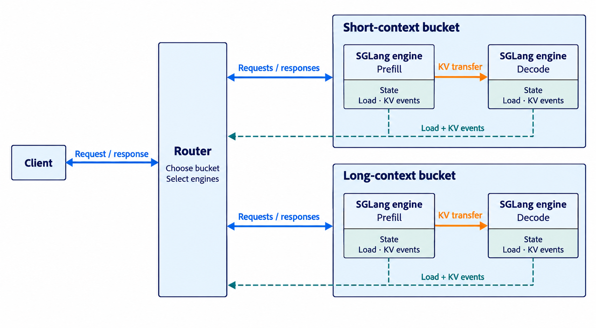
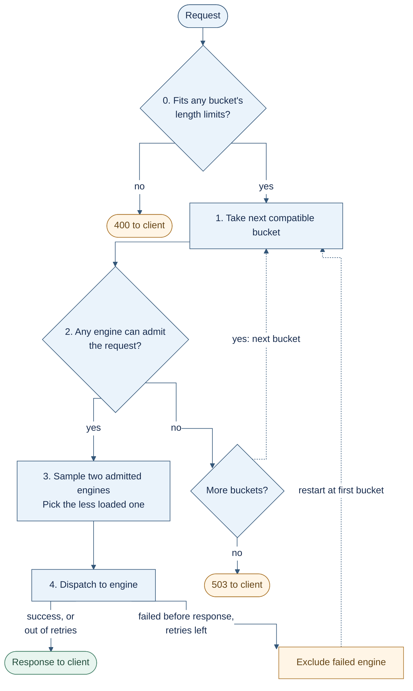

# SGLang router architecture

This document describes `--chat-routing reorg`: the deployment, request flow,
and routing policies. The default legacy path is outside its scope.

- [1. Overview](#1-overview)
- [2. Configuration examples](#2-configuration-examples)

## 1. Overview

### 1.1 Deployment Architecture

A deployment consists of a **router** and **buckets of SGLang engines**. A bucket
is a logical group defined in the router configuration. It contains either a
**unified engine group**, where each engine handles both prefill and decode,
or separate **prefill and decode (P/D) groups**.

The example below shows short-context and long-context buckets, each with prefill
and decode engines.



Each engine publishes load reports and KV events, which the router uses for
routing. An optional [external KV indexer](sgl-kv-indexer/README.md) can supply
prefix matches. The router also maintains session bindings and in-flight request
counts.

To serve a request, the router chooses a bucket, selects engines within it, and
forwards the request. In P/D, it sends the request to both the prefill and decode
engines; the prefill engine transfers KV directly to the decode engine.

### 1.2 Request routing lifecycle
Routing a request typically goes through **preprocessing** (rendering and
tokenizing), **picking a bucket**, **scoring candidate engines** (load, prefix
matching, or session affinity), **choosing engine(s)**, **forwarding** the
request, and **handling output tokens** (e.g. tool parsing). Along the way it
also applies **admission control**, **failure handling**, and **retries**.

### 1.3 Example: load-aware routing

The router tries each **bucket** that fits the request's length, ordered by SLO
preference, capacity, then `rank`; a request that fits no bucket is rejected
with **400** before any engine is considered. In each bucket it drops the
engines that fail **admission**, then picks the **less loaded of two engines
sampled** from those that remain; when no engine admits the request it moves to
the next bucket, and returns **503** when no bucket has one. If **dispatch**
fails before any response and **retries** remain, it excludes that engine and
restarts from the first bucket.

**Load** is a vector of engine metrics compared field by field, and the first
difference decides. For **unified and prefill** engines the order is estimated
prefill queue time, waiting uncached tokens, waiting requests, running requests,
then in-flight requests; **decode** engines rank by waiting and running requests,
then KV usage.



### 1.4 Example: cache-aware and session-aware routing

These policies replace steps **2–3** above. `cache_aware` serves plain and
prefill groups only; decode groups use load-aware (`power_of_two`) unless they set
`session_aware`. Both policies split the group's engines in two:

- **Preferred engine (A):** for `cache_aware`, the best-ranked prefix owner that
  passes admission; for `session_aware`, the engine bound to the session.
- **Normal engines:** the rest of the engine group. When needed, the router picks
  one of them (**B**) with the load-aware `power_of_two` policy.

A and B are checked against the same group admission limits (for example
`max_kv_usage` or `max_waiting_requests`; see [configuration examples](#2-configuration-examples)).

- **`prefer` mode (default):** use A if it passes admission.
- **`balanced` mode:** also pick a B engine and compare the loads of A and B.
  - Switch to B only when it is clearly less loaded:
    `load(A) > load_factor × load(B)` **and** `load(A) − load(B) > load_gap`
    (defaults: factor 2; gap 1024 tokens, or 4 requests). Otherwise, including
    when either load is unknown, keep A.
  - `balanced_by` sets the load metric:
    - **`prefill_tokens` (default):** the engine's reported waiting uncached tokens,
      plus the tokens this request would prefill on it. For `cache_aware` that
      subtracts the engine's cached prefix, so A's cache hit counts in its favor.
    - **`running_requests`:** the engine's reported running requests.
- **No A, or A fails admission (either mode):** fall back to B.

## 2. Configuration examples

**CLI flags** set the defaults for every engine group. A **bucket file**
(`--bucket-config`) defines the buckets, and each group in it can override the
policy, admission, and affinity settings for itself. Without a bucket file,
there are no length tiers: every request can go to any engine.

Settings fall into these categories:

| Category | What it controls | CLI flags | Bucket-file group key |
| --- | --- | --- | --- |
| **Engines** | Plain or P/D, and where engines come from | `--worker-urls`, or `--service-discovery` with `--selector` (plain) or `--prefill-selector` + `--decode-selector` (P/D) | `worker_services`, `worker_ids` |
| **Policy** | How the router scores engines within a group | `--policy` | `policy` |
| **Affinity** | When the preferred engine (prefix owner or session binding) wins over a normal engine | `--affinity-*`, `--cache-affinity-*`, `--session-id-header` | `affinity` |
| **Admission** | Limits that make an engine reject a request | `--max-*` | `admission` |
| **Buckets** | Which buckets a request fits and the order they are tried | `--bucket-config` | `max_input_tokens`, `max_context_tokens`, `rank`, ... |

How policies apply to each group:

- **Plain and prefill groups** use `--policy` (default `power_of_two`).
- **Decode groups** always default to `power_of_two`; under reorg,
  `--decode-policy` must stay `power_of_two`.
- **A bucket-file group** can set `"policy"` to `power_of_two` or to the
  `--policy` value, nothing else. `cache_aware` cannot be used on decode, so
  only `session_aware` can replace `power_of_two` there.

### Example A: plain engines, cache-aware

```bash
sgl-router --model-id qwen3 --chat-routing reorg \
  --worker-urls http://10.0.0.1:30000 http://10.0.0.2:30000 \
  --policy cache_aware \
  --affinity-mode prefer --cache-affinity-min-match-ratio 0.2 \
  --max-waiting-requests 16 --max-inflight-requests 56
```

- **Engines:** two plain engines; each handles both prefill and decode.
- **Policy:** every engine is scored with `cache_aware`.
- **Affinity:**
  - An engine owns the prefix if it holds at least 1024 matched tokens (the
    default) **and** 20% of the prompt.
  - `prefer` sends the request to the best owner that passes admission.
- **Admission:** an engine is rejected when it reports 16 or more waiting
  requests, or has 56 or more requests in flight from this router.

### Example B: P/D engines, session-aware

```bash
sgl-router --model-id qwen3 --chat-routing reorg \
  --service-discovery --service-discovery-namespace inference \
  --prefill-selector app=qwen3,role=prefill \
  --decode-selector app=qwen3,role=decode \
  --policy session_aware --session-id-header x-session-id \
  --affinity-mode balanced --affinity-balanced-by running-requests \
  --max-kv-usage 0.9
```

- **Engines:** Kubernetes discovery finds prefill and decode engines by label.
- **Policy:**
  - Prefill engines use `session_aware`: requests with the same
    `x-session-id` stick to the prefill engine they are bound to.
  - Decode engines use `power_of_two`. To make decode session-aware too, use a
    bucket file whose decode group sets `"policy": "session_aware"`.
- **Affinity:** in balanced mode the router samples an alternative engine, and
  the session moves to it when the bound engine has more than 2x the
  alternative's running requests **and** more than 4 more than it (the
  defaults). The session also moves when the bound engine fails admission.
- **Admission:** prefill and decode engines are rejected at 90% KV usage.

### Example C: P/D buckets from a file

```bash
sgl-router --model-id qwen3 --chat-routing reorg \
  --service-discovery --service-discovery-namespace inference \
  --prefill-selector app=qwen3,role=prefill \
  --decode-selector app=qwen3,role=decode \
  --policy cache_aware \
  --bucket-config buckets.json
```

`buckets.json` defines a short tier with a TTFT estimate and a long tier:

```json
{
  "ttft_slo": "slo_first",
  "buckets": [
    {
      "id": "short",
      "max_input_tokens": 4096,
      "max_context_tokens": 8192,
      "ttft_ms": 300,
      "prefill": {
        "worker_services": ["inference/prefill-short"],
        "admission": {"max_pending_prefill_tokens": 32768},
        "affinity": {"mode": "balanced", "load_factor": 1.5}
      },
      "decode": {
        "worker_services": ["inference/decode-short"],
        "admission": {"max_kv_usage": 0.9}
      }
    },
    {
      "id": "long",
      "rank": 1,
      "max_context_tokens": 131072,
      "prefill": {
        "worker_services": ["inference/prefill-long"],
        "policy": "power_of_two"
      },
      "decode": {"worker_services": ["inference/decode-long"]}
    }
  ]
}
```

- **Engines:** each group takes the discovered engines of its role that belong
  to the listed Kubernetes Services.
- **Buckets:**
  - Requests that fit within 4k input and 8k context fit both buckets; `short`
    is tried first because it is smaller. Longer requests go only to `long`.
  - If `short` rejects a request, the router tries `long`.
- **Policy:**
  - `short` prefill uses `cache_aware` from `--policy`.
  - `long` prefill overrides it with `power_of_two`.
  - Both decode groups use `power_of_two`.
- **Affinity:** `short` prefill uses balanced mode with a load factor of 1.5.
  `power_of_two` groups take no `affinity` block; setting one is rejected at
  startup.
- **Admission:**
  - `short` prefill engines reject requests while 32k or more uncached tokens
    are waiting.
  - `short` decode engines reject requests at 90% KV usage.
  - `long` engines set no limits.
