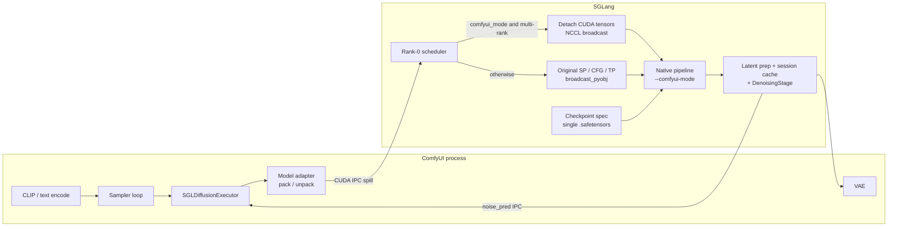

# ComfyUI SGLDiffusion Plugin

A ComfyUI plugin for SGLang Diffusion. Server mode talks to a standalone HTTP
server. Integrated mode keeps ComfyUI's CLIP / VAE / sampler loop and uses
SGLang only as a per-step DiT forward.

Integrated mode no longer ships dedicated `comfyui_*` pipelines. It starts the
native Flux / Qwen-Image / Z-Image / MiniMax-H3 pipeline under `--comfyui-mode`,
loads a single-file ComfyUI `.safetensors` (or GGUF overlay) through a
checkpoint spec, and translates each `apply_model` call through a small
per-model adapter.

## Installation

1. **Install SGLang**: Follow the [Installation Guide](https://docs.sglang.io/docs/sglang-diffusion/installation) to install `sglang[diffusion]`.
2. **Install Plugin**: Copy this entire directory (`ComfyUI_SGLDiffusion`) to your ComfyUI `custom_nodes/` folder.
3. **Restart ComfyUI**: Restart ComfyUI to load the plugin.

## Usage

The plugin supports two modes of operation: **Server Mode** (via HTTP API) and **Integrated Mode** (tight integration with ComfyUI).

### Supported Models
- **Z-Image**: High-speed image generation models (e.g., `Z-Image-Turbo`)
- **FLUX**: State-of-the-art text-to-image models (e.g., `FLUX.1-dev`)
- **Qwen-Image**: Multi-modal image generation models (e.g., `Qwen-Image`,`Qwen-Image-2512`). *Note: Image editing support is currently experimental and may have some issues.*
- **Qwen-Image-2.1**: Integrated mode (`model_type=qwen_image21`, auto-detected) for Comfy-Org's `qwen_image_2.1_bf16.safetensors` or INT8 `qwen_image_2.1_int8_convrot.safetensors`. Text-to-image and reference-image edit work with the official templates after swapping `UNETLoader` for `SGLDUNETLoader`. The worker manages the prefix K/V cache itself, so the `Qwen Image 2.1 Cache` node's options are ignored. Multi-GPU: Ulysses / Ring or TP through the manual layout in `SGLDiffusion Options`. DiT patches (Fun-Control, attention hooks) are not supported. LoRA: use `SGLDiffusion LoRA Loader` instead of `LoraLoaderModelOnly`. Tested with `Viggle/Qwen-Image-2.1-viggle-turbo` (`...-v0.3-6step-lora-r128.safetensors`): euler, `BasicGuider`, `ManualSigmas` `1.0, 0.967754, 0.933358, 0.857192, 0.666756, 0.400096, 0` at 1024x1024.
- **MiniMax-H3**: Joint video-and-audio DiT (`model_type=minimax_h3`). Integrated mode: T2V / I2VA / FL2VA use an `fl2va` checkpoint; R2V needs `ref2va`. CLIP and VAE stay in ComfyUI. Server mode uses `SGLDiffusion Generate MiniMax-H3`.

### Mode 1: Server Mode (HTTP API)
Connect to a standalone SGLang Diffusion server.

1. **Start SGLang Diffusion Server**: Ensure the server is running and accessible.
2. **Connect to Server**: Use the `SGLDiffusion Server Model` node to connect (default: `http://localhost:3000/v1`).
3. **Generate Content**:
   - `SGLDiffusion Generate Image`: For text-to-image and image editing. Set `num_images` (1 to 10) to get several images from one request as one `IMAGE` batch, in order. Image `i` uses `seed + i`, so the same settings and seed reproduce the same batch; a seed of `-1` lets the server pick a random seed.
   - `SGLDiffusion Generate Video`: For text-to-video, image-to-video, and video-to-video (connect a `VIDEO`).
   - Both nodes have an `enhance_prompt` toggle (the server needs `--prompt-enhancer-config`); the rewritten prompt comes out as `revised_prompt`.
   - `SGLDiffusion Generate MiniMax-H3`: For joint video-and-audio on a standalone server.
4. **LoRA Support**: Use `SGLDiffusion Server Set LoRA` and `SGLDiffusion Server Unset LoRA`.

### Mode 2: Integrated Mode (Tight Integration)
ComfyUI keeps CLIP, VAE, and the sampler loop. SGLang loads only the DiT and
runs one forward per sampler step (pass-through scheduler, no text encode /
decode on the worker).

1. **Load Model**: `SGLDiffusion UNET Loader` loads ComfyUI single files (Qwen-Image, FLUX, Z-Image, MiniMax H3, including pre-quantized `*_int8_convrot` files). It takes the same file as the stock UNET loader, so a workflow switches by replacing that node. `SGLDiffusion Native Model Loader` loads native SGLang model directories that have no ComfyUI file: FastH3 8-Step V2 and VDN-H3 (the model type is read from `model_index.json`).
2. **Configure Options** (optional): connect `SGLDiffusion Options` to the loader. Without it the worker uses auto-detection and defaults.
3. **Sample**: Connect the loaded model to standard ComfyUI samplers. Each step is packed by a model adapter and sent to the SGLang scheduler.
4. **LoRA Support**: Use the `SGLDiffusion LoRA Loader` for native LoRA integration.

### Options

`SGLDiffusion Options` keeps `model_type` and `num_gpus` on
top; the other groups fold, and each folded header shows its current choice.
The fields are plain ComfyUI widgets, so the node works without the JavaScript
extension, which only changes the presentation.

| Group | Fields |
| --- | --- |
| Parallel | `parallel_mode` auto or manual; manual sets `tp_size`, `ulysses_degree`, `ring_degree`, whose product must equal `num_gpus` |
| Attention | `attention_backend`: auto (model default), flash_attention, torch_sdpa, sage_attention2, sage_attention3, sol_attention (H3; needs the `sol-attn` package; picking it fills `attention_backend_config` with its defaults), and the H3 sparse backends; `attention_backend_config` |
| Quantization | `quantization` (online: native directories, or `convrot_int8` on a BF16 Qwen-Image-2.1 file); `int8_gemm`: GEMM implementation for INT8 ConvRot weights, auto / sglang_jit / comfy_kitchen |
| Cache | `cache_mode`: off, cache_dit, teacache, spectrum (lossy). For cache_dit, `cache_dit_tuning` auto keeps the defaults; manual sets warmup steps, residual threshold, max consecutive cached steps and Fn compute blocks |
| Execution | `execution_mode`: eager, torch_compile, cuda_graph (breakable CUDA graph); `regional_compile` |
| Memory | `memory_mode`: resident or DiT layerwise offload; `resident_layers`, `prefetch_layers` |

The loader checks the options against the resolved model before starting the
worker and raises instead of dropping a setting. Current limits in integrated mode:

| Option | Supported for |
| --- | --- |
| cuda_graph | MiniMax H3, with `cache_mode` off and no layerwise offload |
| torch_compile | all but FastH3 and VDN-H3 |
| ring_degree > 1 | not FastH3 / VDN-H3; MiniMax H3 needs `fa` |
| quantization | native model directories; BF16 Qwen-Image-2.1 files with `convrot_int8`. Other ComfyUI files carry their own format |
| cache_dit, spectrum | MiniMax H3 family (spectrum: sequence-parallel degree 1); other models send each sampler step as its own request, so a step cache needs per-run state first |
| teacache | none yet |

Changing anything but the Cache group restarts the worker on the next run.

For development, run `node --test web/options_state.test.mjs` in this plugin
folder and `python -m pytest python/sglang/multimodal_gen/test/unit/test_comfyui_options.py`
from the SGLang repository root.

## Adding a Model

Pick the mode before writing code; the wrong one costs several hundred lines
of weight mapping that buys nothing.

Take **Server Mode** when the model needs conditioning ComfyUI cannot supply
(audio, reference materials, task routing), emits more than one modality, or
has its own request contract. Reproducing that inside ComfyUI would duplicate
stages the server already runs.

- If the request fits the existing `generate_image` / `generate_video` fields,
  there is nothing to write — point the existing nodes at the server.
- If the model has extra request fields, pass them via `extra_fields`. The
  request schemas accept unknown keys, so `core/server_api.py` needs no
  per-model change.
- Add a node in `nodes.py` only to surface those inputs as ComfyUI widgets.
  `SGLDiffusionGenerateH3` is the worked example.

Take **Integrated Mode** only when the model denoises a single latent tensor
that ComfyUI already knows how to build and decode, so its KSampler can drive
the loop unchanged. Each model then needs:

- `runtime/pipelines/comfyui_<model>_pipeline.py` mapping ComfyUI's
  single-file checkpoint layout onto the native module tree (350-690 lines in
  the existing three)
- an executor in `executors/` adapting latent layout and conditioning to `Req`
- entries in both `pipeline_class_dict` and `executor_class_dict` in
  `core/generator.py`

## Example Workflows

Reference workflow files are provided in the `workflows/` directory:

- **`flux_sgld_sp.json`**: Multi-GPU (Sequence Parallelism) workflow for FLUX models. High-performance inference across multiple cards.
- **`qwen_image_sgld.json`**: Qwen-Image generation with LoRA support. Optimized for multi-modal image tasks.
- **`flux_controlnet_sgld.json`**: Flux.1-dev with an InstantX canny ControlNet in integrated mode (`instantx_flux_canny.safetensors` in `models/controlnet`, any image as `example.png` in `input/`).
- **`z-image_sgld.json`**: High-speed image generation using Z-Image.
- **`sgld_text2img.json`**: Server-mode text-to-image generation with LoRA support.
- **`sgld_image2video.json`**: Server-mode image-to-video generation.
- **`qwen_image21_t2i_sgld.json`**: Qwen-Image-2.1 text-to-image. For reference edit, use the official template with `SGLDUNETLoader`.
- **`minimax_h3_t2v_sgld.json`**: MiniMax-H3 T2V / I2VA / FL2VA (`fl2va` DiT).
- **`minimax_h3_r2v_sgld.json`**: MiniMax-H3 reference-to-video (`ref2va` DiT).
- **`minimax_h3_t2v_sgld_upscaler.json`**: H3 two-pass latent upscale (low-res then 3D ×2 refine).

For other workflows supporting the models, you can easily use SGLang by replacing the official `UNET Loader` node with the `SGLDUNETLoader` node. Similarly, for LoRA support, replace the official LoRA loader with the `SGLDiffusion LoRA Loader`.

To use these workflows:
1. Open ComfyUI.
2. Load the workflow JSON file from the `workflows/` directory.
3. Adjust the parameters and model paths as needed.
4. Run the workflow.

## Current Implementation

SGLang's optimized kernels and parallelism (TP / SP, compile, cache) run on the
DiT only. Text encoding and VAE stay in ComfyUI.

Start ComfyUI with `--disable-cuda-malloc` for integrated mode. ComfyUI's default `cudaMallocAsync` pool cannot export CUDA IPC handles, so per-step tensors (latents, ControlNet residuals) then go through a host copy; with the flag they are shared on the GPU. Flux + ControlNet at 1024x1024 on an H100 drops from 13.1s to 4.7s for 25 steps.

## Architecture

Per sampler step:

1. The adapter turns ComfyUI `apply_model` tensors into an SGLang `Req`.
2. Local ZMQ pickle replaces CUDA tensors with IPC handles so latents stay on GPU.
3. Rank 0 materializes the handles. Multi-rank `--comfyui-mode` then detaches CUDA tensors and broadcasts them over NCCL; the general SP / CFG / TP path is still the original whole-list `broadcast_pyobj`.
4. The worker pipeline is the native model class with modules trimmed to `transformer` + pass-through scheduler. A single-file checkpoint goes through `comfyui_checkpoints`. After the first step, conditioning stays in a worker session; later steps send latents and the timestep.

Adding a model means a checkpoint spec plus a `ComfyUIModelAdapter`. There is no extra ComfyUI pipeline class.
