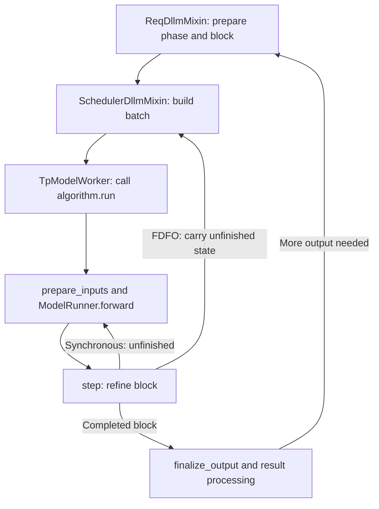

# Diffusion language model runtime

This directory connects diffusion language model (dLLM) decoding to SGLang's
request scheduler. A denoising algorithm refines a block of token positions over
repeated model forwards. The scheduler tracks unfinished blocks and emits tokens
when a block is ready.

Start with the file map, then follow a request through the runtime.

## File map

| File | Responsibility |
|---|---|
| [config.py](config.py) | Build `DllmConfig` from server arguments and checkpoint metadata. Check model and algorithm compatibility. |
| [algorithm/__init__.py](algorithm/__init__.py) | Discover modules that export `Algorithm`. Resolve an algorithm name to its class. |
| [algorithm/base.py](algorithm/base.py) | Define `DllmAlgorithm`, its hooks, and the shared synchronous and FDFO execution loops. |
| [mixin/req.py](mixin/req.py) | Store request phases, block offsets, unfinished token IDs, and algorithm state. Prepare the next block. |
| [mixin/scheduler.py](mixin/scheduler.py) | Select batches, process results, manage request queues, and commit or release key/value (KV) cache entries. |
| [attention.py](attention.py) | Implement the dLLM FA4 attention helper and graph workspaces. Other attention paths live in the shared attention backends. |

The model implementations live in [srt/models](../models/). The denoising
algorithms in this directory decide how to use model logits to update tokens.

## Follow a request

1. **Select an algorithm.** The server reads `--dllm-algorithm` and an optional
   `--dllm-algorithm-config` YAML mapping. `DllmConfig.from_server_args()` selects
   the block size and special token IDs for the checkpoint. It also checks
   algorithm compatibility. The arguments are defined in
   [ExecDllm](../arg_groups/fields/exec_.py).
2. **Prepare request state.** `ReqDllmMixin` records the phase and block offset.
   It builds input IDs for a fresh block or restores an unfinished block.
   Phases distinguish incoming and staged requests, and prefill and denoising.
3. **Build a batch.** `SchedulerDllmMixin.get_new_batch_dllm()` selects requests
   through `DllmManager` and the shared prefill allocator. Context encoding uses
   `EXTEND` when the algorithm requires a separate pass. Denoising uses
   `DLLM_EXTEND`.
4. **Run the algorithm.**
   [TpModelWorker](../managers/tp_worker.py) calls `DllmAlgorithm.run()` with a
   [ForwardBatch](../model_executor/forward_batch_info.py). The algorithm prepares
   inputs, calls [ModelRunner](../model_executor/model_runner.py), and uses
   `step()` to update the block from the returned logits.
5. **Return results.** `DllmRunOutput` carries logits, proposed tokens, optional
   accept lengths, optional algorithm state, and CUDA graph status. An algorithm
   can attach extra results through `finalize_output()`.
6. **Update the request.** `process_batch_result_dllm()` keeps unfinished FDFO
   blocks for another round. It appends completed output and any supported score
   rows, checks stop conditions, and sends output to the shared streamer.
   `finish_dllm_forward()` handles the KV cache before the next round.

This diagram shows the denoising path. A context-only pass does not refine a
block.

## Scheduling and state

**Synchronous mode** runs repeated forwards inside `DllmAlgorithm._run_sync()`.
The batch returns to the scheduler after the loop finishes. Use
`--no-dllm-fdfo` to select this mode.

**First-done-first-out (FDFO) mode** is enabled by default. Each call to
`_run_fdfo()` advances one denoising step. A completed row has an accept length
equal to the block size. An unfinished row has accept length zero. Its tokens
and algorithm state travel with the request into a later scheduler round.
The scheduler emits only completed output.

`ReqDllmMixin` owns `dllm_incomplete_ids`, `dllm_algo_state`, and
`dllm_block_offset`. `DllmManager` owns the waiting and staging queues.
Algorithm state must stay with its request when batches change.

KV cache handling depends on the algorithm. Algorithms that keep generated-block
KV must forward the final tokens before reporting completion. Algorithms with
separate context encoding discard denoising-block KV and encode the generated
tokens causally in a later context pass. See `finish_dllm_forward()` and
`_stash_dllm_context()` for these two paths.

## Algorithms

| Algorithm | How it refines a block |
|---|---|
| [LowConfidence](algorithm/low_confidence.py) | Fill masked positions above a confidence threshold. Fall back to the highest-confidence masked position. |
| [JointThreshold](algorithm/joint_threshold.py) | Combine mask-to-token updates with token-to-token edits. Track an edit budget and preserve prompt positions. |
| [JointThresholdInDel](algorithm/joint_threshold_indel.py) | Add insertion and deletion operations to threshold decoding. Require the checkpoint's delete and split token IDs. |
| [Gemma4Renoise](algorithm/gemma4_renoise.py) | Refine a full DiffusionGemma canvas with sampling, renoising, and self-conditioning. Use a separate context-encoding pass. |

`config.py` currently maps LLaDA2, SDAR, and DiffusionGemma checkpoint
architectures to runtime parameters. Model support also depends on the chosen
algorithm's launch constraints and request validation.

## Algorithm contract

`DllmAlgorithm` provides these extension points:

- `configure_server_args()` declares launch constraints.
- `validate_request()` rejects request features that the algorithm cannot serve.
- `init_step_state()` builds the initial denoising state.
- `prepare_inputs()` updates model inputs before a forward.
- `step()` changes tokens in place and reports which blocks may emit.
- `max_steps()` bounds the synchronous refinement loop.
- `finalize_output()` attaches algorithm-specific results, such as denoiser
  logprobs supported by `Gemma4Renoise`.

During denoising, `ForwardBatch.input_ids` is a flat tensor of
`batch_size * block_size` tokens. The algorithms reshape full logits to
`[batch_size, block_size, vocab_size]`. Keep tensor storage stable where CUDA
graph replay depends on it. Do not report a block as complete before its output
and required KV cache state are ready.

## Where to change code

- **Add a denoising rule:** implement a `DllmAlgorithm` subclass and export it as
  `Algorithm` in its module. The registry discovers that export.
- **Add a checkpoint architecture:** update the mapping and validation in
  `config.py`, and provide its model implementation in `srt/models`.
- **Change request phases or block preparation:** start in `mixin/req.py`.
- **Change batch selection, output, or KV ownership:** start in
  `mixin/scheduler.py`. Follow its calls into the shared scheduler and allocator.
- **Change execution or graph behavior:** follow the worker into `ModelRunner`
  and [runner_backend](../model_executor/runner_backend/). The FA4 helper in
  `attention.py` owns its attention workspaces.

## Tests and model guides

[Unit tests](../../../../test/registered/unit/dllm/) cover denoising rules,
request lifecycle, logprobs, model forwards, and graph behavior.
[KV reuse tests](../../../../test/registered/unit/mem_cache/test_dllm_fdfo_kv_reuse.py)
cover the connection to the cache. The `gemma4_*` dLLM tests cover
DiffusionGemma's implementation, including its `Gemma4Renoise` algorithm.

Use the model guides for checkpoint-specific launch commands:
[LLaDA 2.1](../../../../docs/cookbook/autoregressive/InclusionAI/LLaDA-2.1.mdx)
and [DiffusionGemma](../../../../docs/cookbook/autoregressive/Google/DiffusionGemma.mdx).
