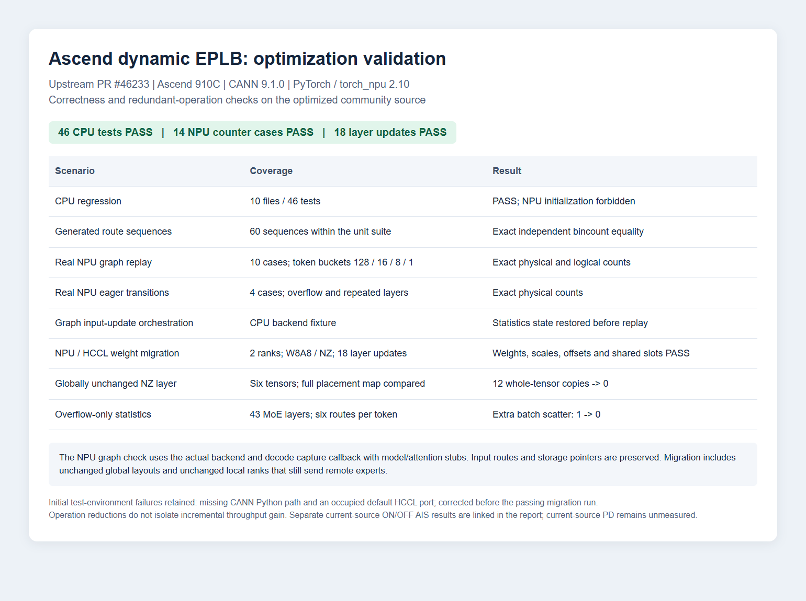
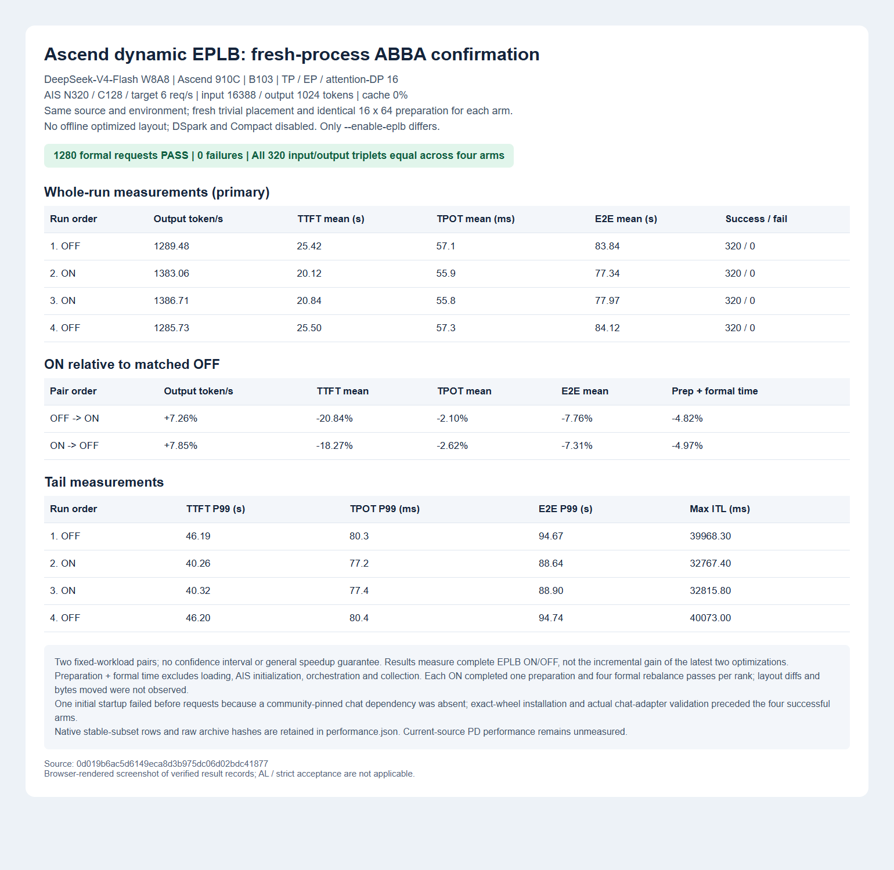
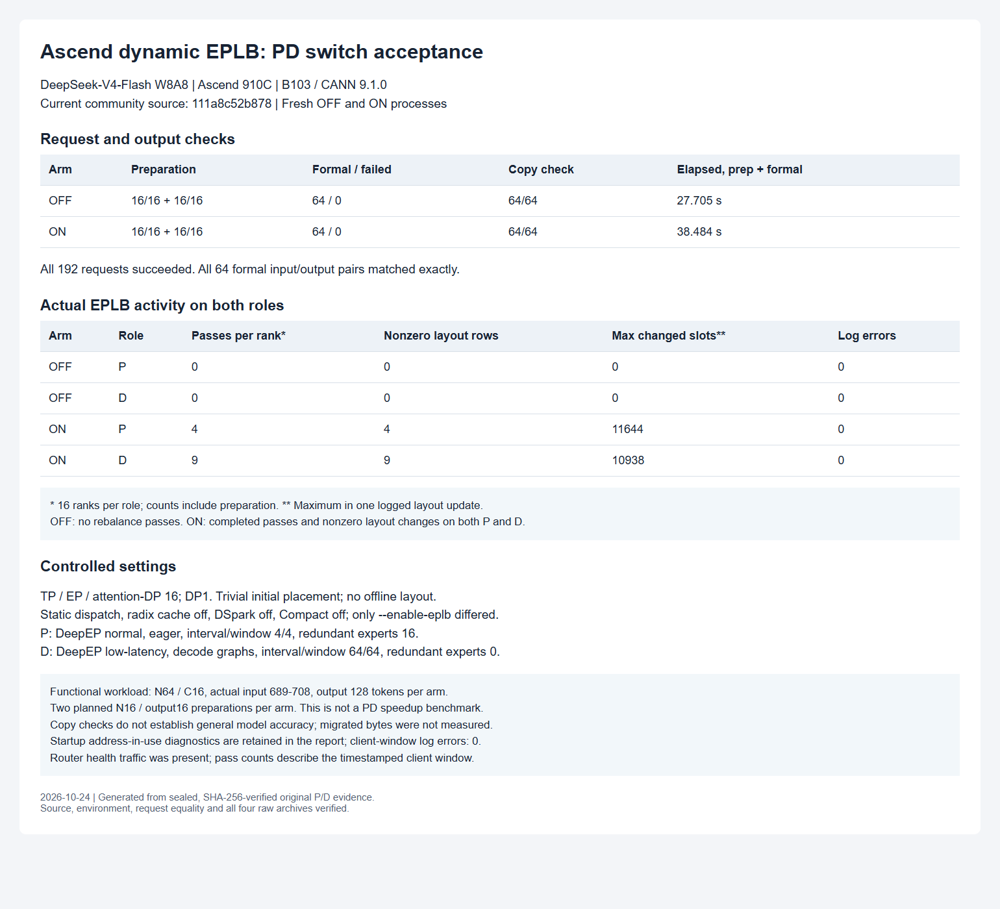
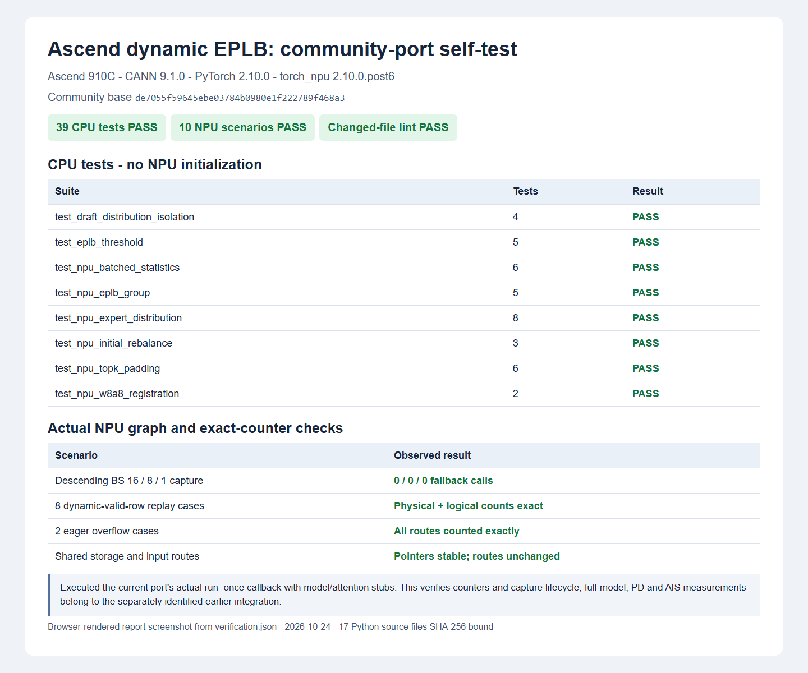
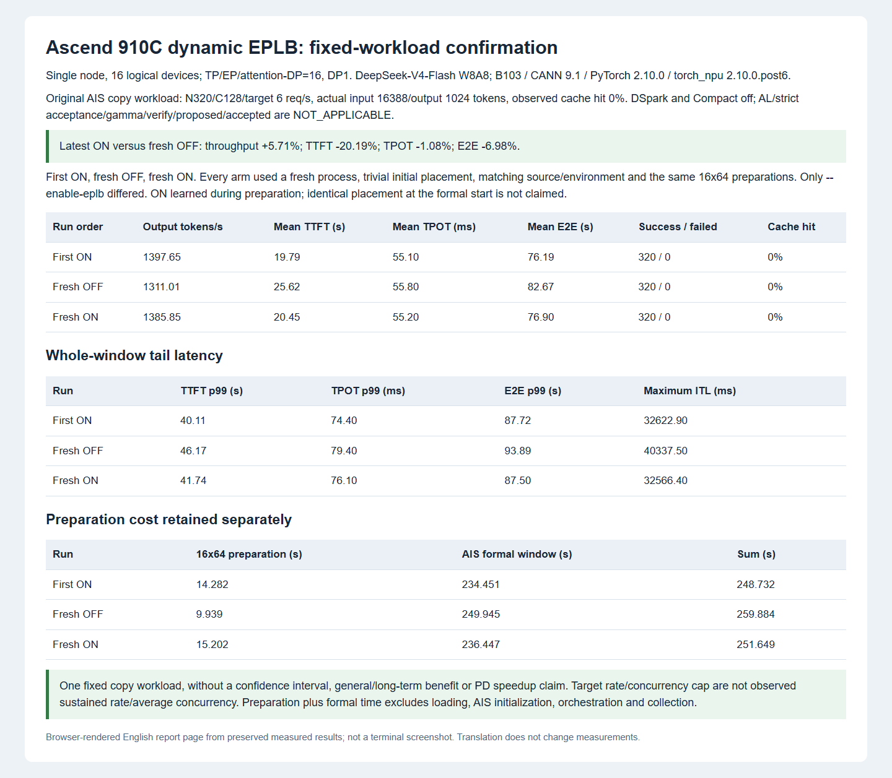

# Ascend dynamic EPLB: community-port self-test

> Scope update (2026-10-26): this report preserves results for the pinned
> historical revisions below. The PR now uses upstream rebalance scheduling;
> the automatic 64-step initial learning policy has been removed. Subsequent
> code cleanup and this policy removal have not been hardware-tested, and the
> throughput improvements below are not measurements of the latest PR revision.

## Source and validation scope

Community base: `de7055f59645ebe03784b0980e1f222789f468a3`.
The [initial verification manifest](ascend_dynamic_eplb_upstream_20261024/verification.json) binds the original 17 Python files and separately records the CI fixture follow-up. The [optimization manifest](ascend_dynamic_eplb_upstream_20261024/optimization.json) identifies the later optimized source, including exact snapshot and canonical LF SHA-256 values.
Eight production files are changed; the existing community TopK padding and shared-expert masking implementation is retained.
The later comment and docstring cleanup leaves the executable code unchanged from the tested revision.

The optimized community source passed CPU, bounded NPU graph, two-rank weight migration and fresh-process full-model AIS checks. Current-source single-node performance is reported separately from the earlier integration results. Fresh OFF/ON disaggregated P/D acceptance at the current community revision is reported below.

## Optimization follow-up

Two unnecessary-work paths were removed after reviewing upstream revision `a7ae5d1f345630e9df51415b4e175dbf103bcea6`:

- Globally unchanged NPU layers are skipped before allocating or converting migration workspaces. The full CPU placement map is compared on every rank, because a rank with unchanged local destinations can still be a remote sender. Elastic recovery and other devices retain their existing path.
- Overflow-only forwards skip the unused batched statistics reduction. The route buffer is cleared only after a forward that could write it. Each NPU graph saves its own batching state; normal replay and replay with input updates restore that state before graph execution. This avoids relying on Python routing hooks during replay.

| Follow-up scenario | Result |
|---|---|
| Ten CPU files, including the NPU backend orchestration fixture | 46 tests PASS; NPU initialization forbidden |
| Generated repeated-layer, invalid, empty and overflowing routes | 60 sequences matched independent bincount oracles within the unit suite |
| Actual NPU backend capture and replay, 43 layers / 272 physical experts / six routes per token | Ten replay cases matched physical and logical counts exactly |
| Actual NPU eager execution after mixed graph sizes | Four cases matched physical counts exactly |
| Large graph and eager overflow-only forwards | 43 original per-layer scatter calls retained; extra batch scatter eliminated |
| Two-rank NPU/HCCL, real W8A8 postprocessing and NZ weights | 18 layer updates PASS; globally unchanged layouts, remote senders, replicated experts and shared slots covered |

The graph check captures descending token sizes 128/16/8/1 using the actual NPU backend and actual decode `run_once` callback with model/attention stubs. Replay alternates large fallback-only and small batched graphs, including zero valid rows. Route values and storage pointers remain unchanged. The input-update replay entry point is additionally checked by the CPU backend fixture.

For an unchanged layer with six tensors, the former workspace path performed 12 whole-tensor copy calls; the new path skips the allocation and copies. This is an operation-count observation. The full-model ON/OFF measurements below cover the complete EPLB feature; they do not isolate the incremental gain of these two optimizations versus the parent revision.

Two initial migration-test exits are retained in the evidence: first an overwritten CANN Python path prevented `acl` import; then the default NPU HCCL port was already occupied by an existing service. Preserving the CANN path and using OS-assigned test ports allowed the same production source to pass. The test used a 32 MiB communication buffer. These are test-environment/communication-setup failures, not successful migration runs.



This is a browser-rendered screenshot of the verified correctness and operation-count results. Current-source full-model AIS measurements are reported below; the earlier integration results retain their original scope.

## Current community source: fresh-process single-node performance

Source: `0d019b6ac5d6149eca8d3b975dc06d02bdc41877`. The [verified performance records](ascend_dynamic_eplb_upstream_20261024/performance.json) retain all four arms, raw archive hashes, whole-run statistics and native stable-subset rows.

DeepSeek-V4-Flash W8A8 on Ascend 910C with the B103 runtime; TP/EP/attention-DP 16, DP1. Original AIS copy workload: N320/C128/target 6 req/s, actual input 16388/output 1024 tokens, cache hit 0%. DSpark and Compact were disabled, so AL and strict draft acceptance are not applicable.

The order was **OFF -> ON -> ON -> OFF**. Every arm loaded a fresh model process with trivial initial placement, no offline optimized layout, and 16 redundant experts. The static dispatch setting is a routing mode, not a precomputed balancing layout. The same source, environment, entry point, original request records and 16x64 preparation requests were checked across all arms; only `--enable-eplb` differed. Cache was flushed before formal measurement. Rebalance interval/window were 640/320, with per-forward balancedness reporting disabled.

| Execution order | Output tokens/s | Mean TTFT (s) | Mean TPOT (ms) | Mean E2E (s) | Success / failed |
|---|---:|---:|---:|---:|---:|
| 1. OFF | 1289.48 | 25.42 | 57.10 | 83.84 | 320 / 0 |
| 2. ON | 1383.06 | 20.12 | 55.90 | 77.34 | 320 / 0 |
| 3. ON | 1386.71 | 20.84 | 55.80 | 77.97 | 320 / 0 |
| 4. OFF | 1285.73 | 25.50 | 57.30 | 84.12 | 320 / 0 |

ON changes relative to the matched OFF:

| Pair order | Output throughput | Mean TTFT | Mean TPOT | Mean E2E | Preparation + formal time |
|---|---:|---:|---:|---:|---:|
| OFF -> ON | +7.26% | -20.84% | -2.10% | -7.76% | -4.82% |
| ON -> OFF | +7.85% | -18.27% | -2.62% | -7.31% | -4.97% |

| Execution order | P99 TTFT (s) | P99 TPOT (ms) | P99 E2E (s) | Maximum ITL (ms) | Preparation (s) | Formal duration (s) |
|---|---:|---:|---:|---:|---:|---:|
| 1. OFF | 46.19 | 80.30 | 94.67 | 39968.30 | 10.19 | 254.12 |
| 2. ON | 40.26 | 77.20 | 88.64 | 32767.40 | 14.65 | 236.92 |
| 3. ON | 40.32 | 77.40 | 88.90 | 32815.80 | 15.34 | 236.30 |
| 4. OFF | 46.20 | 80.40 | 94.74 | 40073.00 | 9.94 | 254.86 |

All 1280 formal requests and 64 preparation requests succeeded. The copy oracle passed 320/320 per formal arm, and all 320 input/output triplets matched exactly across all four arms. OFF completed zero rebalance passes on every rank. Each ON completed one preparation and four formal rebalance passes on each of 16 ranks. Placement logging was disabled equally, so actual layout differences and bytes moved are **NOT_OBSERVED**; completion counts are not a measurement of nonzero weight moves.

The primary table uses the entire fixed AIS workload. Native stable rows were generated by reusing the same completed records without inference resubmission; original total results were hash-checked unchanged. The following automatic subsets are secondary, not a separately matched benchmark:

| Execution order | Native stable N | Mean TTFT (s) | Mean TPOT (ms) | Mean E2E (s) |
|---|---:|---:|---:|---:|
| 1. OFF | 184 | 27.78 | 55.10 | 84.18 |
| 2. ON | 184 | 24.17 | 55.40 | 80.87 |
| 3. ON | 183 | 24.29 | 55.20 | 80.77 |
| 4. OFF | 184 | 27.84 | 55.30 | 84.43 |

Native `OutputTokenThroughput` is per-request token/s and must not be interpreted as aggregate output throughput. The JSON retains all metric directions and sample counts. Preparation-plus-formal time excludes model loading, AIS initialization, orchestration and collection.

This confirms the observed ON/OFF effect in two pairs on one fixed workload. It does not establish a confidence interval, a general speedup guarantee, current-source PD performance, or the incremental gain of the latest two optimizations versus the parent revision.

An initial OFF startup failed after weight loading and graph capture, before any requests, because `deepseek-recipe==0.2.0` (already pinned by community packaging) was absent from B103. The exact official wheel was installed without dependencies; the actual chat adapter and all 320 serialized input lengths were checked before restart. This incurred an extra full load. The failed startup archive is retained, SHA-256 `a713c203d33c1a2c10a434b9d40a3007ac17803913814f35a0b72c8a51ba13c0`.

| Raw arm archive | SHA-256 |
|---|---|
| 1. OFF | `55133889818974d4e54833fbbcde2835cfe43cb03769e63b6e418f66e442ef01` |
| 2. ON | `4f27fb01ff314ecf0784c783c803fd860ed0f4d3955cd7616b414db09fd04928` |
| 3. ON | `ab8198c8830b9572a23abe3f32f76d17c56ff1a58a22b43bf8a3d3fab00eb18d` |
| 4. OFF | `77233eed4ced99d818bc3bd993286cccbdcce55d7afbdb05dc6bb914cf097ceb` |



The image is a browser-rendered screenshot of the verified records. Historical positive/negative PD measurements and failed runs remain available in the pinned integration report below.

### Community CI at the tested source

At source `0d019b6ac5d6149eca8d3b975dc06d02bdc41877`, [lint passed](https://github.com/sgl-project/sglang/actions/runs/40070517623) and all [17 CPU partitions passed](https://github.com/sgl-project/sglang/actions/runs/40070517808). The nine EPLB suites and existing NPU graph-backend fixture were observed in the successful CPU logs. The CI run as a whole is not green.

- Intel SPR image construction exhausted runner disk before tests.
- Two NVIDIA partitions failed importing DeepEP because the driver exposed no usable CUDA device; subsequent partitions failed fast.
- An NPU HiCache test failed allocating host pinned memory with EPLB disabled. A separate GLM image distributed test returned no output; its root cause is unresolved.
- An AMD LoRA latency test exceeded its threshold with EPLB disabled; this is an observed failure, without a matched baseline attribution.
- Extra-suite gates require maintainer opt-in; some hardware jobs remain queued. No gate bypass, latency-threshold change or unrelated production fix was made.

## Current community source: PD switch acceptance

Source: `111a8c52b87869d3904ba00e429bf8bb959cd560`. The [PD acceptance records](ascend_dynamic_eplb_upstream_20261024/pd_acceptance.json) contain per-rank rebalance counts, actual layout-change observations, source hashes and the four verified raw archive hashes.

Two Ascend 910C nodes served separate prefill and decode roles with DeepSeek-V4-Flash W8A8, B103, CANN 9.1.0, PyTorch 2.10.0 and torch_npu 2.10.0.post6. Both used the current community source and the packaging-pinned `deepseek-recipe==0.2.0`. Each OFF/ON arm started fresh processes on both nodes; source, environment and requests matched, with only `--enable-eplb` changed.

Both roles used TP/EP/attention-DP 16, DP1, trivial initial placement and static dispatch, without an offline optimized layout. Radix cache, DSpark and Compact were disabled. P used DeepEP normal in eager mode, memory fraction 0.62, 16 redundant experts and interval/window 4/4. D used DeepEP low-latency with decode graphs 1/2/4/6/8/12/16, memory fraction 0.71, no redundant experts and interval/window 64/64. Placement logging was enabled equally; balancedness reporting was off. The short intervals deliberately exercise the switch and repeated layout updates.

Each arm ran two planned preparations of 16 requests with 16 output tokens, followed by 64 formal requests at C16, actual input 689-708 and output 128 tokens. These are short copy inputs from the existing request bank, not the 16388/1024-token AIS performance workload.

| Arm | Preparation success / failed | Formal success / failed | Copy check | Preparation + formal time |
|---|---:|---:|---:|---:|
| OFF | 32 / 0 | 64 / 0 | 64/64 | 27.705 s |
| ON | 32 / 0 | 64 / 0 | 64/64 | 38.484 s |

All 192 planned requests succeeded. All 64 formal input/output pairs matched exactly between OFF and ON; the 32 preparation pairs also matched. Both P and D completed real layout changes with ON, while OFF completed zero rebalance passes.

| Arm | Role | Completed passes per rank | Nonzero layout-change log rows | Maximum changed physical slots in one update |
|---|---|---:|---:|---:|
| OFF | P | 0 | 0 | 0 |
| OFF | D | 0 | 0 | 0 |
| ON | P | 4 | 4 | 11644 |
| ON | D | 9 | 9 | 10938 |

Counts cover all 16 ranks per role in the timestamped client window, including both preparation rounds. Router health traffic was also present. Before that window, ON had already completed P2/D1 passes per rank during startup and health traffic. Layout rows are log observations, not unique layers or migrated bytes. No ERROR, Traceback, scheduler exception or ERR00100 signatures occurred in the client window. This verifies the PD switch and copy-task behavior; it does not establish PD speedup, general task accuracy or all-layer weight equality.

Startup diagnostics are retained separately: P logged five address-in-use/configuration-store errors in each arm when it attempted to create the already-running test store; OFF D logged two transient TCP bind errors. All occurred before readiness and before the client window. Both arms subsequently completed all planned requests. No transport workaround or retry was added to the client.

| Raw arm archive | SHA-256 |
|---|---|
| OFF P | `89c06b21da13a7232c86fece6f5cc092ecea173fd8f73cc105a929255dc1e7ba` |
| OFF D | `611a2048d5da3bee392d349ce4b90f302afab8f8ea108b926be8bc1894ed04c2` |
| ON P | `8385f5cafe921cf2a85f6286c98964f6a59863573edd531bf79684b47d24d047` |
| ON D | `673f08a5a0f269385cf289b2619e74053ce980ac306ecd7ae3280132718aac0d` |



The image is a browser-rendered screenshot of the verified records. Full raw requests, outputs and logs are retained in the sealed archives; the public JSON contains the source-bound summary.

## Initial community-port tests

Runtime: Ascend 910C, CANN 9.1.0, PyTorch 2.10.0, torch_npu 2.10.0.post6.

| Scenario | Passed | Result |
|---|---:|---|
| Draft/target recording isolation | 4 | PASS |
| Utilization threshold with reporting disabled | 5 | PASS |
| Exact batched statistics, overflow and capture offsets | 6 | PASS |
| Device group creation, reuse and WORLD replacement | 5 | PASS |
| NPU sender counts, DeepEP modes and idle ranks | 8 | PASS |
| Initial learning period and steady-window invariant | 3 | PASS |
| Community TopK padding, shared experts and device row count | 6 | PASS |
| Processed W8A8 weight/scale/offset registration | 2 | PASS |
| Actual NPU graph replay, physical and logical counts | 8 cases | Exact integer equality |
| Repeated-layer and capacity overflow on NPU | 2 cases | Exact integer equality |

All **39 CPU tests passed without NPU initialization**. During port adaptation, an old test expected nonzero weights in padded rows. The test now checks the community's existing zero-padding behavior; production TopK code was not changed.

The NPU probe ran 43 layers, 272 physical experts, 6 routes/token, and descending BS 16/8/1 capture. It executed the actual `run_once` callback extracted from this port, with attention/model stubs. There was no normal recorder reset between warmups and capture. Capture fallback counts were 0/0/0. Eight replay cases varied valid rows from zero to the full batch and matched independent CPU bincount oracles exactly. Two eager overflow cases retained all counts. Shared storage pointers remained stable and route tensors were unchanged. This is a counter/capture test, not a full-model graph or throughput test.

CI compatibility follow-up: the existing PD role-switch test bypasses `ModelRunner.__init__`; its fixture now sets `is_draft_worker=False`, matching a normal target runner. The full **38-case PD role-switch file** and the existing **4-case draft-isolation suite** passed in an isolated source copy without NPU initialization. The 4 draft cases repeat coverage in the 39-test group above; they are not additional distinct cases. Production code was unchanged by this fixture repair.

Changed-file pre-commit checks passed. Three unchanged system hooks expecting a `python3` executable on Windows were also executed successfully using the installed Python.

Run the selected CPU suites in a compatible SGLang development environment:

```bash
for name in draft_distribution_isolation eplb_threshold npu_batched_statistics npu_eplb_group npu_expert_distribution npu_initial_rebalance npu_topk_padding npu_w8a8_registration; do
  python "test/registered/unit/eplb/test_${name}.py" || exit $?
done
```



This image is a browser-rendered report screenshot generated from the verified JSON results, rather than a terminal screenshot.

## Earlier integration: full-model and PD switch acceptance

The [pinned integration report](https://github.com/chenxu214/ci_sglang/blob/f040177346d5eca8ea38ce8d569444f4a5176206/test/manual/ep/reports/ascend_dynamic_eplb_delivery_20261024.md) records source identities, raw archive hashes, scenarios and screenshots. Those tests used the earlier integration source, not the community base above.

- DeepSeek-V4-Flash W8A8, Ascend 910C, CANN 9.1.0.
- Final packaged single-node run: 16 successful requests, 0 failed, exact copy oracle 16/16, with a real rebalance on all 16 ranks.
- Fresh OFF/ON PD arms: each used two planned 16-request preparations and 64 formal requests at C16, actual input 689-708 and output 128 tokens. All 192 planned requests succeeded. Formal outputs matched exactly between OFF and ON; the copy oracle passed 64/64 in each arm.
- OFF had zero updates on every P/D rank. ON had P4/D10 updates per rank in the request window, including preparation, and nonzero layout changes. Successful request logs contained no ERROR, Traceback or scheduler exception.
- The deliberately frequent PD migration configuration took 31.867 s OFF / 36.623 s ON for preparation plus formal requests. This establishes switch functionality, not PD net speedup.

The copy oracle is not a full model-accuracy benchmark. GPU hardware, full task-accuracy evaluation, all-layer/all-rank weight export and hardware-utilization measurements are not claimed.

## Earlier integration: fixed-workload single-node performance

These results belong to the frozen `singlecapture_v1` candidate before the community port. The workload was original AIS copy, N320/C128/target 6 req/s, actual input 16388 and output 1024 tokens, cache hit 0%, TP/EP/attention-DP 16 with DP1. DSpark and Compact were disabled. Each fresh process used trivial initial placement, with no offline optimized layout. Source, environment and 16x64 preparation requests matched; only `--enable-eplb` differed.

| Run order | Output tokens/s | Mean TTFT (s) | Mean TPOT (ms) | Mean E2E (s) | Success / failed |
|---|---:|---:|---:|---:|---:|
| First ON | 1397.65 | 19.79 | 55.10 | 76.19 | 320 / 0 |
| Fresh OFF | 1311.01 | 25.62 | 55.80 | 82.67 | 320 / 0 |
| Fresh ON | 1385.85 | 20.45 | 55.20 | 76.90 | 320 / 0 |

The two ON runs improved output throughput by 6.61% and 5.71% versus the fresh OFF. Latest ON mean TTFT/TPOT/E2E changed by -20.19%/-1.08%/-6.98%. All 320 input/output triplets matched exactly; each run passed the copy oracle 320/320. Preparation plus formal time decreased by 3.17%, excluding loading, AIS initialization, orchestration and collection.

This is reproduction on one fixed workload, without a confidence interval or a general/long-term performance claim. It is not a measured speedup of the rebased community source. Earlier positive/negative PD results and failed runs remain linked in the pinned integration report.


