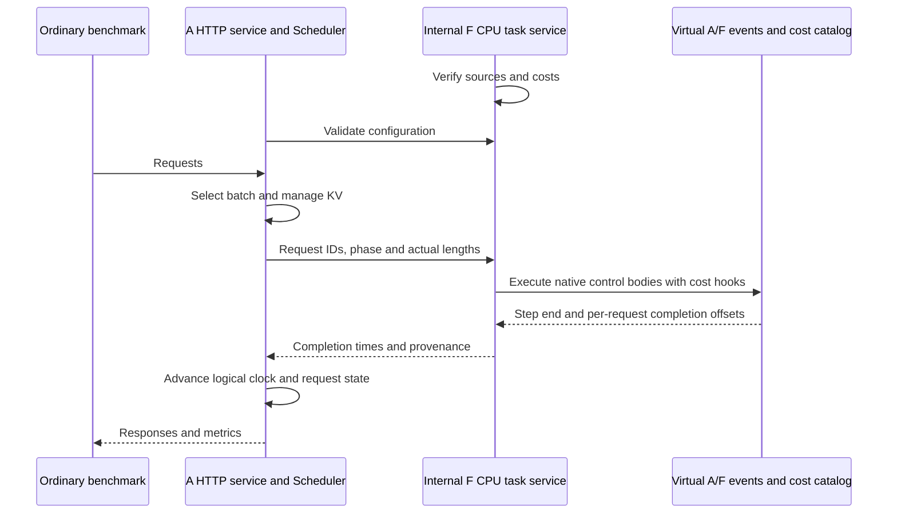

# AFD simulation

## Motivation

Simulate Attention–FFN disaggregation (AFD) on CPU: execute selected native
control bodies as costed virtual events, then return completion times to the
ordinary Simulator Scheduler and benchmark.

AFD implementation: [PR #41646](https://github.com/sgl-project/sglang/pull/41646)
· [issue #41648](https://github.com/sgl-project/sglang/issues/41648).

## Specification

| Item | Current support |
| :--- | :--- |
| Model | Qwen3-235B-A22B: 94 layers, H4096, Q64/KV4/D128, 128 experts, top-k8 |
| Compute | TRTLLM attention with FP8 Q/KV, page64; none A2A and DeepGEMM, compact unmasked layout, block128 UE8M0 |
| F-side routing | 8A + 2/4/8F, two equal stages; route on F after gathering inputs |
| Direct routing | 8A8F, two equal stages; A Router/TopK, broadcast to every F, local expert/combine on F, sum partials on A |
| Request workload | OFFLINE, uniform KV, fixed cohorts, batch divisible by 16, synchronous iterations |
| Costs | Complete decode JSON catalog keyed by batch/effective KV; explicit whole-batch prefill costs |
| Sources | Latest trusted AFD implementation checkout; required files and interfaces are checked |
| Outputs | Request/iteration/metrics files, event traces, critical path and cost provenance |

Use `--afd-execution-mode attention|ffn` and `--afd-config` with
`ffn_backend=fixed|direct`. Missing costs or incompatible sources fail explicitly.

| Boundary | Status |
| :--- | :--- |
| Cost catalog | Prepared exact/interpolated/formula records; no live AIC lookup in the runner |
| Unsupported | Auto negotiation, unequal KV, request migration, cross-iteration overlap |
| Not validated | Capacity admission, numerical model output, full HTTP performance accuracy |
| New models/backends | Require matching execution and cost adapters |

## How it works



A keeps the real Scheduler and KV lifecycle; F runs all virtual A/F ranks in
one event graph. Each request receives its sampling completion offset; the next
iteration waits for the full step. Device costs count, CPU/RPC wall time does not.
Prefill uses an explicit whole-batch cost. Generic scheduling/cost contracts stay
separate from source-checked SGLang adapters; temporary hooks are restored on exit.

## Prepare and reproduce

Run from the repository root in a Linux CPU Simulator environment:
`python3 -m pip install -e tools/sglang-simulator`. Model metadata and the bundled
tokenizer suffice for the control demo.

**1. Prepare the AFD implementation checkout.** `SOURCE` is its repository root
(containing `python/sglang/srt/afd/`), separate from Simulator and AIC. For an
experimental rebase:

```bash
export SIMULATOR="$PWD"
export SOURCE="$(dirname "$PWD")/sglang-afd-experiment"
(
  set -e
  git fetch https://github.com/sgl-project/sglang.git \
    +refs/heads/main:refs/remotes/afd-demo/main \
    +refs/pull/41646/head:refs/remotes/afd-demo/implementation
  git worktree add -b codex/afd-sim-experiment "$SOURCE" \
    refs/remotes/afd-demo/implementation
  git -C "$SOURCE" rebase refs/remotes/afd-demo/main
)
```

Conflicts stop in `$SOURCE`; inspect or run `git -C "$SOURCE" rebase --abort`.
Run the source tests after updating the AFD checkout.

**2. Prepare the HTTP control fixture.** Use a new `CASE`; repeat the environment
settings in each terminal. Generated 10 ns costs are synthetic.

```bash
: "${SOURCE:?Set SOURCE to the AFD implementation worktree created above}"
export CASE="$PWD/experiments/afd-http"
python3 tools/sglang-simulator/scripts/configure_experiment.py \
  --simulator-root "$PWD" --source-root "$SOURCE" --routing direct \
  --output "$CASE-env" && \
python3 tools/sglang-simulator/examples/afd_serving/make_control_fixture.py \
  --source-root "$SOURCE" --output "$CASE"
source "$CASE-env/env.sh"
export AFD_CONFIG="$(cat "$CASE/native.json")"
export SGLANG_USE_CPU_ENGINE=1
export OMP_NUM_THREADS=2 OPENBLAS_NUM_THREADS=2 MKL_NUM_THREADS=2
export SGLANG_SIMULATOR_OUTPUT_MODE=OFFLINE
export SGLANG_SIMULATOR_OUTPUT_DIR="$CASE/a-results"
```

`configure_experiment.py` checks existing source files and writes `env.sh`;
it does not install dependencies or execute a model.

**Terminal F — start the internal task service:**

```bash
python3 -m sglang_simulator.simulation.sglang.launch_server \
  --afd-execution-mode ffn --afd-config "$AFD_CONFIG" \
  --sim-config-path "$CASE/simulation.json"
```

**Terminal A — after F is ready, start the HTTP service:**

```bash
python3 -m sglang_simulator.simulation.sglang.launch_server \
  --afd-execution-mode attention --afd-config "$AFD_CONFIG" \
  --sim-config-path "$CASE/simulation.json" --model-path "$CASE/model" \
  --tokenizer-path tools/sglang-simulator/examples/assets/tokenizer \
  --host 127.0.0.1 --port 30000 --context-length 128 \
  --max-total-tokens 256 --max-running-requests 16 \
  --chunked-prefill-size -1 --disable-radix-cache --disable-overlap-schedule
```

**Terminal benchmark — submit the fixed cohort:**

```bash
python3 benchmark/simulator/bench_serving.py \
  --simulator-mode offline --backend sglang --base-url http://127.0.0.1:30000 \
  --model "$CASE/model" --tokenizer tools/sglang-simulator/examples/assets/tokenizer \
  --dataset-name random-ids --tokenize-prompt \
  --random-input-len 4 --random-output-len 3 --random-range-ratio 1 \
  --num-prompts 16 --max-concurrency 16 --request-rate inf \
  --warmup-requests 0 --profile --output-file "$CASE/benchmark.json"
```

Read logical request metrics from `a-results/{request.jsonl,iteration.jsonl,metrics.json}`
and events from `f-events/step-*.json`. `--profile` enables Simulator statistics;
HTTP wall time is not device time. F is loopback-only, with one A client. Stop
both services afterward. Fixed-step diagnostics: `python3 -m sglang_simulator.afd.cli --help`.

Run the focused checks with both source profiles configured:

```bash
export SGLANG_SIMULATOR_SOURCE_ROOT="$SOURCE"
export SGLANG_SIMULATOR_DIRECT_SOURCE_ROOT="$SOURCE"
PYTHONPATH=tools/sglang-simulator/src python3 -B -m unittest discover \
  -s tools/sglang-simulator/test -p 'test_afd.py'
PYTHONPATH=tools/sglang-simulator/src python3 -B -m unittest discover \
  -s tools/sglang-simulator/test -p 'test_simulation_afd_bridge.py'
```

Source tests skip without their environment variables and fail on missing interfaces;
the Scheduler test needs the ordinary predictor dependencies.

**3. Reproduce public AIC predictions.** Use Python 3.11–3.13 and a compatible Rust
toolchain. Reuse `$SOURCE`; choose new checkout/output paths:

```bash
(
  set -e
  : "${SOURCE:?Set SOURCE to the AFD implementation worktree created above}"
  export AIC_ROOT="$(dirname "$PWD")/aiconfigurator-afd-demo"
  git clone https://github.com/ai-dynamo/aiconfigurator.git "$AIC_ROOT"
  git -C "$AIC_ROOT" checkout --detach 6cd6f9686ab7de6e8fb28171d6e350ee0aa4ed39
  python3 -m pip install -e "$AIC_ROOT/aic-core"
  PYTHONPATH="$PWD/tools/sglang-simulator/src${PYTHONPATH:+:$PYTHONPATH}" \
    python3 tools/sglang-simulator/examples/afd_serving/public_aic.py \
    --source-root "$SOURCE" \
    --systems-path "$AIC_ROOT/aic-core/src/aiconfigurator_core/systems" \
    --output "$PWD/experiments/afd-public"
)
```

For an existing pinned AIC install, run only the Python command.
`public_aic.py` generates shapes, queries public GEMM/Attention/MoE costs, supplies
explicit formulas for other components, and executes four fixed steps. No private
inputs are read; failed queries stop. Outputs: `*-costs.json`, `*-result.json`, `summary.json`.

| Formula input | Assumption, not fitted |
| :--- | :--- |
| Memory / endpoint link bandwidth | 6.4 TB/s / 900 GB/s |
| Auxiliary launch / grouped communication startup | 3 µs / 10 µs |
| Per-step replay / metadata budget | 5 µs / 10 µs |

Ordinary AIC prediction supports `SGLANG_SIMULATOR_AIC_API=legacy|core|auto`;
`auto` prefers installed core. The public example selects core explicitly.
`configure_experiment.py --aic-root … --aic-ref …` records either data layout.
SDK provenance is retained; kernel and page-layout matching remain conditional.

## Demo results

**HTTP control:** Direct 8A8F/S2 on Linux CPU; 16 requests × 4 input / 3 output
tokens. All 48 output tokens completed through one prefill and two decode
iterations, with request/event clocks reconciled. Synthetic costs test control flow only.

**Performance:** SM103, Qwen3-235B, Direct 8A8F/S2, TRTLLM + NCCL Direct + DeepGEMM,
FP8 KV. All throughput values are **token/s / all 16 A+F devices**.

| Effective KV | Batch | Reference pages | Service reference | Expanded AIC | Error |
| ---: | ---: | :--- | ---: | ---: | ---: |
| 8448 | 256 | Shared prefix | 639.607 | 587.386 | −8.16% |
| 8448 | 512 | Shared prefix | 1198.319 | 1084.844 | −9.47% |
| 65792 | 256 | Shared prefix | 549.155 | 527.620 | −3.92% |
| 40320 | 256 | Independent | 521.951 | 492.640 | −5.62% |

*Expanded AIC supplements the existing database with additional operator measurements.*

Public comparison: core 0.12.0 at the revision pinned above, SGLang data 0.5.14;
same event graph, public queries plus explicit formulas, no private costs.

| Effective KV | Batch | Reference pages | Service reference | Public AIC | Error |
| ---: | ---: | :--- | ---: | ---: | ---: |
| 8448 | 256 | Shared prefix | 639.607 | 776.979 | +21.48% |
| 8448 | 512 | Shared prefix | 1198.319 | 1255.308 | +4.76% |
| 65792 | 256 | Shared prefix | 549.155 | 316.363 | −42.39% |
| 40320 | 256 | Independent | 521.951 | 433.499 | −16.95% |

Main public-cost differences:

- **8K:** TRTLLM MoE tables replace the measured DeepGEMM local-expert cost, lowering FFN cost.
- **64K:** Attention lookup has no shared-prefix page-layout key.
- **40K:** Attention cost is 20.4% higher; runtime matching remains unverified.

### Result scope

| Interpretation | Scope |
| :--- | :--- |
| Equal-weight MAPE | **Expanded AIC 6.79%; public 21.39%**; `mean(abs(prediction/reference − 1)) × 100` |
| Reproduction | Expanded AIC rerun unchanged. Public predictions use the command above. |
| Matching | Shared prefixes: 7360 / 7360 / 58944 tokens; historical page maps, runtime and cache state only partially matched. |
| Calibration | No scale/offset fit. Better cost coverage/alignment may improve accuracy; not yet validated. |
| Qualification | Conditional fixed-step comparison, separate from HTTP control validation. Page sharing is not inferred automatically. |

**Time per case**

| Method | Elapsed time | Included work |
| :--- | ---: | :--- |
| sglang-simulator | **1.29–6.69 seconds** | Fixed-step prediction, imports, checks and result JSON |
| Service measurement | **2.3–9.4 minutes** | Two warmups + one formal run, after the service is ready |

Simulation: Python 3.11.15; prepared costs, one timing per case.
Service: same-topology independent inputs, ISL 8K/64K, B256/512, OSL512;
these are recent runs, not the historical accuracy references. Setup and cost
preparation are excluded. Fixed-step prediction and full request generation
cover different work, so these times are not an end-to-end speedup ratio.
